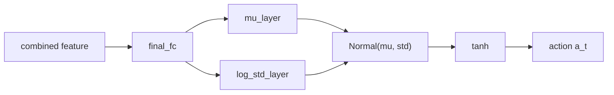
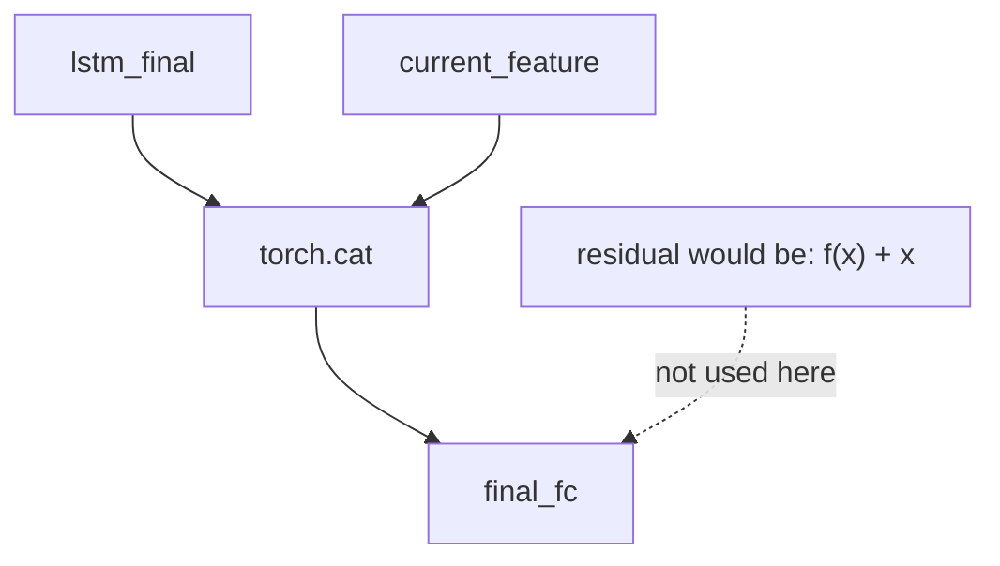
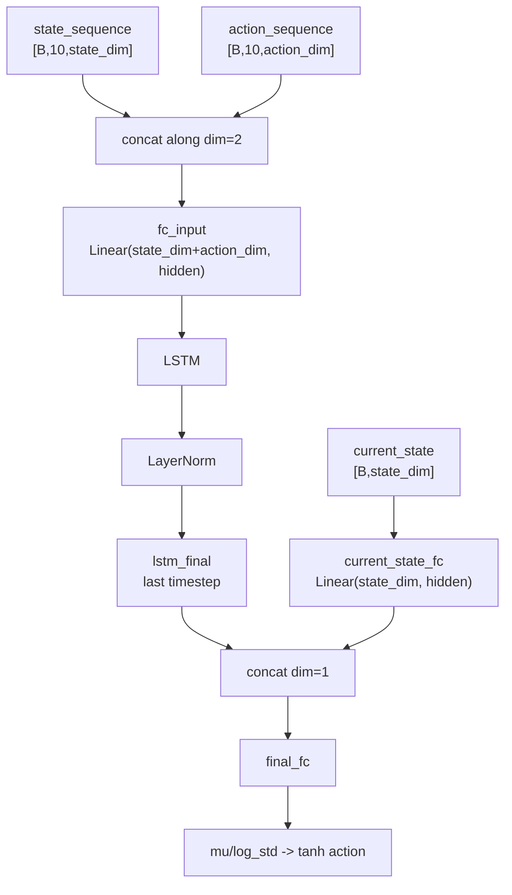
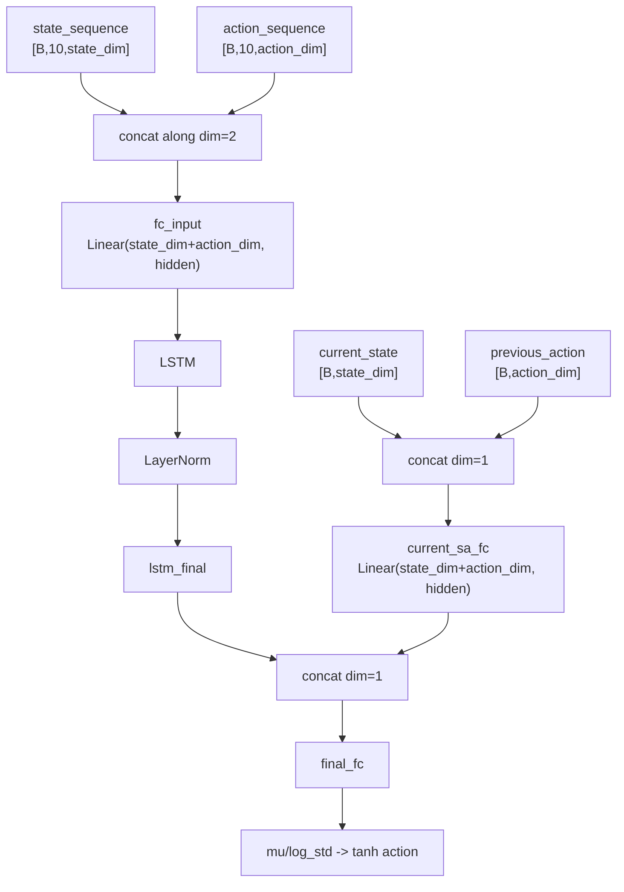
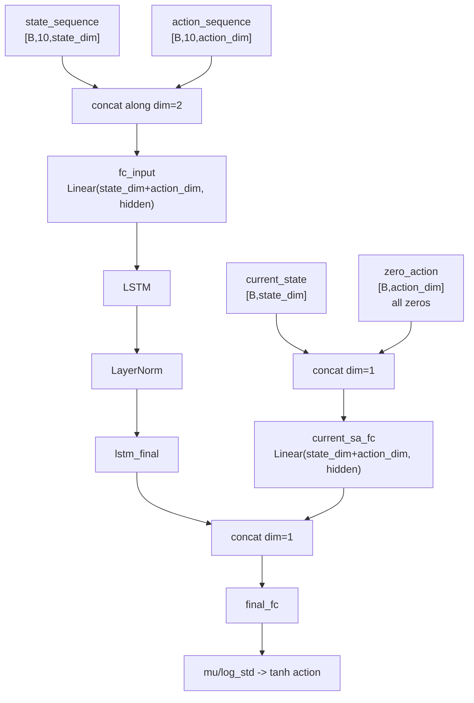
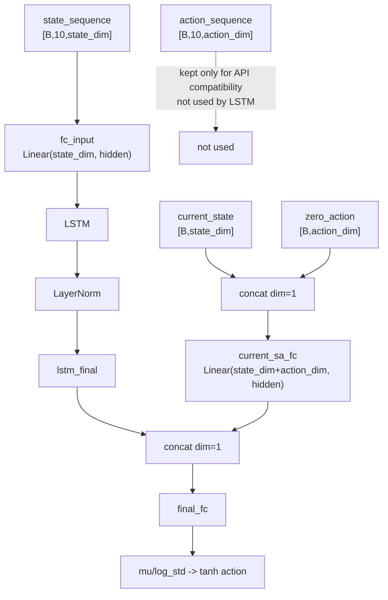
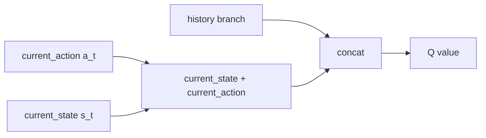

# SAC-LSTM Actor 改动可视化说明

本文档用于解释第四章 SAC-LSTM Actor 的原始结构，以及三个独立实验目录中的改动方式。

涉及目录：

```text
原始版本:              PART4/SAC
previous-action版本:   PART4/SAC_lstm_actor_singlelink
zero-action版本:       PART4/SAC_lstm_actor_zeroaction
state-only-history版本:PART4/SAC_lstm_stateonly_history
```

本文档只解释结构，不修改训练代码。

## 先看结论

四个版本的 Actor 都不是残差连接，而是双分支特征拼接：

```text
历史分支特征 + 当前分支特征
不是数学加法 "+"
而是 torch.cat([...], dim=1)
```

核心区别如下：

| 版本 | 历史 LSTM 分支 | 当前分支 | 使用 `action_sequence` | 使用 `a_{t-1}` | 使用 zero action |
|---|---|---|---|---|---|
| 原始 SAC-LSTM | `LSTM([s,a])` | `MLP(s_t)` | 是 | 否 | 否 |
| previous-action / singlelink | `LSTM([s,a])` | `MLP([s_t,a_{t-1}])` | 是 | 是 | 否 |
| zero-action | `LSTM([s,a])` | `MLP([s_t,0])` | 是 | 否 | 是 |
| state-only-history | `LSTM([s])` | `MLP([s_t,0])` | 接口保留，但 LSTM 不使用 | 否 | 是 |

其中：

```text
s_t       = 当前状态
a_t       = 当前 Actor 将输出的动作
a_{t-1}   = 上一时刻动作
0         = 与 action_dim 相同形状的零动作占位
[s,a]     = torch.cat([state, action], dim=-1)
```

## 共同输出结构

四个版本 Actor 的最后输出都一样：

```text
combined
  -> final_fc
  -> mu_layer
  -> log_std_layer
  -> Normal(mu, std)
  -> tanh
  -> action
```

也就是说，我们改的是 Actor 前面的输入分支，不是 SAC 的策略分布输出逻辑。



## 不是残差连接

残差连接通常长这样：

```text
out = f(x) + x
```

或者：

```text
out = layer(x) + shortcut(x)
```

本项目 Actor 融合处长这样：

```python
combined = torch.cat([lstm_final, current_feature], dim=1)
final_out = self.final_fc(combined)
```

所以它是 concat 特征拼接，不是 residual add。



## 版本一：原始 SAC-LSTM Actor

代码位置：

```text
PART4/SAC/utils_lstm.py
```

输入 shape：

```text
state_sequence:  [batch, 10, state_dim]
action_sequence: [batch, 10, action_dim]
current_state:   [batch, state_dim]
```

结构：

```text
历史分支: concat(state_sequence, action_sequence) -> LSTM
当前分支: current_state -> MLP
融合:     concat(lstm_final, current_state_feature)
输出:     policy action
```



关键代码逻辑：

```python
sa_sequence = torch.cat([state_sequence, action_sequence], dim=2)
x = self.fc_input(sa_sequence)
lstm_out, _ = self.lstm(x)
lstm_final = lstm_out[:, -1, :]

current_state_processed = self.current_state_fc(current_state)
combined = torch.cat([lstm_final, current_state_processed], dim=1)
```

理解：

```text
原始 Actor 让 LSTM 看过去的状态和动作，让当前分支只看当前状态。
```

## 版本二：previous-action / singlelink Actor

代码位置：

```text
PART4/SAC_lstm_actor_singlelink/utils_lstm.py
```

输入 shape：

```text
state_sequence:  [batch, 10, state_dim]
action_sequence: [batch, 10, action_dim]
current_state:   [batch, state_dim]
```

结构：

```text
历史分支: concat(state_sequence, action_sequence) -> LSTM
当前分支: concat(current_state, previous_action) -> MLP
融合:     concat(lstm_final, current_sa_feature)
输出:     policy action
```

其中：

```text
训练模式 previous_action = action_sequence[:, -1, :]
单步模式 previous_action = prev_action
```



和原始版本相比，改的是当前分支：

```diff
- current_state_processed = current_state_fc(current_state)
+ current_sa = torch.cat([current_state, previous_action], dim=1)
+ current_state_processed = current_sa_fc(current_sa)
```

理解：

```text
这个版本认为上一动作 a_{t-1} 对当前决策有物理意义。
帆角、舵角有连续性和执行滞后，所以让 Actor 当前分支显式看到上一动作。
```

## 版本三：zero-action Actor

代码位置：

```text
PART4/SAC_lstm_actor_zeroaction/utils_lstm.py
```

输入 shape：

```text
state_sequence:  [batch, 10, state_dim]
action_sequence: [batch, 10, action_dim]
current_state:   [batch, state_dim]
```

结构：

```text
历史分支: concat(state_sequence, action_sequence) -> LSTM
当前分支: concat(current_state, zero_action) -> MLP
融合:     concat(lstm_final, current_sa_feature)
输出:     policy action
```

其中：

```text
zero_action = zeros([batch, action_dim])
```



和 previous-action 版本相比，改的是当前动作上下文：

```diff
- current_sa = torch.cat([current_state, previous_action], dim=1)
+ zero_action = current_state.new_zeros((batch_size, action_dim))
+ current_sa = torch.cat([current_state, zero_action], dim=1)
```

和原始版本相比：

```diff
- current_state_processed = current_state_fc(current_state)
+ zero_action = zeros([batch, action_dim])
+ current_sa = concat(current_state, zero_action)
+ current_state_processed = current_sa_fc(current_sa)
```

理解：

```text
这个版本不是给 Actor 增加有效物理信息。
它只是让 Actor 当前分支的输入维度形式接近 Critic 的 current (s,a) 分支。
```

## 版本四：state-only-history Actor

代码位置：

```text
PART4/SAC_lstm_stateonly_history/utils_lstm.py
```

输入 shape：

```text
state_sequence:  [batch, 10, state_dim]
action_sequence: [batch, 10, action_dim]  # 接口保留，但历史 LSTM 不使用
current_state:   [batch, state_dim]
```

结构：

```text
历史分支: state_sequence -> LSTM
当前分支: concat(current_state, zero_action) -> MLP
融合:     concat(lstm_final, current_sa_feature)
输出:     policy action
```



和 zero-action 版本相比，改的是历史分支：

```diff
- sa_sequence = torch.cat([state_sequence, action_sequence], dim=2)
- x = fc_input(sa_sequence)
+ x = fc_input(state_sequence)
```

同时历史分支输入层从：

```diff
- Linear(state_dim + action_dim, hidden)
+ Linear(state_dim, hidden)
```

理解：

```text
这个版本用于验证：历史动作命令 action_sequence 是否可以被历史状态序列替代。
因为状态里已经包含实际帆角、舵角和船体响应，所以这个实验只让 LSTM 看状态轨迹。
```

## Critic 有没有同步改？

前两个改版中，Critic 保持原始结构：

```text
singlelink Critic:  LSTM([s,a]) + MLP([s_t,a_t])
zeroaction Critic:  LSTM([s,a]) + MLP([s_t,a_t])
```

state-only-history 中，Critic 的历史分支也同步改成只看状态：

```text
state-only Critic:  LSTM([s]) + MLP([s_t,a_t])
```

注意：Critic 当前分支必须保留 `a_t`，因为 Critic 的任务就是评价当前动作。



## 总流程对比图

```mermaid
flowchart TB
    subgraph Original["原始 SAC-LSTM"]
        O1["history: [s,a]"] --> O2["LSTM"]
        O3["current: s_t"] --> O4["MLP"]
        O2 --> O5["concat"]
        O4 --> O5
        O5 --> O6["policy"]
    end

    subgraph Prev["previous-action"]
        P1["history: [s,a]"] --> P2["LSTM"]
        P3["current: [s_t,a_{t-1}]"] --> P4["MLP"]
        P2 --> P5["concat"]
        P4 --> P5
        P5 --> P6["policy"]
    end

    subgraph Zero["zero-action"]
        Z1["history: [s,a]"] --> Z2["LSTM"]
        Z3["current: [s_t,0]"] --> Z4["MLP"]
        Z2 --> Z5["concat"]
        Z4 --> Z5
        Z5 --> Z6["policy"]
    end

    subgraph StateOnly["state-only-history"]
        S1["history: [s]"] --> S2["LSTM"]
        S3["current: [s_t,0]"] --> S4["MLP"]
        S2 --> S5["concat"]
        S4 --> S5
        S5 --> S6["policy"]
    end
```



## 最小伪代码对比

### 原始版本

```python
sa_sequence = cat(state_sequence, action_sequence)
lstm_final = LSTM(sa_sequence)
current_feature = current_state_fc(current_state)
combined = cat(lstm_final, current_feature)
action = policy(combined)
```

### previous-action 版本

```python
sa_sequence = cat(state_sequence, action_sequence)
lstm_final = LSTM(sa_sequence)
previous_action = action_sequence[:, -1, :]
current_feature = current_sa_fc(cat(current_state, previous_action))
combined = cat(lstm_final, current_feature)
action = policy(combined)
```

### zero-action 版本

```python
sa_sequence = cat(state_sequence, action_sequence)
lstm_final = LSTM(sa_sequence)
zero_action = zeros(batch, action_dim)
current_feature = current_sa_fc(cat(current_state, zero_action))
combined = cat(lstm_final, current_feature)
action = policy(combined)
```

### state-only-history 版本

```python
lstm_final = LSTM(state_sequence)
zero_action = zeros(batch, action_dim)
current_feature = current_sa_fc(cat(current_state, zero_action))
combined = cat(lstm_final, current_feature)
action = policy(combined)
```

## 一句话理解

```text
原始版本:
  过去看状态+动作，现在看状态。

previous-action:
  过去看状态+动作，现在看状态+上一动作。

zero-action:
  过去看状态+动作，现在看状态+零动作占位。

state-only-history:
  过去只看状态，现在看状态+零动作占位。
```

## 为什么这些改动可能影响训练很大

虽然有些改动看起来很小，但强化学习训练不是在原模型上做确定性等价替换，而是重新初始化并重新训练。结构一变，会导致：

```text
参数维度变化
初始化分布变化
ReplayBuffer 采样轨迹变化
Q target 变化
Actor 梯度变化
最终策略训练轨迹分叉
```

所以 `zero-action` 从函数表达上接近原始方法，但它不是严格等价实验。

