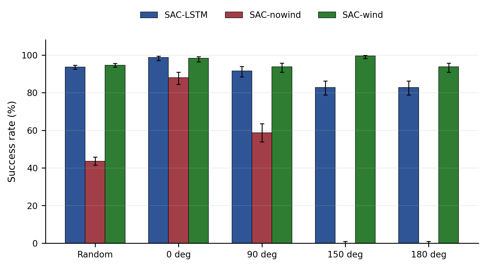
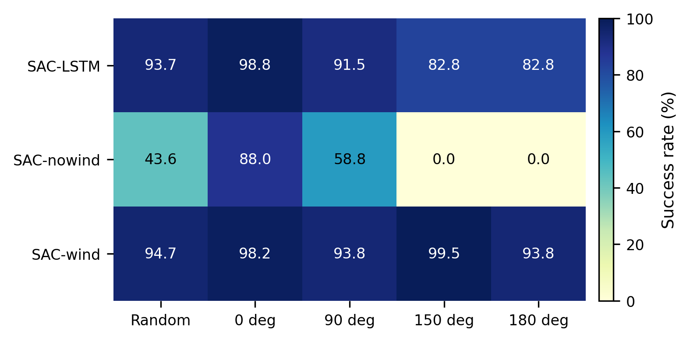
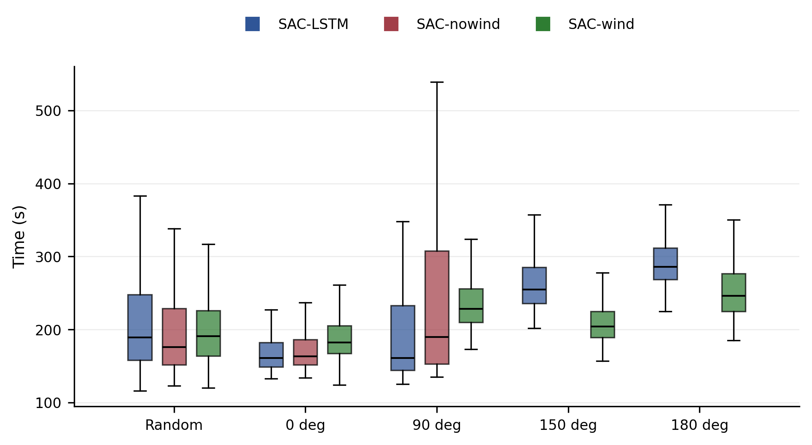
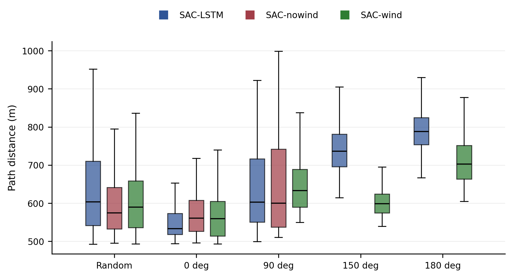
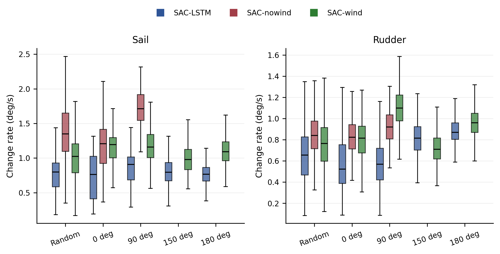
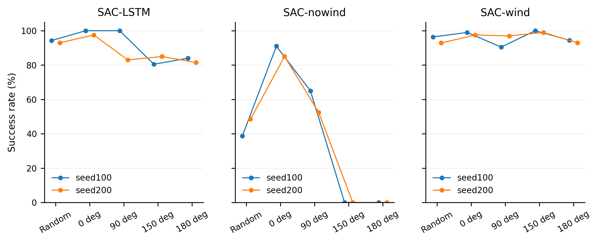

# 种子消融结果可视化与分析

## 数据来源

- 结果目录：`D:\Project\26_4\sailboat_RL\PART4\seed_reward_ablation\seed_eval_suite\seed_eval_results\seed_eval_20260518_002624`
- 分析输出：`D:\Project\26_4\sailboat_RL\PART4\seed_reward_ablation\seed_eval_suite\seed_eval_results\seed_eval_20260518_002624\analysis_report`
- Episode 总数：`10800`
- 运行时间记录：`2026-05-18T01:42:21`
- 运行命令：`D:\Project\26_4\sailboat_RL\PART4\seed_reward_ablation\seed_eval_suite\batch_eval_seed_ablation.py --num_workers 8 --dvc cpu`
- 随机风向 episode：`1000`；固定风向 episode：`200`；固定风向：`0,90,150,180`
- 噪声设置：`{"enable_sensor_noise": true, "sensor_noise_ratio": 0.03, "enable_actuator_noise": true, "actuator_noise_ratio": 0.03}`

## 统计口径

- 成功率按全部 episode 统计，并使用原始 summary 中的 95% CI。
- 航行时间、航行距离、帆角变化率、舵角变化率只在成功 episode 子集上统计。
- `SAC-nowind` 在 `fixed_wind_150` 和 `fixed_wind_180` 下成功数为 0，因此这些场景没有成功航行的时间、距离和角度变化率分布；图中不做 0 填补。
- 主结论按 `SAC-LSTM / SAC-nowind / SAC-wind` 聚合，seed100/seed200 的差异仅作为补充稳定性分析。

## 主要发现

- 随机风向场景下，`SAC-wind` 成功率为 94.65%，`SAC-LSTM` 为 93.65%，两者接近；`SAC-nowind` 只有 43.60%。
- 固定不利风向下，`SAC-wind` 保持最强鲁棒性：150 度成功率 99.50%，180 度成功率 93.75%。
- `SAC-LSTM` 在 0/90 度表现较好，但 150/180 度降至 82.75% 和 82.75%，说明无风向观测时 LSTM 历史信息能缓解但不能完全替代风向信息。
- `SAC-nowind` 对风向变化最敏感：150/180 度成功率均为 0.00%，是最明确的失效场景。
- 成功样本中，随机风向下 `SAC-LSTM` 平均成功时间 206.87 s，`SAC-wind` 为 214.31 s；`SAC-wind` 的随机风向平均航行距离 611.60 m，低于 `SAC-LSTM` 的 633.03 m。

## 图表说明

### 成功率

该图直接比较三类模型在随机风向和四个固定初始风向下的成功率。误差线为 95% CI。`SAC-wind` 在全部固定风向中保持高成功率，`SAC-nowind` 在 150/180 度完全失效。

热力图更突出风向敏感性：`SAC-nowind` 的性能随风向恶化出现断崖式下降，而 `SAC-wind` 的颜色分布最稳定。

### 成功航行效率

该箱式图只包含成功 episode。`SAC-nowind` 在 150/180 度没有成功样本，因此不显示箱体。随机风向下，`SAC-LSTM` 和 `SAC-wind` 的时间分布接近，`SAC-nowind` 的可成功样本不代表整体鲁棒性，因为失败 episode 已经由成功率体现。

航行距离同样只在成功样本内比较。`SAC-wind` 在随机风向下路径均值较低，说明其在成功航行中通常更直接；固定 180 度下路径长度上升，符合逆风或不利风向下机动距离增加的预期。

### 控制平滑性

帆角和舵角变化率按总变化量除以成功航行时间计算。该图用于比较控制动作的平滑性和频繁调整程度，应结合成功率一起解释：高成功率模型即使变化率略高，也可能代表其能主动适应风向扰动。

### Seed 稳定性

该补充图展示每个模型 family 内 seed100/seed200 checkpoint 的成功率差异。主结论仍以聚合结果为准；若某模型在两个 seed 间差异很大，需要后续补充 seed300/seed400 后再判断稳定性。

## 结论

`SAC-wind` 是当前三类模型中风向鲁棒性最好的方案；`SAC-LSTM` 在随机风向总体接近 `SAC-wind`，但在 150/180 度固定初始风向下退化明显；`SAC-nowind` 缺少风向观测后，在不利风向下出现系统性失败。论文或汇报中建议把成功率作为主指标，把成功样本的时间、距离和角度变化率作为效率与控制行为的补充指标。

## 输出文件

- `figures/*.png`：300 dpi 位图。
- `figures/*.svg`：矢量图。
- `tables/model_family_compact_summary.csv`：聚合结果简表。
- `tables/checkpoint_success_rate_summary.csv`：seed/checkpoint 成功率简表。
