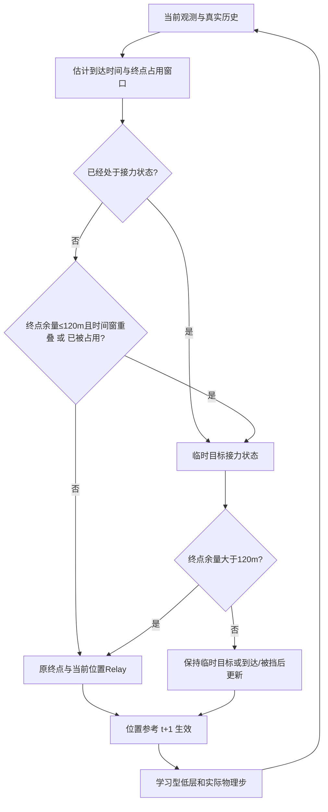

# R7 方法说明：终点占用时间窗与临时目标接力

R7改变的是高层位置目标管理和动态观测接口，未训练或替换R6的18D SAC-LSTM-Attention。直接动态接入已经能完成多数会遇；最明确的可修复问题是移动船暂时覆盖任务终点时，静态路线接口报告无路。最终方案在可能赶上占用窗口时暂时绕行，终点释放后继续原任务。32个冻结新实例中，安全完成由30变32，但一个原本成功的实例增加740秒。收益是限定条件下的任务连续性，不是普遍避碰优势或提效。

## 来源与选择

主要文献为Eriksen、Bitar、Breivik和Lekkas的 [Hybrid Collision Avoidance for ASVs Compliant with COLREGs Rules 8 and 13–17](https://www.frontiersin.org/journals/robotics-and-ai/articles/10.3389/frobt.2020.00011/full)，2020，DOI10.3389/frobt.2020.00011。核对其CPA、会遇状态和分层控制组织，来源摘记在运行目录`review-stage/source_notes.md`与`literature/`。

|来源机制|保留内容|必要适配|不能继承|
|---|---|---|---|
|相对运动CPA与会遇状态|接近时间、距离和进入/退出监督|输出位置目标，由真实帆船动力学执行|原文MPC、运动模型、完整COLREGs表现|
|保持避让直至退出|开发对照保存目标身份、绕行侧和参考|持续参考与CPA消退释放分别实验|位置参考可执行性与安全保证|
|R6边界距离编码和Relay120|当前移动圆、500m路线接力|每个历史时刻保存真实观测，再重编码|动态输入分布上的通用可靠性|
|本轮接口适配|固定终点占用时间窗、临时目标接力|处理暂时不可用终点，不预测候选闭环航迹|不可称原文算法的完整复现或新安全理论|

CPA适配在第一轮确认中弱于直接接入，因此不纳入最终主方案。未选择重训：现有证据直接定位了目标接口故障，轻量高层适配已改善它；这不证明训练无价值或现有低层充分。

## 输入、输出与物理执行

在线输入：本船当前位置p、艏向、过去10秒地面位移速度v；完整静态地图；1000m内1Hz理想观测的目标ID、时间戳、有效性、当前位置q、地面速度w、尺寸和类别；实际历史及当前参考。没有直接风观测、目标未来计划、真实环境副本或未来状态。每个历史时刻使用该时刻目标位置和有效性；槽位按当时情况编码，不用当前位置回填。

输出是世界坐标位置目标。t时刻选择的目标在物理步结束t+1生效，随后以原始真实历史重编码低层记忆。低层仍以1Hz帆舵动作执行原14D物理状态；目标方向不是即时航向。本轮保留此时序是实现选择，不是旧阶段限制。最终任务到达始终以原终点10m半径判断，不把临时目标当成功。

图为机制示意，源码在`src/sailboat_routing/r7_goal.py:GoalRelaySupervisor.plan`；不是安全证明。

## 公式与参数

动态评价的共同圆近似R=本船10m+目标15m+缓冲60m=85m。本船10m是占据代理，不声称已验证精确船体包络。静态评价仍为原障碍实体外60m。规划留量120m与真实安全半径分开。

固定终点g的当前余量为 min_j ||q_j−g||−85。对当前观测匀速预测，求满足 ||q_j−g+τw_j||²≤85² 的未来区间。令r=q_j−g，a=w_j·w_j，b=r·w_j，c=r·r−85²，则根为(−b±sqrt(b²−ac))/a；去掉负的结束时间，将开始截到0。静止且占用时区间为[0,∞)。这些τ均为相对当前观测的秒数。

名义到达时间T=||g−p||/[v·(g−p)/||g−p||]，分母≤0.1时为∞。当[T−30,T+30]与任一区间重叠，且终点当前余量≤120m，进入接力。终点已经被覆盖时也进入；无时间门消融忽略重叠条件。30秒只是开发启发式响应余量，没有标定为误差上界。

临时目标位于g周围305m圆上（85+120+100），每45度一个，共8点。排除距本船不足200m、当前几何航段不安全或端点附加余量不足120m的点。余下点最小化 ||z−p||+80|wrap(angle(z−p)−heading)|；80的单位为m/rad。这是距离和转向的几何排序，不是候选真实航迹预测。没有可用点则保留无路失败，不伪造兜底。

普通接力参数继承R6：路线留量120m、前视500m、临时点交接距离100m。进入接力后，在距临时点不足100m或航段被挡时重新选择，并清除旧参考；终点余量>120m才退出并清除旧参考。进入退出使用同一个120m阈值，没有额外迟滞；时间门后来不成立不会单独退出。因此可能长时间绕行。305m圆只是候选位置集合，不是规定的实体环绕轨迹。

CPA对照使用r=q−p、u=w−v，τCPA=−r·u/(u·u)，dCPA=||r+max(0,τCPA)u||。接近且0<τCPA<180秒、dCPA<185m时考虑偏置参考；固定参考持有与CPA解除版本都保留。公式、常量和对照配置见`r7_dynamic.py`和`configs/r7_methods.json`。最终方案无该CPA改点模块。

## 真实决策与代价

`goal_confirmation/final_overtaking_2__current_goal/trace.json`：84秒时终点余量119.196m，名义到达还有169.541秒；预测占用区间为未来116.888–280.804秒，即绝对200.888–364.804秒。时间窗重叠，选择临时目标(784.332,−215.668)m，85秒生效。483秒终点余量120.535m，释放接力，最终627秒完成；同时刻最小距离172.826m，真实动态余量87.826m。直接接入在208秒报告NoRouteError，当时并未侵入安全边界。

反例`final_overtaking_1`：273秒估计还需234.761秒，而预测占用将在237.019秒后开始。±30秒门触发；但原直接接入实际382秒就能完成，比预测早得多。新方法到1054秒才退出，1122秒完成，原方法382秒；增加740秒、2716.518m。说明名义地面进度外推不能可靠预测帆船后续到达。新方法并非“更聪明地绕行且无代价”。

## 规则与适用边界

依据 [IMO COLREG概述](https://www.imo.org/en/about/conventions/pages/colreg.aspx) 与 [USCG国际规则合订入口](https://www.navcen.uscg.gov/navigation-rules-amalgamated)：第13条追越责任持续到驶过并让清，不规定统一绕行侧；两艘机动船的第14/15条不能直接套给纯帆动力本船。横向机动船保持原航向的测试标为不合作目标安全测试。

最终方法持续检查目标当前位置，但没有实现完整追越责任状态机。8个名义追越中，5个完成时在目标前方，3个接力案例完成时仍在目标后方，属于延后到达，不能称全部完成追越。它们各自最小同时刻距离为166.762、172.826、115.570m；安全到达不是完整规则合规。85m不是公约规定的距离。

当前证据仅覆盖理想观测、单目标、少量静态混合和有限转向条件。两槽身份交换经过编码检查，未做多船闭环确认。无硬实时、扫掠船体或通用安全保证；实际计算重编码可超过1秒。推荐动态作为有限扩展，主论文不依赖此模块成立。
