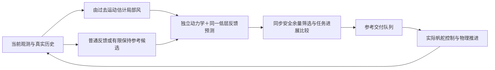

# R8 方法说明：控制条件轨迹采样与滚动航迹点监督

**实际结果：** 冻结新实例reactive28/30、15秒方案30/30，新增两例是途中缓冲侵入避免；3/5km比较为3/4对4/4。共同安全新集平均多15.29秒、最大多267秒；全轮单次规划峰值43.46秒。收益并非只有终点恢复，但尚非实时部署方案。

本轮研究未知风场中的动态会遇。方法采用 Wilkie、van den Berg、Manocha 的 **Generalized Velocity Obstacles（GVO，2009）** 的控制条件运动评价思想，适配到学习型帆舵控制器的位置参考接口。候选不是瞬时速度，而是“一个位置参考＋保持时间＋随后恢复普通反馈”的执行协议。独立物理预测器按这个协议实际运行同一个控制器，比较本船和目标船的同时刻距离。在线使用真实新观测重新决策，不读取真实环境副本或未来目标计划。

这是一项 GVO 思想的有限采样适配，不是完整 BC-MPC 复现，不继承原文安全保证。R8 没有训练或替换网络：已有18D SAC-LSTM、actor10800和归一化资产仍用于实际执行和内部预测。选择先改高层的理由是：同状态分支已显示不同位置参考产生可区分、可预测的实际机动；此前只凭当前位置或CPA选点不能检验这种差异。允许训练的授权仍有效，但本轮没有证据表明先重训是必要步骤。

## 来源与适配

主要来源：[Wilkie et al., Generalized Velocity Obstacles, IROS 2009](https://gamma.cs.unc.edu/NHRVO/WilkieIROS09.pdf)，DOI 10.1109/IROS.2009.5354175，§IV/V、式(2)(3)(10)、Algorithm 1。

| 原方法机制 | 本轮保留／适配 | 实现 | 不继承的结论 |
|---|---|---|---|
| 控制u诱导运动A(t,u) | 用参考保持与恢复协议替代车辆控制参数；同一学习控制器驱动独立帆船动力学 | `r8_model.CausalModel.rollout` | 模型预测不等于真实未来 |
| 数值检查同时刻相对运动 | 逐秒相对线段最小距离，目标按当前地速外推 | 同上 | 不保证未观测目标或未来转向安全 |
| 在可行控制中接近偏好控制 | 普通反馈预测可行就保持，否则选终端进展最好者 | `r8_planner.SampledSupervisor.plan` | 有限候选并不完备 |
| 重复观测并更新 | 主方案每15秒重评估；60秒协议作为简单对照 | 同上 | 不证明硬实时执行 |

BC-MPC 原文用于核对“候选执行及反馈必须对应”的设计要求，未实现它的分支加速度树，故不宣称复现该算法。终点处理是共享任务管理，不称完整 SIPP-IP。

## 输入、时序与信息边界

输入为当前本船可观测状态、已执行帆舵动作、真实历史观测、当前参考及待交付队列、完整静态地图、目标船带ID和时间戳的当前位置／地速。目标可见范围沿用1000m；600m内才启用预测。目标真值只进入环境推进与离线评价，正式选择器不接收未来轨迹、真实风或环境RNG。

每秒先由当前参考下的策略计算动作，随后选择器提出下一参考；真实物理执行已经算出的动作，之后参考入队并在到期时应用。普通交付为1秒。3秒交付实验对所有方法共享，预测器复制相同FIFO逻辑。参考改变后按真实历史重新编码策略状态，不把预测写入实际历史。

图是实现数据流说明，不是安全证明。

## 预测模型

独立实例复用已有动力学代码，但风仅来自因果辨识。用最近公开船体状态差分得到加速度，以已知动力学加速度拟合二维风向量，数值最小二乘每个起点配置max_nfev=35（首次7个起点；不包括数值Jacobian的附加调用）、每分量范围[-16,16]m/s。残差对四个加速度分量的权重为[1,1,5,5]。首次用(0,8)m/s先验和六个8m/s方向初始化；后续用上次估计。

实现取最近六次转移的隔次三对，实际使用t−6→t−5、t−4→t−3、t−2→t−1，未使用最近t−1→t。这个滞后和恒定局部风假设在快变风中可能产生误差。模型恢复真实已执行动作累计得到的执行器目标角，不能用当前实际角代替目标角。当前参考来自有效坐标框架，避免历史记录中的滞后一帧目标污染初始化。首个预测动作必须与已经计算的真实动作逐元素一致。

目标预测为 q_j(t+k)=q_j(t)+k v_j(t)。这是当前观测下的假设，不读取目标实际未来转向表。未来模型观测仍按可见范围产生；真实评价按真实目标轨迹计算。

## 候选、评价和退出

主方案预测H=60秒，每15秒决策。候选包括：普通接力反馈；当前参考保持15秒；相对普通参考方向旋转−90、−45、+45、+90度、距离当前位置350m的四个参考，各保持15秒。保持结束后的预测恢复普通AvailabilityRelay反馈。普通候选全程使用其真实更新规则。候选位置只是低层参考，绝不等同直线航迹或瞬时航向。

对候选c，预测至60秒或进入原任务目标10m范围为止。预测余量m(c)为该时域内各步动态同步距离减85m、静态实体边界外距离减60m的最小值。可行要求预测完整、数值积分有效且m(c)≥30m。30m是额外规划保留量，真实任务判据仍为0m；没有通过放宽评价制造成功。

普通候选可行时直接采用，避免为了距离得分主动打断低层。否则，在可行候选中最小化：

J(c)=终端距原始任务目标距离 + 20·1[c非普通] + 10·1[c为新侧向参考]。

所有候选不可行时，先在完整有效预测中选择最小余量最大的候选；全无完整预测时继续当前参考。日志标记`all_predicted_infeasible`。这是尽力处理，不能称安全后备控制器。保持时间到期后重新比较；普通方案再次可行则解除保持并接回任务。60秒对照同时改变保持时间和重评估周期，不是单独隔离“反馈”的消融。

参数是开发期工程选择，不是最优值或控制稳定性推导。600m用于限制计算范围，350m是有限参考尺度，60秒提供短程交会检查；15秒和60秒协议的证据及代价见研究报告。本轮没有搜索多个guard或宣称最优参数。

## 真实决策：已知mixed3，115秒

本船位置(224.305,−18.201)m，风估计(−3.756,6.962)m/s。当前参考(275,−100)m。以下是同一决策前状态的真实预测记录；不是不同轨迹的同一时刻拼接。

| 候选 | 参考坐标m | 保持 | 预测最小余量m | J/m | 可行 |
|---|---|---:|---:|---:|---|
| 普通反馈 | (275,−100) | 按反馈更新 | 11.482 | 637.174 | 否 |
| 继续当前参考 | (275,−100) | 15s | 110.104 | 764.617 | 是 |
| −90° | (−73.194,−202.577) | 15s | 84.135 | 746.647 | 是 |
| −45° | (144.315,−358.938) | 15s | 83.492 | 743.408 | 是 |
| +45° | (565.042,−98.192) | 15s | 12.651 | 672.946 | 否 |
| +90° | (521.804,166.174) | 15s | 52.940 | 743.042 | 是、选中 |

普通预测仍有正余量，只是低于30m规划guard，不能写成“预测到了60秒内必然碰撞”。+90°比−45°仅低0.366m代价，说明选择存在近似平局敏感性；没有证据证明这个方向普遍最好。

115秒选择，116秒实际交付；130秒重评估释放，131秒接回普通参考。完整任务431秒安全到达，对照184秒先出现−1.166m缓冲侵入后NoRoute。独立再生完整前缀的四分支均匹配到115秒及首个旧动作；普通分支到175秒的完整记录匹配。+90°分支预测/实际60秒最小余量52.940/52.956m，15秒位置误差0.0245m；继续参考分支60秒误差10.350m。不能用选定分支的低误差替代所有分支可靠性。

## 临时终点处理、代价与边界

三组共享AvailabilityRelay：只在当前最终目标确实被覆盖时启用暂时可用参考；优先继续仍可行且未接近的当前参考，否则比较目标周围8个305m位置。终点恢复可用后重新接入原任务。不会把船停住、删除目标或缩小动态圆。开发正例反应基线因此也能451秒完成；预测方案446秒。该任务管理收益与途中缓冲侵入改善分开报告。

开发中的740秒误干预反例，两组均382秒、航迹相同。已知mixed6则由293秒变336秒，代价43秒；不能把每次介入都称必要。计算期间物理时钟冻结，开发单次规划达到28.157秒，超过15秒周期。方法目前是非实时闭环仿真适配，不是部署就绪系统。真实感知误差、观测延迟、目标合作规则和多船复杂交通尚未证明。新实例与长程结果、全部负例、资源和论文定位见`R8_RESEARCH_REPORT.md`。

冻结评估中实际出现3次全候选低于30m规划guard的尽力退化选择（新集hold60一次、长程两组各一次），均记录在final_validation.json。实际未侵入不表示规划约束始终满足。60秒对照还改变风辨识更新历史，不能将误差差异单独归因于预测长度。
