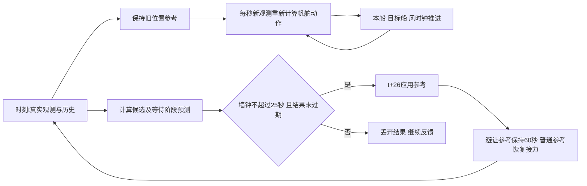

# R9 方法说明：与计算等待一致的航迹点预测和交付

本轮改高层的时间协议和历史重编码实现，没有训练或更换SAC-LSTM。目标是检验R8候选执行预测在计算期间仍航行时是否有用。R6障碍输入适配的条件性证据、R8理想交付收益仍保留；旧结果不能替代本轮时间验证。

## 采用什么、为什么改

沿用[Wilkie、van den Berg、Manocha的GVO（IROS2009）](https://gamma.cs.unc.edu/NHRVO/WilkieIROS09.pdf) §IV式(2)(3)的控制条件轨迹与同时刻最小距离思想。位置参考及其保持/恢复协议替代车辆控制变量；通过固定学习控制器和独立已知动力学产生预测运动。不是完整BC-MPC，不继承安全定理。

六个真实状态的profile显示动力学积分、路线搜索和历史Actor重放均有开销。首先只删除重放中不用的历史动作输出头，保留归一化、全部真实历史、逐步FC/LSTM、h/c及注意力窗口。六状态所有已评估候选航迹逐点一致；四个完整理想交付回合的实际状态和动作也与R8逐值一致（full_replay_equivalence.json）。这不代表任意环境的形式等价证明。旧状态最长单决策从43.64降至30.77秒，仍不能当瞬时计算。

| 历史长度 | 候选数 | 原实现s | 优化s | 最大航迹差m |
|---:|---:|---:|---:|---:|
|11|1|2.293|2.253|0.0|
|116|6|17.491|15.180|0.0|
|131|1|4.292|3.517|0.0|
|268|6|15.722|13.772|0.0|
|552|6|36.471|26.745|0.0|
|725|6|43.639|30.775|0.0|

初次新模型构造另计，插桩与非插桩分开。cProfile有明显额外开销，嵌套累计时间不能相加成比例。计算器使用AMD EPYC7V12主机，4个单线程回合进程、无GPU。热点原表见profile.json。

## 输入和可用信息

正式输入仅有当前本船状态、实际已执行命令、真实带时间/身份的目标观测、当前参考、静态地图和管理状态。未知风由近期已发生运动拟合，预测时固定局部风；目标按当前地速外推。预测器不接收真实未来风、目标转向表、真实环境副本或未来轨迹。历史重编码使用每个过去时刻当时的目标观测，不用当前位置回填。

## 明确的闭环时间协议

一次只允许一个待决计划。离线事件模拟假设规划执行器和反馈执行器独立；没有在每个实验进程另开并行求解线程。真实测得规划墙钟决定ready时间；主方案固定B=25秒交付时隙，ready前不能使用结果。快于25秒也等到时隙结束。超过时隙则等计算真正结束后丢弃；超过60秒参考年龄也丢弃。任务结束取消待决结果。ready、可交付、实际应用、同参考交付分别记录。

时刻t先算实际动作a_t，再开始快照计算。等待t至t+25期间，每秒依据真实新状态和旧位置参考重算动作，绝不重复旧帆舵增量。t+25释放结果，旧参考下已算的动作仍执行到t+26，然后才应用新参考。保持钟从t+26开始；下一次高层请求最早t+86。低层始终按原实际帆船动力学执行，位置参考不等于瞬时航向。

若选普通候选，应用后立即继续每秒AvailabilityRelay反馈；若选避让候选，则保持该参考60秒。预测H=86秒覆盖同样的26秒首次生效延迟和后续60秒。观察范围1000m、预测触发范围600m、侧向参考350m、guard30m沿用开发起点。B=25是初始工程时隙；首轮全参考保持开发最大19.15秒，等待一致版开发最大16.77秒，随后冻结；没有根据新集反调。不称最优值或硬实时界。

## 评价公式及退出

候选为普通接力、继续当前参考、相对普通目标方向±45°/±90°参考。每个候选在同一观测历史上运行同一低层；等待阶段都保持旧参考。令p_c(k)为候选预测本船位置，q_j(k)为当前地速外推位置，动态余量为同一秒相对线段的最小距离减85m，同时检查静态实体边界外60m。m(c)取整个预测有效区间最小值。

可行要求完整有效预测且m(c)≥30m。普通候选可行则直接采用，否则选可行候选中：

J(c)=终端距原任务目标距离+20·1[非普通]+10·1[新侧向参考]

最小者。全候选不满足guard时，选完整有效预测中余量最大者；无完整预测则继续当前参考。这是尽力退化规则，不是安全保证。实际判分仍要求动态余量>0、静态余量>0和原10m目标到达，未放宽安全标准。临时终点处理公平复用AvailabilityRelay，并单独报告其代价。

## 一个真实决策及机制边界

旧开发mixed7，t=150，本船(481.063,7.829)m，主方案和忽略等待消融直到176秒状态一致。实测计算16.767秒，ready=166.767；25秒时隙结束后，于176秒真正应用+90°参考，首个不同实际状态出现在177秒。

| 候选 | 目标坐标m | 预测最小余量m | 代价m | 可行 |
|---|---|---:|---:|---|
|nominal|(750.00,-125.00)|-1.032|327.975|False|
|continue|(750.00,-125.00)|-33.358|299.915|False|
|turn-90|(326.07,-305.98)|70.692|606.815|True|
|turn-45|(593.36,-323.67)|59.475|498.752|True|
|turn45|(812.56,120.13)|-2.969|289.119|False|
|turn90|(636.06,321.64)|43.541|410.705|True|

同状态消融把未来预测当作立即交付，普通候选余量88.689m，因此不干预；等待一致的预测为−1.032m，改选+90°，预测余量43.541m。完整任务主方案524秒、安全余量43.010m；消融219秒NoRoute并侵入−2.032m。原表mechanism_case.json保存精确值。这个对照支持该状态下等待建模影响了实际选择，不能证明所有场景都需要该模块。

mixed3中两组全轨迹相同、全为普通候选，收益来自等待期间冻结参考更新的协议效应；不将它归为预测避让。endpoint_5主方案777秒对reactive317秒，增加460秒，仍是显著误干预/任务交互代价。冻结短集中主方案与reactive均安全、没有新增安全例；仍有5次全候选低于guard的尽力选择（最低5.953m）。更重要的是slot30下mixed3的101秒预测余量82.692m、实际共同窗口却侵入−0.949m，最大位置误差140.048m。因此等待协议一致并不保证预测准确或安全，不能把30m当作误差上界。新长程和转向验证见研究报告。

## 运行与边界

配置：runs/r9_timing_20261005T085308Z/frozen_configs.json。实际代码r9_timing.py、r9_planner.py、r9_model.py、r9_replay.py与scripts/run_r9.py；公共动力学、安全判分、R8源文件均保留。独立规划资源是声明部署条件，4回合吞吐不等于部署实时保证；控制tick包括重编码/编码、当前Actor和普通规划，超1秒情况见报告。

恒速目标、短期风拟合、有限候选、60秒避让保持和25秒等待均有边界。没有多船规则系统、真实感知噪声或硬实时/安全理论证明。观察到更快的计算可能改变交付时刻及轨迹，不能以同状态数值等价推出闭环安全改善。
