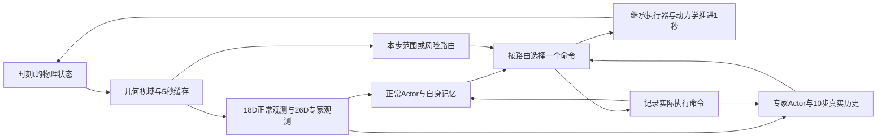

# 双策略动态避障原型

第四轮已完成4次真实适配训练、固定状态诊断和新50场400个唯一回合确认。见[第四轮报告](REPORT_ROUND4_ZH.md)、[实际命令](runs/round4_20261025/COMMANDS.md)及[交接](HANDOFF.md)。前三轮全部结果保留；不能把单源局部改善称为重复成功。下文原型规格与24场结果是首轮历史背景，当前事实以第四轮报告为准。

本轮在线输入采用理想化仿真观测：前向120°、150 m内直接提供目标位置和速度；这不是实机感知能力。无视觉、AIS、滤波或未来风输入。

来源只读：`/home/ot/Students/hs/sailboat-routing-v0`，基点 `4c6a07878e7432da12dea50d42a3272dbce7a820`，来源有未提交修改。仅复制必要动力学、网络/SAC和18D Actor/normalizer；不修改A线。新目录不是Git仓库。

采用 ARIS research-implement-feature 的逐级实现与验证方式。依用户的最小目录要求，规格、假设与验收记录集中本文件，不另建科研框架。ASK=never，普通实现自主推进。

## 规格和预先声明的选择

目标：真实训练动态专家，并用同一专家完成 normal/avoid/range/risk 四组配对比较。输出为 checkpoints、逐回合JSON、轨迹NPZ、学习曲线、真实动画、REPORT_ZH.md、HANDOFF.md。

| 决策 | 采用值与含义 | 来源 |
|---|---|---|
| 安全 | 中心距离小于40 m为违规；来自继承V3的collision判定，推广至动态目标；1 s两端相对运动线段近似，不宣称连续ODE安全证明 | 代码核查/本轮选择 |
| 奖励与停止 | r=继承导航奖励−4·max(0,(80−d)/40)²−120·违规；d含不可见目标/静态障碍。首次违规、到达、出界或700 s终止。失败航时仅为停止时刻，不能当到达加速 | 本轮选择/实现检查补充 |
| 物理环境 | 继承senior/sailboat_s14.py的四自由度、Dryden、1 Hz、动作量化；增加外生目标及独立安全评价；不调用旧S15 | 用户/本轮选择 |
| 输入 | normal原18D匹配统计；avoid前18D加8维动态量，独立26D统计，基础统计固定保留、附加量用固定物理尺度 | 本轮选择 |
| 平面速度 | 按原动力学运动学矩阵，将横向体速度先乘cos(横摇)再旋转到世界系。早期二维近似已修正；恢复早期回放时仅对有效动态槽的相对横速度补上v·(1−cos(横摇))，新检查点记录roll_projected_velocity=true，防止重复转换 | 原动力学源码405—406行/定向修正 |
| 记忆 | normal保持原streaming；avoid训练与部署均用最近10个真实(观测,执行命令)的零初态窗口，初期用初始观测/零命令左填充。两者不复制隐状态 | 本轮选择 |
| 初始化 | 兼容Actor张量复制；扩展输入新列置零，历史动作列正确平移。Critic/优化器/replay新建，只是热启动 | 资产检查 |
| 训练 | 复用原SAC更新和双Q；固定归一化，关闭dropout使训练/部署一致；Critic先预热；正常策略前缀产生真实接管状态 | 本轮选择 |
| 导航保留修正 | 全量微调4456步后，无目标开发seed810000由初始化155 s到达退化为700 s超时。改用`--dynamic-columns-only`：冻结继承参数，仅学习两个输入层的新增8列，共4096参数；Actor Adam lr=3e-4、weight_decay=0。未见过动态目标时附加8维全零，保留初始窗口策略的无目标函数；并非保证有目标时导航不退化 | 开发反例/针对性修正 |
| 感知 | 5 s常速缓存，失效后隐藏相对位置速度，只保留seen/age；未知不等于安全 | 用户/起始值 |
| 过期输入修正 | 两个固定开发反例中，相同10277步权重屏蔽过期age/seen后，由700 s超时变为299/269 s安全到达。采用`--mask-expired-metadata`：Actor和Critic归一化后动态8维在valid=0时置零；有效缓存内保留真实年龄。原始观测/路由/轨迹仍保留真实age与seen，失联不构成安全证书。此选择牺牲Actor对长期失联与从未见过的直接区分，路由继续维护不确定性 | 区分性开发实验/针对性修正 |
| 静态障碍 | 首次在几何视域内发现后缓存固定位置；距船150 m内继续向旧槽位提供，保留继承静态记忆语义。移动目标严格走5 s缓存，不能混用 | 继承语义/实现检查修正 |
| 路由交还 | 有效观测内两组共用最低交还保护：当前距离>75 m、正在远离、沿任务方向按当前速度外推30 s仍>75 m，连续3步且接管至少5 s。范围路由在缓存无效且下述可达区域条件满足后交还；风险路由可在有效观测内提前交还。两组主要区分进入/提前退出，不把范围组称纯距离规则 | 本轮选择 |
| 失联交还修正 | 开发集两种路由各10/12，但8个有接管回合均未交还。过期后采用保守可达圆盘：以最后观测位置为中心、半径1.6×age m。本船至圆盘的下界间距>75 m，且当前速度与任务方向速度的径向远离分量均>1.6 m/s，连续3步才可交还。1.6 m/s覆盖本轮目标速度；它是明确的运动上界假设，不是当前目标真值或长期点外推。该判断不保证之后任意操舵都安全 | 实际交还失败/最小几何修正 |
| 成本 | 当前avoid/range/risk评估每步都计算normal和avoid输出；报告包含两次前向、路由和窗口编码的实际耗时，不能解释为优化后的单专家最小成本 | 本轮实现 |
| 任务 | 500 m固定终点，无中间过时航点；切换不改变参考/物理状态/计时；无附加传感器/执行器噪声，保留原风扰动 | 本轮选择 |
| 评估 | 最终24个新场景、6类各4个；seed=910000+i，开发seed=810000+i，训练seed=710000+i。最终结果不用于调参或选权重 | 预先冻结 |
| 检查点选择 | 仅从新训练的固定开发集评估中，先最大化安全完成数，再最小化各场安全到达航时之和（失败一律记700 s），再取较早检查点。不能用失败提前停止赢得选择分数 | 观察正式训练开发结果前声明 |
| 资源 | CPU最多4个单线程进程，先1个；24 h墙钟上限；GPU未分配，不使用 | 用户授权边界 |

## 实现阶梯

- F0：加载原Actor，真实物理rollout与轨迹文件。
- F1：动态观测、不可见屏蔽、安全判分、范围交接及针对性测试。
- F2：序列SAC真实更新、可恢复检查点、固定开发集。
- F3：冻结专家后四组24场比较、轨迹、报告及动画。

F0—F3已实际执行：50步物理smoke、观测/交接契约检查、真实SAC训练、24场×4组评估和96条轨迹重算均完成。完整结果见REPORT_ZH.md，恢复入口见HANDOFF.md。

主训练最终31122步、7717次Q更新、1804次Actor更新；开发规则选择28617步（1647次Actor更新、开发12/12），没有选开发10/12的末轮权重。新场景安全完成：normal 17/24、avoid 22/24、range 21/24、risk 23/24。risk相对avoid新增2场安全完成、丢失1场；仅净增1场且共同安全航时更长，不能认定路由已有稳定独立收益。

## 控制时序

每秒先生成本时刻合法观测，再路由、计算动作，最后只执行所选命令。固定500 m终点保持不变，交还不存在回到旧中间航点的问题。



图中的循环每控制步只走一次。非活动正常Actor也仅前向一次，历史动作随后用实际执行命令覆盖。专家窗口仅追加实际观测与执行命令；不复制两策略的LSTM隐状态。避障专家的LSTM在每次窗口前向时从零初始化，训练和部署一致。安全评价/奖励另读全部实体真值，不能通过在线观测回流。

初始偏航、速度与风在各回合随机，目标恒速且不主动让路。`late`等名称是生成规则标签，不是该策略最终轨迹一定无冲突的保证；实际安全由同步距离判定。未实现缓慢转向或多船，未以这些未做项支撑结果。

轨迹NPZ的最后一行只记录终止物理状态和终止观测；其`action=0`、`active=False`是占位值，没有执行该命令，也不代表交还。动作、接管时长和切换统计使用`[:-1]`。动画终止帧明确显示最后实际执行的策略。

## 实际入口

服务器运行目录为 `/home/ot/Students/hs/sailboat-dynamic-routing-v0`。只读使用旧项目环境，不需修改其依赖。以下每条命令前均设置 `PYTHONDONTWRITEBYTECODE=1`；新运行请换输出目录。

```bash
cd /home/ot/Students/hs/sailboat-dynamic-routing-v0
PY=/home/ot/Students/hs/sailboat-routing-v0/.venv/bin/python
export PYTHONDONTWRITEBYTECODE=1

# 加载与物理链路；针对性契约检查
"$PY" scripts/smoke.py
"$PY" scripts/check.py

# 本轮第一阶段命令；实测在15258步用STOP_AFTER_EPISODE保存退出
"$PY" scripts/train.py --dynamic-columns-only --steps 30000 --out runs/train_columns --dev-every 5000 --hours 3

# 第二阶段：从保存状态启用经开发反例检验的无效动态槽屏蔽
"$PY" scripts/train.py --dynamic-columns-only --mask-expired-metadata --dev-at-start --resume runs/train_columns/resume.pt --steps 30000 --out runs/train_masked --dev-every 5000 --hours 3

# 第二阶段在26082步保存退出；对齐横摇投影后，继续至约31000步
"$PY" scripts/train.py --dynamic-columns-only --mask-expired-metadata --dev-at-start --resume runs/train_masked/resume.pt --steps 31000 --out runs/train_final --dev-every 2500 --hours 1

# 从本轮完整回合边界继续；保留参数训练模式
"$PY" scripts/train.py --dynamic-columns-only --mask-expired-metadata --resume runs/train_final/resume.pt --steps 50000 --out runs/continued --dev-every 5000 --hours 3

# 开发集选择后冻结；已存在冻结文件时拒绝覆盖
"$PY" scripts/select_checkpoint.py --run runs/train_final
"$PY" scripts/verify_checkpoint.py checkpoints/selected/resume.pt

# 四个CPU进程，共用同一新专家、相同24场景
"$PY" scripts/compare.py --checkpoint checkpoints/selected/resume.pt --out runs/confirmation
"$PY" scripts/check_trajectories.py runs/confirmation
"$PY" scripts/plot.py --run runs/confirmation --train runs/train_final
"$PY" scripts/report.py --run runs/confirmation
```

训练脚本写入`STOP_AFTER_EPISODE`标记时，会在当前回合结束后保存退出。恢复不是从Actor文件猜测优化器状态，必须使用resume.pt。开发评估会消耗随机数；改变开发评估频率不保证后续训练逐位等同于原长跑。各阶段源快照和配置保存在训练目录。

上述训练命令记录实际执行流程。重放早期阶段应使用该目录的source_train.py、source_dynamic.py与source_prototype.json快照；直接运行最新版是新的训练运行，不能承诺复现旧接口下的失败轨迹。最终冻结检查点的评估使用当前代码与匹配normalizer。

单CPU调试评估可用 `scripts/evaluate.py --split dev --checkpoint <resume.pt> --out <new-directory> --modes normal avoid range risk`。最终测试集一旦看过不能再称新确认集；后续方法调整须另定未见场景。

## 第二轮入口

第二轮沿用本项目，协议与实际诊断位于`runs/round2_20261011/`，当前状态以HANDOFF.md为准。首轮REPORT_ZH.md、checkpoints/selected及runs/confirmation不覆盖。

第二轮训练在原scripts/train.py增加显式seed、scene-base、handover-distribution选项；actual_routes按回合轮换初态专家、真实range接管、真实risk接管。输入、mask、网络、奖励与路由保持首轮最终定义。默认legacy仍可重放旧采样逻辑，但第一轮精确阶段应使用旧源码快照。

scripts/round2_train_launch.sh保存两次独立训练命令；round2_select.py在两者完成后冻结；round2_confirm.py --key-cases做已见五场比较，round2_confirm.py则在冻结后生成并运行50场/350回合。round2_events.py和round2_report.py生成事件、配对表及REPORT_ROUND2_ZH.md。普通结果图沿用scripts/plot.py，新增50场纵轴适配和可选静态输出。具体执行收据与边界见本轮协议及报告，不把新训练叫从首轮selected续训。


## 第三轮入口

新输入约束由src/round3_policy.py中的AdaptNormalizer实现，旧核心dynamic.py与train.py保持不变。新训练入口scripts/train_round3.py，评估round3_evaluate.py，恢复验证verify_round3_checkpoint.py。所有实际命令、最终矩阵及边界见第三轮COMMANDS.md和报告。不要将旧FixedNormalizer用于加载带guard的新权重。新确认930000—930049现已见，不能用于再次选点。

