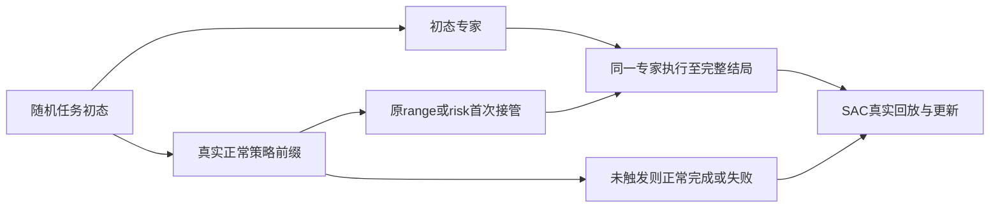

# 双策略动态避障第二轮实测报告

## 本轮回答什么

检验专家能力与路由收益在两个从继承Actor独立初始化的训练中能否重复，并解释首轮路由损失。首轮权重/失败/确认和A线保留。没有视觉、第三路由网络、S15搜索或新仿真器。

两训练种子共用同一份50个新场景：none/away/late/edge_static各8，cross/headon各9。实际完整新回合350个：normal50个复用，加两个专家各150个。不是100个独立场景；全部50场均在分母内。

**专家能力：** 两个种子均出现安全完成净改善，构成有限重复证据。 两个净变化为[8, 6]场。

**路由价值：** 风险路由相对始终使用专家的收益没有在两个种子中一致为正，不应默认采用较复杂的风险路由；范围路由须按其自己的配对结果判断。 两个净变化为[0, 1]场。

**范围路由：** 两种子相对avoid均净增2场，但各自仍损失2场和1场。risk相对range没有救回任何场，分别额外损失2场和1场。复杂风险门在本确认上不值得默认采用。

## 四个问题的结论

1. **改善是否重复？** 相对normal的30/50，两个专家为38/50和36/50，净改善重复；但专家分别救回14/13场、又损失6/7场，不是全面替代。首轮旧cross的接管修复仅一个种子成功，不能声称本轮训练修改已稳定解决接管问题。

2. **路由救回、损失什么？** range相对avoid分别救4失2、救3失1；risk分别救2失2、救3失2。两种子共同救回的late 920018完全未接管，是保留normal避免专家自行引入冲突。另有normal和avoid均失败、切换后成功的真实组合收益，例如种子20261011的headon 920040、种子20261012的late 920020及headon 920035。逐场ID在下面配对表保留。

3. **与接管、失联还是交还有关？** risk在cross 920025于32s接管，比range的25s晚7s，两种子均因此组比较损失该场；两种路由在失败发生前都尚未交还，进入规则是受控比较中的关键差异。种子20261011的late 920019也是risk延至68s才接管、range为53s。两种子其余路由损失920033/920038/920046都在首次可见时接管，仍会失败，不能只靠更早阈值解决。

失联确实出现在这些轨迹：920033/920038在缓存失效后重新看见目标，随后仍违规；920046在97s缓存失效、103s对不可见动态目标违规，但此前10步历史尚未全部清空。920025的第二个种子直到终止帧才首次形成“当前输入和全部10步历史都无动态槽”，最后已执行动作尚有历史。因此失联是相关状态，不足以单独定罪mask；当前路由全部损失均无此前交还。

4. **下一步？** 优先诊断并改善专家在真实接管及失联/重见状态下的动作稳定性，保留range作简单候选，暂不采用当前risk作为默认方案。不增加路由网络、不取消mask、不按新确认调阈值。下一轮先用少量预登记同状态分支区分适配动作与失联表示，再决定是否最小改输入或训练。若再做新训练/路由修改，必须使用另一份未见确认集。

range的有限收益也有成本：其与avoid共同安全场景平均分别多用7.89s、4.77s；risk分别多用13.50s、3.38s。路由当前仍计算两个Actor，没有计算节省证据。这里建议保留range作研究候选，不宣称已获得稳定安全保证或部署优势。

## 首轮诊断与唯一算法修改

关键案例为910008/910010（专家损失）、910002/910014（range额外损失）、910009（两路由共同cross损失）。完整时间线、原动作/航向/航速、七个固定分支及全部两两效率见 [DIAGNOSIS_ZH.md](runs/round2_20261011/diagnosis/DIAGNOSIS_ZH.md)。

910009在首次可见86s即由两种路由接管，133s违规，没有交还。相同86s状态交给首轮训练专家失败，保持normal或用未训练新增列的初始窗口专家则分别170/167s到达。102s缓存首次失效后改normal可204s完成，但同时改变了整套策略，不能单独证明mask致错。违规路径没有出现连续超过10步无效槽后才失败的证据。因此不撤销曾修复超时的mask。

910002/910014的range在尚无danger时接管，随后才出现danger并违规；risk不进入且安全。已有风险门避免这两次无谓接管，没有再加阈值。910010从normal前缀90s接管时，训练/初始专家均安全，说明整回合失败不能代替接管能力判断。

首轮risk与avoid直接共同安全21场，risk平均快6.67s、航程短11.38m；四组共同12场risk慢8.17s属于另一子集。两者同时保留，不挑有利分母。

唯一算法修改是训练接管分布：按回合轮换三种起点（各约1/3）：从初态专家、原range实际首次接管、原risk实际首次接管。前缀始终真实执行normal并维护双方各自历史；第一次接管后专家锁存到任务结束学习完整推进。未触发回合继续normal并如实进入回放。没有改输入、mask、奖励、4096参数适配范围或路由阈值。另补了终止原因日志，不改变终止条件。

该干预针对已见状态差异，但本轮没有同随机种子的训练分布消融；新训练与首轮中途改协议的训练也不同。不能把全部变化因果归于接管分布。

## 独立训练与选点

两运行均无resume，Q/目标Q、优化器和replay新建；初始Actor哈希相同、Q哈希不同、replay=0。从第0步使用最终mask、横摇投影、归一化、10步窗口、奖励和更新比例。保留normal streaming与专家窗口的已知差异。统一预算40000环境步（按完整回合略超），每5000步及最终边界用固定12场810000—810011的avoid表现选点；先安全完成，再失败计700s的总航时，再较早步数。没有按种子表现单独延长，也未将新确认纳入选点。

| 训练种子 | 实际环境步 | Q更新 | Actor更新 | 回合 | 墙钟/分 | 选定步 | 选定开发安全 |
|---|---:|---:|---:|---:|---:|---:|---:|
| 20261011 | 40038 | 9946 | 2361 | 238 | 44.49 | 20550 | 11/12 |
| 20261012 | 40006 | 9938 | 2359 | 237 | 43.93 | 35634 | 12/12 |

完整恢复状态、Actor、normalizer、选点记录分别位于`checkpoints/round2/20261011/`和`checkpoints/round2/20261012/`。恢复状态含Q目标、优化器、replay、RNG与训练协议。首轮selected只作历史诊断，不算第三次独立训练。

| 训练种子/前缀 | 回合数 | 实际进入专家 | 首次接管中位/最大s | 超过45s接管数 |
|---|---:|---:|---|---:|
| 20261011/avoid | 80 | 80 | 0.00/0.00 | 0 |
| 20261011/range | 79 | 49 | 62.00/135.00 | 42 |
| 20261011/risk | 79 | 48 | 61.50/103.00 | 30 |
| 20261012/avoid | 79 | 79 | 0.00/0.00 | 0 |
| 20261012/range | 79 | 48 | 61.00/117.00 | 42 |
| 20261012/risk | 79 | 50 | 63.50/119.00 | 40 |

此表覆盖整个训练预算；被选检查点只包含截至其步数的经验。avoid的0s是从初态运行，不是路由事件。覆盖更晚的首次接管不代表已覆盖所有状态或重复交还后的接管。

## 训练种子 20261011：50场确认

| 方法 | 安全完成 | 到达 | 违规 | 超时 | 其他失败 | 最小间距/m | 切换总数 | 平均接管/s | 接管/交还/交还且安全/最终normal完成 | 决策ms/步 |
|---|---:|---:|---:|---:|---:|---:|---:|---:|---|---:|
| 正常策略 | 30/50 | 30 | 20 | 0 | 0 | 37.18 | 0 | 0.00 | 0/0/0/0 | 1.08 |
| 专家始终运行 | 38/50 | 38 | 12 | 0 | 0 | 37.57 | 0 | 177.44 | 0/0/0/0 | 2.58 |
| 范围路由 | 40/50 | 40 | 10 | 0 | 0 | 37.25 | 40 | 88.48 | 32/8/8/8 | 2.53 |
| 风险路由 | 38/50 | 38 | 12 | 0 | 0 | 37.25 | 42 | 55.56 | 30/12/12/12 | 2.62 |

接管/交还计数为发生该事件的回合数；“交还且安全”允许之后再接管，“最终normal完成”还要求最后实际控制者是normal。always-avoid不是一次路由接管。最小间距纳入全部实体，包括不可见目标；无实体的null不混入间距均值。终止原因与原环境terminated/truncated单独保存在逐回合表。

| 类别（总数） | normal | avoid | range | risk |
|---|---:|---:|---:|---:|
| none（8） | 8 | 8 | 8 | 8 |
| away（8） | 8 | 8 | 8 | 8 |
| late（8） | 7 | 5 | 7 | 6 |
| cross（9） | 2 | 7 | 8 | 7 |
| headon（9） | 4 | 4 | 3 | 3 |
| edge_static（8） | 1 | 6 | 6 | 6 |

normal/avoid四格：共同安全24；仅normal安全6；仅avoid安全14；共同失败6。这是实际整回合成功集合，不是在线事后赢家路由。

原正常轨迹真实违反安全域的集合为20场[920020, 920025, 920026, 920027, 920029, 920030, 920031, 920032, 920034, 920035, 920036, 920038, 920040, 920042, 920043, 920044, 920045, 920047, 920048, 920049]；各方法在该集合安全完成数为{'normal': 0, 'avoid': 14, 'range': 15, 'risk': 14}。这是按正常闭环轨迹定义的动/静态实际冲突集合，不把名义cross/late标签当成必然冲突，也不用于训练或筛选最终场景。

- avoid-minus-normal：救回14场 [920026, 920027, 920029, 920030, 920031, 920032, 920035, 920038, 920042, 920043, 920044, 920047, 920048, 920049]；损失6场 [920018, 920019, 920024, 920039, 920041, 920046]。
- range-minus-avoid：救回4场 [920018, 920019, 920025, 920040]；损失2场 [920033, 920038]。
- risk-minus-avoid：救回2场 [920018, 920040]；损失2场 [920033, 920038]。
- risk-minus-range：救回0场 []；损失2场 [920019, 920025]。

### 共同安全航时/s

| 后者−前者 | 共同安全n | 前均值/中位 | 后均值/中位 | 差均值/中位 | 最大退化 | 更小/相同/更大 |
|---|---:|---|---|---|---:|---|
| avoid-minus-normal | 24 | 165.50/171.00 | 177.25/162.50 | 11.75/-0.50 | 195.00 | 12/0/12 |
| range-minus-normal | 25 | 165.52/166.00 | 186.08/176.00 | 20.56/0.00 | 200.00 | 1/18/6 |
| risk-minus-normal | 24 | 163.92/163.00 | 188.08/171.00 | 24.17/0.00 | 369.00 | 0/20/4 |
| range-minus-avoid | 36 | 190.56/184.00 | 198.44/192.50 | 7.89/3.50 | 76.00 | 14/1/21 |
| risk-minus-avoid | 36 | 190.56/184.00 | 204.06/186.50 | 13.50/4.50 | 236.00 | 12/0/24 |
| risk-minus-range | 38 | 196.58/189.00 | 201.89/186.00 | 5.32/0.00 | 195.00 | 5/27/6 |

### 共同安全航程/m

| 后者−前者 | 共同安全n | 前均值/中位 | 后均值/中位 | 差均值/中位 | 最大退化 | 更小/相同/更大 |
|---|---:|---|---|---|---:|---|
| avoid-minus-normal | 24 | 554.44/538.88 | 601.99/549.14 | 47.55/10.31 | 496.74 | 11/0/13 |
| range-minus-normal | 25 | 554.99/536.03 | 613.33/556.03 | 58.34/0.00 | 509.86 | 0/18/7 |
| risk-minus-normal | 24 | 551.63/534.39 | 611.61/543.13 | 59.98/0.00 | 846.97 | 0/20/4 |
| range-minus-avoid | 36 | 639.94/618.59 | 650.93/592.92 | 10.99/3.81 | 144.92 | 15/0/21 |
| risk-minus-avoid | 36 | 639.94/618.59 | 660.26/592.92 | 20.32/5.71 | 470.35 | 15/0/21 |
| risk-minus-range | 38 | 646.85/592.92 | 655.69/592.92 | 8.84/0.00 | 399.48 | 6/27/5 |

每行使用该对各自的共同安全集合，失败提前停止不进入效率比较；逐场差值与对应ID见paired_scenes.csv。最大退化为后−前最大值，负值表示该集合没有正退化。

### 路由得失的事件证据

- risk相对avoid rescued 920018（late）：接管[]，交还[]，结束153s/arrival，末步策略normal；全窗口动态缺失且仍接管0步。事件：153:terminal。
- risk相对avoid rescued 920040（headon）：接管[43]，交还[148]，结束173s/arrival，末步策略normal；全窗口动态缺失且仍接管60步。事件：43:visible+,valid+,danger+,active+；53:visible-；58:valid-,danger-；75:visible+,valid+,danger+；80:visible-；85:valid-,danger-；148:active-；173:terminal。
- risk相对avoid lost 920033（headon）：接管[72]，交还[]，结束131s/safety_violation，末步策略avoid；全窗口动态缺失且仍接管14步。事件：72:visible+,valid+,danger+,active+；90:visible-；95:valid-,danger-；119:visible+,valid+,danger+；131:terminal。
- risk相对avoid lost 920038（headon）：接管[50]，交还[]，结束115s/safety_violation，末步策略avoid；全窗口动态缺失且仍接管13步。事件：50:visible+,valid+,danger+,active+；72:visible-；77:valid-,danger-；100:visible+,valid+,danger+；115:terminal。

上述是同步事件顺序，不是单因素因果证明。没有交还的失败不能归因于过早交还；交还后失败仅提示检查退出/接回，不能自动证明退出是唯一原因。最终确认没有新增同状态分支或事后调参。

## 训练种子 20261012：50场确认

| 方法 | 安全完成 | 到达 | 违规 | 超时 | 其他失败 | 最小间距/m | 切换总数 | 平均接管/s | 接管/交还/交还且安全/最终normal完成 | 决策ms/步 |
|---|---:|---:|---:|---:|---:|---:|---:|---:|---|---:|
| 正常策略 | 30/50 | 30 | 20 | 0 | 0 | 37.18 | 0 | 0.00 | 0/0/0/0 | 1.08 |
| 专家始终运行 | 36/50 | 36 | 14 | 0 | 0 | 36.86 | 0 | 141.28 | 0/0/0/0 | 2.65 |
| 范围路由 | 38/50 | 38 | 12 | 0 | 0 | 37.38 | 50 | 39.90 | 32/18/18/18 | 2.72 |
| 风险路由 | 37/50 | 37 | 13 | 0 | 0 | 37.38 | 45 | 35.72 | 30/15/15/15 | 2.59 |

接管/交还计数为发生该事件的回合数；“交还且安全”允许之后再接管，“最终normal完成”还要求最后实际控制者是normal。always-avoid不是一次路由接管。最小间距纳入全部实体，包括不可见目标；无实体的null不混入间距均值。终止原因与原环境terminated/truncated单独保存在逐回合表。

| 类别（总数） | normal | avoid | range | risk |
|---|---:|---:|---:|---:|
| none（8） | 8 | 8 | 8 | 8 |
| away（8） | 8 | 8 | 8 | 8 |
| late（8） | 7 | 4 | 6 | 6 |
| cross（9） | 2 | 8 | 8 | 7 |
| headon（9） | 4 | 2 | 3 | 3 |
| edge_static（8） | 1 | 6 | 5 | 5 |

normal/avoid四格：共同安全23；仅normal安全7；仅avoid安全13；共同失败7。这是实际整回合成功集合，不是在线事后赢家路由。

原正常轨迹真实违反安全域的集合为20场[920020, 920025, 920026, 920027, 920029, 920030, 920031, 920032, 920034, 920035, 920036, 920038, 920040, 920042, 920043, 920044, 920045, 920047, 920048, 920049]；各方法在该集合安全完成数为{'normal': 0, 'avoid': 13, 'range': 15, 'risk': 14}。这是按正常闭环轨迹定义的动/静态实际冲突集合，不把名义cross/late标签当成必然冲突，也不用于训练或筛选最终场景。

- avoid-minus-normal：救回13场 [920025, 920026, 920027, 920029, 920030, 920031, 920032, 920040, 920042, 920043, 920044, 920047, 920048]；损失7场 [920018, 920019, 920023, 920024, 920033, 920039, 920041]。
- range-minus-avoid：救回3场 [920018, 920020, 920035]；损失1场 [920046]。
- risk-minus-avoid：救回3场 [920018, 920020, 920035]；损失2场 [920025, 920046]。
- risk-minus-range：救回0场 []；损失1场 [920025]。

### 共同安全航时/s

| 后者−前者 | 共同安全n | 前均值/中位 | 后均值/中位 | 差均值/中位 | 最大退化 | 更小/相同/更大 |
|---|---:|---|---|---|---:|---|
| avoid-minus-normal | 23 | 164.91/166.00 | 161.09/156.00 | -3.83/-3.00 | 36.00 | 13/0/10 |
| range-minus-normal | 23 | 164.83/166.00 | 169.09/166.00 | 4.26/0.00 | 61.00 | 0/19/4 |
| risk-minus-normal | 23 | 164.83/166.00 | 168.70/166.00 | 3.87/0.00 | 61.00 | 0/21/2 |
| range-minus-avoid | 35 | 160.40/155.00 | 165.17/159.00 | 4.77/3.00 | 91.00 | 13/2/20 |
| risk-minus-avoid | 34 | 160.47/154.50 | 163.85/156.00 | 3.38/1.50 | 91.00 | 14/2/18 |
| risk-minus-range | 37 | 164.92/157.00 | 163.59/155.00 | -1.32/0.00 | 2.00 | 3/33/1 |

### 共同安全航程/m

| 后者−前者 | 共同安全n | 前均值/中位 | 后均值/中位 | 差均值/中位 | 最大退化 | 更小/相同/更大 |
|---|---:|---|---|---|---:|---|
| avoid-minus-normal | 23 | 555.18/541.72 | 561.60/536.70 | 6.43/-1.30 | 130.33 | 12/0/11 |
| range-minus-normal | 23 | 553.55/536.03 | 566.07/536.03 | 12.52/0.00 | 149.35 | 0/18/5 |
| risk-minus-normal | 23 | 553.55/536.03 | 565.37/536.03 | 11.82/0.00 | 149.35 | 0/20/3 |
| range-minus-avoid | 35 | 568.60/551.30 | 570.20/558.48 | 1.60/-0.12 | 188.40 | 18/0/17 |
| risk-minus-avoid | 34 | 568.77/551.07 | 566.94/553.73 | -1.83/0.55 | 188.40 | 17/0/17 |
| risk-minus-range | 37 | 569.87/557.79 | 566.56/550.37 | -3.31/0.00 | 2.50 | 3/33/1 |

每行使用该对各自的共同安全集合，失败提前停止不进入效率比较；逐场差值与对应ID见paired_scenes.csv。最大退化为后−前最大值，负值表示该集合没有正退化。

### 路由得失的事件证据

- risk相对avoid rescued 920018（late）：接管[]，交还[]，结束153s/arrival，末步策略normal；全窗口动态缺失且仍接管0步。事件：153:terminal。
- risk相对avoid rescued 920020（late）：接管[79]，交还[163]，结束192s/arrival，末步策略normal；全窗口动态缺失且仍接管42步。事件：79:visible+,valid+,danger+,active+；106:visible-；111:valid-,danger-；163:active-；192:terminal。
- risk相对avoid rescued 920035（headon）：接管[43]，交还[110]，结束137s/arrival，末步策略normal；全窗口动态缺失且仍接管22步。事件：43:visible+,valid+,danger+,active+；58:visible-；63:valid-,danger-；70:visible+,valid+,danger+；73:visible-；78:valid-,danger-；110:active-；137:terminal。
- risk相对avoid lost 920025（cross）：接管[32]，交还[]，结束78s/safety_violation，末步策略avoid；全窗口动态缺失且仍接管0步。事件：25:visible+,valid+；32:danger+,active+；52:visible-；57:valid-,danger-；60:visible+,valid+,danger+；63:visible-；68:valid-,danger-；78:terminal。
- risk相对avoid lost 920046（edge_static）：接管[58]，交还[]，结束103s/safety_violation，末步策略avoid；全窗口动态缺失且仍接管0步。事件：58:visible+,valid+,danger+,active+；81:visible-；86:visible+；92:visible-；97:valid-,danger-；103:terminal。

上述是同步事件顺序，不是单因素因果证明。没有交还的失败不能归因于过早交还；交还后失败仅提示检查退出/接回，不能自动证明退出是唯一原因。最终确认没有新增同状态分支或事后调参。

## 旧关键任务前后对比

两个已选专家在首轮五场上按同样四模式另跑小组对照；这是已见开发材料，不算50场新确认。每个专家的normal仍可复用。逐回合及配对记录在runs/round2_20261011/retrained_key_cases。

| 新训练种子 | 场景 | 历史normal/avoid/range/risk | 新normal/avoid/range/risk |
|---|---:|---|---|
| 20261011 | 910002 | ✓/✓/×/✓ | ✓/✓/×/✓ |
| 20261011 | 910008 | ✓/×/✓/✓ | ✓/×/✓/✓ |
| 20261011 | 910009 | ✓/✓/×/× | ✓/×/✓/✓ |
| 20261011 | 910010 | ✓/×/✓/✓ | ✓/×/×/× |
| 20261011 | 910014 | ✓/✓/×/✓ | ✓/×/×/✓ |
| 20261012 | 910002 | ✓/✓/×/✓ | ✓/✓/✓/✓ |
| 20261012 | 910008 | ✓/×/✓/✓ | ✓/×/✓/✓ |
| 20261012 | 910009 | ✓/✓/×/× | ✓/×/×/× |
| 20261012 | 910010 | ✓/×/✓/✓ | ✓/×/×/× |
| 20261012 | 910014 | ✓/✓/×/✓ | ✓/×/×/✓ |

旧cross 910009的路由失败只在20261011修复：86s接管、293s交还、318s安全到达；normal为170s，安全修复伴随148s航时代价。20261012仍在121s违规，且没有交还。两份新专家从初态运行在该场均失败，不能将首轮专家成功视为已保留的能力。910010两份新路由也均失败，而首轮路由成功。接管覆盖干预尚未稳定修复旧问题，部分能力发生退化。

## 实际成本、验证与适用边界

- 新确认实际350回合，最多4个单线程CPU worker，墙钟543.22s。normal50回合只运行一次。两个训练按各自墙钟报告，并行时间不能相加冒充总墙钟。
- 决策计时包含路由和Actor前向，不含观测构造/环境推进/初始化。normal一次Actor；avoid/range/risk当前实现都计算两个Actor。接管减少不等于计算节省。
- 500m任务、700s时限、40m中心安全域、1Hz、120°/150m理想几何观测、0—1艘低速恒速目标保持不变。出视域真值停止更新，5s缓存后mask保持；评价仍检查不可见实体。
- 失联交还仍依赖最后观测位置及1.6m/s上界的可达圆盘与向外运动条件。不是长期点位置真值，也不保证后续任意操舵安全。
- 40m判分采用1s端点相对线段近似，不是连续ODE/实体船体安全证明。保留所有超时、违规和其他失败，未缩小阈值。
- 两种子只提供有限重复性信息；50场同一清单不能算100个独立实例。选择集仅avoid表现，不保证选出的权重最适合路由。
- 本文“专家改善”指所选专家相对normal的安全完成净差。新50场没有增加零新增列的初始窗口专家对照，因此不能把该差全部因果归于RL训练；normal流式记忆与专家窗口的差异仍存在。
- 只做一次针对训练分布/信息边界/日志变更的实现检查，same-family/provisional。确定性前缀核验与恢复检查另有真实收据，不称论文审稿通过。

- 训练20261011的所选恢复状态两次独立装载后连续4次更新完全一致；轨迹核验收据：`runs/round2_20261011/confirmation50/seed_20261011/trajectory_checks.json`。
- 训练20261012的所选恢复状态两次独立装载后连续4次更新完全一致；轨迹核验收据：`runs/round2_20261011/confirmation50/seed_20261012/trajectory_checks.json`。

两份轨迹核验各含200条方法记录，其中normal50是复用副本；对应350条唯一真实新回合，不是400次独立执行。

## 真实动画与复现

- [训练20261011 / normal](runs/round2_20261011/confirmation50/seed_20261011/figures/normal.gif)：scene 920000，normal，safe=True。
- [训练20261011 / avoid_and_return](runs/round2_20261011/confirmation50/seed_20261011/figures/avoid_and_return.gif)：scene 920025，range，safe=True。
- [训练20261011 / failure_or_cost](runs/round2_20261011/confirmation50/seed_20261011/figures/failure_or_cost.gif)：scene 920033，risk，safe=False。

动画来自实际轨迹，显示同步目标、FOV、活动策略和间距；终止帧只显示最后已执行策略，未来轨迹仅离线展示。

实际命令见[COMMANDS.md](runs/round2_20261011/COMMANDS.md)。预览包`DualPolicy_Round2_preview.zip`不含大权重和全量轨迹；完整产物保存在当前项目对应目录。
