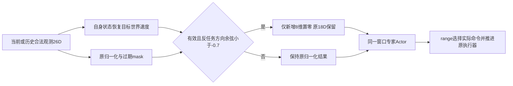

# 双策略动态避障第三轮实测报告

## 本轮结论与保留方案

**本轮没有找到相对第二轮专家始终运行的、可重复的安全增量。** 实际完成W0归因、四个真实接管源状态的12条分支、两个有限候选筛选、两次独立训练，以及冻结后同一50场的600次完整确认。开发上有效的反任务方向输入约束，在新确认上未保住收益；不把它升级为默认方案，也不继续围绕这批确认调阈值。

| 同一新50场安全完成 | 种子20261011 | 种子20261012 |
|---|---:|---:|
| 原normal | 36 | 36（同一结果复用） |
| 未训练W0 | 39 | 39（同一结果复用） |
| 第二轮专家始终运行 | **44** | **44** |
| 第二轮range | 43 | 43 |
| 旧权重加输入约束＋range，不重训 | 42 | 42 |
| 第三轮新专家始终运行 | 42 | **44** |
| 第三轮新专家＋range | 39 | 42 |

**历史接口的作用（事实）：** W0在新50场相对normal救3失0，净增3；共同安全36场平均快1.44s，但航程多18.43m，最坏多42s。旧50场W0的净增8不能直接搬到新50。W0使用原18D障碍槽，收益不是屏蔽目标获得的，也不能再全部归于RL。

**学习适配的作用（事实）：** 新专家相对同接口W0分别救8失5、救6失1，净增3、5，说明学习确有超出初始化的能力；主要体现在cross与edge_static。可是相对同场第二轮专家，新专家分别救2失4、救5失5，净变−2、0。第二轮专家相对W0在两种子均救10失5、净增5，本轮没有超过这一强简单对照。新专家在9个headon中的整条状态和动作轨迹均与W0完全一致，因此这部分是输入处理恢复初始化行为，不能称为新训练获得的迎面能力。

**输入约束的作用（受控事实）：** 固定第二轮权重、只加同一约束后，新50场两种子都救930034、损失930036和930040，range从43降到42。其余41个非headon回合与原range逐步一致。已见旧50中“净救3”的收益没有在新场景重复。两次新训练也未增加这一方向下的能力，因为在本场景生成范围内新增列被持续抑制。

**路由的作用（事实）：** 新range相对同一新专家，两种子都只救回930039，分别损失[930017,930020,930040,930047]与[930040,930046,930048]，净损失3、2。930039确有组合收益：normal在70s失败，W0/新专家在64s失败；range在44s接管、115s交还、164s安全完成。不过第二轮专家始终运行本来就能完成该场，最小间距80.74/67.37m，而新range仅42.43m。这个正例不能抵消整体损失，也不是新学习独有的能力。

路由损失全部首次可见即接管，违规前均无交还。种子20261011的930020从64s发现并接管直到100s违规始终可见；种子20261012的930048从46s至73s同样没有失联。共同损失930040在99s违规时缓存仍有效，age=5s。另有930047经历缓存失效、930046经历失联重见。**因此可以排除“过早交还”作为这些损失的原因，也不能用统一取消过期mask解释全部损失。** 真实前缀改变了接管状态，专家动作与状态的匹配仍是问题；本轮新确认没有再做分支，尚不能把训练覆盖不足、模型选点偏差或更细的失联表征缺陷判作唯一根因。

**代价与决定：** 新range与新专家各自共同安全38/41场的平均航时仅减少0.50/0.02s，最坏反而增加34/25s；安全净损失不能被这点平均差抵消。新专家相对旧专家的共同安全航时，一个种子减少17.30s，另一个增加8.13s，方向不重复。两次新训练各用44.74/44.12分钟CPU墙钟，确认用14.01分钟；新方法每步决策约2.86—2.94ms，旧专家约2.63—2.64ms，且都执行两个Actor前向，没有计算节省证据。所有效率数字只取对应共同安全集合，不把违规早停算提速。

**建议保留第二轮专家始终运行作为当前最有依据的研究基线，暂不采用本轮方向约束或range作为默认增强。** 保留W0作训练归因对照、保留range正例作机制研究，但不宣称路由已值得其代价。下一次若获得继续研究授权，应先针对真实接管状态的可靠性与开发选点做区分实验；无需先叠加退出阈值或取消mask。这个建议不是实船部署结论，两个种子和50场仍有限。

本轮真正解决的是**此前无法区分历史接口、学习适配和路由收益的证据缺口**；性能修复尝试已被新确认部分反驳。旧三处失败的同状态W0可行轨迹、训练独有的920040正例及全部新失败同时保留。普通none/away在所有方法均16/16安全，新专家在这些任务的状态/动作与W0一致，没有通过削弱正常任务对照制造收益。

## 证据范围与比较对象

两次独立训练、同一份50个未见实例，实际600个新完整闭环回合：normal与W0各50次共享，另有每训练种子5×50次。两个组合表各350行，包含共享控制的副本，不能称700次执行或100个独立场景。none/away/late/edge_static各8，cross/headon各9。配置和检查点先固定，再生成930000—930049；确认结果没有用于改方法、调参数或重新选点。

W0保留完整18D障碍输入，其动态新增列未训练且为零；使用与专家一致的26D统计、mask、10步真实历史和执行接口。normal是原流式记忆策略。W0−normal隔离的是历史/接口组合，不能进一步将差异全归于某个历史长度；训练专家−W0才比较学习适配。旧权重+约束+range使用第二轮原selected，仅改变输入处理，检验不重训的低成本方案。新专家与新range共用同一份权重和normalizer。

| 表中简称 | 实际方法 |
|---|---|
| normal | 原正常策略始终运行 |
| w0 | 未训练初始化窗口专家始终运行 |
| old_avoid | 第二轮对应selected专家始终运行 |
| old_range | 第二轮对应selected专家＋原range |
| guard_old_range | 同一第二轮权重＋新输入约束＋原range，不重训 |
| final_avoid | 第三轮独立训练selected专家始终运行 |
| final_range | 同一第三轮专家＋原range |

## 已见归因与有限探索

完整证据见[DIAGNOSIS_ZH.md](runs/round3_20261011_2308/diagnosis/DIAGNOSIS_ZH.md)。旧50场W0为38/50，normal为30/50，第二轮专家38/36。两专家相对W0分别救12失12、救11失13；cross/edge_static收益伴随headon/late损失。此前相对normal的净成绩不能全部归于RL。

四个预先固定的真实range接管源状态，完整恢复真实前缀、两策略各自历史、执行器、缓存和路由；每源比较normal继续、W0接管、训练专家接管，共12条完整分支，没有扫描时刻。920033、920038、920046中训练专家失败而W0安全；920040中只有训练专家接管安全。W0在920040从初态成功却从normal接管状态失败，说明不能用整回合结果代替接管能力。分支后策略锁定到结局，与在线交还分开。

筛选仅用已见旧50：统一缩小新增输入至0.5使range为22/37，拒绝；条件输入约束使两份原权重range为43/41（原40/38），但丢失已有有利组合。range+W0仅34/50，弱于W0始终38/50，未作为新确认主要对照。所有筛选失败保留。筛选结果不是新确认结果。

已有轨迹逐项比较进一步表明：两份固定权重加约束后，旧9场headon的raw/action/active均与range+W0完全相同，其余41场与各自原range完全相同。因此这部分开发收益是条件恢复初始化行为，不是新学会的能力。新确认仍保留不重训对照来检验重训增益。

## 唯一算法改动及机制边界

headon_guard在合法观测/短时缓存有效且目标世界速度与固定任务轴余弦<−0.7时，将归一化后的新增8维置零。原18D障碍槽、10步历史、5s缓存、过期mask与所有路由条件保持。每个历史观测按其当时可用信息独立处理。没有使用kind/seed/视域外真值，没有取消mask或改变安全阈值。

这是对反任务方向来船的学习适配约束，不是COLREGs分类器或未知目标安全判定。当前所有任务起点为世界原点，固定goal定义任务轴；移到非零起点必须显式保存任务轴。该生成器将反向目标和横穿速度较明显分开，其他方向、加速/转弯、多船、感知噪声和真实部署均未验证。历史内未受抑制的旧输入仍可影响动作，因此抑制当前列不等于完全切换成W0。

训练从第0步采用约束；normalizer同时用于Actor、Q与target-Q。4096个新增输入列仍是唯一可训练Actor参数；继承参数冻结。奖励、SAC实现、更新比例、训练分布与开发选点保持第二轮。独立重训与仅旧权重套约束的对照将输入规则收益与重训收益分开；本轮没有证明某个单步动作或mask是唯一根因。

## 两次最终独立训练与恢复

两个种子均从同一继承Actor开始，Q/优化器/replay新建，resume_source=null、初始步数和replay为0；初始Actor哈希相同、Q哈希不同。训练种子和场景基址与第二轮匹配，以减少比较中的随机性混杂。预算统一40000环境步，完整回合边界略超；每5000步及最后边界用旧12场always-avoid开发结果，先安全数，再失败计700s的总航时，最后较早步。没有只挑较好的训练种子。

| 种子 | 实际步数 | Q更新 | Actor更新 | 回合 | 墙钟min | selected步 | 开发安全/12 |
|---|---:|---:|---:|---:|---:|---:|---:|
| 20261011 | 40003 | 9937 | 2359 | 226 | 44.74 | 40003 | 12 |
| 20261012 | 40050 | 9949 | 2362 | 241 | 44.12 | 5214 | 10 |

训练前缀仍按回合轮换：初态专家、真实range首次接管、真实risk首次接管；前缀实际执行normal且维护双方历史，接管后专家锁存至完整结局。没有触发则正常结束并如实进入回放。这不是本轮新增路由算法。选点仍只测always-avoid，是保留的局限，不能声称已优化路由选点。

最终完整恢复状态在checkpoints/round3/<seed>/resume.pt，含Actor/Q/target-Q、优化器、replay、RNG、normalizer和训练协议；另存actor.pth/normalizer.pth。两次独立装载后连续4次更新完全一致，只证明本实现恢复自洽，不冒充上游历史精确续训。W0和旧权重加约束控制只有Actor与normalizer，不冒充SAC训练恢复状态。

## 种子 20261011：新50场

| 方法 | 安全完成 | 到达 | 违规 | 超时 | 其他失败 | 最小距离m | 切换总数 | 平均专家执行s | 接管/交还/交还且安全/最终normal完成 | 决策ms/步 |
|---|---:|---:|---:|---:|---:|---:|---:|---:|---|---:|
| normal | 36/50 | 36 | 14 | 0 | 0 | 37.54 | 0 | 0.00 | 0/0/0/0 | 1.02 |
| w0 | 39/50 | 39 | 11 | 0 | 0 | 37.17 | 0 | 147.14 | 0/0/0/0 | 2.90 |
| old_avoid | 44/50 | 44 | 6 | 0 | 0 | 36.76 | 0 | 181.98 | 0/0/0/0 | 2.63 |
| old_range | 43/50 | 43 | 7 | 0 | 0 | 36.67 | 40 | 90.50 | 32/8/8/8 | 2.61 |
| guard_old_range | 42/50 | 42 | 8 | 0 | 0 | 36.97 | 44 | 75.94 | 32/12/12/12 | 2.88 |
| final_avoid | 42/50 | 42 | 8 | 0 | 0 | 37.56 | 0 | 158.00 | 0/0/0/0 | 2.90 |
| final_range | 39/50 | 39 | 11 | 0 | 0 | 36.97 | 48 | 46.82 | 32/16/16/16 | 2.86 |

接管/交还为发生事件的回合数；always-avoid没有路由接管事件。“交还且安全”允许之后再次接管，“最终normal完成”还要求最后已执行策略为normal。所有实体都参与最小距离与违规评价，不可见目标不删除，无实体的null不当零距离。

| 类别/总数 | normal | w0 | old_avoid | old_range | guard_old_range | final_avoid | final_range |
|---|---:|---:|---:|---:|---:|---:|---:|
| none/8 | 8 | 8 | 8 | 8 | 8 | 8 | 8 |
| away/8 | 8 | 8 | 8 | 8 | 8 | 8 | 8 |
| late/8 | 8 | 8 | 6 | 3 | 3 | 5 | 3 |
| cross/9 | 5 | 6 | 8 | 8 | 8 | 8 | 8 |
| headon/9 | 5 | 7 | 7 | 8 | 7 | 7 | 7 |
| edge_static/8 | 2 | 2 | 7 | 8 | 8 | 6 | 5 |

逐步状态/动作身份核对（读取现有轨迹，不是新增实验）：
- final_avoid-vs-w0：headon完全一致9/9；各类全量结果见functional_equivalence.json。
- guard_old_range-vs-old_range：headon完全一致0/9；各类全量结果见functional_equivalence.json。
- final_range-vs-guard_old_range：headon完全一致9/9；各类全量结果见functional_equivalence.json。

### 学习、输入处理和路由的配对安全得失

| 后者−前者 | 救回ID | 损失ID | 共同安全 | 共同失败 |
|---|---|---|---:|---:|
| w0-minus-normal | [930032, 930034, 930040] | [] | 36 | 11 |
| old_avoid-minus-normal | [930024, 930025, 930030, 930032, 930039, 930040, 930043, 930044, 930045, 930046, 930047, 930048] | [930018, 930019, 930031, 930042] | 32 | 2 |
| old_range-minus-normal | [930024, 930025, 930030, 930032, 930036, 930039, 930040, 930043, 930044, 930045, 930046, 930047, 930048] | [930018, 930019, 930020, 930022, 930023, 930031] | 30 | 1 |
| guard_old_range-minus-normal | [930024, 930025, 930030, 930032, 930034, 930039, 930043, 930044, 930045, 930046, 930047, 930048] | [930018, 930019, 930020, 930022, 930023, 930031] | 30 | 2 |
| final_avoid-minus-normal | [930024, 930025, 930030, 930032, 930034, 930040, 930043, 930045, 930046, 930047, 930048] | [930018, 930019, 930022, 930028, 930042] | 31 | 3 |
| final_range-minus-normal | [930024, 930025, 930030, 930032, 930034, 930039, 930043, 930045, 930046, 930048] | [930017, 930018, 930019, 930020, 930022, 930028, 930042] | 29 | 4 |
| old_avoid-minus-w0 | [930024, 930025, 930030, 930039, 930043, 930044, 930045, 930046, 930047, 930048] | [930018, 930019, 930031, 930034, 930042] | 34 | 1 |
| old_range-minus-w0 | [930024, 930025, 930030, 930036, 930039, 930043, 930044, 930045, 930046, 930047, 930048] | [930018, 930019, 930020, 930022, 930023, 930031, 930034] | 32 | 0 |
| guard_old_range-minus-w0 | [930024, 930025, 930030, 930039, 930043, 930044, 930045, 930046, 930047, 930048] | [930018, 930019, 930020, 930022, 930023, 930031, 930040] | 32 | 1 |
| final_avoid-minus-w0 | [930024, 930025, 930030, 930043, 930045, 930046, 930047, 930048] | [930018, 930019, 930022, 930028, 930042] | 34 | 3 |
| final_range-minus-w0 | [930024, 930025, 930030, 930039, 930043, 930045, 930046, 930048] | [930017, 930018, 930019, 930020, 930022, 930028, 930040, 930042] | 31 | 3 |
| old_range-minus-old_avoid | [930036, 930042] | [930020, 930022, 930023] | 41 | 4 |
| guard_old_range-minus-old_avoid | [930034, 930042] | [930020, 930022, 930023, 930040] | 40 | 4 |
| final_avoid-minus-old_avoid | [930031, 930034] | [930022, 930028, 930039, 930044] | 40 | 4 |
| final_range-minus-old_avoid | [930031, 930034] | [930017, 930020, 930022, 930028, 930040, 930044, 930047] | 37 | 4 |
| guard_old_range-minus-old_range | [930034] | [930036, 930040] | 41 | 6 |
| final_avoid-minus-old_range | [930020, 930023, 930031, 930034] | [930028, 930036, 930039, 930042, 930044] | 38 | 3 |
| final_range-minus-old_range | [930023, 930031, 930034] | [930017, 930028, 930036, 930040, 930042, 930044, 930047] | 36 | 4 |
| final_avoid-minus-guard_old_range | [930020, 930023, 930031, 930040] | [930028, 930039, 930042, 930044] | 38 | 4 |
| final_range-minus-guard_old_range | [930023, 930031] | [930017, 930028, 930042, 930044, 930047] | 37 | 6 |
| final_range-minus-final_avoid | [930039] | [930017, 930020, 930040, 930047] | 38 | 7 |

### 所有两两共同安全航时/s

| 后者−前者 | n | 前均值/中位 | 后均值/中位 | 差均值/中位 | 最大退化 | 更小/相同/更大 |
|---|---:|---|---|---|---:|---|
| w0-minus-normal | 36 | 168.36/168.50 | 166.92/164.00 | -1.44/-2.50 | 42.00 | 21/1/14 |
| old_avoid-minus-normal | 32 | 168.28/168.50 | 185.62/182.50 | 17.34/7.00 | 135.00 | 11/1/20 |
| old_range-minus-normal | 30 | 168.63/170.50 | 187.33/181.00 | 18.70/0.00 | 141.00 | 0/18/12 |
| guard_old_range-minus-normal | 30 | 168.63/170.50 | 177.67/173.00 | 9.03/0.00 | 141.00 | 4/18/8 |
| final_avoid-minus-normal | 31 | 166.48/162.00 | 165.68/164.00 | -0.81/-2.00 | 28.00 | 18/1/12 |
| final_range-minus-normal | 29 | 168.10/167.00 | 166.48/167.00 | -1.62/0.00 | 4.00 | 6/19/4 |
| old_avoid-minus-w0 | 34 | 166.18/165.00 | 186.09/189.50 | 19.91/0.00 | 143.00 | 1/21/12 |
| old_range-minus-w0 | 32 | 166.25/165.00 | 189.81/183.00 | 23.56/7.50 | 150.00 | 8/1/23 |
| guard_old_range-minus-w0 | 32 | 166.47/166.50 | 178.12/173.00 | 11.66/3.00 | 150.00 | 12/1/19 |
| final_avoid-minus-w0 | 34 | 165.12/165.00 | 165.35/165.00 | 0.24/0.00 | 14.00 | 2/29/3 |
| final_range-minus-w0 | 31 | 166.74/169.00 | 165.94/167.00 | -0.81/0.00 | 25.00 | 14/2/15 |
| old_range-minus-old_avoid | 41 | 188.80/193.00 | 200.73/196.00 | 11.93/4.00 | 175.00 | 14/2/25 |
| guard_old_range-minus-old_avoid | 40 | 188.80/193.50 | 190.55/183.00 | 1.75/2.00 | 175.00 | 18/1/21 |
| final_avoid-minus-old_avoid | 40 | 184.43/190.50 | 167.12/165.00 | -17.30/0.00 | 2.00 | 18/21/1 |
| final_range-minus-old_avoid | 37 | 186.32/193.00 | 168.62/164.00 | -17.70/-10.00 | 25.00 | 25/1/11 |
| guard_old_range-minus-old_range | 41 | 200.22/196.00 | 191.51/184.00 | -8.71/0.00 | 0.00 | 6/35/0 |
| final_avoid-minus-old_range | 38 | 196.71/190.50 | 167.66/166.50 | -29.05/-13.00 | 21.00 | 29/1/8 |
| final_range-minus-old_range | 36 | 192.44/190.50 | 169.08/165.50 | -23.36/-3.50 | 0.00 | 18/18/0 |
| final_avoid-minus-guard_old_range | 38 | 186.87/182.00 | 167.84/167.00 | -19.03/-5.00 | 21.00 | 25/1/12 |
| final_range-minus-guard_old_range | 37 | 182.11/182.00 | 169.03/167.00 | -13.08/0.00 | 0.00 | 12/25/0 |
| final_range-minus-final_avoid | 38 | 168.24/167.00 | 167.74/165.50 | -0.50/0.50 | 34.00 | 16/3/19 |

### 所有两两共同安全航程/m

| 后者−前者 | n | 前均值/中位 | 后均值/中位 | 差均值/中位 | 最大退化 | 更小/相同/更大 |
|---|---:|---|---|---|---:|---|
| w0-minus-normal | 36 | 563.48/555.76 | 581.91/572.43 | 18.43/5.40 | 99.65 | 13/0/23 |
| old_avoid-minus-normal | 32 | 566.73/558.30 | 633.95/609.30 | 67.22/29.20 | 328.61 | 7/0/25 |
| old_range-minus-normal | 30 | 564.80/554.47 | 624.67/578.11 | 59.87/0.00 | 342.96 | 0/18/12 |
| guard_old_range-minus-normal | 30 | 564.80/554.47 | 596.53/573.13 | 31.73/0.00 | 342.96 | 3/18/9 |
| final_avoid-minus-normal | 31 | 565.65/557.63 | 584.37/581.03 | 18.72/6.34 | 99.65 | 9/0/22 |
| final_range-minus-normal | 29 | 567.12/557.63 | 573.41/560.57 | 6.29/0.00 | 68.91 | 3/18/8 |
| old_avoid-minus-w0 | 34 | 582.58/572.43 | 635.45/623.83 | 52.87/0.00 | 334.24 | 1/21/12 |
| old_range-minus-w0 | 32 | 580.50/559.87 | 627.81/582.11 | 47.31/5.77 | 348.58 | 12/0/20 |
| guard_old_range-minus-w0 | 32 | 580.78/561.91 | 598.87/577.05 | 18.09/1.75 | 348.58 | 16/0/16 |
| final_avoid-minus-w0 | 34 | 581.46/563.38 | 582.39/566.46 | 0.94/0.00 | 47.88 | 2/28/4 |
| final_range-minus-w0 | 31 | 584.35/563.82 | 573.81/560.57 | -10.54/-1.76 | 37.99 | 18/0/13 |
| old_range-minus-old_avoid | 41 | 643.82/639.23 | 656.50/646.84 | 12.67/-0.04 | 274.80 | 21/0/20 |
| guard_old_range-minus-old_avoid | 40 | 644.06/642.56 | 629.24/602.03 | -14.82/-4.92 | 274.80 | 24/0/16 |
| final_avoid-minus-old_avoid | 40 | 633.88/631.44 | 583.81/577.46 | -50.08/0.00 | 0.00 | 19/21/0 |
| final_range-minus-old_avoid | 37 | 636.90/628.39 | 578.17/567.25 | -58.73/-45.76 | 11.34 | 29/0/8 |
| guard_old_range-minus-old_range | 41 | 654.17/627.53 | 628.19/590.18 | -25.98/0.00 | 0.00 | 6/35/0 |
| final_avoid-minus-old_range | 38 | 645.28/626.67 | 583.52/571.53 | -61.76/-39.00 | 99.65 | 27/0/11 |
| final_range-minus-old_range | 36 | 640.50/626.67 | 578.66/568.68 | -61.84/-15.51 | 0.00 | 18/18/0 |
| final_avoid-minus-guard_old_range | 38 | 620.92/595.06 | 583.76/571.53 | -37.16/-5.77 | 99.65 | 23/0/15 |
| final_range-minus-guard_old_range | 37 | 610.62/578.26 | 579.24/570.11 | -31.38/0.00 | 0.00 | 12/25/0 |
| final_range-minus-final_avoid | 38 | 584.99/577.46 | 577.96/568.68 | -7.03/-1.40 | 45.99 | 22/0/16 |

每一对使用自己的共同安全集合，失败早停不进入效率比较。最大退化为后−前最大值；若为负则该子集没有正退化。逐场ID和差值保留在paired_scenes.csv，不能混用不同共同安全分母。

### 新range相对新专家的事件证据

- rescued 930039/headon：接管[44]，交还[115]，终止164s/arrival，最小距离42.43m；全窗口失联仍运行专家34步。时间线：44:visible+,valid+,active+；66:visible-；71:valid-；115:active-；164:terminal。
- lost 930017/late：接管[41]，交还[]，终止72s/safety_violation，最小距离39.79m；全窗口失联仍运行专家0步。时间线：41:visible+,valid+,active+；43:visible-；46:visible+；72:terminal。
- lost 930020/late：接管[64]，交还[]，终止100s/safety_violation，最小距离39.61m；全窗口失联仍运行专家0步。时间线：64:visible+,valid+,active+；100:terminal。
- lost 930040/headon：接管[75]，交还[]，终止99s/safety_violation，最小距离39.61m；全窗口失联仍运行专家0步。时间线：75:visible+,valid+,active+；95:visible-；99:terminal。
- lost 930047/edge_static：接管[57]，交还[]，终止94s/safety_violation，最小距离39.78m；全窗口失联仍运行专家5步。时间线：57:visible+,valid+,active+；74:visible-；79:valid-；94:terminal。

事件先后不是单因素因果证明；没有交还的失败不归因于过早交还。新确认只做离线事件分析，没有新增分支、扫描切换点或修改策略。

## 种子 20261012：新50场

| 方法 | 安全完成 | 到达 | 违规 | 超时 | 其他失败 | 最小距离m | 切换总数 | 平均专家执行s | 接管/交还/交还且安全/最终normal完成 | 决策ms/步 |
|---|---:|---:|---:|---:|---:|---:|---:|---:|---|---:|
| normal | 36/50 | 36 | 14 | 0 | 0 | 37.54 | 0 | 0.00 | 0/0/0/0 | 1.02 |
| w0 | 39/50 | 39 | 11 | 0 | 0 | 37.17 | 0 | 147.14 | 0/0/0/0 | 2.90 |
| old_avoid | 44/50 | 44 | 6 | 0 | 0 | 38.16 | 0 | 158.84 | 0/0/0/0 | 2.64 |
| old_range | 43/50 | 43 | 7 | 0 | 0 | 37.74 | 50 | 52.84 | 32/18/18/18 | 2.70 |
| guard_old_range | 42/50 | 42 | 8 | 0 | 0 | 36.97 | 51 | 48.48 | 32/19/19/19 | 2.86 |
| final_avoid | 44/50 | 44 | 6 | 0 | 0 | 37.90 | 0 | 163.74 | 0/0/0/0 | 2.90 |
| final_range | 42/50 | 42 | 8 | 0 | 0 | 36.97 | 45 | 51.10 | 32/13/13/13 | 2.94 |

接管/交还为发生事件的回合数；always-avoid没有路由接管事件。“交还且安全”允许之后再次接管，“最终normal完成”还要求最后已执行策略为normal。所有实体都参与最小距离与违规评价，不可见目标不删除，无实体的null不当零距离。

| 类别/总数 | normal | w0 | old_avoid | old_range | guard_old_range | final_avoid | final_range |
|---|---:|---:|---:|---:|---:|---:|---:|
| none/8 | 8 | 8 | 8 | 8 | 8 | 8 | 8 |
| away/8 | 8 | 8 | 8 | 8 | 8 | 8 | 8 |
| late/8 | 8 | 8 | 6 | 4 | 4 | 8 | 8 |
| cross/9 | 5 | 6 | 8 | 8 | 8 | 8 | 8 |
| headon/9 | 5 | 7 | 7 | 8 | 7 | 7 | 7 |
| edge_static/8 | 2 | 2 | 7 | 7 | 7 | 5 | 3 |

逐步状态/动作身份核对（读取现有轨迹，不是新增实验）：
- final_avoid-vs-w0：headon完全一致9/9；各类全量结果见functional_equivalence.json。
- guard_old_range-vs-old_range：headon完全一致0/9；各类全量结果见functional_equivalence.json。
- final_range-vs-guard_old_range：headon完全一致9/9；各类全量结果见functional_equivalence.json。

### 学习、输入处理和路由的配对安全得失

| 后者−前者 | 救回ID | 损失ID | 共同安全 | 共同失败 |
|---|---|---|---:|---:|
| w0-minus-normal | [930032, 930034, 930040] | [] | 36 | 11 |
| old_avoid-minus-normal | [930024, 930025, 930030, 930032, 930036, 930039, 930043, 930045, 930046, 930047, 930048] | [930018, 930022, 930028] | 33 | 3 |
| old_range-minus-normal | [930024, 930025, 930030, 930032, 930036, 930039, 930040, 930043, 930045, 930046, 930047, 930048] | [930017, 930018, 930020, 930022, 930028] | 31 | 2 |
| guard_old_range-minus-normal | [930024, 930025, 930030, 930032, 930034, 930039, 930043, 930045, 930046, 930047, 930048] | [930017, 930018, 930020, 930022, 930028] | 31 | 3 |
| final_avoid-minus-normal | [930024, 930025, 930030, 930032, 930034, 930040, 930043, 930046, 930048] | [930027] | 35 | 5 |
| final_range-minus-normal | [930024, 930025, 930030, 930032, 930034, 930039, 930043] | [930027] | 35 | 7 |
| old_avoid-minus-w0 | [930024, 930025, 930030, 930036, 930039, 930043, 930045, 930046, 930047, 930048] | [930018, 930022, 930028, 930034, 930040] | 34 | 1 |
| old_range-minus-w0 | [930024, 930025, 930030, 930036, 930039, 930043, 930045, 930046, 930047, 930048] | [930017, 930018, 930020, 930022, 930028, 930034] | 33 | 1 |
| guard_old_range-minus-w0 | [930024, 930025, 930030, 930039, 930043, 930045, 930046, 930047, 930048] | [930017, 930018, 930020, 930022, 930028, 930040] | 33 | 2 |
| final_avoid-minus-w0 | [930024, 930025, 930030, 930043, 930046, 930048] | [930027] | 38 | 5 |
| final_range-minus-w0 | [930024, 930025, 930030, 930039, 930043] | [930027, 930040] | 37 | 6 |
| old_range-minus-old_avoid | [930040] | [930017, 930020] | 42 | 5 |
| guard_old_range-minus-old_avoid | [930034] | [930017, 930020, 930036] | 41 | 5 |
| final_avoid-minus-old_avoid | [930018, 930022, 930028, 930034, 930040] | [930027, 930036, 930039, 930045, 930047] | 39 | 1 |
| final_range-minus-old_avoid | [930018, 930022, 930028, 930034] | [930027, 930036, 930045, 930046, 930047, 930048] | 38 | 2 |
| guard_old_range-minus-old_range | [930034] | [930036, 930040] | 41 | 6 |
| final_avoid-minus-old_range | [930017, 930018, 930020, 930022, 930028, 930034] | [930027, 930036, 930039, 930045, 930047] | 38 | 1 |
| final_range-minus-old_range | [930017, 930018, 930020, 930022, 930028, 930034] | [930027, 930036, 930040, 930045, 930046, 930047, 930048] | 36 | 1 |
| final_avoid-minus-guard_old_range | [930017, 930018, 930020, 930022, 930028, 930040] | [930027, 930039, 930045, 930047] | 38 | 2 |
| final_range-minus-guard_old_range | [930017, 930018, 930020, 930022, 930028] | [930027, 930045, 930046, 930047, 930048] | 37 | 3 |
| final_range-minus-final_avoid | [930039] | [930040, 930046, 930048] | 41 | 5 |

### 所有两两共同安全航时/s

| 后者−前者 | n | 前均值/中位 | 后均值/中位 | 差均值/中位 | 最大退化 | 更小/相同/更大 |
|---|---:|---|---|---|---:|---|
| w0-minus-normal | 36 | 168.36/168.50 | 166.92/164.00 | -1.44/-2.50 | 42.00 | 21/1/14 |
| old_avoid-minus-normal | 33 | 166.70/166.00 | 166.09/160.00 | -0.61/-3.00 | 29.00 | 20/1/12 |
| old_range-minus-normal | 31 | 168.23/167.00 | 169.74/170.00 | 1.52/0.00 | 25.00 | 5/19/7 |
| guard_old_range-minus-normal | 31 | 168.23/167.00 | 169.00/169.00 | 0.77/0.00 | 25.00 | 6/19/6 |
| final_avoid-minus-normal | 35 | 168.29/167.00 | 172.63/173.00 | 4.34/1.00 | 56.00 | 15/1/19 |
| final_range-minus-normal | 35 | 168.29/167.00 | 173.03/174.00 | 4.74/0.00 | 38.00 | 5/18/12 |
| old_avoid-minus-w0 | 34 | 164.59/162.00 | 165.44/160.00 | 0.85/0.00 | 39.00 | 4/23/7 |
| old_range-minus-w0 | 33 | 166.15/164.00 | 168.61/168.00 | 2.45/4.00 | 35.00 | 13/1/19 |
| guard_old_range-minus-w0 | 33 | 166.36/164.00 | 168.39/168.00 | 2.03/3.00 | 35.00 | 14/1/18 |
| final_avoid-minus-w0 | 38 | 165.92/164.00 | 172.53/173.00 | 6.61/0.00 | 45.00 | 1/28/9 |
| final_range-minus-w0 | 37 | 165.92/164.00 | 172.86/173.00 | 6.95/3.00 | 50.00 | 14/1/22 |
| old_range-minus-old_avoid | 42 | 166.74/161.00 | 172.00/167.50 | 5.26/3.00 | 88.00 | 12/2/28 |
| guard_old_range-minus-old_avoid | 41 | 166.98/162.00 | 169.56/167.00 | 2.59/2.00 | 31.00 | 13/2/26 |
| final_avoid-minus-old_avoid | 39 | 165.08/160.00 | 173.21/173.00 | 8.13/0.00 | 52.00 | 3/23/13 |
| final_range-minus-old_avoid | 38 | 165.71/162.00 | 173.71/172.00 | 8.00/3.00 | 65.00 | 14/1/23 |
| guard_old_range-minus-old_range | 41 | 172.44/168.00 | 169.56/167.00 | -2.88/0.00 | 0.00 | 6/35/0 |
| final_avoid-minus-old_range | 38 | 168.47/165.50 | 174.79/174.00 | 6.32/2.00 | 47.00 | 17/1/20 |
| final_range-minus-old_range | 36 | 172.11/169.00 | 174.86/172.00 | 2.75/0.00 | 64.00 | 9/18/9 |
| final_avoid-minus-guard_old_range | 38 | 168.29/167.00 | 174.97/174.00 | 6.68/2.50 | 47.00 | 16/1/21 |
| final_range-minus-guard_old_range | 37 | 168.78/167.00 | 174.65/171.00 | 5.86/0.00 | 64.00 | 3/25/9 |
| final_range-minus-final_avoid | 41 | 176.05/175.00 | 176.02/174.00 | -0.02/3.00 | 25.00 | 17/1/23 |

### 所有两两共同安全航程/m

| 后者−前者 | n | 前均值/中位 | 后均值/中位 | 差均值/中位 | 最大退化 | 更小/相同/更大 |
|---|---:|---|---|---|---:|---|
| w0-minus-normal | 36 | 563.48/555.76 | 581.91/572.43 | 18.43/5.40 | 99.65 | 13/0/23 |
| old_avoid-minus-normal | 33 | 563.70/553.88 | 582.45/561.62 | 18.74/6.34 | 99.65 | 8/0/25 |
| old_range-minus-normal | 31 | 564.95/553.88 | 578.19/564.56 | 13.24/0.00 | 82.89 | 0/18/13 |
| guard_old_range-minus-normal | 31 | 564.95/553.88 | 574.02/556.48 | 9.07/0.00 | 68.91 | 3/18/10 |
| final_avoid-minus-normal | 35 | 563.61/553.88 | 586.98/583.44 | 23.37/10.49 | 99.65 | 9/0/26 |
| final_range-minus-normal | 35 | 563.61/553.88 | 577.37/570.11 | 13.76/0.00 | 106.99 | 4/18/13 |
| old_avoid-minus-w0 | 34 | 580.50/562.36 | 581.80/561.25 | 1.31/0.00 | 39.38 | 4/21/9 |
| old_range-minus-w0 | 33 | 581.51/560.89 | 576.94/564.56 | -4.57/3.55 | 53.45 | 14/0/19 |
| guard_old_range-minus-w0 | 33 | 581.79/562.93 | 574.59/566.87 | -7.19/-0.04 | 45.66 | 17/0/16 |
| final_avoid-minus-w0 | 38 | 578.03/561.91 | 585.98/582.23 | 7.95/0.00 | 90.06 | 3/28/7 |
| final_range-minus-w0 | 37 | 578.68/562.93 | 578.44/576.14 | -0.24/-0.04 | 108.20 | 19/0/18 |
| old_range-minus-old_avoid | 42 | 584.00/570.56 | 587.19/568.68 | 3.19/3.63 | 230.33 | 18/0/24 |
| guard_old_range-minus-old_avoid | 41 | 584.03/569.59 | 577.36/566.94 | -6.68/-0.30 | 55.61 | 22/0/19 |
| final_avoid-minus-old_avoid | 39 | 580.26/561.62 | 591.79/583.44 | 11.53/0.00 | 154.32 | 8/21/10 |
| final_range-minus-old_avoid | 38 | 581.39/565.61 | 582.96/567.83 | 1.56/-2.36 | 186.36 | 22/0/16 |
| guard_old_range-minus-old_range | 41 | 587.39/567.25 | 577.36/566.94 | -10.03/0.00 | 0.00 | 6/35/0 |
| final_avoid-minus-old_range | 38 | 578.18/566.91 | 592.96/582.23 | 14.79/0.90 | 143.94 | 18/0/20 |
| final_range-minus-old_range | 36 | 585.99/567.06 | 584.34/567.83 | -1.65/0.00 | 194.13 | 11/18/7 |
| final_avoid-minus-guard_old_range | 38 | 576.14/567.09 | 593.21/582.23 | 17.07/3.58 | 143.94 | 15/0/23 |
| final_range-minus-guard_old_range | 37 | 575.25/566.87 | 584.76/568.42 | 9.51/0.00 | 194.13 | 5/25/7 |
| final_range-minus-final_avoid | 41 | 593.73/589.71 | 586.52/576.14 | -7.21/-1.03 | 50.19 | 22/0/19 |

每一对使用自己的共同安全集合，失败早停不进入效率比较。最大退化为后−前最大值；若为负则该子集没有正退化。逐场ID和差值保留在paired_scenes.csv，不能混用不同共同安全分母。

### 新range相对新专家的事件证据

- rescued 930039/headon：接管[44]，交还[115]，终止164s/arrival，最小距离42.43m；全窗口失联仍运行专家34步。时间线：44:visible+,valid+,active+；66:visible-；71:valid-；115:active-；164:terminal。
- lost 930040/headon：接管[75]，交还[]，终止99s/safety_violation，最小距离39.61m；全窗口失联仍运行专家0步。时间线：75:visible+,valid+,active+；95:visible-；99:terminal。
- lost 930046/edge_static：接管[45]，交还[]，终止83s/safety_violation，最小距离38.66m；全窗口失联仍运行专家0步。时间线：45:visible+,valid+,active+；65:visible-；70:valid-；78:visible+,valid+；82:visible-；83:terminal。
- lost 930048/edge_static：接管[46]，交还[]，终止73s/safety_violation，最小距离38.31m；全窗口失联仍运行专家0步。时间线：46:visible+,valid+,active+；73:terminal。

事件先后不是单因素因果证明；没有交还的失败不归因于过早交还。新确认只做离线事件分析，没有新增分支、扫描切换点或修改策略。

## 执行成本与限制

- 新确认600回合墙钟840.33s，最多4个单线程CPU worker，无GPU；各方法决策ms/步见上表。训练墙钟按两运行分别列出，不将并行时间相加当总墙钟。
- 决策计时包含路由和Actor前向，不含观测构造、物理推进或初始化。normal一个Actor，其他方法当前都计算两个Actor；专家接管时长减少不等于计算节省。
- 500m任务、700s时限、40m中心安全域、1Hz、前向120°/150m、0—1艘恒速低速目标。目标不可见后停止真值更新，缓存只外推5s，年龄显式可用；物理评价始终保留目标。
- 40m判分是1s端点相对线段近似，不是连续ODE或实体船体安全证明。无目标/远离/错时类别不自动等于真实无冲突，轨迹才决定安全。
- range保持既有进入/交还；丢失后仍用最后合法观测可达域判断风险，不能当作专家继续知道真值。切换不重置船体、帆舵设定值、时钟或各自真实历史；未执行输出不写成真实动作。
- 只有两个训练种子和一份50场，不能声称稳定泛化或部署安全。试探过的shrink失败、所有超时/违规/退化均保留。
- 只做一次新增实现检查（same-family/provisional），未做全仓复核、论文审查或新平台。物理轨迹检查与恢复一致性是实际收据，不替代方法有效性证据。

## 产物与复现

实际命令见[COMMANDS.md](runs/round3_20261011_2308/COMMANDS.md)。协议、冻结身份和来源分别为PROTOCOL.md、freeze.json、source_before；旧首轮/第二轮selected、失败轨迹和A线均保留。新检查点必须用AdaptNormalizer加载，旧FixedNormalizer会漏掉约束，不能用于复现本轮方法。

逐回合、全部配对、事件和轨迹：runs/round3_20261011_2308/confirmation50/seed_<seed>/；唯一600条原始轨迹在parts/*/trajectories。旧50W0与12分支在diagnosis，筛选250回合在screen，全部失败均在对应文件。

3张静态关键图及1段真实动画位于runs/round3_20261011_2308/figures；动画从实际轨迹抽帧，完整原始1Hz轨迹另存。终止帧不伪造交还。图是证据展示，不是机制证明。

- [旧50场历史接口与学习适配](runs/round3_20261011_2308/figures/01_w0_attribution.png)：已见诊断，包含无目标和远离任务；不当作新确认。
- [四个真实同状态分支](runs/round3_20261011_2308/figures/02_same_state_branches.png)：包含训练损失及训练独有的接管正例；不扫描切换时刻。
- [新50场与独立训练选点](runs/round3_20261011_2308/figures/03_final_confirmation.png)：两个种子分别报告；相同50场，不合算100个独立场景。
- [真实正常、接管交还、失败或代价](runs/round3_20261011_2308/figures/04_actual_handover_and_cost.gif)：三例同步显示实际时间；短回合结束后停帧，不伪造继续执行。
  Normal / no target：20261011/930000，safe=True，最小距离—m；Takeover and return：20261011/930034，safe=True，最小距离40.65m；Failure or cost：20261011/930017，safe=False，最小距离39.79m。成功案例930034最小裕度仅约0.65m，不代表稳健安全保证。

[DualPolicy_Round3_preview.zip](DualPolicy_Round3_preview.zip)含报告、代码、表格和关键图；大检查点、全量原始轨迹另存于项目目录，不声称预览包可脱离继承环境独立运行。
