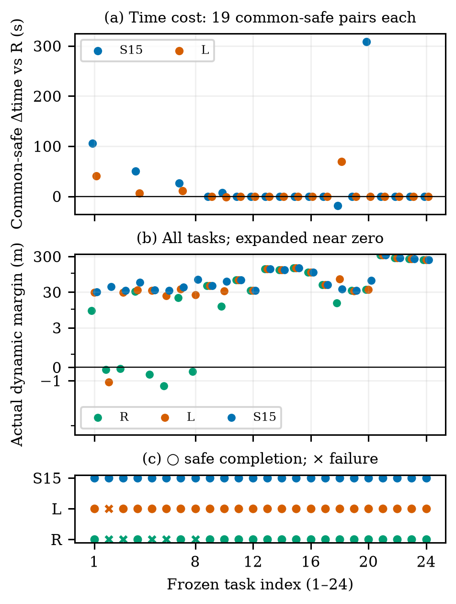
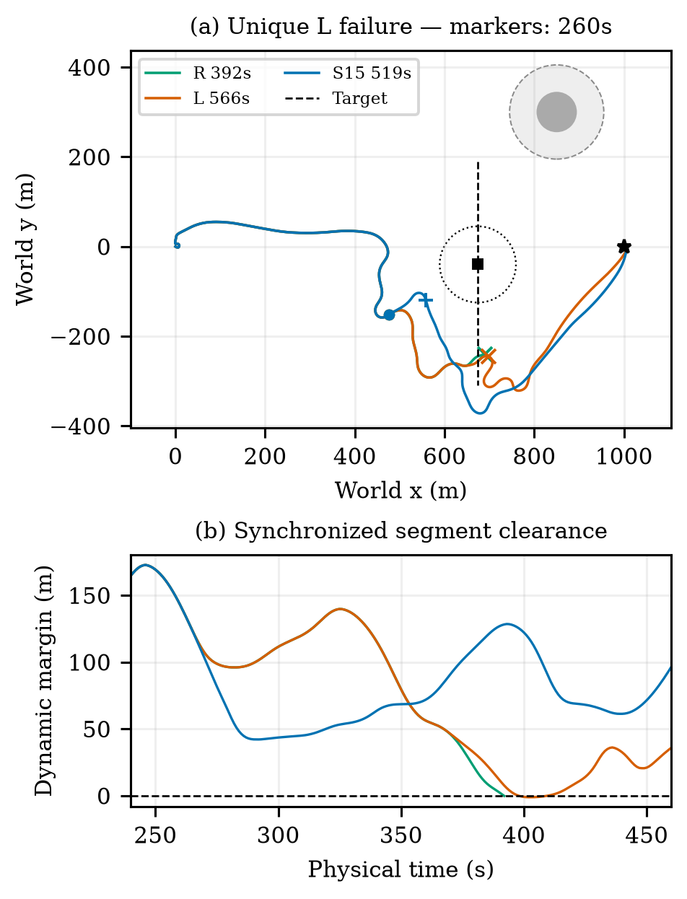
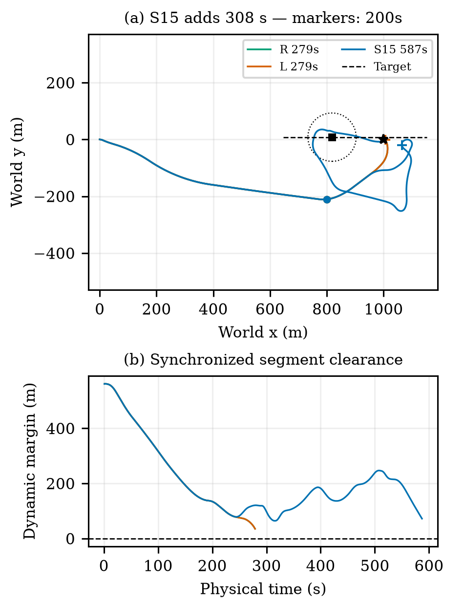
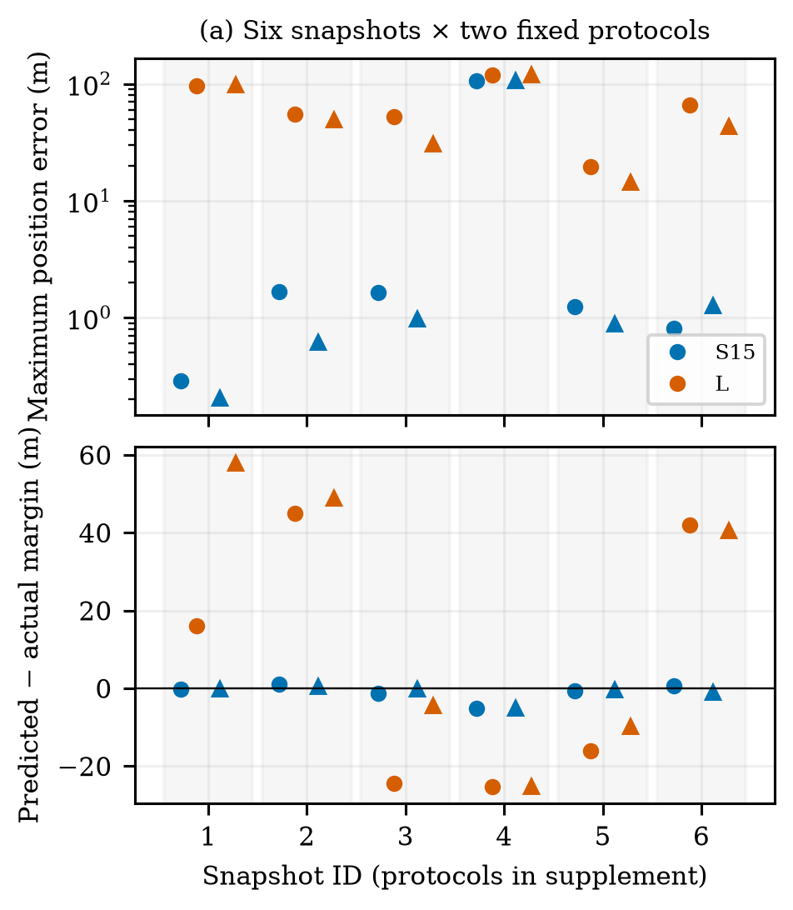

# 先看这份：这篇帆船论文到底做了什么？

这是一份面向作者的中文导读，不是新实验报告。依据为R13第四轮英文稿及已核验日志。正文有条件的结论在这里仍然保留。

## 1. 一句话抓住论文

**我们给一个已有的帆舵控制器增加“先预测候选目标会被怎样执行，再决定是否换目标”的高层监督器，研究它能否避免部分动态会遇中的危险航迹，以及这种干预的代价。**

帆船不是指向一个点就沿直线驶过去。它会受风、转向响应、帆舵执行器以及控制器记忆影响。因此，“从这里到那个点的线段不碰障碍”，不等于“给控制器这个点以后，实际航迹也不碰障碍”。这就是本文要处理的具体问题。

这里的“危险”主要指侵入预定义安全缓冲区，不等于已发生实体船体碰撞。把两者混写，会夸大实验意义。

## 2. 我们改的是哪一层？

| 层次 | 做什么 | 本文的角色 |
| --- | --- | --- |
| 帆舵控制器 | 接收局部状态和位置目标，输出帆、舵动作 | 使用继承的18D循环SAC注意力策略及原权重；本文不重训 |
| 帆船动力学 | 根据动作和风推进船舶运动 | 使用继承实现；预测与真实执行分别使用独立实例 |
| 常规路线接力 | 沿任务方向给出下一个位置目标 | 作为共同基础，也用于反应式对照R |
| 候选执行预测监督器 | 判断常规目标是否值得继续，必要时比较替代位置目标 | 本文主要研究对象 |
| 评价与分析 | 同时刻比较两船间距、完整任务结果、预测误差和代价 | 用于检验方法实际起了什么作用 |

因此，本文没有提出新的强化学习训练算法，也没有训练出一个比师兄更强的新底层网络。贡献来自已有预测避碰思想在“位置目标＋循环式帆舵控制器”接口上的适配，以及有正反例的闭环验证。

## 3. 方法实际如何运行？

“候选”不是一根理想直线，而是一个执行协议：给哪个位置参考、保持多久、何时恢复常规接力。

```text
当前状态、真实历史、已下发动作、目标船观测
                    ↓
  重建控制器记忆/执行器状态，并从过去运动拟合局部风
                    ↓
           先预测常规参考的执行航迹
                    ↓
       预测有效且最小余量达到30米？
          ┌─────────┴─────────┐
         是                   否
          ↓                    ↓
   采用常规参考       预测继续当前参考＋4个侧向参考
          │                    ↓
          │         可行集内选择终端代价较低者
          │         全不满足时按最大余量尽力选择
          └─────────┬─────────┘
                    ↓
 已算出的旧动作先执行；下一秒交付参考；真实低层继续反馈
                    ↓
    按新的真实状态复查（非默认参考通常保持15秒）
                    └─────────→ 回到输入
```

这是流程示意，不是安全证明。常规参考不会被强行锁定15秒，保持规则针对非默认参考。

详细预测S15把继承控制器放入内部预测分支，用已知动力学和因果拟合的局部风，预测最多60秒。当前目标船位置和速度用于外推其运动。候选不同，控制器反馈和预测航迹也不同。预测分支不读取未来真风，不把预测历史写入真实控制器记忆。

先检查常规参考，足够安全就直接用它，不进行全面候选比选。否则比较继续当前参考和相对常规目标方位偏转−90、−45、+45、+90度的4个350米目标。预测门槛是排除边界外再留30米，但它只是经验门槛，不是安全保证。

这里有一个很重要的条件：**本文主成绩是在规划计算时暂停物理时钟得到的。** 常规控制动作和下一秒参考生效的时序仍保留，但没有把十几秒计算期间的船舶运动纳入该组主成绩。R9另做过延迟实验，不能将其机制与R8/R12成绩拼接成已经验证的实时系统。

## 4. 三个主要对照究竟比较什么？

| 方法 | 决策时预测什么 | 作用 |
| --- | --- | --- |
| R：反应式接力 | 不展开未来候选轨迹，沿共同的常规接力运行 | 判断加预测是否有作用 |
| L：低阶候选预测 | 用经标定的转向响应模型，分别预测不同目标的轨迹 | 检查是否一个便宜的简单预测就足够 |
| S15：详细候选预测 | 使用循环策略、执行器与动力学，预测候选协议的执行 | 检验更详细执行预测的增量价值 |

L不是“所有候选都走同一条恒速直线”的弱对照。它也会针对目标改变航迹；它与S15共用候选、门槛、保持规则和真实低层执行，只替换预测器。

但L同时省略了循环策略、执行器、风及速度动力学。因此比较支持“整个详细预测器相对这个低阶预测器的差异”，不能单独证明某一网络记忆、某一动力学项不可缺少。

## 5. 真正取得了什么效果？

主比较为预先冻结的24项1千米任务，每种方法运行同一组任务，共72条完整记录。场景为8项高压力会遇，以及交叉、追越、终点占用、非冲突各4项。不是任意海况或自然交通分布。

| 主结果 | R | L | S15 |
| --- | --- | --- | --- |
| 安全完成 | 19/24 | 23/24 | 24/24 |
| 相对R新增成功/新增失败 | — | 4/0 | 5/0 |
| 累计回合CPU时间 | 270.68秒 | 378.44秒 | 2133.23秒 |

**最需要诚实面对的比较是S15对L：只多救回1项，没有新增失败；在共同安全的23项中平均多耗时7秒，中位数为0，最坏多耗时308秒。**

所以，简单预测已取得相对R的大部分安全收益。详细预测展示了一个额外救回案例，但没有证明普遍优于简单预测。它的价值需要和计算、绕行以及误干预代价一起理解。



### 一个真正有判别力的成功例子

在唯一“L侵入而S15安全”的新任务中，到260秒为止，两方法的物理状态、历史和指令都相同，因此此时可以公平比较它们对同一决策输入的判断。

| 260秒的判断 | L | S15 |
| --- | --- | --- |
| 常规目标 | (575,−200)米 | (575,−200)米 |
| 预测常规目标最小余量 | 59.832米，通过30米门槛 | 11.893米，未通过 |
| 实际选择 | 继续常规参考 | +90度侧向参考(627.068,163.231)米 |
| S15备选依据 | 常规通过后，不再搜索 | 所选预测余量36.546米；代价509.528米，低于可行−90度备选513.228米 |
| 完整任务结果 | 566秒到达，但曾侵入至−1.115米，判失败 | 519秒安全到达，最小余量42.096米 |

这说明详细预测在一个真实关键状态中作出了不同判断，并伴随后续安全结果。它不证明全程收益仅由第一次换点造成，因为之后两条航迹、干预和遇到的风都不同。



### 一个必须同时展示的失败方向：不必要干预

另一任务中，R和L都在279秒安全到达，S15却花了587秒，多308秒。其预测和干预没有换来必要的安全收益，却带来了绕行。



## 6. 其他实验分别证明到哪一步？

| 证据 | 回答的问题 | 实际观察 | 不能据此声称 |
| --- | --- | --- | --- |
| 6个状态、每个2种固定协议 | 给定执行协议，详细预测是否更贴近实际？ | 分支最大位置误差的中位数：S15 1.104米，L 53.818米；仍有S15 106.064米大误差 | 所有状态准确、12个独立任务、统一误差上界 |
| 12项旧任务的4种门槛 | 增大预测留量是否一定更好？ | 0/15/30/60米均12/12安全，余量与时间尾部变化；最大额外时间28/334/267/321秒 | 30米最优或越大越好 |
| 积分器子步核验 | 米级侵入是否只是粗采样伪影？ | 核验案例的安全/侵入标签保持，端点状态一致 | 实体船体连续安全证明 |
| 3个状态各重复3次的规划计时 | 详细预测付出多少计算？ | S15中位数17.009秒，L 0.067秒；候选数和工作量可能不同 | 已满足15秒周期、等工作量加速比 |
| R9延迟闭环 | 算完后再交付是否仍安全？ | 有条件性收益，也有延迟反例 | 本文24/24能直接迁移到实时部署 |

106米误差案例没有导致那条分支侵入，也不能因此忽略误差。它说明详细模型并非始终准确，30米门槛不等于安全证书。



## 7. 论文应当把力气放在哪里？

**中心问题：在没有直接风观测、底层帆舵策略既定的情况下，如何判断一个位置目标是否适合该控制器执行，并在必要时选另一个？**

**方法着力点：** 把“目标点”变成完整的参考执行协议，正确处理循环记忆、坐标系、旧动作、保持和恢复，用候选各自诱导的运动来比较同时刻的动态安全余量。

**证据着力点：** 同状态决策差异、真实完整任务，以及强简单预测对照。安全收益、误干预和计算代价同时给出。

**贡献层级：** 成熟预测避碰思想的控制接口适配与有边界的应用验证。不是新网络、新训练算法、新安全理论；不能把师兄的底层能力作为本文新贡献。

如果压缩成一句论文结论，应是：

> 在当前仿真条件下，对位置参考的真实控制执行过程进行候选条件化预测，能够避免部分动态缓冲区侵入；相对经标定的简单预测，其增量收益有限，并伴随明显计算与误干预代价。

我的判断：这是一篇**有限范围的控制接口与实验验证论文**。其最强部分不是24/24这个数，而是能说明“同一个目标，简单模型为何判断可以继续，详细预测为何改变参考”，并诚实保留详细方法失算或过度干预的情况。当前证据还不能回答“详细预测在什么条件下肯定值得它的成本”，也不能支持通用或实时避碰产品。

你读英文稿时感觉主线不够清楚，有一个具体原因：正文花了较多篇幅交代实现、核验和研究轮次。那些内容是正确性所需，但容易遮住“执行可行性判断”这个主问题。这份导读重新排列了阅读顺序，没有改动正式稿或扩大结论。

## 8. 资产包怎么读？

1. 先看本文件或离线HTML，不必从R1一路读到R13。
2. 看01_METHOD_MAP.md，理解方法各部分与源码的对应关系。
3. 看02_EVIDENCE_MAP.md，理解每项结论由哪些实验支持。
4. 看03_paper中的中文全文，再对照英文PDF和补充材料。
5. 有疑问再查05_evidence中的原始表；要恢复运行看06_reproduction中的代码/权重/72条主轨迹包和R12完整原始归档。
6. 07_history只用于追溯研究过程；其中旧许可待确认状态、旧计划和旧推荐已由当前R13说明替代，不应重新当成当前限制。

本包覆盖当前论文的完整主比较资产和R12补证原始归档，并附历史方法/研究报告。**不声称收齐V0—R10每一次旧试验的全部原始文件**；历史运行位置在索引中保留。所有历史成绩不能合并成一条“版本越新越好”的成功率曲线。

## 9. 你读完后最值得判断的三件事

- 是否认可“目标几何可达，不代表控制执行安全”是本文的实际问题？
- 是否接受本文主要贡献是接口适配和有限实证，而不是训练新模型？
- 是否愿意以“存在条件性收益，但详细预测只比简单预测多救回一场且成本更高”作为真实结论，而不是追求全面领先的叙事？

这三件事比模拟审稿是否Accept更能决定你是否认可这篇论文的价值。
