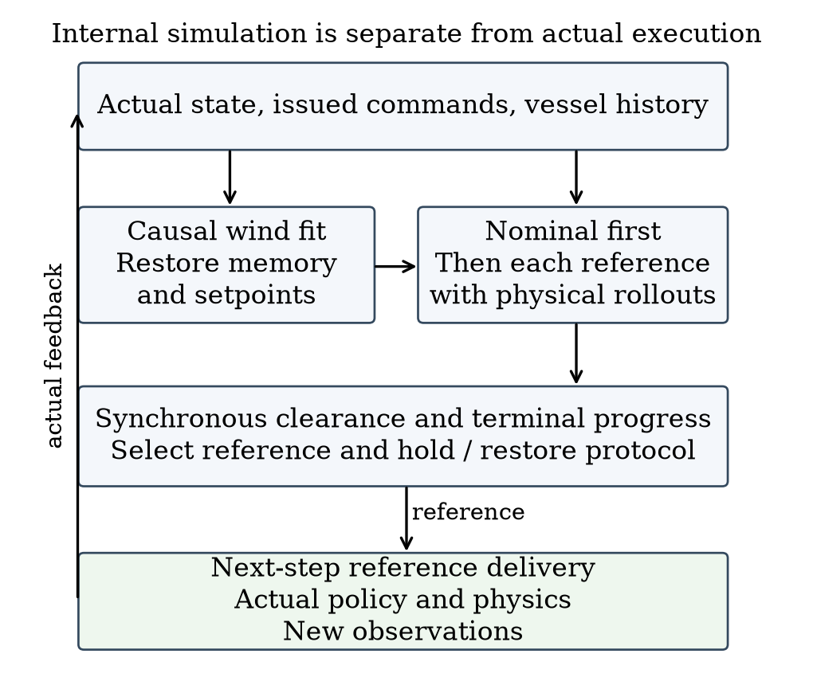
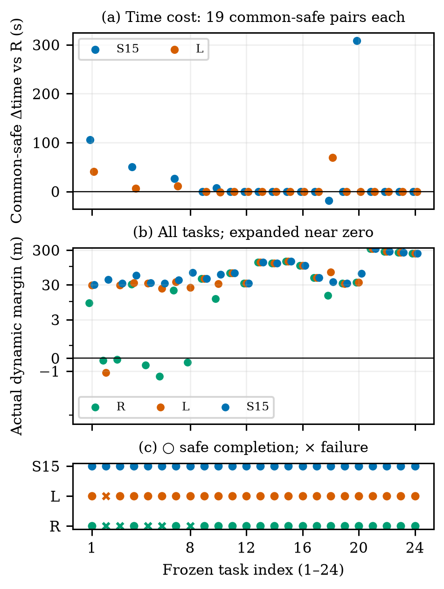
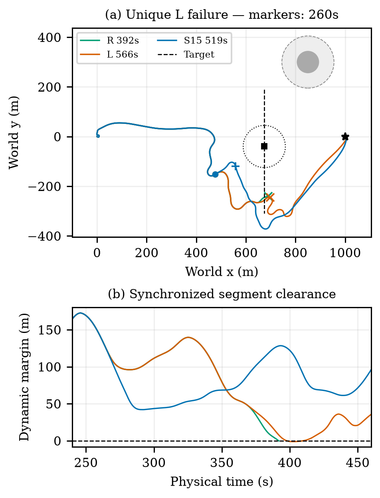
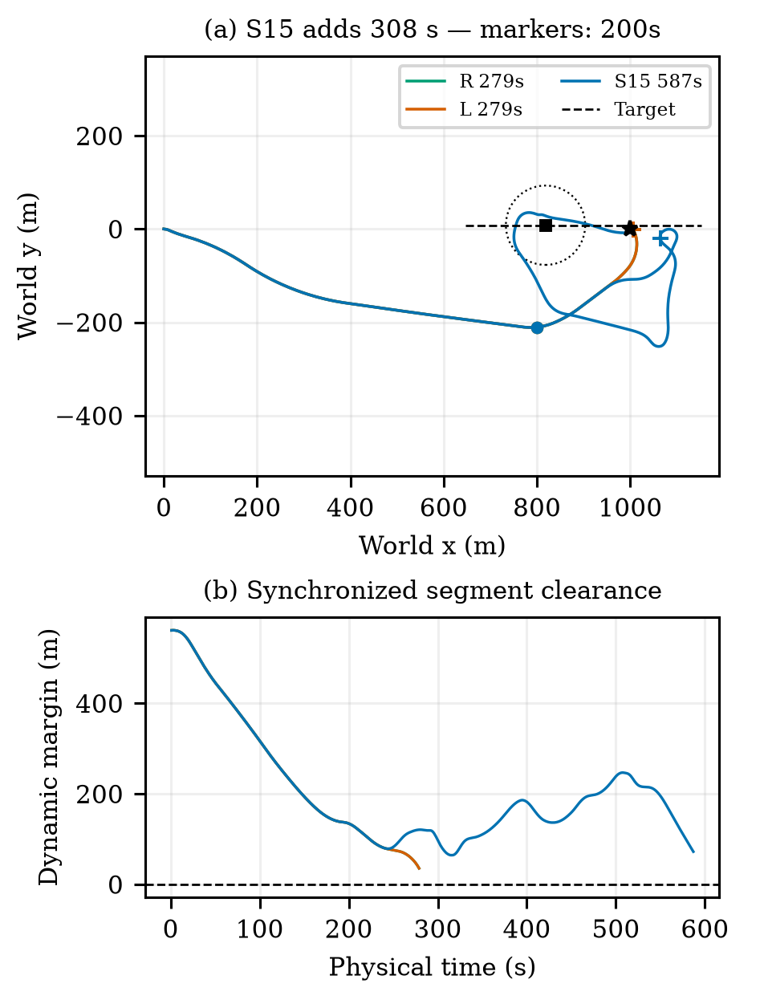
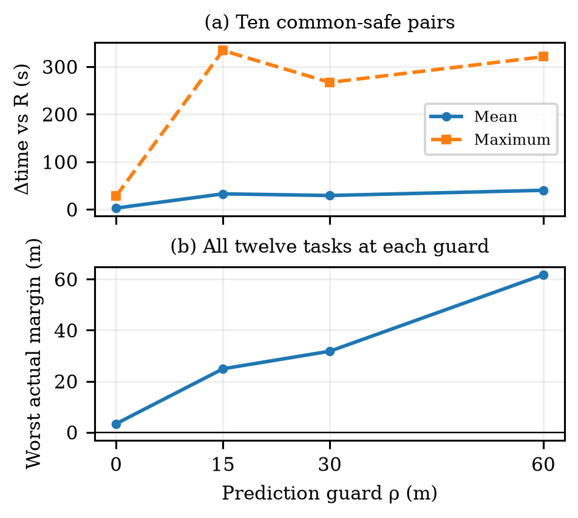
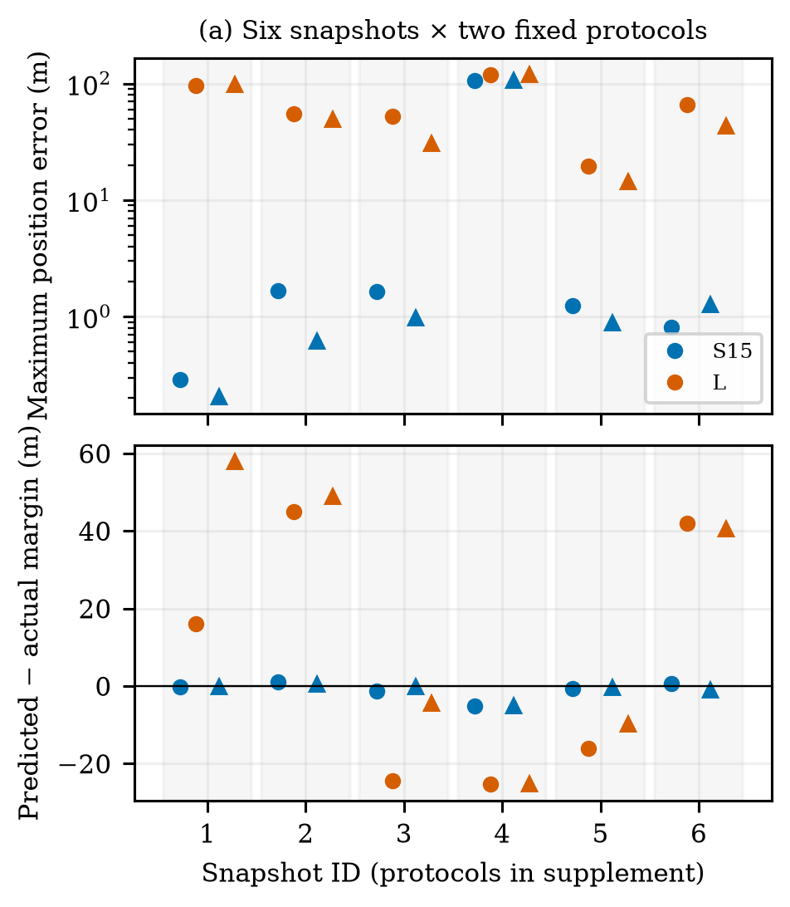

# 面向自主帆船动态避碰的位置参考条件化闭环预测

作者与单位待确认

> 中文阅读稿：对应 R13 第四轮复核的英文正文，供作者通读和修改。保留原文的公式、实验数据、图表及结论边界；参考文献沿用英文原条目。此译稿未单独送审，不替代英文定稿。图内英文标注保持原样。

## 摘要

即使本船到目标点的几何连线没有障碍，一个位置参考仍可能使帆船执行出不安全的航迹。本文研究一种高层监督器：在固定循环式帆船控制器的基础上，预测不同“目标参考—保持”协议的实际执行效果。监督器使用独立的策略和动力学实例，重建因果历史，根据船舶运动拟合局部风矢量，并在下一控制步下发参考之前，评估本船与障碍物的同时刻间距。选择机制优先检查常规参考，在其不能满足预测裕量门槛时考虑有限备选；该机制不提供安全证明。

在计算期间物理时钟暂停的理想计算条件下，历史实验既出现了避免安全缓冲区侵入的收益，也出现了不必要干预的代价。在一组预先冻结的24项任务中，反应式导航、经标定的低阶候选预测器和详细预测方法分别安全完成19、23和24项任务。详细预测比低阶对照多完成1项，但在两者共同安全完成的23项任务中，平均多耗时7秒，并需要显著更多的计算。固定协议核验支持其在所选局部状态中的预测精度优势，同时保留了一个106米预测误差的反例。预测裕量敏感性及积分器子步核验进一步说明了安全余量与代价的关系及数值证据边界。结果支持考虑控制执行过程的预测在特定条件下具有价值，但不支持普遍的效率优势或实时安全保证。

**关键词：** 自主帆船；参考条件化预测；动态避碰；循环控制；闭环仿真

## 一、引言与相关工作

航迹点规定了帆船控制器应当驶向哪里，却没有规定帆船实际将走出什么航迹。依赖风力的推进、有限的转向响应、执行器动力学和循环状态，都可能使实际运动偏离本船到目标点的连线。因此，在与移动船舶会遇时，一个几何上畅通的参考目标仍可能引发安全缓冲区侵入。高层监督需要比较的不只是参考位置，还包括保持参考和恢复反馈的规则。

帆船高层规划可以利用环境信息。例如，Silva Junior等使用Q-learning进行帆船路径规划[1]。本文关注规划之下的执行接口：静态地图完整已知，没有直接风观测，可以观测一艘低速目标船。广义速度障碍方法（GVO）评估控制作用所产生的运动，而不是假设期望速度能够立即实现[2]。参考调节器也通过修改输入到既有闭环中的指令来工作[3]。分支航向模型预测控制在执行机动的初始部分之前，先评价候选海上机动[6]。反馈运动预测则针对独轮车模型的参考调节，构造与控制器有关的运动包络[7]。这些工作为本文的接口设计提供依据，但其控制器假设和安全保证不能直接移植到循环式帆船策略。

本文将GVO的思想适配为有限的位置参考协议。在根据运动拟合的局部风条件下，独立的策略与动力学实例预测各个协议。MoWe[4]启发了从船舶运动获取风信息的思路，但本文采用的有界逆动力学拟合既不是对MoWe的复现，也不作为新的估计器提出。本文的贡献是一个具体的执行预测接口，以及对其适用范围作出限定的实验评价。实验比较详细预测与经标定的低阶候选预测，考察有限的预测裕量取值，并区分真实短前缀的一致性和固定协议下的预测质量。规划计算期间，物理时钟暂停。真实运动仍由帆船动力学和反馈控制产生；系统不获得完美航向跟踪能力，也不读取未来环境信息。

## 二、系统与评价条件

### 2.1 继承的动力学与局部策略

动力学实现和预训练资产由Chao Yang从Yang等相关研究的代码库中提供[9]，本研究已获准使用。实际评价的是一个18输入、带时间注意力的循环SAC策略，使用配套冻结的归一化器和确定性tanh动作。该资产不同于文献[9]报告的14维无风输入策略；本文不声称二者是同一检查点，也不声称复现了该文的基准成绩。Actor隐藏层大小为(256,256)，具有持续的循环状态和10个槽位的注意力历史。SAC算法本身见文献[5]。本文不训练策略。物理执行与预测使用相互独立的继承动力学实例；这隔离了执行和预测过程，但没有消除模型辨识误差这一问题。

实际实现的四自由度运动状态包含位置、横摇、航向、船体坐标系下的纵向和横向速度，以及横摇、艏摇角速度，另有实际帆角和舵角。参数包括质量25,900千克，以及170、1.17和8.7平方米的帆、舵和龙骨面积。文献[8]是原始建模来源；软件实现的相关研究来源[9]与其分开说明。尚未证明Python移植与原模型发布版本逐项等价。补充材料S9及S11—S12说明观测映射、归一化、代码和权重身份，以及获准提供复现材料的方式。内部复现包能够加载精确资产，并根据全部72条轨迹重建表1。当前18D检查点与原始训练运行的精确对应关系仍缺少记录。

生效参考点g定义一个刚性局部坐标系：角度θ为参考生效时本船指向参考点的方位角，坐标原点为g−500[cosθ,sinθ]。不进行尺度缩放，参考点在该坐标系中位于(500,0)米。策略前14项输入包括局部位置、横摇和局部航向、船体速度、角速度、实际帆舵角、两个进度差值和参考坐标。进度差值分别是前一步减当前的目标距离，以及前一步减当前的|500−x_local|，初始均为零。船体速度仍保持在船体坐标系中。另有两组障碍物距离和方位输入；距离编码为max(0,d−R+40米)，其中R为排除半径。编码距离在150米以内的障碍物按距离、方位排序，缺失项补零。

参考改变后，系统重新编码真实历史，并回放已下发指令，以重建循环状态。历史中的每项移动障碍输入均使用当时的观测，预测历史不会写入真实历史。动作先按10度缩放，再以保留符号的向下取整方式量化到1度增量，累加为执行器设定值；帆角设定值限制为±90度，舵角限制为±30度。实际角度每秒最多变化10度。自定义自适应Dormand–Prince积分器推进每个1秒控制区间。所有实际执行的对照方法使用相同执行器规则。

### 2.2 可用信息、时序与安全判据

在控制边界t，监督器接收观测到的物理状态、因果历史、已下发指令、完整静态圆形地图、当前参考及管理器状态，以及目标船的身份、时间戳、位置、对地速度和有效性。目标观测范围为1000米，实验不额外添加传感器噪声。预测器不能访问真实风场、环境随机数状态、场景种子或目标船未来运动计划。实际安全评价使用完整的目标真值。

局部策略先在t时刻根据当前生效参考计算动作，随后才执行规划。已经算出的动作推进t至t+1；如果参考改变，则在此后应用新参考并重新编码记忆。因此，新参考最早影响的物理区间是t+1至t+2。规划期间物理仿真时钟暂停。这里评价的是理想计算条件，而不是声称实现了实时系统。

动态排除距离为85米，由25米的合并实体代理尺度（本船10米、目标船15米）加60米缓冲构成。静态排除半径为障碍物实体半径加60米。设相对位移r₀=pₜ−qₜ，d=(pₜ₊₁−qₜ₊₁)−r₀，同时刻线段余量定义为：

$$
c_{j,t}=\|r_0+\alpha^*d\|-D_j,\qquad \alpha^*=\operatorname{clip}_{[0,1]}\!\left(-\frac{r_0^\top d}{\|d\|^2}\right)\quad(d\ne0).
$$

当d=0时取α*=0；代码以位移平方不超过10⁻¹²作为数值退化阈值。动态目标的Dⱼ=85米；静态障碍的Dⱼ为其实体半径加60米，q为固定圆心。实际任务最小余量m_real为所有真实障碍、所有已执行区间的cⱼ,ₜ最小值，失败任务也计入。这个计算对于同步的1秒线性相对运动是精确的，但不表示船体扫掠几何的精确安全性。

安全完成要求到达目标G的10米范围内、全程余量严格为正，且1/3/5千米任务分别在1800/5400/9000秒内结束。即使之后到达终点，只要侵入过缓冲区，任务仍判失败。NoRouteError只是退出原因，不是安全度量本身。

## 三、参考条件化预测方法

### 3.1 状态重建与参考协议

常规几何接力采用120米规划留量、500米前视距离、100米交接距离及80米几何余量触发条件。各对照共享临时终点管理机制：当终点被占用时，保留一个距离本船超过100米且仍畅通的当前临时目标，或者在以终点为中心、半径305米的圆周上考察8个点。候选点必须距本船至少200米、本船至候选点的线段畅通，且候选点处的余量至少为120米；按距离加80倍航向转角绝对值排序。终点重新可用时，清除临时目标并接回原任务。不存在可接受的临时参考时产生NoRouteError。

预测检查从10秒开始，要求存在距离严格小于600米的有效目标，且复查计时器已到期。当t<until时，非默认参考的保持优先。代表性配置为预测时域H=60秒、周期P=15秒、预测裕量门槛ρ=30米。预测分支需要物理状态、累计执行器设定值、循环及注意力状态、参考坐标系、管理器状态、真实历史，以及已经算出的动作。实现从零初始设定值出发，根据完整指令历史重建执行器设定值，并通过历史回放重建策略状态。系统断言重建后的当前动作与原动作相同。这是状态恢复一致性检查，不是未来预测精度的证明。

预测之前先调用真实的常规接力管理器，各候选获得其调用后状态的副本。真实保持期间不更新该管理器；释放保持时清除当前临时目标。这些细节影响分支恢复。独立预测器的时钟从零开始，而常规管理使用绝对任务时间。因此，执行快照规定的是预测所需信息，不代表复制了所有隐藏环境状态。



### 3.2 局部风拟合与候选展开

设z=(u,v,ωφ,ωψ)，f_z为继承动力学计算的相应导数。使用起始时刻为Iₜ={t−6,t−4,t−2}的三段状态转移，最新一段在t−1结束。拟合风矢量近似最小化以下残差目标：

$$
\mathcal L_t(w)=\sum_{i\in I_t}\|D e_i(w)\|^2,\qquad e_i(w)=f_z(\bar s_i,w)-\frac{z_{i+1}-z_i}{\Delta t}.
$$

中点状态s̄采用端点平均，航向使用最短角插值。用于本次导数评价的帆舵输入是两端观测角度的平均，并令区间内角度增量为零。D=diag(1,1,5,5)是在实际存储单位下使用的经验尺度，不是估计出的噪声协方差。有界局部最小二乘求解器逐分量搜索w∈[−16,16]²米/秒。首次拟合尝试初值(0,8)，以及6个模长为8、方向间隔60度的初值；后续拟合从前次估计热启动。每个初值的max_nfev=35，有限差分步长为10⁻³。历史不足时保留当前估计。系统不保证求得全局最小值，也不保证风矢量可辨识。

候选顺序为：常规反馈参考、可用时继续当前参考，以及距离当前位置350米、相对常规目标方位偏转−90、−45、+45和+90度的4个点。常规候选遵循正常接力更新；其他候选从选择时刻起保持P秒，然后清除当前临时目标并恢复常规反馈。因此，相同的初始参考坐标也可能产生不同航迹。预测尾段不模拟未来在线候选搜索。

所有候选在第一个区间使用同一个尚待执行的旧参考动作。分支内部将拟合风视为常量，目标位置按当前观测速度外推。预测策略及接力的观测保留1000米感知截断，但余量评分在整个时域内保留初始时有效的全部已观测目标，不引入尚未观测到的未来目标。分支在达到H、预测到达、路径失败或积分失败时停止。有效的提前到达可以接受，路径或积分失败不可接受。

### 3.3 常规参考优先选择与裕量门槛的含义

对候选协议γ，令Kγ为已经完成的1秒预测区间数，Oₜ为完整静态地图与当前观测列表中有效目标的并集。预测最小余量定义为：

$$
\hat m(\gamma)=\min_{j\in\mathcal O_t}\min_{0\le k<K_\gamma}\hat c_{j,k}(\gamma).
$$

每个ĉ都使用前述同步线段计算和对应障碍物的Dⱼ。H=60秒是预测展开上限；Kγ≤60，可能在预测到达或失败时提前结束，因此有效时域为Kγ秒。有效提前到达包含到达区间，但不保证此后持续占位的安全。对非空展开，空障碍集合Oₜ的最小余量取+∞。零步展开使用实现中的−10⁹米哨兵值，不能通过门槛。路径或积分失败的候选，无论记录的余量如何，都予以排除。

P=15秒是保持和复查周期；ρ=30米是加在不变的真实排除边界之外的额外预测裕量。令V为有效且积分成功的候选集合，F(ρ)={γ∈V:m̂(γ)≥ρ}，n表示常规候选，ι表示枚举顺序。原实现的终端偏好代价为：

$$
J(\gamma)=d_G(\gamma)+20\mathbf1_{\gamma\ne n}+10\mathbf1_{\gamma\in\mathrm{side}},\qquad d_G(\gamma)=\|\hat p^\gamma(K_\gamma)-G\|\quad[\mathrm m].
$$

常规候选可行时立即返回，不再比较其他候选。否则，若F非空，按(J,ι)排序；若F为空而V非空，则按(−m̂,J,ι)作字典序排序，即先最大化余量，再选择较小原始代价。若V为空，则有当前参考时继续保持，否则返回常规参考。候选生成之前的基础规划器失败仍可能终止执行。系统没有单独的侧向参考几何预筛，也没有经过安全证明的后备控制器。

常规候选被拒绝后，20米偏置对所有可行备选相同，因此不衡量该分支中“是否值得干预”。当退化选择包含常规候选且余量相同时，它仍可能影响排序。代码中保留该项。是否考虑备选由搜索触发条件和常规候选的裕量检查决定，终端代价用于排列这些备选。

```text
算法1：在1秒控制边界选择参考
1. 若t<until，返回正在保持的参考。
2. 调用常规管理；保持已到期时清除当前临时目标。
3. 若未到复查时刻，或没有严格位于600米内的目标，
   则释放已到期保持并返回常规参考。首次复查为10秒。
4. 将下一次复查设为t+P；拟合风并重建分支状态。
5. 预测常规候选。若有效、积分成功且满足ρ，选择它。
6. 否则预测继续当前参考及4个侧向协议。
7. 按门槛内代价、最大余量退化选择或当前参考退化选择。
8. 非常规选择设置until=t+P；选择常规参考则释放保持。
9. 已经算出的真实动作执行后，再应用改变的参考。
```

当t=until时允许复查，此时选择释放也要在下一步才生效。只有在预测轨迹固定时，增大ρ才必然缩小F；完整闭环的安全性和耗时不一定单调变化。对于相同协议γ、障碍集合O、半径和共同时间域T，定义M=m_real(γ;T,O)与M̂=m̂(γ;T,O)，分别为限制在该域内的实际和预测最小余量。二者不同于全任务指标m_real。由三角不等式可得：

$$
|M-\widehat M|\le E,\qquad M\ge\widehat M-E.
$$

其中E为时间域T及所比较障碍范围内，本船位置误差加目标位置误差的上确界；静态圆心的位置误差为零。如果已知E<ρ，则满足ρ的预测意味着实际余量为正。但本文没有这样的统一误差上界。经验最大误差和30米门槛均不能建立该保证。推导与退化选择的反例见补充材料。

## 四、匹配对照与实验设计

### 4.1 历史证据与定向修订

每项任务中，实际策略、归一化器、动力学、初始条件、地图、外部风参数、目标运动、执行时序及评价方式保持匹配。不同航迹可能遇到不同的局部风。反应式接力R采用常规反馈，不预测未来候选。Search15（S15）使用详细预测，P=15秒；Search60（S60）保持相同候选和H，但P=60秒。常规预测保持法NH预测常规候选；若其无效、积分失败或低于门槛，则在有当前参考时保持它，不评价其他候选。NH不是无预测基线，S60也不是不搜索候选的方法。

历史R8证据包含30项短任务（高压力交叉、普通交叉、追越、终点占用和非冲突各6项），以及4项长任务（3/5千米交叉与追越）。R10的13项机理场景与历史短任务有重叠，另行冻结了12项新任务。R12用旧任务标定和分析敏感性，再冻结24项确认任务，包括8项高压力任务及其余四类各4项，比较R、S15和简化预测器。所有生成任务及失败均保留。这些人工设计的场景比例不代表自然交通频率，各组证据不合并统计。

主比较的24项任务均为1千米。除终点任务的目标速度为0.8—1.0米/秒外，其余为0.65—0.95米/秒。高压力类同时改变会遇几何、基准风向（115—135度，而不是45—80度），并在(850,300)米处设置实体半径45米的静态圆障碍。因此，该类中的收益不能分离归因到某一个因素。各类生成范围见补充材料S10。这些场景对高层监督评价而言是新生成的，但不能保证它们与继承策略缺少记录的训练场景完全分离。

主实验中所有目标船都以世界坐标系下的恒定速度运动，没有预设转向，因此观测外推模型与实际目标运动形式匹配，尚未测试目标机动的鲁棒性。风场基准速度为8米/秒。历史短任务包含18项稳定风、6项慢变风和6项快变风；R10为6项稳定、6项快变；R12为12项稳定、12项快变。慢/快变风分别加入25/45度的时空方向波动、最高3/6度的扰动以及12%/20%的速度调制。准确场景清单随结果提供。共同安全任务的耗时和路径差值排除任一方法失败的配对；统计样本单位是任务，而不是预测窗口。

### 4.2 匹配的低阶候选预测器

对照L保留相同监督器、候选、H/P/ρ、代价、退化选择、终点管理和实际执行，仅替换预测器。其低阶状态为位置、对地航迹方向χ及其变化率r，使用因果的近期位置差初始化。预测时域内固定使用最近观测的对地速度v。对于当前生效参考的方位误差e，采用：

$$
\bar r_k=\operatorname{clip}(\kappa e_k,-r_{\max},r_{\max}),\quad r_{k+1}=r_k+(1-e^{-\Delta t/\tau})(\bar r_k-r_k),\quad \chi_{k+1}=\chi_k+\Delta t\,r_{k+1}.
$$

r和r̄分别是模型中的实际及期望航迹方向变化率，单位为弧度/秒；χ以弧度表示；κ的单位为秒⁻¹；τ为响应时间，单位为秒。Δt=1秒，eₖ=wrap(bearing(g−pₖ)−χₖ)，位置按速度v和方向χₖ+Δt·rₖ₊₁/2推进。当前艏向与对地航迹方向的差保留为固定偏置，用于复制出的接力管理器的航向输入；其10步速度窗口由预测位置重新计算。

新参考影响后续区间，初始区间与候选无关。与详细预测不同，L在第一步外推已观测运动，不评价待执行动作。L同时省略循环策略、执行器、风和速度动力学，因此它是整个预测器的替换，不能解释为只改变了常微分方程阶数。

参数在固定48点网格中选择：用7项已见任务标定，另用5项已见任务验证。目标对各任务在参考不变的15秒窗口内的平均位置误差等权。选定τ=8秒、κ=0.1秒⁻¹、r_max=0.16弧度/秒，在136/87个训练/验证窗口上的误差为2.749/2.694米。角速度上限是所测范围的上界，不是辨识出的物理极限。这种标定不能证明60秒预测或新侧向参考下的准确性。参数和24项新任务在观察结果前冻结。

### 4.3 预测裕量、预测质量与数值核验

12项预选旧任务包含3项高压力、3项终点、普通交叉/追越/非冲突各2项。在不改变真实安全判据的条件下，比较ρ∈{0,15,30,60}米。经过逐位一致的444步S15复现后，复用原30米结果；其他取值运行完整任务。这是敏感性分析，没有据此另选门槛。

既有详细预测日志提供了已选协议的实际执行前缀，直到下一次复查或预测/真实执行提前终止。完整15秒与截断窗口分开报告，重新规划后的尾段不纳入原预测误差。此外，从6个开发状态快照分别执行两种固定协议，持续至60秒或实际终止。只有完整物理前缀及已选协议前15秒精确复现原轨迹，才接受分支比较。预测器仅使用因果输入；只有离线真实分支推进实际外部风场。

对两个具有判别意义的米级侵入及对应安全S15结果，使用原积分器回放固定的已下发指令，并记录被接受的内部子步；要求端点保持精确一致。同步子步线段余量补充而不取代原1秒指标。实验硬件为AMD EPYC 7V12服务器，至多使用4个单线程CPU实验进程，不使用GPU。单次规划耗时与整个回合的CPU时间分开报告，不声称满足在线截止时间。

## 五、结果

### 5.1 24项匹配任务的主比较

表1包含全部24项预先指定的R12确认任务，没有按结果筛选。在R12评价时，这些任务尚未用于方法选择，各方法已冻结；本次修订复用其结果，不把事后分析重新称为新确认。“新增成功/新增失败”表示安全完成状态的配对变化。耗时差以两方法均安全完成为条件，不通过给失败分配人为时间来构造总体效率指标。

**表1　24项匹配结果。Δt为相对R、仅在共同安全任务上的耗时差；CPU为整个回合集合的累计CPU时间，不是航行时间。**

| 指标 | R | L | S15 |
| --- | --- | --- | --- |
| 安全完成数/24 | 19 | 23 | 24 |
| 相对R新增成功/新增失败 | — | 4/0 | 5/0 |
| 与R共同安全的任务数 | — | 19 | 19 |
| 平均Δt（秒） | — | +6.63 | +25.16 |
| Δt中位数（秒） | — | 0 | 0 |
| 最大Δt（秒） | — | +69 | +308 |
| 累计回合CPU时间（秒） | 270.68 | 378.44 | 2133.23 |

相对L，S15增加1项安全完成，没有新增失败。二者共同安全的23项任务中，S15−L的平均耗时差为+7秒，中位数为0，最大为+308秒。这是描述性的配对结果，不代表总体优势或统计上已确立的安全收益。R的5项失败和L的1项失败均为高压力交叉场景中的缓冲区侵入。L在其失败任务中最终到达终点，但仍判为不安全。S15和L都在11项任务中激活。高压力任务占比较高的设计不能用于估计自然交通中的发生频率。



### 5.2 一次决策分歧与一个不利案例

唯一的“L不安全而S15安全”任务是r12new_mixed_pressure_1。直到t=260秒，两方法记录的物理状态、参考历史和已下发指令完全相同。在该状态下，详细预测给出常规候选最小余量11.893米，低于ρ=30米；L则给出59.832米，直接返回常规候选。详细预测选择+90度候选，预测余量36.546米、代价509.528米；另一可行的−90度候选余量为70.147米、代价513.228米。所选目标为(627.068,163.231)米，常规目标为(575,−200)米。260秒完成选择，261秒下发，最早可能影响261—262秒物理区间。这是已经核验的同输入决策差异；L在常规候选通过后不再评价其他候选。



完整航程中，L在566秒到达，最小余量为−1.115米，出现在402秒；S15在519秒到达，最小余量42.096米，出现在291秒；R在392秒退出，余量为−0.162米。后续状态、干预和遭遇的风均不同。因此，不能将整段航程的结果完全归因于第一次换点，也不能根据后来重新规划的轨迹推断这次换点固定执行60秒的反事实效果。完整候选表及精确日志位置见补充材料。

新任务中最明显的耗时反例是r12new_endpoint_3：R和L均在279秒安全到达，S15却需要587秒。+308秒的代价保留在主表和图4中。有用的风险干预与不必要的干预必须同时评价。



历史R8中，S15避免了30项短任务中2项、4项长任务中1项反应式方法的失败。R10的12项独立新任务没有相对R增加安全完成，且包含+271秒的终点绕行；其13项已见机理任务与R8重叠。这些组在补充材料S6中分开，作为背景支持，不是表1的额外独立样本。S60仍搜索候选，NH仍预测常规参考，均不称为无预测基线。

### 5.3 预测裕量敏感性

表2给出同一组12项旧任务的4种门槛结果。30米在一致性核验后复用原结果，反应式方法安全完成10/12。门槛改变完整闭环决策，不改变真实排除边界。0/15/30/60米下的非常规选择总数分别为7、13、20、32；没有候选满足门槛而进入退化选择的次数为0、1、0、2。图5展示耗时尾部和最差实际余量。该实验没有辨识出最优门槛，也没有建立单调安全保证；原30米配置保持不变。

**表2　预测裕量敏感性。共同安全任务的Δt相对R计算，真实安全判据不变。**

| ρ（米） | 安全完成数/12 | 最差动态余量（米） | Δt中位数/最大值（秒） |
| --- | --- | --- | --- |
| 0 | 12 | 3.35 | 0.00/28.00 |
| 15 | 12 | 24.88 | 0.00/334.00 |
| 30 | 12 | 31.78 | 0.00/267.00 |
| 60 | 12 | 61.77 | 0.00/321.00 |



### 5.4 预测一致性、数值安全核验与计算代价

来自46项不同历史任务的1083个已选协议窗口中，1048个具有完整15秒前缀，35个提前截断。这些是按任务聚类的窗口，不是1083项独立任务。在进入、常规反馈、重新评价和释放四类阶段中，最大位置误差分别为1.039、30.506、2.090和0.626米。所比较的前缀中，没有出现预测余量为正而实际余量非正的情况；在这些短前缀中，也未出现预测达到30米而实际未达到门槛的情况。这一有限观察不能验证未执行候选或之后重新规划的尾段。

6个快照产生的12条固定真实分支，都精确复现完整物理前缀及已选协议前15秒。详细预测和真实分支在全部12条中共有完整60秒；加入L进行三方比较时，10条共有60秒，2条共有58秒，原因是L预测提前到达而真实分支继续。共同区间中，各分支最大位置误差的中位数为：详细预测1.104米，L为53.818米。L有3次常规预测达到30米门槛，而实际余量为17.868、23.384和16.430米。这是未达到额外预测门槛，不是侵入真实缓冲区。

另一方面，详细预测在一个终点快照中达到106.064米的位置误差；其常规与继续当前参考的航迹重合，不是两次独立失败。预测/实际最小余量仍为140.990/146.171米。图6同时保留局部精度优势与大误差反例。



在历史高压力快照t=149秒处，详细常规预测余量为17.706米，未通过30米门槛；选中的−90度侧向协议预测94.815米。两种协议固定执行后的实际余量为17.868/95.098米。低阶预测在同状态却以75.748米接受常规候选。这隔离出一个影响决策的预测差异，但不将整个后续航程归因到一个分支。该开发快照说明固定协议的局部精度，与图3—4中新确认的完整任务比较不同。

对唯一新差异案例增加的同指令核验保持每个1秒端点精确一致，R/L/S15的子步最小余量为−0.162/−1.117/42.094米，三者判定均保持。这是数值回放，不是3项新任务。历史积分器接受子步的核验也保持全部1秒端点精确一致；两个历史反应式侵入仍为−1.225和−0.872米。对应S15最小余量从1秒线段下的43.589/38.455米，变为接受子步线段下的43.597/38.425米，最大子步0.1秒。因此，这些具体收益标签不是仅由1秒连线的正负号错误造成。但它仍是圆形代理的数值检查，不是船体扫掠或严格连续安全证明。

在3个固定状态上，每模型测量9次估计/展开/选择核心，包含两种风险状态及一种普通反馈状态，各重复3次。详细预测墙钟时间的中位数/p95/最大值为17.009/17.662/17.685秒，L为0.067/0.136/0.136秒。计时不含最初的常规管理/候选构造和模型加载。常规候选提前返回可能造成不同候选评价数，因此这不是等工作量的单候选加速比。

新确认任务的整个回合累计CPU时间，R、S15、L分别为270.68、2133.23和378.44秒。这些指标包含的工作不同，不能互换。详细预测单次调用可能超过15秒复查周期，而本文此时仍暂停物理时钟。独立R9延迟执行失败属于边界证据，不与主方法成绩合并。

## 六、讨论与结论

本文通过明确参考、保持和反馈恢复协议，将控制作用所产生运动的预测适配到循环式帆船控制器。因果状态重建使候选预测与实际控制接口对应。主要选择机制是常规参考优先的门槛检查，再评价有限备选；20米项不是一般性的干预收益—代价权衡。

定向修订支持三个有限结论。第一，详细预测在所选固定协议上更准确，并在24项冻结任务中比经标定的低阶对照多完成1项安全任务。第二，该收益伴随计算与航行代价，其中包括308秒的不必要终点绕行；更简单的预测器仍是有竞争力的选择。第三，四种门槛改变了实际余量和耗时尾部，却没有确定最优取值。大预测误差和有限的尽力退化选择，使门槛不能被解释为安全保证。

评价使用继承动力学、无额外噪声的当前运动观测、完整静态地图，以及一艘不协同的低速匀速目标船。目标外推在这些测试中匹配实际运动；尚未证明对机动目标、更广泛模型失配、多船会遇和完整COLREGs规则的适用性。预测窗口与开发分支用于诊断，不是独立任务试验。规划期间物理时钟暂停，单次实测调用可能超过复查周期。实时部署需要单独验证“计算期间船舶继续运动”的指令交付协议。在这些边界内，本文提供了明确的参考执行接口、经过内部恢复核验的材料，以及有用避让与保守干预代价两方面的证据，而不是普遍改进的主张。

## 代码与模型可用性

经继承资产提供者同意，可应编辑和审稿人请求提供源代码、预训练权重、配套归一化器，以及复现所报告实验所需的配置和记录。补充材料S9及S11—S12标明具体版本和复现命令。这表示材料可以经许可提供，不表示精确18D资产已经公开发布。

## 致谢与作者待办

作者姓名、单位与资助仍待确认。AI工具辅助了写作、实现和内部证据审查；人类作者仍负责核验与披露。本研究包含仿真对照及离线检查，本次修订整理了这些证据，没有进行策略训练或实船实验。

## 参考文献

[1] A. G. da Silva Junior, D. H. dos Santos, A. P. F. de Negreiros, J. M. V. B. de Souza Silva, and L. M. G. Gonçalves, “High-level path planning for an autonomous sailboat robot using Q-learning,” Sensors, vol. 20, no. 6, Art. 1550, 2020, doi: 10.3390/s20061550.

[2] D. Wilkie, J. van den Berg, and D. Manocha, “Generalized velocity obstacles,” in Proc. IEEE/RSJ International Conference on Intelligent Robots and Systems, 2009, doi: 10.1109/IROS.2009.5354175.

[3] E. Garone, S. Di Cairano, and I. Kolmanovsky, “Reference and command governors for systems with constraints: A survey on theory and applications,” Automatica, vol. 75, pp. 306–328, 2017, doi: 10.1016/j.automatica.2016.08.013.

[4] Q. Sun, W. Qi, and H. Qian, “MoWe: Motion observation for wind estimation of sailing robots,” Journal of Field Robotics, vol. 42, no. 5, pp. 2355–2374, 2025, doi: 10.1002/rob.22512.

[5] T. Haarnoja, A. Zhou, P. Abbeel, and S. Levine, “Soft actor-critic: Off-policy maximum entropy deep reinforcement learning with a stochastic actor,” in Proc. 35th International Conference on Machine Learning, vol. 80, pp. 1861–1870, 2018.

[6] B.-O. H. Eriksen, M. Breivik, E. F. Wilthil, A. L. Flåten, and E. F. Brekke, “The branching-course model predictive control algorithm for maritime collision avoidance,” Journal of Field Robotics, vol. 36, no. 7, pp. 1222–1249, 2019, doi: 10.1002/rob.21900.

[7] A. İşleyen, N. van de Wouw, and Ö. Arslan, “Feedback motion prediction for safe unicycle robot navigation,” in Proc. IEEE/RSJ International Conference on Intelligent Robots and Systems, 2023, pp. 10511–10518, doi: 10.1109/IROS55552.2023.10341787.

[8] L. Xiao and J. Jouffroy, “Modeling and nonlinear heading control of sailing yachts,” IEEE Journal of Oceanic Engineering, vol. 39, no. 2, pp. 256–268, 2014, doi: 10.1109/JOE.2013.2247276.

[9] C. Yang, B. Guo, Y. Zhang, Y. Gu, Y. Li, S. Huang, H. Huang, J. Dong, and P. Li, “Learning to sail without wind information: reinforcement learning-based control for unmanned sailing vessels under partial observability,” Applied Ocean Research, vol. 175, Art. no. 105246, 2026, doi: 10.1016/j.apor.2026.105246.
