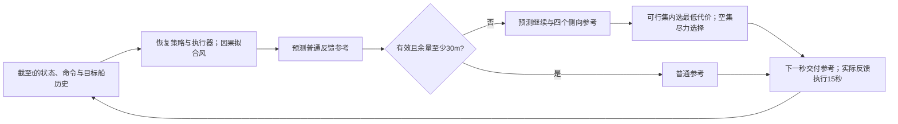

# R10：本篇方法与范围决策

2026-10-05。最终选择：**面向学习型帆船控制器的候选参考执行预测，用于理想计算条件下的局部动态避碰仿真**。不是默认延续最新 R9，也不把 R6 与 R8 的不同场景成绩拼成一个系统。

## 首页结论

**问题。** 在完整静态地图已知、没有直接风观测、低层接收位置目标的连续航行中，普通路线参考可能使实际帆船进入移动船舶的安全缓冲区。只判断几何连线或“预测有风险就保持原目标”，不能区分不同参考经低层反馈执行后的运动。

**假设。** 本船状态和已发动作可观测，目标船的位置、地速、身份及有效性有因果历史。预测采用已知帆船动力学、从过去运动拟合的恒定风及目标船恒速外推。实际本船通过原动力学和继承的 SAC-LSTM 执行。本文主结果暂停物理时钟完成规划，随后保持原下一秒参考交付时序；这是一项**非实时、理想计算仿真研究**，不是部署安全承诺。

**方法。** 采用 Wilkie、van den Berg、Manocha 的 Generalized Velocity Obstacles（GVO）中“控制输入诱导运动，再比较同一时刻相对距离”的思路。必要适配是把候选控制改成“位置参考＋保持时间＋恢复普通反馈”的协议，用同一学习控制器进行候选特异闭环预测。普通参考预测满足留量时不干预；不足时比较继续当前参考和四个侧向参考；执行一段后按新状态重新判断。采用既有 sampled15 作为冻结代表配置，保留 hold60 为有竞争力的同族方案，不声称15秒最优或必需。

**实际效果。** R10 的13个已见判别场景中，搜索安全完成13个，普通参考预测触发后简单保持完成9个，反应式对照完成11个。三个分歧的共同历史和普通参考预测逐值一致，其中149秒的决定改变了参考及后续真实航迹。冻结后的12个新实例中，搜索、hold60、反应式均完成12个，简单保持完成11个；搜索相对反应式平均慢27.08秒，最差慢271秒。新集**没有证明相对反应式的安全收益**。历史 R8 的两个途中缓冲侵入救回仍是有效但条件有限的证据。

**为什么选它。** 两项判别实验改变了选型：匹配障碍集合／排序的原始中心距离复制了静态边界输入的四个关键救回，因此不能以距离公式独立必要性为论文中心；动态候选选择则有同状态分歧、实际执行及简单对照的支持。论文价值是对已有方法的位置参考接口适配及其收益／代价边界，不是新网络、新定理或普遍性能领先。新确认中未获得反应式安全优势，故将中心限定为“有条件的参考选择作用”，而非“整体优于反应式导航”。

**下一阶段：证据整理与写作，不再自动开启方法搜索。** 已达到本篇有限方法和范围的定稿决策；尚不是完成可直接投稿的全文，也不代表真实 CCDC 审稿通过。若作者必须主张实时执行或新场景普遍优越，则现有证据不足，必须另行改变任务。

## 方法定义与继承关系

输入为当前本船状态、真实状态／命令历史、当前参考与管理状态、已知静态地图，以及目标船截至当前的观测。在线入口不接收场景种子、未来真风、未来目标动作或真实环境副本。输出为世界坐标位置参考；不把指向该参考的航向当作本船瞬时航迹。

在决策时刻 t，用同一过去历史恢复策略记忆、坐标系和执行器累积设定，首先复现当前动作。内部模型预测每个参考协议 u 对应的本船位置 p̂ᵤ(t+k)。目标船位置由当前位置与速度外推。候选最小余量为：

`m(u) = min_k { static_clearance(p̂ᵤ segment), min_j relative_segment_distance(p̂ᵤ, q̂ⱼ) − 85m }`。

此处 k 遍历60秒预测内实际完成的1秒段，使用同步相对线段最近距离。85m 为当前动态排除半径；静态排除半径为实体半径加60m。真实评价不增加或缩小这两个边界。预测可行条件是模型有效、积分成功且 `m(u) ≥ 30m`；30m 是开发配置的保守 guard，**不是误差上界或安全证明**。

候选包括普通反馈参考 nominal、当前参考 continue，以及相对普通参考方位−90°、−45°、+45°、+90°、距离350m的位置。非普通候选先保持15秒，再在预测余段恢复普通反馈。候选代价按实际代码为：

`J(u) = 预测终点到最终任务目标的距离 + 20·I[u≠nominal] + 10·I[u为侧向参考]`。

普通参考可行时直接选普通参考。否则在可行候选中取最小代价。若全部预测不可行，则在有效完整预测中先取最大余量、再取较低代价；无有效预测时回退当前参考。这个尽力选择分支不保证安全。

图为控制逻辑说明，未作为机制证据。普通参考没有15秒强制锁定；图中15秒保持仅适用于非普通参考。计算本身不推进主结果的物理时钟；参考在 t+1 生效，第一秒沿用已生成的低层动作，目标变化后按真实历史重编码。源码为 `src/sailboat_routing/r8_planner.py`、`r8_model.py`、`scripts/run_r8.py`。R10 未修改这些科学实现。

继承部分包括：SAC-LSTM 18D 权重与归一化、帆船动力学、连续历史接口、Relay120、边界障碍输入、公共临时终点不可用处理。R10 未训练模型；权重哈希及源码冻结见复现索引。边界输入是本系统条件，不列作第二个已证明独立的新贡献。公共终点处理公平用于所有动态对照，其恢复收益不冒充途中避碰收益。

参数来自已运行的 R8 配置；R10 在新确认前冻结，不用确认结果搜索参数。hold60 同样预测60秒，但保持／更新周期为60秒，并非不预测。R10 新集它与 sampled15 安全完成相同，累计CPU约328.77秒对777.05秒；sampled15 平均航时少9.25秒。这是计算／航行的有限权衡，不能宣布15秒支配60秒。

## 带真实数值的决定

已见 `r8new_mixed_pressure_2`，决策时刻149秒。候选搜索和简单保持的此前物理状态、动作和普通参考预测逐值相同；两个方法都采用同样 guard 和交付时序。

| 候选 | 世界坐标目标(m) | 预测最小余量(m) | 预测评分J(m) | guard筛选 |
|---|---|---:|---:|---|
| 普通反馈 nominal | (650, −175) | 17.706 | 409.587 | 不满足 |
| 继续参考15s | (650, −175) | 22.110 | 439.183 | 不满足 |
| 侧向−90° | (238.784, −324.617) | 94.815 | 521.172 | 可行且被选 |
| 侧向−45° | 见原始表 | 132.228 | 551.687 | 可行但代价更高 |
| 侧向+45° | 见原始表 | 8.350 | 436.774 | 不满足 |
| 侧向+90° | 见原始表 | 71.630 | 529.880 | 可行但代价更高 |

nominal 与 continue 的坐标相同，但预测中的保持／反馈协议不同，因此预测运动不同。普通预测的17.706m为正，不能写成“预测必然碰撞”；它只是低于额外30m guard。搜索150秒交付侧向参考，151秒出现物理状态差异；最终444秒安全完成，真实最小动态余量43.589m。简单保持224秒结束并侵入缓冲区，余量−0.649m。决策后首15秒（149–164秒，包含第一秒旧动作）的最大位置误差0.00684m；另核对150–165秒参考执行区间，最大值相同；不能把这个稳定风局部结果外推到60秒、变风或其他实例。证据：本轮 `dynamic_same_state.json`、`figure_data/committed_prefix_error.json` 及所列原始轨迹。

## 最强反例与本篇边界

- 冻结新集 `r10new_endpoint_0`：反应式313秒、余量10.957m；搜索584秒、余量34.687m。两者都安全，额外271秒不能记为安全成功增益。新集另一个压力场景搜索比反应式慢54秒，其余10场航时相同。
- 新集搜索仅在2/12场干预。没有干预的成功不能作为激活后避让机制的验证。简单保持在新 pressure0 侵入，而反应式也安全，说明该例更直接证明“触发后盲目保持可能有害”，并不证明必须干预。
- 历史 R9 增加5秒等待的 mixed3：预测余量82.692m，实际−0.949m，最大位置误差140.048m。它限制计算等待条件下的转用，不与理想计算成绩混写，不在没有分离试验时单因归于风估计。
- 不声称实体碰撞下降、任意风场鲁棒性、完整COLREGs、实船或实时安全保证。有限采样会漏掉其他可行参考；恒速目标与恒风预测均可能失配。

篇内尚未解决的是“何时干预值得其代价”。候选搜索优于盲目保持，不代表当前触发比继续反应式更好。作者最终保留意见被采纳；不能只谈部署时延而回避这个负结果。

本篇主方法保留候选执行预测及因果接口。静态距离编码判别放消融／选型附录；R9作为交付延迟边界。不会自动开启新网络、重训、任意时延补偿、多船交规、海试或新一轮阈值扫描。若新证据表明更简单规则同时复制关键救回并减小代价，再重开简化，而不是因版本更新重开。

方法来源：[Wilkie et al., Generalized Velocity Obstacles, IROS 2009，§IV](https://gamma.cs.unc.edu/NHRVO/WilkieIROS09.pdf)。保留控制诱导运动和同步距离思想；位置参考、继承策略记忆、实际动力学与保持后反馈是当前接口适配。没有移植原文的安全定理。CCDC来源访问层级和当前规则未核验项见研究报告及来源表。

