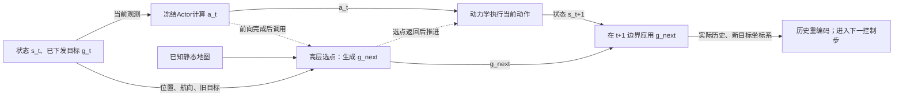

# R1：未知风场下冻结帆舵控制器的可执行航迹点选择

> 冻结评估、原始数据复算与最终结果review已完成。主方案65/72，锚点39/72，去留量39/72；宽候选额外价值和风/历史收益均未得到充分支持。

## 问题与结论范围

已知完整静态圆障碍地图，不使用天气预报或直接风传感器；冻结14D SAC-LSTM @7200的权重、归一化、物理模型及因果历史重编码。目标是高层选择低层能实际执行的局部目标，安全到达优先，效率在共同成功场景配对统计。当前资产不是论文final@9000，不作实船或其他checkpoint泛化保证。

R1采用用户新授权，独立于V0.2的固定25m试验。未改写历史预算或旧结果；4轮开发后冻结纯几何主方案。显式估风和运动历史补偿均保留负结果，未作为主方法贡献。

## 主方法：路线一致的留量与多尺度候选

实现：`src/sailboat_routing/r1_planner.py`，冻结代码`fa6fecd`。真实安全图始终为实体半径+场景缓冲区。规划图另外添加留量，**80m只是上限**：

`m = min(80, max(0, min(起点安全余量, 终点安全余量) - 5))`。

在复制的规划图上A*并做视线简化；若额外留量下无路，明确回到原安全图规划，仍要求候选航段满足原安全域。这种缩减/回退不保证实际航迹安全，也不是原地停车。无原图路径时按原接口结束失败；缓冲区侵入不会因后续恢复/停止而消失。

候选包括：合法旧目标、500m内可见路线转角及最终目标、以首个路线方向为中心的500/300/150m三圈候选（全周15°间隔）。所有候选需通过规划图航段检查，并能接回一处后续路线顶点。剩余地图长度为当前位置至候选长度，加候选连接该顶点的长度及后续路线长度，取可见连接中的最小值。

主方案总分为 `剩余地图长度 + 15×航向圆周角差绝对值 + 0.04×与旧目标距离`，分数越小越好。无额外风/历史评分。通常10秒重新规划、20秒保持、15分改点收益阈值；旧目标失效或当前航段余量过低时绕过保持。保持/改善阈值仅对仍通过本次候选筛选的旧目标生效；旧目标不在候选集或触发紧急条件时直接采用最优可行候选。精确条件见源码。中间目标近于40m触发更新，最终目标不受这个淘汰规则影响。

```text
每控制步接收当前位置、航向、当前已下发目标、已知地图终点
  若旧目标仍可用且未到重规划时刻：保持
  在可用空间内构造附加留量图，生成路线
  生成路线顶点与多尺度全周候选，逐个检验航段和接续
  按地图长度、转向、改点代价排序；应用保持和改善阈值
  返回目标，下一控制边界应用；物理、风场时间与低层历史连续
```

主方案控制时序如下。实线表示数据传递，虚线表示调用顺序；所有网络参数冻结，无训练梯度。风模式的旁路读出未画入此主方案图。



该图是代码时序示意，未声称图形渲染已验证；高层不能改变本步已经算出的动作。

高层未获得环境克隆、随机数状态、未来风或未访问区域真风。估计风诊断复用原270维旁路读出器；oracle只给当前本船局部真风，不是最优上界。正式高层主方法仅使用地图和当前运动状态。“几何”描述高层选点；冻结低层仍保留原因果历史，不是无记忆控制器。

## 开发路径与取舍

| 轮次 | 检验 | 完整结果 | 决定 |
|---|---|---|---|
| 1 | 扩展候选与一致规划留量；旧12场 | 40m为10/12；80m为12/12 | 保留80m进入多布局开发 |
| 2 | 旧12+新18，几何/历史/估计风/oracle | 30/30、26/30、26/30、25/30；原锚点新18场12/18 | 淘汰这两类信息评分作为主方法 |
| 3 | 12个连续3/5km开发场景；宽/窄候选、去留量 | 12/12、12/12、4/12；去留量7侵入+1超时 | 保留规划留量，继续检验简化 |
| 4 | 30短程窄候选，配对未改动的第2轮宽候选 | 29/30对30/30；长程共同成功12场窄候选平均慢151.5秒 | 主方法保留宽候选 |

旧V0.2 t=165快照下，扩展候选中36个满足至少25m实际安全域外的航段余量，支持原有限候选覆盖不足；这只是一项几何快照证据，闭环成功另由完整回合验证。

第一次review发现临近终点10–15m时丢弃终点候选的实现问题；Round1原始数据保留，修复后用于所有R1框架方法。该轮40/80比较不作为最终裕量优劣证据，未重跑修复版40m；80m不宣称最优，最终去留量消融只支持已固定80m上限与0m的比较。历史模块在启用前已消除候选集合/额外几何评分混杂，并按实际目标切换清空其独立运动估计窗（不清低层记忆）。历史贡献在零偏差时严格为零，候选集合相同。不能把这项实现纠错计成信息收益。

历史分支使用同目标下最近20秒位移相对目标方位的偏差，截断后半量补偿；风分支仍试验0.3权重的局部逆风惩罚。信息确实进入了执行：估计风改变了24/30场实际轨迹，历史补偿改变了29/30场；估计读出有效帧比例为96.5%–99.5%，783/816条已保存决策含非零风成本（非全时刻随机样本，保持分支可能沿用上次候选分数），证据见information_activation.json。有效帧比例仅表示通过读出有效性门槛，不代表新场景估计误差小。负结果只否定这两个具体启发式配置，不证明历史信息或风估计普遍无效。在第2轮新18场的12个共同成功样本中，主方案平均航时487.08s，原锚点401.58s：开发期安全提升伴有85.5s绕行代价。

开发第3轮的距离与布局存在循环索引耦合；保留原始开发数据，不用于独立归因距离效应。最终评估前修正为显式全交叉。开发生成器的相对基风方向按索引循环，最终改为独立抽样；因此最终测试是预先冻结的扩展覆盖评估，不是严格同分布留出集，开发/测试成功率之差不能单独解释为过拟合。开发新增种子为71/73，最终为271，实际划分以各批manifest为准。最终review发现两个元数据歧义：final.json的suite.purpose继承旧“V0 development set”描述，但外层冻结阶段、场景划分和时间戳共同记录其最终评估用途；生成器默认把非71种子标为frozen_test，后续复用必须显式核对用途。现有seed73的round3.json及development_long_scenarios.json均正确标为development。本轮没有因此混用划分，冻结清单和生成器不事后改写。窄候选同时将全周三尺度候选改为500m上的三个方向，路线顶点、终点和旧目标候选仍保留，检验的是**径向候选库整体简化**，不能仅归因于角度或距离之一。

## 冻结评估规则

新seed271生成72个实例：3距离(1/3/5km)×4布局(islands/channel/staggered/open)×3风况(stable/slow/fast)×2重复。目标方位随机[-65°,65°]，基风方向相对目标方位独立抽取六种60°间隔再加±12°扰动。是未参与开发的新地图/风实例，不是未见布局家族或真实天气测试。

所有72场运行原几何锚点、主方案、窄候选与去留量；另在同24个1km场运行估计风和oracle，合计336回合。风对照继承主方案候选/留量/切换规则。原锚点读取suite.planner_config，R1各变体读取job.config。相对原锚点的比较改变了路线使用、候选、评分与切换等一组因素；去留量/窄候选消融仅隔离同框架内相应因素，未隔离每个评分系数或切换阈值的贡献。各方法逐场共享种子、地图、风生成规则、10m终点半径；每公里1800s时限，坐标边界±(距离+1600)m，原点半径上限距离+2000m。长程保持约500m局部尺度，物理、风时钟、历史全过程连续。

主指标安全到达；先分实体碰撞/缓冲侵入，再列软件停止原因。换舷沿用实际航向与当前真风的离线判定（10°滞环、至少20°船艏运动，并区分风变造成的换边），是可复现启发式，不是因果操纵标签或目标切换次数。共同成功效率配对并公开场景ID/n；失败截断航时不作效率收益。按scene_id+variant核验完整manifest，无缺失、重复或额外回合才生成最终汇总。报告Wilson95区间、配对胜负和精确McNemar检验；小样本百分位bootstrap仅探索性，不凭其排除0或退化[0,0]宣称显著/等效。配对检验均未作多重比较校正，作为探索性统计报告；不凭某一个p值宣布普适方法优势。

规划计时沿用navigation.py：累计正常返回的逐步plan调用，不含正常初始化及最后抛异常的调用；其数值不是完整高层总成本。回合wall_seconds与已记录的cpu_seconds覆盖更广的回合执行，另列历史重编码开销；不据平均时间声称硬实时保证。原锚点在保持判断前也执行当前位置及候选的路径搜索（planner.py:261、292），R1允许未到重规划期且不紧急时提前返回；算时差异包含该执行顺序改变，不能仅归于候选数量。

## 最终结果

全部336回合已完成；72个场景的版本/清单、配对输入、连续时间、目标切换、航程和真实安全余量复算通过（final_integrity.json）。未删除失败、补挑种子或按最终得分调整方法。

| 方案 | 1km（各24场） | 3km（各24场） | 5km（各24场） | 合计 | Wilson95% |
|---|---:|---:|---:|---:|---:|
| 原几何锚点 | 16/24 | 15/24 | 8/24 | 39/72 | 42.7–65.2% |
| 冻结主方案geom80 | 23/24 | 23/24 | 19/24 | 65/72 | 81.3–95.2% |
| 窄候选 | 22/24 | 22/24 | 19/24 | 63/72 | 77.9–93.3% |
| 去留量 | 16/24 | 14/24 | 9/24 | 39/72 | 42.7–65.2% |
| 估计局部风 | 21/24 | 未运行 | 未运行 | 21/24 | 69.0–95.7% |
| 真实局部风 | 21/24 | 未运行 | 未运行 | 21/24 | 69.0–95.7% |

主方案90.3%的安全到达率只对应本套合成测试；5km为19/24，不能宣称已经解决长程安全。按布局（各18场），主方案/锚点在islands为18/5、staggered为15/5、channel为15/12、open为17/17；open中窄候选18/18。这些分层是描述性结果，不能外推为任意障碍或风况的保证。

| 方案 | 缓冲侵入 | 候选耗尽 | 超时 |
|---|---:|---:|---:|
| 原几何锚点 | 7 | 23 | 3 |
| 冻结主方案geom80 | 5 | 0 | 2 |
| 窄候选 | 9 | 0 | 0 |
| 去留量 | 30 | 0 | 3 |
| 估计局部风 | 1 | 0 | 2 |
| 真实局部风 | 1 | 0 | 2 |

未观察到实体碰撞或区域越界。主方案无候选耗尽不等于无执行失败；其5次侵入均随后以NoRouteError结束。风模式分母为24，其余为72。

| 对照→主方案 | 配对场景n | 主方案独有成功/独有失败 | 精确p | 共同成功n | 平均航时差（主−对照） | 平均航程差 |
|---|---:|---:|---:|---:|---:|---:|
| 原几何锚点→geom80 | 72 | 27/1 | 2.161e-07 | 38 | -3.89s | -7.87m |
| 去留量→geom80 | 72 | 27/1 | 2.161e-07 | 38 | +104.53s | +70.11m |
| 窄候选→geom80 | 72 | 5/3 | 0.7266 | 60 | +149.78s | +106.20m |
| 估计局部风→geom80 | 24 | 2/0 | 0.5 | 21 | -51.90s | -42.87m |
| 真实局部风→geom80 | 24 | 2/0 | 0.5 | 21 | -1.10s | -5.03m |

**最有力的组件证据是规划留量：** 同框架去留量从65/72降到39/72，侵入从5次增到30次；配对为27个正向、1个反向场景。这支持该固定配置下留量策略的经验作用，不证明80m最优、裕量越大越好或跟踪误差有界。原锚点对比支持整体规划适配，不能把其中全部收益归给单个组件。

**宽候选的额外价值未被确认：** 65/72对63/72的配对p=0.727；60个共同成功场景中宽候选反而慢149.78s、长106.20m，平均换舷4.42对2.73、改点17.23对12.85。保留预先冻结的geom80作研究参考，同时交付narrow可运行配置；不能据此证明两者安全等效，也不能把宽候选包装成必要贡献。

**当前信息分支未显示增益：** 同24个1km场景，主方案23/24，估计风/oracle均21/24，均0个新增成功、2个新增失败，精确p=0.5。各21个共同成功场景中，估计风平均慢51.90s、oracle慢1.10s。这不构成显著劣势或等效证明，只是不支持这两个具体风评分配置的额外到达收益；历史分支仅在开发集淘汰，未在最终集重新选择。

效率有明显距离差异，不能用总体平均掩盖：

| 距离 | 与锚点共同成功n | 锚点→主方案平均航时 | 平均航程差（主−锚点） |
|---|---:|---:|---:|
| 1km | 16 | 387.19→341.56s | -17.16m |
| 3km | 14 | 1460.14→1092.64s | -222.38m |
| 5km | 8 | 2112.25→2828.12s | +386.11m |

合并38个共同成功样本，主方案/锚点平均换舷3.71/3.82、改点12.55/6.18。5km中更多安全到达伴随共同成功航时增加715.88s，不能声称安全与效率同时普遍提升。共同成功集合因比较对象而变，场景ID和全部指标保存在analysis.json/report_pairs.json。

| 方案 | 全部回合平均墙钟 | 记录的规划时间 | 历史重编码时间 |
|---|---:|---:|---:|
| 原几何锚点 | 231.00s | 190.61s | 5.70s |
| 冻结主方案geom80 | 78.77s | 16.75s | 18.97s |
| 窄候选 | 49.86s | 9.17s | 6.91s |
| 去留量 | 79.04s | 27.93s | 16.09s |
| 估计局部风 | 16.57s | 0.23s | 1.53s |
| 真实局部风 | 14.88s | 0.19s | 1.18s |

该成本表包含失败回合、不同完成时刻和共享服务器影响，不是统一轨迹上的纯计算基准。每回合CPU时间另存episodes.csv。


航迹图按每距离首个“主方案成功、锚点失败”的场景ID选择（figure_selection.json），只说明具体行为，不代表平均场景。三例均为islands，是该明确选择规则的结果；主方案失败另见下节。

## 典型失败：几何可行性不等于下一步可执行性

按场景ID排序取主方案首个失败 `s271_010_staggered_fast_1000`，不把该例当失败占比。t=471时位置为(243.300,89.160)m，仍在真实安全域外；t=472第一次侵入，随后NoRouteError停止。证据为 `failure_example.json` 及对应final回合原始轨迹。

| t=471决策前/后对象 | 对原安全边界的最小余量 |
|---|---:|
| 船当前位置 | +0.0747m |
| 已执行旧目标(225,0)的连线 | −0.2898m |
| 新选目标(225,25)的连线 | +0.0733m |
| 实际471→472航迹段 | −0.3847m |

这次重规划的附加留量已缩至0，仍有40个候选。新目标在t=472边界应用，471→472动作已由旧目标产生。记录直接支持“接近安全边界才选择到新的几何合法目标，未避免下一步侵入”；不能据此证明切换延迟是唯一根因，也不能断言提前切换一定成功。旧目标航段在最后安全状态已不合法，不能写成该时刻旧航段仍安全。惯性、低层响应、此前路线与切换规则的各自因果贡献尚未分离。


全部7个主方案失败的终点距离、安全余量及窄候选结局见`main_failures.csv`。两个超时案例分别是无障碍3km的`s271_023`（5400s结束，剩余235.73m，34次改点）和5km交错障碍的`s271_034`（9000s结束，剩余1578.19m，105次改点）；窄候选分别在2778s/3716s到达，改点11/37次。两次主方案超时的最后300s到终点的距离仍分别减少了742.70m/602.76m，因此不能称为终态停滞或物理不可达。证据支持预设时限内推进不足，以及候选库设置与闭环效率的取舍；角度覆盖、径向长度及切换行为的具体贡献未被分离。

## 信息评分反例：同状态改点成立，闭环推进退化

` s271_003_open_stable_1000 `没有障碍。三组物理状态和动作逐值一致至t=21；在t=20，两个风模式首次选择新目标，t=21应用；几何主方案首次改点要到t=180。沿用原日志评分，并因history_gain=0仅扣除local_wind_penalty，可精确得到同候选、同状态的无风总分，无需重放物理或改变目标管理状态。

| t=20候选 | 距离 | 地图长度项 | 转向项 | 改点项 | 无风总分 | oracle风项 | oracle总分 |
|---|---:|---:|---:|---:|---:|---:|---:|
| 旧目标(260.153,149.400) | 316.863m | 1016.863 | 23.855 | 0 | 1040.718 | 94.549 | 1135.267 |
| 新目标(86.192,108.770) | 150m | 1022.604 | 19.450 | 7.146 | 1049.200 | 39.208 | 1088.407 |

无风时旧目标是全部候选的首选；oracle风项改变排序并形成46.860分改善，超过15分阈值，且20秒保持期已满。估计风也选该新目标，旧/新总分为1134.173/1086.584。源码风项为 `0.3×min(d,500)×max(0,cos(a−wind−π))²`；它是局部角度和长度惩罚，不是预计航时或冻结低层可达性模型。三尺度候选的风项覆盖不同局部长度，而地图项覆盖完整剩余路线；局部评价跨度与方向偏好是否混杂，是尚未做分离消融的解释。

几何方案611秒安全到达；估计风、oracle均在1800秒超时，最终距终点1504.55m、1472.44m，期间最接近也仍有995.87m。实际换舷计数为10、1、1。风项影响执行且oracle也退化，说明本例不能仅归咎读出误差；但目标距离、方向和低层响应的因果贡献尚未隔离，不能把换舷计数差直接写成唯一根因。证据/复现：`wind_failure_example.json`；运行同目录`wind_failure_details.py`仅读取已保存数据。

## 限制、参考与研究定位

安全余量使用1秒控制步轨迹线段近似，不是完整积分曲线或船体安全证明；规划留量不是控制误差界。合成圆障碍/合成风、单一冻结checkpoint、有限方位与风速设定限制外推。未训练低层或辅助模型，未做动态避碰/天气预报/实船迁移。

LOS漂移补偿已有基础：[Fossen与Lekkas作者版](https://www.fossen.biz/publications/2015%20Fossen%20and%20Lekkas%20IJACSP.pdf)使用特定运动/速度条件；本轮简单历史偏差启发式不等于其控制律或稳定性结论。[Risk-aware stochastic control of a sailboat](https://arxiv.org/abs/2309.13436)研究随机风与换舷的联合控制；本轮不实现其优化模型，也不声称留量/候选扩展具有算法首创性。参考只作问题定位，非完整新颖性审计。

## 证据与复现

主产物：`runs/r1_autoresearch_20261003T021913Z/`；完整授权user_prompt.md，plan.json与iterations.jsonl记录预算和4轮去留；round1–round4及final分别保存具体job、版本、逐回合配置/轨迹/评分、exit、汇总；final_protocol.json为结果前冻结规则，final.json为全部336个任务。原V0/V0.1/V0.2目录未覆盖。旧准入收据只用于核对未变的冻结特征/模型身份；R1规划改动由单独测试、版本和闭环证据支持，不冒充旧协议准入。

保存数据分析：`.venv/bin/python -B scripts/analyze_r1.py runs/r1_autoresearch_20261003T021913Z/final --plots`。原执行命令：`.venv/bin/python -B scripts/run_r1.py runs/r1_autoresearch_20261003T021913Z/final.json --workers 4`。已有目录拒绝覆盖；重现实验应在新的获授权run中复制具体manifest并设置相应输出路径和预算，不改旧run账本。

以下补充命令均只读取已保存实验、更新派生分析，不推进环境（从项目根目录运行）：

```sh
.venv/bin/python -B runs/r1_autoresearch_20261003T021913Z/verify_final.py
.venv/bin/python -B runs/r1_autoresearch_20261003T021913Z/failure_details.py
.venv/bin/python -B runs/r1_autoresearch_20261003T021913Z/wind_failure_details.py
.venv/bin/python -B runs/r1_autoresearch_20261003T021913Z/resource_summary.py
```

源代码、固定模型身份见final/provenance.json与identity.json；测试tests_frozen.log。ARIS共调用3次review：开发/冻结前2次gpt-6-astra/xhigh，最终result-to-claim一次gpt-6-astra/ultra。最终claim_supported=yes仅限本报告固定合成评估主张；均为同家族、provisional，不是外部独立证明。正式evidence_check.py及EXPERIMENT_AUDIT.json不可用，integrity_status=unavailable；项目自有复算单独报告，不冒充正式审计。完整请求与原始反馈见review-stage及对应.aris/traces，归纳见review-stage/CLAIMS_FROM_RESULTS.md。审查只用于发现问题，不作为科学成立门槛。

## 研究定位与下一步

本轮支持一个应用研究骨架：问题是冻结低层并非直线跟踪器，有限几何候选与实际航迹安全会脱节；方法是路线一致的规划留量及局部选点适配；证据是72个新实例的完整对照、0m消融、候选库简化和同框架风模式。收益已经在无额外高层风输入时成立，不能写成风读出贡献或新RL算法贡献。算法首创性、其他控制器/真实海况泛化均未经证明。

面向CCDC的暂定大纲：①问题与冻结控制协议；②路线/候选一致的规划留量；③开发与冻结测试设计及计算成本；④安全到达、失败类型、效率取舍与负结果；⑤适用边界。现有证据可以支撑该限定范围的报告，尚不能把宽候选必要性、80m最优性或风信息收益作为论文中心主张；不自动写完整论文或投稿。

只推荐一个下一轮判别实验：保持全周角度、留量、评分、切换和低层不变，将径向长度集合从{150,300,500}m改为{500}m，路线顶点/终点/旧目标仍保留。在开发分布上配对比较安全到达、侵入、共同成功航时和改点/换舷，检验窄候选的效率优势是否来自径向尺度，而非角度范围。该试验尚未实施，结果可反驳“多尺度有益”；后续最终测试须重新冻结新实例，不能再把本轮72场称为未见数据。

## 核验、资源与停止原因

冻结实现67项测试通过；分距离分析扩展的3项既有unittest通过，见tests_frozen.log与analysis_tests.log。final_integrity.json复算全部336条原始轨迹的航程及实体/缓冲余量，并核对连续时间、切换边界、配对输入及冻结清单/主规划器哈希。该项目自有检查不冒充正式独立实验审计，也不证明连续积分曲线安全。

4轮开发228回合，冻结评估336回合，共564个新完整回合；最多4个CPU工作进程、每进程单数值线程，GPU使用0小时。完整批次墙钟合计9980.35s，episode记录墙钟合计37267.45 worker-seconds；R3/R4/final共402回合记录CPU时间34458.03s，前两轮162回合无精确CPU时间字段，不能用墙钟冒充。总历时以resources.json的recorded_at/elapsed_seconds为准；LLM token及费用无法从现有接口读取，未填猜测值。

停止依据是本轮核心交付完成，不是review分数或预算耗尽；没有继续搜索测试集参数。所有旧V0/V0.1/V0.2结果、上游与低层资产保留，未push。
