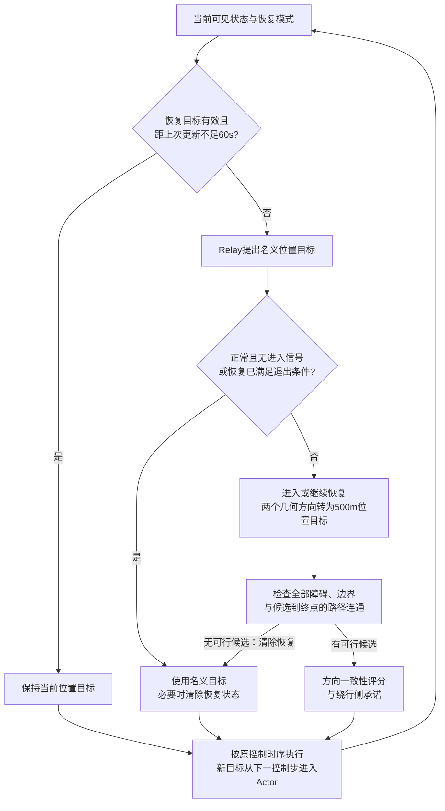

# R5中文方法说明：从恢复航向到固定SAC-LSTM位置目标

**结论：得到一个有来源、可运行、在预定义风险工况有初步收益的位置目标恢复候选；尚不足以替换默认Relay160，更没有证明优于Relay120的普遍长程效率。** 本轮采用Jambak等（2026）的恢复监督结构，主候选为90m恢复尺度、60s位置目标检查周期及90m退出阈值；科学实现和配置在新实例生成前冻结。

新36场风险任务中，主候选36场安全完成，Relay160为33、Relay120为32；相对160的3场新增完成原本都是超时，不是三次碰撞。新36场常规任务中，主候选与Relay160均34场安全，Relay120为35场。常规共同安全34场里，主候选比Relay120平均慢99.06s、中位慢15.5s；相对Relay160平均快30.38s，但中位为0、探索性区间跨0。风险共同安全33场相对Relay160平均快103.79s，中位仍为0。不能把不同任务族混成单一总体收益。

因此建议将它作为**文献适配与条件性应用验证的候选方案保留**，保留Relay120/160和简单固定位置对照，不新增模块包装结果，也不立即更换项目默认参考。风险完成差异只有3个不一致对（精确双侧p=0.25）；当前样本不支持普遍安全提升或等价结论。选题可以围绕可重复的接口适配与收益—代价收敛，但“全面更安全、更高效”这一主张不成立，未达到可直接投稿的确认状态。

问题是已知静态地图、未知风场下如何给固定低层更合适的目标并及时回接。采用Jambak等的两个恢复方向、方向对齐与绕行侧承诺结构；必要适配是有限位置目标、全地图可接续检查以及目标保持/退出时序。原文风投影和PD控制不接入。本轮形成可运行且来源明确的候选，不宣称完整复现WF-RS或新的安全理论。

## 方法来源与不能直接继承的部分

本轮主要采用 Ahmad Irham Jambak、Ismail Bayezit、Mahmut Reyhanoglu 的 **Obstacle Avoidance for Autonomous Sailing Sea Drones with No-Go-Zone Recovery**（Drones 10(8),578,2026，DOI:10.3390/drones10080578）中恢复监督器的几何与状态管理结构。出版社完整PDF和XML已取得并交叉核对，特别是第3、5节、式(13)/(15)和表2。不是从摘要补造算法，也不是完整复现其WF-RS控制系统。

原文在每个控制步输出航向，随后用自己的PD舵控与风相关帆角规则执行。本项目输出世界坐标位置目标，由固定SAC-LSTM产生帆舵动作。原文每步重新计算切线并承诺**侧别**，不等于保持一个世界坐标目标。帆船实际航迹也不等于所下发目标的连线。

| 原文位置 | 保留部分 | 本项目必要适配 | 不能继承的结论 | 实现位置 |
|---|---|---|---|---|
| 第3节式(3) | 圆障碍距离余量 h=距离−安全半径，单位m | 真实安全半径仍为实体外60m，不能改成原文8m | 原文完成率与安全裕量不可用于本任务 | `_entry` / `segment_circle_clearance` |
| 第5节式(13) | 两个膨胀圆切线方向；在规划圆内使用π/2 | 航向映射为有限位置目标；检查所有障碍、地图边界与候选到终点的连通性 | 几何切线不保证SAC-LSTM执行安全 | `tangent_headings`；`plan`候选与筛选 |
| 式(15)及随后文字 | 目标方向对齐度＋已承诺侧奖励；侧承诺时间与切换分差 | 原文未给b、Tc、Δσ数值，本项目显式选择并在配置记录 | 不声称逐值复现原作者控制器 | `plan`中的`alignment/bonus/incumbent` |
| 式(18)与进入/退出文字 | 正常/恢复模式、进入优先、最短恢复时间与退出迟滞 | 正常分支沿用Relay；relevance和退出几何谓词具体化为可执行条件 | 原文未完全定义这些判据，具体布尔实现属于本项目 | `plan`模式及`_entry`；原`RelayPlanner.plan` |
| 式(14)、风不可航区与TACK驻留管理 | 不接入 | 本项目没有可用直接风观测，不将真风投影伪装成合法能力 | 本方法不具有原文的风可航性机制；适配失败不能称原论文失败 | 无对应实现，明确省略 |
| 式(16)/(17) | 不接入 | 保持冻结SAC-LSTM、归一化、动力学和真实历史语义 | 不能移植原控制器响应性质 | 沿用原`navigation.py/runtime.py`调用固定Actor |

原文评分为 σ_k=ĥ_k·ĝ+b·I(k=k_commit)，目标对齐项权重为1，没有附加风险评分。侧承诺规则位于式(15)后的文字；式(16)实际为舵控公式。表2列出的10°侧切换迟滞与无量纲Δσ不是同一个数，原文没有提供两者转换。本轮不擅自作转换。

原文公开证据仓库不提供完整host runner/控制器源码，因此未知参数不能靠“源码复现”补齐。完整核查与未指定项见本轮literature/R5_WFRS_SOURCE_READOUT.md。本文公式和结构给原作者署名；程序为基于公开公式的独立接口实现，没有复制未获许可的控制器源码。

补充阅读了 İşleyen、van de Wouw、Arslan 的 *Feedback Motion Prediction for Safe Unicycle Robot Navigation*（IROS2023，作者版arXiv:2209.12648v3），核对其式(2)、(25)–(27)与稳定性条件。其解析预测区域绑定指定的前进单轮车反馈控制器，不能直接当作SAC-LSTM帆船的包络。本轮先验证切线监督接入，没有为形式相似而再加一个未经验证的预测模块。

来源：[出版社正文](https://www.mdpi.com/2504-446X/10/8/578)、[完整PDF](https://mdpi-res.com/d_attachment/drones/drones-10-00578/article_deploy/drones-10-00578.pdf)、[作者证据仓库](https://github.com/irhjambak/wf-rs-c2000-pil-evidence)、[补充作者版](https://arxiv.org/html/2209.12648v3)。

实现位置除特别标注外均指`src/sailboat_routing/r5_planner.py`：配置第15行、方向生成第28行、进入判据第46行、主流程第59行。科学实现冻结于`822817495ac9ddae06a2743a021b8aa0d160f2d7`，预览包提供对应源码快照。


## 方法及位置目标接口

这是 Jambak 等（2026）恢复监督器的部分结构适配，不是完整 WF-RS 复现。正式输入仅包括当前船位、当前目标、仿真时间、已知静态地图和终点；低层继续使用原 SAC-LSTM 及真实因果历史。高层没有风场查询、真实环境副本或未来状态。



图中省略初始化与原有异常终止。恢复退出的详细条件是：最短恢复时间已到、没有新的进入信号，且径向余量或名义航段余量恢复。判定在允许重新规划时执行，不是在保持期间额外偷换目标。

令船位为 $p$，第 $i$ 个障碍中心为 $c_i$，实体半径为 $r_i$。真实评价半径始终为 $R_{s,i}=r_i+60\,\mathrm m$。径向余量 $h_i=\|p-c_i\|-R_{s,i}$。额外切线留量 $b_\tau$ 只影响规划，不改变真实评价。

沿用原文式(13)：
\[
\theta_i=\operatorname{atan2}(c_{iy}-p_y,c_{ix}-p_x),\quad
\gamma_i=\arcsin\min\{1,(R_{s,i}+b_\tau)/\|c_i-p\|\},\quad
\psi_i^\pm=\theta_i\pm\gamma_i.
\]

转为位置目标是本项目适配：$q^\pm=p+L[\cos\psi_i^\pm,\sin\psi_i^\pm]^T$，$L=500\,\mathrm m$。这是给定目标的位置，不是对实际船迹的预测。当前点若在额外规划圆内，原文截断使 $\gamma=\pi/2$，此时几何上不存在该规划圆的真实切线，实际使用径向两侧的垂直方向；仍须通过原地图的航段检查。该条件不构成闭环安全证明。

每个候选必须满足：原地图边界内，当前位置到候选的线段避开全部真实安全圆，候选到终点仍存在原地图路径。未通过的候选不参与评分。保留原文式(15)的方向一致性及侧承诺奖励：
\[
\sigma_k=\hat h_k^T\hat g+b\,\mathbf1[k=k_{commit}].
\]
$\hat h_k$ 为候选单位方向；$\hat g$ 在本实现中指向 Relay 的名义位置目标，而非跳过已有地图路线直接指向终点。$b=0.05$，一致性权重为1。若当前绕行侧仍可行，在60 s承诺时间内不切换侧；之后另一侧评分须至少改善0.10。当前侧不可行时允许选择可行的另一侧。原文未给出这三个维度一致的数值，本实现将其列为工程选择，未宣称来源于原文表格中的10°迟滞。

正常状态使用原 Relay160。恢复状态重求名义目标时，向 Relay 传入空当前目标，避免把恢复目标当成名义接力点而撤销/固化错误管理状态。进入条件为某障碍与有限名义航段相关，且径向余量不足或名义航段被该安全圆阻挡。相关定义是障碍沿航段投影落在航段内且径向余量不超过500m，或已处于进入余量内。多障碍时选择径向余量最小者，但候选合法性仍检查全部障碍。

目标保持有效条件为：距离大于100m接力半径、不大于550m，且当前位置到该目标的线段仍安全。有效目标在更新周期内保持。越过接力区或线段失效时可以提前更新。每次允许更新后，若恢复已满60s、没有进入信号，且相对当前障碍的径向余量或名义航段最小余量达到退出阈值，则恢复结束，交还 Relay。没有可行切线时记录 `no_candidate` 并退回名义接力；这不是停车动作或安全保证。若原安全地图已经不可行，沿用原 NoRouteError 及失败判分。

所有提出目标遵守原时序：时刻t先用旧目标计算动作，然后管理器提出目标；该动作仍执行，新目标从t+1进入下一次Actor计算。初始目标在第一步前选定，单独标注，不伪称一次航行中的改点。没有修改低层重编码、帆舵限幅、风或动力学。

### 与 Relay 的具体衔接和触发边界

Relay160 的160m是附加规划留量上限，并非每次都使用160m。其实际留量为 `min(160, max(0, min(当前点余量,终点余量)-5))`；若该膨胀地图无路，则回退原安全地图。Relay120只改上限，其余相同。近障风险任务的初始名义目标可能很短，不能把“500m前视”误写为每个下发目标都距船500m。

本适配传入恢复监督器的是已经经过几何检查的 Relay 名义航段。因而原文“直接路线阻挡”与本实现不是相同的触发机会；当名义航段安全时，实际进入恢复主要由径向余量阈值决定。高层没有闭环风险预测器，也不把该阈值称为动态安全证书。原文相关性和退出谓词没有完整数学定义，本实现的有限航段相关性、全障碍筛选及状态机条件均属于明确的工程适配。

更新时间是整个恢复管理器的检查周期。目标有效时，周期内既不重算切线，也不重新判退出；目标失效/过近可以提前检查。因此30/60秒对照检验的是这一管理时序的整体作用，不能单独宣称证明了低层所需的纯响应时间。`hold_position=True`对照保持当前世界坐标目标，但仍每10秒检查退出；它也不是强行保持到终点。报告将这些可执行语义与参数名称分开说明。


恢复状态保存进入时的障碍索引；直到退出或无候选回退才清除，不自动换成另一障碍。其他障碍仍参与进入信号和候选筛选，因此可以阻止退出或排除候选；这不等于已验证多障碍连续交接的可靠性。


## 可执行流程摘要

```text
输入：当前位置p、当前目标q、时间t、完整静态地图M、终点g；恢复管理器状态S
若S有效且q满足距离和原地图航段检查，并且距上次更新不足60s：返回q
用Relay160取得名义目标q_nom（恢复中不把q当成Relay的原目标）
检查进入信号；按最短恢复时间、无进入信号及退出余量决定是否结束恢复
若正常且不需进入，或已结束恢复：返回q_nom
若新进入：保存活动障碍索引和进入时间
用式(13)生成两个方向，映射为距p为500m的世界坐标位置目标
按全部真实安全圆、边界和到终点连通性过滤
若无可行候选：记录no_candidate、清除恢复状态、返回q_nom
用式(15)及侧承诺条件选择目标；保存侧别、更新时间与位置目标
返回目标；原导航循环保持t已算出的动作，新目标t+1进入Actor
```

名义规划无路时，原运行器记录失败并结束；不存在未说明的停车或安全备选。初始目标在第一步前选定，不属于上述航行中的一拍延迟改点。实际源码及配置优先于伪代码；伪代码省略日志、浮点容差和继承的Relay内部A*步骤。


## 冻结参数及依据

| 参数 | 本轮主候选 | 依据与限制 |
|---|---:|---|
| Relay附加留量上限 |160m|继承R3强参考；有端点收缩及原图回退，不是误差界|
| 恢复位置目标距离L |500m|沿用既有局部目标尺度；原文航向接口没有该长度参数|
| 额外恢复圆留量b_tau |90m|开发工作假设：原文12m按60/8安全膨胀量比值放大；检验12/90，未证明比例规律或最优|
| 进入/退出余量 |90/90m|初试90/135；完整56场检验后取消额外45m空间退出要求，保留时间保持；仍有新增超时|
| 有效目标更新周期 |60s|比较10/30/60s及固定位置；R4已响应者代理18s中位、约55s p90仅用于候选时间量级，有删失，非响应上界|
| 最短恢复/绕行侧承诺 |60/60s|原文结构的工程数值；原文未给出完整数值，未独立证明每项必要|
| 绕行侧奖励/改侧分差 |0.05/0.10|维度为1，评分一致性权重1；不是把原表10°直接改写为0.10|
| 接力半径/目标距离上限 |100/550m|继承现有接口；可提前打断周期保持|

12m与90m尺度对照成组改变了恢复圆留量、进入和退出阈值，不能单独归因于额外圆半径；只有最后的退出135→90对照是单参数变化。原文尺度按60/8放大只提供有限开发候选，不构成物理相似律。

主方法没有135m空间迟滞：经过最短恢复时间且没有进入信号时，在本轮几何安全名义航段下即可退出。60s周期控制检查时刻，不能理解为任意目标都至少或恰好执行60s。当前航段失效、距离过远或进入接力区会提前重新规划。侧承诺保留侧符号，周期保持保留具体位置；两者不是同一状态。

## 一处真实决策：选择、保持和回接

此例是已见开发场景`s4271_004_islands_slow_1000`，用于解释机制，不用于估计新实例收益。1376s船位(544.912,215.754)m，原目标(650,275)m，距原目标120.638m。第二个障碍中心(652.639,23.552)m，实体半径70.701m；真实安全半径130.701m。船到中心220.333m，径向余量89.632m，触发90m进入条件。

额外恢复圆半径220.701m略大于当前距离，因此公式截断为gamma=90°。以下为实际日志候选，不是将不同轨迹同一时刻混作同状态复算。

| 侧 | 位置目标(m) | 方向一致性×1 | 承诺奖励 | 总分 | 原安全航段余量(m) | 筛选 |
|---|---|---:|---:|---:|---:|---|
|−1|(108.750,−28.710)|−0.999997|0|−0.999997|−17.858|航段被其他障碍安全圆阻挡；后续连通检查未执行|
|+1|(981.074,460.218)|+0.999997|0|+0.999997|89.632|通过全部障碍航段及终点连通检查|

因此选+1侧；1377s目标生效，1376s已计算的旧目标动作仍然执行。有效目标在周期内保持。1436s船到(663.727,251.509)m，已恢复60s，径向余量97.526m，名义航段余量93.620m，已无进入信号。主方法退出恢复，选择Relay名义目标(775,225)m，1437s生效。

仅将退出阈值设为135m的消融在相同前缀下拒绝退出。两组到1437s的完整记录相同，位置和物理动作在1438s首次不同。这是整回合配对及已记录前缀检查，不冒称另行保存并恢复了全部隐藏状态的分支。

完整结局：主方法1577s安全，最小真实余量81.420m；退出135m消融1800s超时。但原Relay1601499s就已安全，固定位置版1541s安全。因此本例支持修正适配器自身制造的超时，不是相对可靠基线的提效证据。另一个开发场景`s4271_009_channel_fast_1000`反向退化：主方法1800s超时，Relay160425s、固定位置493s、退出135m版本683s均安全；唯一退出参数配对在150s首次提出不同目标、151s应用，152s位置/动作开始不同。

逐值证据：`method_decision_example.json`、`development_case004.json`、`release_prefix_checks.json`和`exit_tradeoff_rows.json`，均在本轮RUN根目录。原始目标日志和完整物理轨迹路径随JSON记录。退出条件对其他完整任务是否有益，必须看冻结评估，不能只凭这一内部回归修复下结论。


## 实际作用与边界

新实例中主候选有50次恢复目标提案，48次使用规划圆内的径向垂直分支；38个航中实际恢复目标中36个使用该分支，另12个初始目标全部如此。故本轮主要验证的是原式截断恢复方向的位置接口，不能把结果统称为真实切线方向的有效性。

风险000中，初始余量78.149m，Relay的125m近目标最终超时，适配器以500m恢复目标开始、60s后接回Relay，509s安全完成。常规000则相反：Relay160532s安全，主候选三次入恢复后943s完成，最小安全余量还由48.853m降至35.428m。5km交错障碍034在621s进入恢复后仍于808s侵入，而Relay1201438s安全到达。新增能力、误干预代价与未解决失败同时存在。

完整场景/参数配对能够评价策略效果；本轮没有等长度非切线对照，不能把方向、500m长度和管理时序的联合变化单独归因于“切线”。最小证据缺口是该接口成分的隔离及更多独立工况，不是再增加一个复杂模块。本轮不实施追加实验。

完整分母、消融与反例见[R5研究报告](R5_RESEARCH_REPORT.md)。该经验方法没有实际船迹包络或安全证明；90m不是通用误差界，60s不是目标执行寿命保证。风险收益不能外推成自然场景的失败率变化，源论文的保证或实测数字不属于本项目结果。


## 复现、资源和交付

服务器项目根为`/home/ot/Students/hs/sailboat-routing-v0`，本轮RUN为`runs/r5_literature_20261004T080700Z`。配置在`configs/r5_methods.json`；完整原始证据索引为`RUN/raw_index.csv`（796新回合＋70条明确标注的旧参考），冻结评估索引为`RUN/final/raw_index.csv`。源码冻结、清单生成与核验分别见`freeze.json`、`scenario_generation.json`、`final_source_checks.json`。所有旧结果和R3英文稿保留。

```bash
cd /home/ot/Students/hs/sailboat-routing-v0
.venv/bin/python -B scripts/analyze_r5.py runs/r5_literature_20261004T080700Z --merge-development
.venv/bin/python -B scripts/analyze_r5.py runs/r5_literature_20261004T080700Z/final --audit --main tangent_exit90
.venv/bin/python -B scripts/plot_r5.py runs/r5_literature_20261004T080700Z --figure statistics
```

作图的其他选项为`trajectories`、`intervention`、`tradeoff`、`failure`、`development`。前五为关键图，最后为已见开发补充图。失败局部图是在新结果后为展示共同失败而增加，选例规则显式记录；没有更换原先的配对统计或主图规则。完整复现入口见`RUN/REPRODUCE.md`。物理复跑需新的清单stem、输出目录及授权预算；原运行器拒绝覆盖旧回合与超预算。统计/作图不推进环境。

六轮（五轮开发＋一次冻结评估），796个新物理回合全部结束；最多4个单线程CPU工作进程，GPU和低层训练均为0。至原始分析阶段耗时2.64小时，记录到的回合CPU累计9.11小时，不包括全部文献、分析、审查和交付开销；打包时点记录于`resources.json`，最终本地传输校验见包外`docs/R5_DELIVERY.json`，原12小时预算没有重置。

13项针对性实现/继承检查、432个最终回合的完整覆盖/原始安全与航程复算、配对输入、目标时序，以及冻结源码/配置身份检查通过。这些是本项目自身的确定性检查，不能称独立认证。ARIS的`evidence_check.py`未能在配置位置定位，正式独立完整性审计不可用；一次有限主张—结果—引用审查的实际状态与修正见`RUN/review-stage/`，不以分数判断研究成功。

本地`R5_METHOD_preview.zip`提供两份中文说明、五张关键PNG/SVG/PDF与开发补充图、逐点数据、离线`gallery.html`、配置、精确科学源码归档、当前离线作图工具和证据索引。轻量包不含全部大型控制日志、模型权重、环境和凭据。R3衔接建议另存`paper/ccdc/R5_METHOD_UPDATE.md`，不改原稿。源码通过服务器提交、本地fetch和冻结归档恢复，不覆盖旧本地工作树，不自动push。

一次有限ARIS核对已完成：`claim_supported=yes`仅适用于上述条件性、描述性结论，状态为same-family/provisional，正式独立完整性审计仍不可用。审阅复核了432行汇总并抽查16条完整原始轨迹；原始评语、范围和唯一统计单位修正收据见`review-stage/`。这不是普遍新增收益、安全保证或投稿充分性的认证。没有追加实验或再审循环。

本机Python3.11/NumPy1.24.3/Matplotlib3.7.1使用交付逐点数据成功重绘六张图，30处离线图集/报告图像链接有效；收据为`offline_redraw_receipt.json`和`offline_links_receipt.json`。重绘不运行物理模型，不宣称不同Matplotlib版本逐像素一致。
