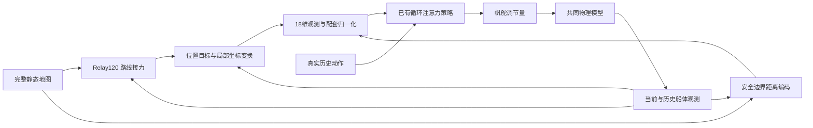

# R6 方法说明：已有时序控制器的连续航行接入与安全边界输入适配

> 已完成开发、冻结及新实例确认：主方案54/54安全完成，原Relay120为52/54、Relay160为51/54、R5为53/54；同18D中心／零输入对照均51/54。换用了已有控制器资产，没有训练新权重。开发仍有侵入，新实例也有航时退化；详细分母、消融与边界见 [R6_RESEARCH_REPORT.md](R6_RESEARCH_REPORT.md)。

## 1. 为什么改控制器接入，而不是继续调恢复阈值

研究问题是：在完整静态地图已知、没有直接风测量的条件下，如何把已有局部帆舵策略用于完整的 1/3/5 km 连续任务。策略会自行转向和换舷；高层给出的两点连线不是实际航迹。

R5 的一个无障碍 5 km 慢变风案例，六个高层方案全部 9000 s 超时。R6 在同一完整任务中，原接口仍超时；14D 训练对齐 10 步窗口在 2033 s 到达；已有 18D 接入版在 2015 s 到达。这说明接口或控制器资产改变能影响此前高层恢复未覆盖的失败，但不能据此断定原权重是唯一根因。

本轮改用已有 18D SAC-LSTM-Attention 控制器，配合原有简单 Relay120，并适配障碍距离输入。没有新增网络，没有更新权重，也没有叠加新的恢复监督器。72 个已见开发场景中，候选安全完成 71 场，原 Relay120/160 各 67 场；但风险任务出现一个原控制器没有的缓冲侵入，所以不宣称普遍更安全。选择依据包含完成数、失败类型和共同安全航时，而不只是一个成功率。

## 2. 采用了谁的什么方法

- SAC 的算法来源是 Haarnoja、Zhou、Abbeel、Levine（ICML 2018）。本轮复用已训练策略，不运行 SAC 更新。[官方论文记录](https://proceedings.mlr.press/v80/haarnoja18b.html)
- 帆船的循环编码、当前状态查询注意力和历史检查点来自师兄的上游代码与资产。内部材料《基于强化学习的无人帆船控制模型研究》署名杨潮；该材料按内部稿处理，不推断已经公开发表。R6 不把该网络或原训练工作写成本轮发明。内部稿的实验结果也不自动归属于当前检查点。
- 注意力代码使用标准缩放点积结构，公式与 Vaswani 等人的式 (1) 一致；当前帆船网络含 LSTM，不是一个完整 Transformer。[原文 §3.2.1](https://arxiv.org/html/1706.03762v7)
- 高层沿用项目 R2/R3 的简单路线接力：在有额外留量的地图上求路径，选可直视的前方位置目标，并保持目标。地图膨胀、A* 和目标保持均不作为新算法。

实际部署资产是 `checkpoints/obstacle_candidate/saclstm_s14obst_noise_0204_actor10800.pth` 及其同名前缀 normalizer。Actor SHA256 为 `6092d4543c003793f4cd3f21c5ed722f0978eebfdba2f62d77892af333085bd6`；归一化 SHA256 为 `3baf7d1d9d4c9e4505fc991f339221e9e0dc64e9777c6f1c568413a2846b63b6`。完整来源、文件身份和训练状态检查见 `docs/R6_ASSETS.json` 与运行目录 `literature/source_index.json`。模型编号不是本轮训练步数，也不据此推断与 14D 的训练预算相等。

## 3. 输入经过什么处理

图表示部署数据流。风场只通过物理运动影响可观测状态，没有真实风、未来状态或测试环境副本到策略的输入箭头。图省略了下一节说明的一步目标应用时序；不表示所有节点在同一时刻并行执行。

基础 14 维观测保留船体运动、帆舵状态、目标进度及位置目标信息。对每个当前目标 g，以航段方向为局部 x 轴，只作刚体坐标变换，使局部目标固定为 (500,0)。若方向角为 α，原点为 o=g−500(cosα,sinα)，位置编码为 R(−α)(p−o)，航向编码为 wrap(ψ−α)。没有缩放物理长度。旧归一化统计中目标两维方差为零，直接送入任意世界目标坐标并不等价。

另外四维是至多两个障碍的距离和相对船首方位。设第 i 个障碍中心为 c_i、实体半径为 r_i，当前真实评价边界半径为 R_i=r_i+60 m：

\[
 d_i^{eff}=\max\{0,\|p-c_i\|-R_i+40\},\qquad
 \beta_i=\operatorname{wrap}(\operatorname{atan2}(c_{iy}-p_y,c_{ix}-p_x)-\psi).
\]

从完整已知地图选取 d_eff≤150 m 的最近两个，按 d_eff 排序，不足两个用 (0,0) 补齐；追加 `[d1,beta1,d2,beta2]`，再用原 18D 归一化器处理。未修改归一化均值、方差或模型参数。零输入对照是在归一化前将原始障碍四维置零，不表示归一化后为零，也不是重新训练的无障碍网络。

40 m 来自原障碍环境的中心距离临界尺度，150 m 来自原输入截取范围。当前评价边界映射为 d_eff=40，而不是把实际安全缓冲缩小为 40 m。安全区域内 d_eff>40；输入截取等价于实际边界余量不超过 110 m。这个适配同时影响距离尺度、可见范围和近邻次序，是一个整体输入适配。它不是世界地图的刚体变换，不保留所有运动几何关系，也不携带原控制器的安全保证。

原 18D 环境先用 120° 视场发现障碍并保留已发现集合，再取附近障碍；这里使用完整地图。此信息分配在 R6 中合法，但不是原 18D 输入协议的逐值复现。没有向整个系统新增地图权限：地图在原高层已经可用。

## 4. 已有模型和连续接口如何运行

策略在 eval 模式运行，关闭原网络的 dropout。以 z_t 表示归一化观测，实际上一动作是 a_(t−1)。持续循环分支接收 `(z_(t−1), a_(t−1))`，先经 20→256 维全连接层与 ReLU，再更新 256 维 LSTM 状态并做 LayerNorm；当前观测另经 256 维全连接层得到查询。保留最近 10 个归一化 LSTM 输出作为注意力键和值：

\[
 c_t=\operatorname{softmax}(q_t K_t^T/\sqrt{256})V_t,\qquad
 a_t=\tanh\bigl(W_\mu\operatorname{ReLU}(W_f[c_t,\operatorname{FC}(z_t)]+b_f)+b_\mu\bigr),\quad a_t\in[-1,1]^2.
\]

q、K、V 都经过继承的可学习线性投影；输出头先由 final_fc 将拼接后的 512 维映射至 256 维并作 ReLU，再由 mu_layer 映射至两个动作均值并作 tanh。本轮没有更新这些参数。注意力读出窗口是 10，LSTM 本身仍持续递推，不能将它说成“只记住过去 10 秒”。初始 LSTM 的 h、c 均为零；首个循环输入对为 (z₀,0)。注意力队列初始填十个零输出，当前 LayerNorm 输出先入队再计算注意力，因此第一次注意力使用九个零输出和当前输出。输出经过共同的动作缩放、量化与物理约束，作用于帆舵调节，不能把输出当作实际航向或直线速度。

航中换目标时，把截至当前的真实观测重新表达在新坐标系中，按原时序重建循环状态。历史动作使用已经执行的真实归一化命令，不重新计算过去动作；进度特征由相邻真实位置在同一新坐标系中求差，避免把目标跳变当成物理前进。这里重建的是策略记忆，不是船体、风场或时间。

本轮最终方法选择保留共同协议：在 t 时刻按当前目标算动作，高层也读取 t 时刻可见状态；执行这个动作后，新目标在 t+1 边界生效。初始目标在第一个动作之前确定。R6 允许研究其他协议，保留这一协议是此次比较的选择，不是因果性的唯一合法形式。

## 5. 高层参数及依据

Relay 在原真实安全地图上检查当前点、航段和目标。当前目标有效、未接近中间目标、未触发几何风险时就保持；否则重新接入路线。额外规划留量的上限为 120 m，而非每处固定增加 120 m：

\[
 m=\min(120,\max(0,\min(C(p),C(g_{final}))-5)).
\]

C 是相对实体外 60 m 边界的点余量；没有障碍时不受端点余量限制。如果额外膨胀后无路，按原实现回退至真实安全地图。沿路线走至 500 m 前视范围，取可直视的最远已访问候选，不越过被遮挡拐点。中间目标 100 m 内接力；有效目标最大距离 550 m；航段几何风险阈值为 min(80,max(0,当前点安全余量−5)) m。未启用预测分支，也没有风评分、候选打分库或新增恢复阈值。

120/160 来自已有有竞争力的高层方案，本轮做小型交叉比较后选择 120；不称其最优留量或跟踪误差界。40/150 来自源输入语义；60、10 及任务时限属于保持不变的评价协议。

## 6. 一个同状态的真实决策

开发场景 `risk7371_000_c80_b-45_stable_1000`，t=0：船在 (0,0)，航向 1.749991 rad；障碍中心距离 204.297295 m，评价半径 126.148453 m，当前余量 78.148842 m。Relay 的有效附加留量被端点限制为 73.148842 m，路线是 `(0,0)→(100,75)→(1000,0)`，当前位置目标为 (100,75)。该目标由共同高层产生，R6 的主要变化发生在如何控制去往这个目标。

原中心距离超过 150 m，因此中心输入版和零输入版都填零。适配距离为 118.148842 m、相对方位 −2.457860 rad，因此主方案把该障碍送入低层。下表第一动作都基于同一个初始物理状态、目标及上述相同的初始化规则，不是拿分歧后的同一时刻冒充同状态。

| 控制器输入 | 第一个归一化帆调节命令 | 第一个归一化舵调节命令 | 完整任务 |
|---|---:|---:|---|
| 原 14D，Relay160 | −0.139103 | −0.394830 | 1800 s 超时 |
| 18D 中心距离，Relay160 | −0.862053 | −0.127435 | 527 s 安全到达 |
| 同一 18D，原始障碍四维置零，Relay160 | −0.862053 | −0.127435 | 527 s 安全到达 |
| 同一 18D，边界编码，Relay160 | −0.727856 | −0.534475 | 512 s 安全到达 |
| 主方案，边界编码，Relay120 | −0.727856 | −0.534475 | 512 s 安全到达 |

例子证明边界输入确实进入动作计算，也表明该场景多数收益在没有障碍输入时已经出现。不能把 1800→512 s 全部归因于边界编码，不能由此证明注意力比 LSTM 更好。后续轨迹反馈和高层换点构成完整闭环，15 s 差异是该输入处理下的整体任务差异。

证据：运行目录 `pilot_same_state_example.json` 及其中逐项原始路径；`adaptation/...obstacle18_boundary120/r2_decisions.json` 的第一个规划记录给出留量和路线。

## 7. 实现边界与复现

核心新增实现仅在 `src/sailboat_routing/r6_controller.py`；运行入口 `scripts/run_r6.py` 复用既有完整航行循环；方法配置 `configs/r6_methods.json`。科学冻结版本为 `f572dac20e3e8a13bda57ebac0c6bf2343d384f2`，具体源码及权重哈希见运行目录 `freeze.json`。报告的复现章节提供批量运行和离线分析命令。

全部船体状态、风场、时钟在一个任务内连续；没有分段 reset 拼接成绩。评价仍是实体外 60 m、最终 10 m 到达半径、1800/5400/9000 s 时限及一秒位置段安全检查。它不是连续积分的船体扫掠安全证明。计算时延另行测量，未注入物理仿真时钟；全历史重编码可超过一秒，因此当前方案只验证闭环仿真，不宣称已满足实时船载部署。

本轮没有训练新模型，原因是已有资产接入获得了值得确认的开发信号，而不是继续遵守旧冻结限制。训练路线保留为尚未检验的替代：现有 14D Actor/Critic 可做有记录的 warm start，但缺少完整优化器、目标网络、replay 和 RNG 状态，不能称精确断点续训。没有把少量更新或资源待确认写成训练无效。
