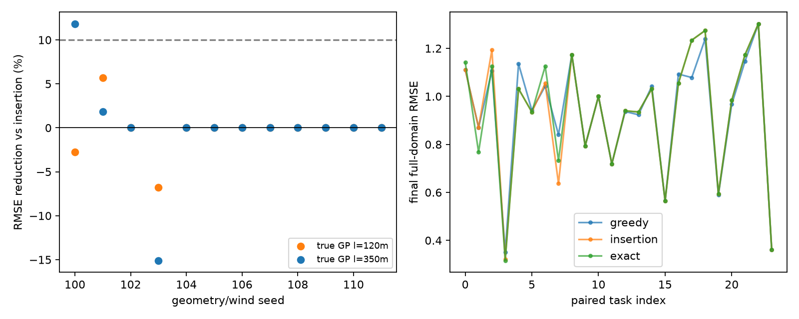
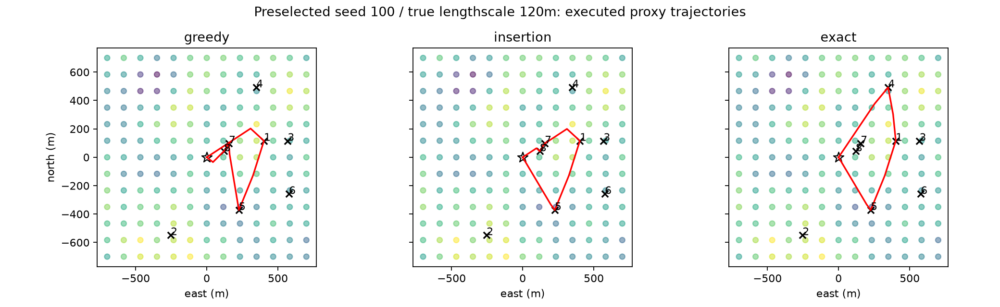

# I：期限返航信息采样 pilot — 停止复杂化

2026-10-08。本次为预先固定的开发筛选，不是独立确认集。**未选中此路线作为继续投入方向。** 在有限站点、静态已知风流、固定核 GP 的任务级代理中，强简单路线优化已经接近该路线族内的信息最优；更精确规划没有稳定改善实际场重构。

## 实际运行和结果

12个几何/风向/期限实例×2个真值相关尺度，共24个配对任务；3种方法得到72条任务结果。真值 GP 尺度为120m/350m，估计 GP 固定220m，两组均存在核错配。每个任务8个候选测点、共同初始home测量和共同逐站噪声。点传感只测经过且被选择的站，未访问值不进入后验或规划。

|方法|最终全域RMSE均值|后验积分方差均值|额外测点数均值|任务移动/机动代理耗时均值(s)|规划耗时均值(s)|按时返航|
|---|---:|---:|---:|---:|---:|---:|
|有向航时收益比 greedy|0.930466|0.717657|4.667|1471.877|0.001033|24/24|
|多起点 insertion + 有向2-opt|0.928846|0.696931|5.250|1496.761|0.391856|24/24|
|有限路线族穷举信息最优|0.929708|0.692789|5.250|1525.251|0.039941|24/24|

穷举相对 insertion 的逐任务 RMSE 相对改善：**中位0%，平均−0.2179%，3胜18平3负**。平均后验方差相对下降 **0.5873%**。18/24任务的选点结果相同（9/12几何），不是漏跑导致的平局。继续门要求中位改善≥10%、至少17/24胜、方差平均下降≥5%且不牺牲返航，未通过。

这里的方差最优不等于每个隐藏真值场的误差最优。seed103两种真值尺度都出现方差下降而真实误差上升，说明不能用规划目标替代最终观测质量。8站点使穷举足够便宜，当前实现甚至比多起点局部改进快；这不证明大图可扩展，也不构成研究收益。

## 图与解释边界



第一图使用实际程序输出的隐藏场重构误差。每个点为一个固定任务，不是示意数字。虚线是预先10%意义门，不是统计置信线。



第二图按运行前协议固定展示seed100、真实相关尺度120m，未选择赢家。红线是程序计算的任务级航时图路径；不是帆舵动力学实测轨迹。背景只用于评分和作图，规划器没有读取背景真值。

运动契约：航向相对迎风方向至少45°；有向速度由准稳态极图加固定流速得到，两航段形成换舷位移；所有航段终点误差检查<1e-7m。航向变化按8deg/s收费，跨风两侧另收5s，包含迎风换舷和顺风换舷，不专指迎风动作。**机动只加时间，不积分机动位移；无障碍、无执行器、无横摇/失速动态**。传感器按理想瞬时点测量处理，额外耗时0，不隐含船能悬停。穷举最优仅针对预选每对站点边路径组成的有限路线族，不是物理航行全局上界。

固定核 GP 的方差由测点位置决定，测值只影响重构均值。本次是航前信息采样设计，不是随测值内容改变决策的闭环自适应采样。此任务类别已有成熟方法，例如 [Ott/Kochenderfer/Boyd 的 ASPO](https://web.stanford.edu/~boyd/papers/ipp.html)；本次没有实现ASPO，也不宣称优于它。

## 修正、验证及资源

初次smoke由于 NumPy bool 写JSON失败，保存失败日志后修复。初版批次还遗漏规划计算占用期限；后置验证发现一个贴边任务加计算时间后会迟归。因此**旧批次的全按时结论无效**，原始结果移入 `archive_no_planning_latency/`。修正为所有方法在原总deadline内共同预留2s航前计算，允许航行预算减少2s，任务截止不变；在home尚未释放平台时计算，不假设海上停车。实测单次规划最高<0.71s；全部72行把实测路线搜索耗时加回后仍按时，最小余量5.674s。预留没有按方法分别放宽，种子、指标、真值核及继续门均未改变。计时仅覆盖 greedy/insertion/exact 路线搜索，不含共有的航时边与GP子集后验表预计算；因此这些数字不能证明完整在线管线满足2s期限。

最终运行与验证均真实退出0，见 `pilot_exit.txt`、`verify_exit.txt`。`results/receipt.json`含PID、起止时间、脚本哈希和全部数值线程为1的记录。最终批次墙钟约7秒（含输出绘图，准确值见receipt）；未用GPU，未安装包，未新开环境。所有服务器写入均在当前B2候选目录。

检查覆盖：72行唯一任务/方法键、无重复测点、轨迹时间单调、回home、点测量数匹配、全部256个测点子集后验方差为正且单调、均值计算只使用被测索引、隐藏真值/核改变不改变路线、含实测路线搜索延迟不超deadline。检查通过见 `results/verification.json`。这些检查不替代低层物理验证。

## 取舍

停止在这个代理上增加MCTS、RL或更长视野。该结果不否定所有风驱采样任务；它排除的是“静态已知航时、8站点、固定核信息设计仍需要复杂规划”的当前动机。只有独立应用需求引入新的信息条件，例如真实时变场或必须定位特定现象，才值得重新立题。不得因本轮无收益就扩大图、换种子或弱化insertion继续寻找赢家。

## 复现与完整索引

服务器目录：`/home/ot/Students/hs/sailboat-track-b/discovery_b2/candidates/return_sampling`。解释器只读复用既有V0环境。

```sh
cd /home/ot/Students/hs/sailboat-track-b/discovery_b2/candidates/return_sampling
OMP_NUM_THREADS=1 OPENBLAS_NUM_THREADS=1 MKL_NUM_THREADS=1 NUMEXPR_NUM_THREADS=1 CUDA_VISIBLE_DEVICES='' PYTHONDONTWRITEBYTECODE=1 TMPDIR="$PWD/cache" /home/ot/Students/hs/sailboat-routing-v0/.venv/bin/python pilot.py
OMP_NUM_THREADS=1 OPENBLAS_NUM_THREADS=1 MKL_NUM_THREADS=1 NUMEXPR_NUM_THREADS=1 CUDA_VISIBLE_DEVICES='' PYTHONDONTWRITEBYTECODE=1 /home/ot/Students/hs/sailboat-routing-v0/.venv/bin/python verify.py
```

运行前将已有 `results/`另存；上述命令会更新该目录。正式本次收据不得冒充未来复跑结果。

- `PILOT_PLAN.md`、`protocol.json`：运行前协议及计时契约修订。
- `pilot.py`、`verify.py`：完整原型和契约检查，无训练权重。
- `results/episodes.json`：全部72行结果及站点顺序。
- `results/trajectories.json`：全部任务级分段路径、时间和采样事件。
- `results/fields.json`：全部真值评分网格、站点、风流配置；只用于复核和绘图。
- `results/summary.json`、`verification.json`、`receipt.json`：成对统计、检查和运行证据。
- `results/paired_errors.png`、`trajectories.png`：两张实际代理运行图，已人工查看。
- `pilot.log`、`verify.log`、`smoke.log`及对应`*_exit.txt`：运行输出/退出证据。
- `smoke_serialization_failure.log`：首次序列化错误。
- `archive_no_planning_latency/`：撤销全按时结论的早期结果、日志和失败验证，保留避免混淆。
