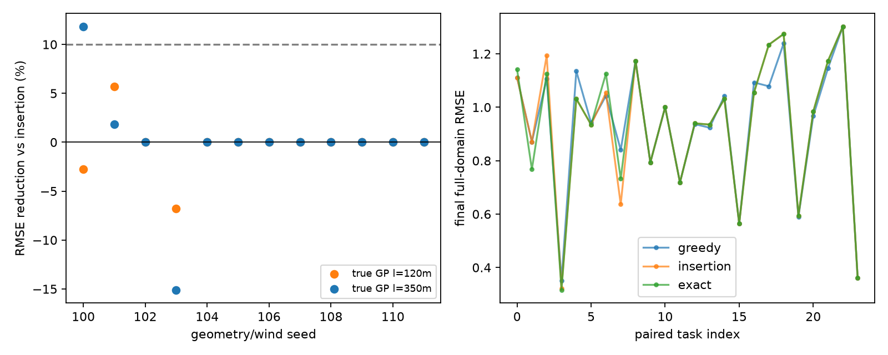
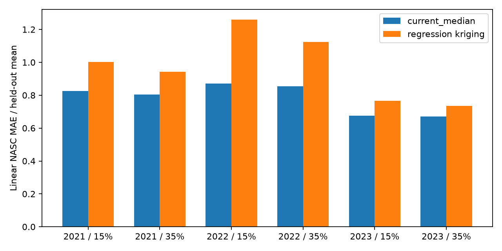

# B2 自主选题发现与实测筛选

状态：筛选完成，**尚未选中值得扩大投入的选题**。三个候选已完成有限实测，没有自动进入论文写作。第一题的指定指标接近上限；第二题相对强简单路线优化没有足够增量；第三题存在真实重构误差，但当前历史适配未产生足够改善。这三种原因不能混为“需求不存在”。
本轮独立于 A 与旧 B；原资产只读。共享预算、执行上限见 ../SHARED_BUDGET.json。

## Literature landscape

三个真实独立视角的初始原始意见为 ../notes/needs.md、literature.md、simple_physics.md。初始提交前未交换意见。应用记录提供了配对断面、漂移科学仪器、声学节能等需求；文献已有信息采样、覆盖规划、故障诊断与成熟航线控制。没有证据说这些成熟方法普遍无效。
阅读深度与源码证据分别记录在原始意见。RRTCV 的欧氏预算实现是代码事实，不能从中直接推断有向航时适配超越正确实现的成熟方法。An等2026覆盖论文已包含环境预测和MCTS；不将相同框架换名为创新。VAIMOS的最大帆开度接口提醒我们不能继承旧B任意有符号帆角的物理假设。

## Ranked ideas

下表是机械合并后的九个任务，非最终名次。只有 L2/P2 因任务相同合并；移动锋面与双艇漂移阵列任务分别保留。

|ID|具体任务|最强便宜适用对照|关键未决/便宜反证|状态|
|---|---|---|---|---|
|F|移动锋面反复横断|漂移估计+前瞻移动端点截获+可航路由|优化横断方向是否增加完整配对横断，而非几个点|实测停止：指标上限|
|I|有期限返航的风驱信息采样|有向航时返航约束+信息/时间贪心及简单路线优化|复杂视野是否有任务级剩余空间|实测停止：增量不足|
|T|帆船与调查船时间窗配对断面|滚动松弛度+局部搜索/小规模枚举|无真实联合进度时只能验证模型内调度|保留|
|D|漂移仪器双侧同步采样|移动坐标系+漂移前馈+可达几何|前馈已足够或物理不可达|保留|
|E|声学观测预算下代表性估计|随机相位等间隔/分层随机采样|是否有连续公开声学数据；适应性偏差|未pilot：校准/QC参考未就绪|
|C|有限回转/窄条带覆盖|优化扫描方向+可行连接+任务排序|成熟优化扫线已接近最优；近邻MCTS强|保留|
|N|故障与环境漂移区分|建模流/侧滑的EKF及残差观测器组|缺乏冗余下不可辨识|保留，诊断优先|
|H|阵风瞬态横倾约束|可达帆角查表+滚转PD卸载|动作物理与阈值依据不足|未实测|
|X|横流中测线完整性|积分LOS/地速偏流补偿|常规控制已解决，不能包装遗漏修复|未实测|

只以任务、机制和可验证性挑选pilot；非因未入选而宣布候选无效。初批无任务级信号时，在剩余预算内作一次实质换题。

## Novelty verification

独立初筛已完成：F PROCEED，I/E PROCEED WITH CAUTION，见 ../notes/selection_review.md。Pinto2022已给阈值跨锋算法，ASPO2024已支持有向带权图预算；不把两者换名当创新。该许可只是进入便宜pilot，不代表缺口或收益已证实。成熟方法直接有效允许采用。

## External critical review

/root/b2_selection_review（gpt-6-astra，xhigh）完成初筛及换题复核，见 [初筛](../notes/selection_review.md) 和 [换题复核](../notes/pivot_review.md)。/root/b2_evidence_review（gpt-6-astra，ultra）完成最终独立证据核验，见 [原始审查](../notes/critical_review.md)。这是实际不同子agent、同模型家族的 provisional 审查，不是会议审稿，也不以票数决定方向。

最终核验独立重算第三题 198 条评分，最大数值差 4.44e-16；核查当前中位数、历史趋势、历史残差更新和训练年份。作者已落实两点修订：I 的计时不含共有预计算；U 的 2km 距离门实际额外排除 0 组，不能称额外空间隔离带。审查支持本轮未选中，没有要求增加第四题或更多模型。

## Pilot evidence

首批已完成并停止，两批真实退出后才启动第三题。全部为探索性筛选，未自动做论文。

|任务|实际最强对照与检查|实际结果|取舍|
|---|---|---|---|
|F 平移直锋面|双阈值横断＋相对法向进度＋有限转向积分；对照与24箱绝对上限比较|18场15×24箱、3×23箱，平均23.833；理论剩余仅0.167箱|停止当前尺度复杂规划；未实现原复杂原型，不伪称双边比较|
|I 期限采样|有向航时多起点插入+2-opt，对照有限路线族穷举信息最优|24成对任务3胜18平3负；RMSE中位改善0%、均值−0.2179%；方差相对改善0.5873%；含实测路线搜索耗时均按时（不含共有预计算）|停止该代理题复杂化；不把方差增益当观测收益|

F证据 ../candidates/front_sampling/RESULT.md；首腿初始化计分已修正，最终18/18轨迹独立复算一致。F轨迹由有限转向运动学积分，极图/转速未船型标定，不能证明低层帆舵可执行。15分钟时间箱为预先筛选尺度，不是海洋科学通用指标。
I证据 ../candidates/return_sampling/RESULTS.md；原遗漏规划时间批次已撤销全按时结论并保留，所有方法统一从原期限内扣2s航前计算预留后重跑同族。有限边航时图收取机动时间但不积分机动位移，只用于任务级余量筛选，不是物理最优或闭环动力学成绩。24任务来自12几何×2真值核，不当24次独立海试。

## Substantive pivot

首批没有有用信号，因此从导航规划实质转向观测数据问题。原E声学占空比找到公开EK80，但小段raw仅11.03分钟，校准/QC尚未形成可评分连续材料；暂停原因不是‘没有公开数据’或‘缺解析库’。
新增第10个候选 U：少量当年声学观测更新历史模型，重构未用于更新的已观测空间组。背景来自Carlsen2024的海鸟觅食区声学调查，使用公开CC0 Sailbuoy 2019–2023数据；每行实际为7分钟积分段，不能把ReadMe的hourly mean粗描述当精确时间。自然对数恢复与坐标尺度已核查。
U为明确离线任务，允许共有CMSI后验产品，不宣称在线可用、能源节省、鱼类生物量或未观测海域总量。比较当前整体/分层均值与中位数、IDW、普通克里金，以及历史趋势、残差修正和成熟回归克里金（RK）。方法来源与数据边界见 [数据核对](../notes/pivot_data_options.md)，实际实现与结果见 [第三题完整报告](../candidates/acoustic_update/RESULTS.md)。不是完整复现原论文 sdmTMB，也没有声称发明 RK。

### 第三题的机制与协议

输入是 2019–2023 年真实 Sailbuoy 声学数据。4–6 月 30,329 个七分钟片段形成 3,324 个年/月/2km 空间组。先逐行 exp(log_NASC)，再求组均值，避免把几何平均误作线性声学指数。

2019→2020 用于开发选择，2021/2022/2023 分别作为目标年；每个目标年拥有完整更早年份。每年随机选 15% 或 35% 的 8km 空间块，三个固定掩码。每块内全部月份组可见，其余组用于评分。18 个任务汇总为六个年×预算单元；掩码是相关重抽样，不是独立海试。目标位置构成的有限支持集事先已知，不验证未观测海域外推。

历史法先给每组一个历史预测，再用当前可见组的预测残差作整体中位数校正。RK 则通过空间核预测残差。因此比较检验的是“历史先验及空间残差能否比当前简单统计更好地重构当年观测支持集”，而非帆船机动能力。主要指标 NMAE = 线性 NASC 平均绝对误差 / 同一测试集真值均值；均值偏差另报，不能替换主指标。

### 先修实现，再判断增量

部分文件传输期间启动的一次运行无效，保留为 invalid_transfer_race。完整输入首版原型确实失稳：多项式趋势在开发年 NMAE 已达 59.50，33.66% 的 log 预测触裁剪；2021 温度铰链项贡献达 67.51。不能据此判任务无效。

修复为有界线性趋势并加入历史分层中位数、历史 IDW，沿用任务、掩码、指标及继续条件。开发年选中历史月/深度中位数，开发 NMAE 降至 0.8784。最终比较选中 history_median 与 current_median。修复前已看过目标结果，因此修正版是探索性诊断，不能称独立确认。

|年份|历史更新改善，15%|历史更新改善，35%|RK 改善，15%|RK 改善，35%|
|---|---:|---:|---:|---:|
|2021|+0.004310|+0.000930|−0.177704|−0.138375|
|2022|−0.000241|+0.003076|−0.387638|−0.268822|
|2023|+0.005889|+0.005619|−0.089427|−0.062558|

改善均为 current_median NMAE 减方法 NMAE。预设继续条件为至少四格改善≥0.05、全部六格非负且均值偏差不恶化超过0.02；历史更新 0/6 达到0.05，一格负；RK 六格全负。RK 虽降低均值偏差，但未通过主指标。独立辅助有限支持均值估计中，GREG 平均绝对相对误差0.2119，样本均值0.1608，也没有支持扩大当前方法。

当前简单法 NMAE 仍为0.672–0.871，绝对相对均值偏差0.407–0.679。**不能说基线饱和或监测需求已经解决。** 数据存在昼夜、月份与空间覆盖不均，领域可接受误差阈值尚未确认。每个掩码消耗699–4,008个实际片段，合计81.55–467.60小时声学积分；15%块预算不是15%续航节省。

## 关键真实图

F为有限转向运动学代理的实际日志，不是实船或SAC帆舵动力学轨迹。

I为固定随机场与有限路线族的实测计算结果，不是24次独立海上任务。

U每柱汇总三个掩码，不以预测组数当独立任务数；完整逐组预测另存。

## 最终取舍与恢复入口

本轮覆盖十个候选任务，实际启动三个候选pilot。F以强基线对绝对上限的便宜筛选停止，未伪造复杂原型；I和U完成双边比较。首批无信号后已实质换到真实观测重构。未选中方向，因此不生成 FINAL_PROPOSAL，也不自动训练、扩样、写论文或修改A。

最值得保留的是三套可复用的可证伪筛选与明确边界，不是一项已经证明有效的新方法。若未来重新开启选题，U需要先确定监测任务真正关心的是局部绝对误差、平均指数还是高值事件，以及可接受误差和采样成本；本轮不把这些尚未成立的条件当继续授权或预期收益。

完整有效/失效记录、复现入口与哈希见 [RESULTS_INDEX](../RESULTS_INDEX.md)。所有实验 worker 已退出，GPU使用为0，无新增依赖。A和旧B不改动、不push。预算未耗尽不是继续无依据扩张的理由，三候选上限已经达到。

ARIS记录见 ../.aris/runs/b2-20261008.json。本轮遵循用户允许的“尚未选中”分支；refine 阶段标记 skipped，而非假造精炼方案。通用门禁要求所有五阶段均完成，会对这一分支给出 BLOCKED，实际输出保留；这不是科学结论被否定，也不将该门禁包装为全流程PASS。

## 一手来源与阅读边界

- [NOAA TPOS任务](https://www.pmel.noaa.gov/ocs/ocs-saildrone-mission-tpos-2024/) 与 [调查断面应用](https://www.fisheries.noaa.gov/science-blog/saildrones-survey-transects)：应用背景，不证明新算法缺口。
- [Branch 2018 原文](https://ai.jpl.nasa.gov/public/documents/papers/branch-planrob2018-front.pdf)：横断锋面方法来源；相关成熟阈值方法与Pinto2022核对见独立文献笔记。
- [ASPO官方论文入口与代码](https://web.stanford.edu/~boyd/papers/ipp.html)：已存在有向预算信息规划；I不是ASPO复现，也不主张超越它。
- [Carlsen等2024](https://doi.org/10.1016/j.ecoinf.2024.102852)、[作者代码](https://github.com/Astidac/Autonomous-data-sampling-for-high-resolution-spatiotemporal-fish-biomass-estimates)、[CC0数据](https://doi.org/10.5878/9m27-vg06)：核对原文方法与数据，不从摘要补造仪器时间。U新增稀疏更新任务属于本轮假设，不是原论文已证明的缺口。
- 各条来源的全文/方法段/摘要阅读层级与未核实项保存在 notes/ 原始意见；未宣称穷尽文献或证实新颖性。

<!-- ARIS_IDEA_DISCOVERY_EVIDENCE_GATE:START -->
## Evidence Gate
**Status:** BLOCKED

The workflow is not complete. Required stage evidence is missing:
- BLOCKED: research-refine-pipeline evidence missing (status=skipped)
<!-- ARIS_IDEA_DISCOVERY_EVIDENCE_GATE:END -->
