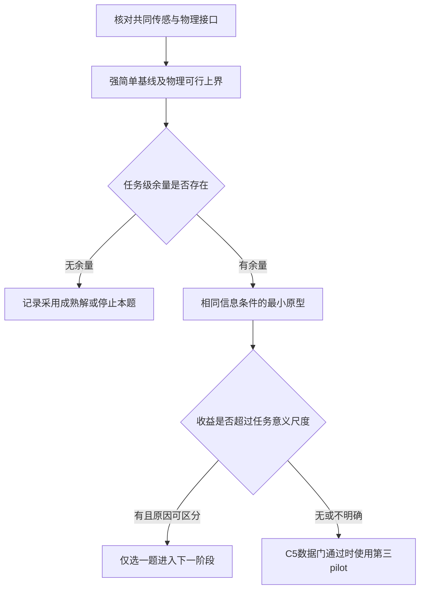

# B2 独立选题与查新筛选评审

日期：2026-10-08。评审 agent：`/root/b2_selection_review`。评审调用模型：`gpt-6-astra`。本文件由真实独立子 agent 阅读三个发现工作流后形成；初始发现不是本评审重新独立生成的。本评审未运行仿真、训练或数据处理实验，实验 worker 占用为 0，GPU 占用为 0。

已读 `RESEARCH_BRIEF.md`、`SHARED_BUDGET.json`、`notes/needs.md`、`notes/literature.md`、`notes/simple_physics.md`，并独立核查下列一手来源。采用本地 `novelty-check` 的判决边界：邻近工作不是淘汰理由；成熟方法可用于应用研究；只有具体论文已经包含同一拟议结果，才因重复给出 ABANDON。本次是选题初筛，不是穷尽查新、论文 Accept 或实验审核通过。

## 结论

建议先试 **C1：移动锋面的有效双侧横断采样** 和 **C2：期限返航下的信息采样**；保留 **C5：保持统计代表性的声学占空比调度** 作为真正换题。C1 的查新结论为 **PROCEED**，C2 和 C5 为 **PROCEED WITH CAUTION**。三者都没有已验证的强基线缺口，也没有本地实测收益。

本轮允许直接采用成熟方法作为最终方案。若 ASPO 或等价成熟求解器在有依据、可验证的应用条件下带来足够的采样收益，就可以继续该应用方向；不要求再造一个超过 ASPO 的增强版。下文把“方法结构已知”和“本应用条件下收益未验证”分开，查新判决不把前者自动当成后者失败。

我同意协调者的首批组合，但有三处实质修正：

1. C1 不能只比固定横断面或简单平移端点。已有实船双阈值穿越、历史交点估计方向的算法与公开代码，必须让成熟基线进入首轮。
2. C2 不能把“有向航时图＋预算返航＋滚动 orienteering”写成算法贡献。ASPO 已明确支持有向图和带权边预算；任务适配仍可以试，但必须报告成熟方法相对公平任务对照的实际收益和成本。
3. C5 已找到比泛海洋数据目录更具体的公开 EK80 原始数据、校准与 GPS 文件入口。它改变传感决策和统计估计，适合在前两题没有余量时换题；不应因为船舶控制代码复用较少而隐藏。

“coverage 可能被简单解饱和”目前只是合理威胁，不能记为已发生的结果。我暂不把 C6 排进前三，理由是缺少传感器足迹参数、已有非常直接的风流覆盖论文、且与前两题共享规划及运动学风险；不是因为覆盖研究已经无价值。

## 机械合并：9 个候选全部保留

只合并 `L2` 与 `P2` 的有限机动覆盖，其余问题的任务目标或可用信息不同。尤其 C1 与 C4 不合并：锋面位置可能必须由标量测量推断，而漂移仪器有独立位置通信。C6 与 C9 也不合并：区域覆盖决定去哪些测线，横流完整性决定能否取得规定测线。

下表的“需求已证实”仅表示来源中确实存在该任务；不表示当前团队能按时改进它。“缺口”均指相对正确实现的强合理方法。

| ID／原始卡 | 应用问题与首要指标 | 强简单解／成熟来源 | 需求与缺口证据 | 查新判决与本轮位置 |
|---|---|---|---|---|
| **C1／P1** | 风驱船反复取得移动温盐锋面两侧的有效配对横断；完整横断数、配对时差 | 双阈值触发＋历史交点方向估计＋漂移前馈＋共同可达航段；Pinto 2022、Fossum 2021 | NOAA 任务证实需求；“风速各向异性使成熟横断规则损失完整采样”**未证实** | **PROCEED**；第一 pilot。可验证的新结果是帆船可达性与横断时序的交互，不是发明锋面跟踪 |
| **C2／L1** | 固定回收期限内完成信息采样并返航；重构误差、迟归率／时长 | 有向航时＋返航可行集＋收益/航时贪心；多起点插入／局部交换；ASPO、RRTCV | 海洋 IPP 类任务有证据；具体回收期限尚属任务设定；强方法余量**未证实** | **PROCEED WITH CAUTION**；第二 pilot。薄弱处是具体回收约束和收益链尚未验证；采用已知优化形式本身不构成否决 |
| **C3／N1** | 帆船与调查船在时间窗内完成同一声学断面；有效配对长度 | 滚动松弛度调度、局部搜索、统一跳过／截断权限、小图枚举 | NOAA 现场记录支持时间窗及跳过操作；完整调查船计划／进度数据未取得；算法缺口**未证实** | **PROCEED WITH CAUTION**；保留。薄弱处是目前无法区分有用的鲁棒调度和人为制造的时间窗困难 |
| **C4／N2** | 漂移仪器两侧保持采样几何；有效双侧长度、梯度估计误差 | 移动坐标系固定几何＋漂移前馈＋LOS＋可达性投影；多平台时序协调已有先例 | NOAA WireWalker 任务已证实；仪器轨迹／目标间距未核验；缺口**未证实** | **PROCEED**；本轮暂缓。可以研究，但两船、通信和未知标量场同时增加因果归因成本 |
| **C5／N3** | 受限声学开启预算下保留断面均值／积分估计；误差与区间覆盖 | 随机相位等间隔、分层随机、两阶段方差分配、正确抽样估计；简单触发器 | 论文有实际降占空比依据；本评审核实具体 raw 数据入口；完整连续期及 QC 尚未通过；缺口**未证实** | **PROCEED WITH CAUTION**；真正换题／第三 pilot 预留。薄弱处是数据处理和自适应抽样偏差，而非控制创新不够 |
| **C6／L2+P2** | 有限转向和窄条带下完成区域覆盖；达到覆盖率所需时间、漏测面积 | 扫描方向／起点优化＋可行连接＋剩余条带重排＋2-opt；An 2026 MCTS | 任务类成立；具体传感足迹未知；转向尺度缺口及简单解饱和均**未证实** | **PROCEED WITH CAUTION**；暂不占前三。薄弱处是尺度差异尚无现实参数支撑 |
| **C7／L3** | 弱冗余导航系统区分传感故障与流／侧滑；固定误报下延迟和故障后任务误差 | 正确扰动模型的 EKF＋创新门限、残差观测器组；Asfihani 2024、Dhyani 2026 | 诊断方法已有；本船传感故障样本未核验；部分辨识性风险有理论依据，但具体可辨识条件**未证实** | **PROCEED WITH CAUTION**；先做观测等价反例，暂不闭环。薄弱处是无独立锚点时某些偏置根本不可辨 |
| **C8／P3** | 阵风下限制横倾且维持测线进度；超限时间／峰值、有效进度 | 可达帆开度查表＋横倾/角速度 PD 卸载＋滞回；约束 NMPC | 稳态／受约束修帆已有来源；本船真实安全阈值、帆索速率／软帆可达性未知；瞬态缺口**未证实** | **PROCEED WITH CAUTION**；暂缓。薄弱处是潜在收益可能来自虚构执行器 |
| **C9／P4** | 横流中取得规定重复测线；完整横断获得率 | 积分 LOS／慢偏流估计＋可航航向投影＋换舷滞回；VAIMOS 与后续航迹工作 | 测线跟踪已有实船基础；“合理可达条件下强解仍漏测”**未证实** | **PROCEED WITH CAUTION**；优先当基础设施。薄弱处是目前差异可能只来自补上普通积分补偿 |

没有候选整体被判 **ABANDON**。这不是保留所有方向继续投入：只给两题首轮计算预算，其他项是可追溯的未选候选。以下宽泛“首次”表述应直接撤回，因为已有具体论文：首次用阈值反复横断海锋面（Pinto 2022）；首次有向带权预算 IPP（Ott 等 ASPO）；首次风流预测帆船覆盖（An 2026 已公开预印本）。撤回这些表述不等于否定其有区别的应用验证。

## 改变筛选的近邻工作核查

### C1：成熟锋面跟踪比固定航点强

[Pinto 等，2022，原论文](https://fieldrobotics.net/Field_Robotics/Volume_2_files/Vol2_28.pdf) 第 858 页 Algorithm 2 用上下盐度阈值切换横断方向，并从历史交点更新锋面方向。算法部署主体是 AUV；同航次的 Saildrone 参与定位及表面观测，不能写成该算法已在帆船执行。出版站 PDF 直接打开失败后，核读了[作者上传全文](https://www.researchgate.net/publication/360755024_Coordinated_Robotic_Exploration_of_Dynamic_Open_Ocean_Phenomena)相应方法段和可检索的出版 PDF 段落。

[作者 FrontTracking.java](https://raw.githubusercontent.com/zepinto/imc4j/feature/front_following/src-backseat/pt/lsts/autonomy/soi/FrontTracking.java) 当前可读取，含双阈值检测、交点记录和下一航点生成；尚未锁定 commit、检查许可或运行。论文伪码与实现有非对称细节，因此首轮可以复现算法原则，但不能把自行简化的版本标为原作者复现。应明确传感改为表层温度时的假设。

[Fossum 等，2021，IEEE JOE](https://ieeexplore.ieee.org/document/9445111/)已有 Arctic front detection / adaptive transects 的海试。此次独立检索核实出版页与摘要，没有全文复现。该工作确认“重复自适应横断”本身成熟；它没有使风驱航行约束下的采样时序命题自动失效。

[NOAA TPOS-2024 原始任务记录](https://www.pmel.noaa.gov/ocs/ocs-saildrone-mission-tpos-2024/)证实移动锋面、多平台采样和强流带来的运营难度。记录中的人工路线更新、强流和时间延迟能支持任务背景，不能证明某现有自主算法失败。也不能以“当时未自动化”作为论文增量。

### C2：有向预算不是新的优化形式

[Ott、Kochenderfer、Boyd，ASPO，2024 原文](https://arxiv.org/html/2402.08841v2) §2.1 已定义有向图；§5.1 允许边权 `d_ij` 和总预算；§4 用滚动 orienteering 构造路径，§6.6 讨论局部优化。因此固定风下把边权设为航时，属于直接方法适配。若有风向变化、有限换舷状态或预报更新，差异应写在可用信息、状态和边成本上，并实测它使已有方法损失了什么。

[ASPO 官方仓库](https://github.com/sisl/InformativePathPlanning)是 Julia 实现，README 明确有 `open` solver 模式；只有部分论文图复现提到商业求解器。不能称“没有商业许可所以算法不可用”。本轮未安装或运行；移植／模型接口成本仍存在。

[Yanes Luis 等，2026-10-06 v2](https://arxiv.org/html/2609.34577v2)的方法与实验已经比较共同环境模型下的 greedy、MCTS 和滚动 orienteering；其 orienteering 使用欧氏边成本。读到的结果不是风驱期限返航证据，但禁止把“多步规划优于贪心”当全新机制。它也提示一个诊断：信息模型若失配，规划器比较可能被估计误差淹没。本轮不照搬其数值，也不把文中的一般贪心近似保证自动移植到有路由约束的任务。

RRTCV 的欧氏返航预算与代码证据、2026 Dubins IPP 的读取限制沿用 `notes/literature.md` 中的明确边界；本评审未复现其运行。不能只攻击欧氏 RRTCV，再宣布胜过整个 IPP 文献。

### C5：有原始数据入口，但不能跳过声学数据门

[NCEI SD1049-2020-01_EK80 官方记录](https://www.ncei.noaa.gov/access/metadata/landing-page/bin/iso?id=gov.noaa.ncei:SD1049-2020-01_EK80)明确列出 EK80 原始文件、校准参数 `.ecs`、独立 GPS CSV／NETCDF，以及原始数据尚未通过 NOAA QC 的边界。原始声学文件本身没有 GPS，不能把文件行号直接当沿断面距离。

[NOAA 公共桶说明](https://registry.opendata.aws/ncei-wcsd-archive/)提供无需账号的公开读取。已实际请求桶目录，确认路径 `data/raw/Saildrone/SD1049-2020-01/` 下有 `EK80/`、`EK80_calibration/`、`ancillary/` 及 `README_SD1049-2020-01_EK80.md`。只读了目录，没有下载原始二进制、确认连续开启段或生成声学指标。相关请求为公开 S3 ListObjects，未使用凭据、未采购服务。

[De Robertis 等，2019](https://academic.oup.com/icesjms/article/76/7/2459/5529308)给出当时 WBAT 的 12 分钟测量组和占空比控制依据。**不能把 2019 WBAT 的全部启动／功耗约束自动套到 2020 EK80**。2020 数据可先用于固定轨迹上的抽样误差重放；部署约束需要另有对应来源或明确作保守假设。

### C6：保留尺度命题，不能把简化模型当失败证明

[An 等，2026 原文](https://arxiv.org/html/2602.15901v1) §II–IV 已覆盖时变风流、预测和 MCTS。格内观测覆盖、格内可完成换舷和大于船长的格尺度，是明确假设。窄传感条带和有限转向可以形成不同问题；原文未测该尺度不等于方法必败，也不证明优化扫线已饱和。首先应获得有依据的足迹尺度。

## 两个首轮 pilot：先把最强简单解跑正确

以下是预先定义的设计建议，不是已运行结果。所有意义阈值都是选题决策尺度，不能冒充海洋学标准。初始 pilot 用开发场景校准后，冻结一个 18–24 任务的探索集合，正常与困难条件都保留；指标按整段任务配对，不把步数当样本量。重复 seed 用于噪声敏感性，不能替代独立任务变化。

图为决策关系示意，未实际渲染验证；不表示实验已执行。

### Pilot 1：C1 移动锋面双侧横断

**明确命题。** 在双方共享锋面估计、风流观测和运动学接口时，风驱方向可达性与锋面漂移会使成熟往返规则损失完整双侧样本；有限候选的横断几何选择能取回这部分样本。

**先固定指标。** 一次有效横断必须到达同一局部锋面段两侧预定距离、满足最大时间差与最低有效观测长度。按锋面坐标登记空间箱及回访时间，避免把极窄幅度的来回抖动算成无穷多有效横断。主指标是有效完整横断数；辅助报告覆盖了多少独立锋面段、配对时间差、最长断档、定位／梯度误差及换舷次数。

**对照。** 第一条主基线为双阈值＋历史交点方向估计＋合理漂移前馈；第二条简单威胁为每腿最大化相对锋面法向进度，包含可达航向、转向／换舷代价和最小横断深度。固定地理横断仅作弱诊断。原型只增加有限候选的切入点／方位选择，不更换估计器。若强简单解已经把任务所有有效空间箱采满，应停止几何优化。

**条件族。** 风与锋面法向取三档相对方向；锋面相对可达横断速度取静止、慢漂、接近可行边界三档；传感／发布延迟取两档，构成至少 18 个基础条件。轻微变形作为额外压力测试，不混入初始调参。先用共同已知锋面模型隔离规划，再用共同估计器；只有全知真值的上界不能被当在线方法。

**物理门。** 高层只输出航向或航段，极图、禁航角、换舷时间和角速率对双方一致。逆风进度须来自可航两舷的投影，不能赋给船一个虚构逆风直航速度。若漂移法向速度超过船的可用法向进度，失败记为物理不可行，不计控制器缺陷。运动学通过只支持任务规划，不证明软帆执行器或真实 Saildrone 可实现。

**支持／反驳。** 建议意义尺度是在共同 6 小时示意预算内稳定取回至少一次有空间意义的完整横断，且时差和独立覆盖不恶化。若只增加 ping 数、只在偷看未来锋面时获益、基线修正后差异消失、或 oracle 也无余量，停止。若已知锋面时无收益、估计锋面时有收益，应先定位估计／阈值差异，不能宣称规划机制成立。

**预算建议。** 1 个单线程 CPU worker，首轮目标 20–40 CPU 分钟；实现与检查约 2 小时，单候选硬超时不超过共享规定的 3 小时。时间是上限建议，不是性能承诺。

### Pilot 2：C2 期限返航信息采样

**明确命题。** 在相同场模型和预测下，强简单的期限可行采样仍可能过早使用易达信息点，剩下高价值但无法及时访问／返回的区域；成熟滚动规划适配能改善真实场重构，同时保持按时返回。若只证明欧氏预算不适合帆船，结论只能是必要工程修正。

**对照。** 首轮至少有：有向最短航时返航＋保守余量的收益/航时贪心；同预算的多起点插入／局部交换规划。后者防止把已经成熟的短路径优化省略掉。原型可用 ASPO 思路、浅层 beam 或小图滚动 orienteering，方法来源如实归属。成熟求解器本身可以成为最终采用的方法，无需再加模块与其竞争。若未运行 ASPO 作者实现，只能称本地成熟方法适配，不能宣称超越 ASPO。

**物理与时间状态。** 静态边权 `tau_ij` 只能支持静态环境。风更新或换舷状态影响成本时，使用 `tau_ij(t, heading, tack)` 或等价状态扩展；返航检查要从预计到达时刻开始，不能在出发时刻读取一张静态返航表后称动态保证。未知未来风只能使用双方相同发布预报与保守误差假设；全知未来仅作上界。有限控制集合内的枚举最优，不等于连续物理全局最优。

**信息与观测。** 所有组使用同一 GP／重构器、先验、噪声、采样频率和数据更新方式。真实传感只在经过位置取样，不能一到节点就看见整片区域。在线奖励不能直接读未观测真值。若只优化 GP 方差，仍须用隐藏的场真值评估误差；规划得分上涨不等于科学信息改善。

**小图与条件族。** 固定少量候选区域；包含各向近似对称与明显不对称航时、宽松与紧期限、静态与有一次风更新条件。可从 12–24 个成对任务开始，小图枚举同一信息目标的上界。先把候选数限制到可枚举范围，再增加复杂度；禁止通过只挑贪心必败的图获得首个成功故事。

**报告与判别。** 单独报告迟归／无法返航任务及完整误差分布，失败任务不能删除。结果展示至少包含“误差—迟归”二维比较，以及等采样数或等测量时长诊断。支持信号是相对两个主基线取回有用区域、减少实测重构误差且不增加迟归。若贪心＋局部交换已接近小图上界、优势只来自多花预算、或换一个合理核长度尺度即消失，不应进入复杂规划。若静态场通过、预测变化时失败，定位预测／可行性缺陷；不直接加神经网络。

**预算建议。** 1 个单线程 CPU worker，首轮 30–60 CPU 分钟，单候选硬超时 ≤3 小时。不需 GPU，不要求移植 ROS、Gazebo 或训练深度 ensemble。

## 真正换题：C5 的条件第三 pilot

选择 C5 的原因是它对 **何时开启传感器、怎样估计总体量** 做决策，能使用固定轨迹实测数据重放，避免再次依赖可疑帆角或低层仿真。它不是在 C1/C2 名称上改指标，也不是自动更“安全”的题目。

**数据门建议 ≤1 小时。** 从上述明确数据路径取有界样本，核验校准、时间连续性、GPS 对齐和适用 QC；至少找到多个完整连续观测断面／日段。若无可评分连续段，标“未判定：数据未就绪”，本轮不冒充声学 pilot，也不无限搭建声学工具链。目录可访问不足以通过此门。

**双边比较。** 相同开启分钟、最短开启组和开关数约束下，比较随机相位等间隔、分层随机、成熟两阶段方差分配与只用历史观测的最小自适应调度。目标为断面按距离加权的平均／积分背散射，另报告峰值漏检；船速不恒定时不能以不加权时间均值替代断面空间平均。先用整日／整断面划分开发与测试，再固定预算比例。

**统计门。** “自适应＋随机探索”不自动无偏。若预算用尽导致后续条件采样概率为零，不能直接用每步选择概率作逆概率权重后宣称无偏。优先使用能够写清纳入概率的固定预算抽样设计或独立随机估计子样本；否则如实评估偏差与区间覆盖。用全量数据指导下一次开启属于泄漏。历史未开启期间的数据只能作为离线评分参考，不能进入策略状态。

**反事实范围。** 固定实际轨迹、仅掩蔽传感开启时间，可以评估该轨迹条件下的抽样估计变化。不能由此得出换路线后的鱼群观测效果，也不能声称真实电量节省；能耗需对应仪器的功耗与启动资料。原始全量声学仍受气泡、底部回声和坏 ping 影响，先 QC 后定义参考真值。

**继续／停止。** 只有在多个未参与调参的断面／日段上，等预算估计误差降低、偏差及区间覆盖不恶化，才继续。若收益只在峰值检测、不改善代表性，说明任务已变；应停止原命题或单独重定义。若成熟分层／两阶段抽样足够，采用它并结束该算法方向。建议第三 pilot ≤1 CPU 小时，单候选仍遵守 ≤3 小时上限。

## 预算、优先级与退出边界

- 本轮沿用同一共享截止时间：`2026-10-09T02:51:58Z`；不因换题重置 24 小时。实验全局最多 4 个单数值线程 worker；本评审没有申请或占用其中任何一个。
- 建议首批只占 C1、C2 各 1 worker；C5 数据门可以先做轻量只读检查，真正 pilot 必须由协调者确认共享额度后开始。无需把 4 个槽全部填满。
- C1 与 C2 首轮结束后只深入一条。不能因为“两题都勉强有某条件收益”就两条同时扩成论文；也不能要求必须选出一条。
- 如果强简单解满足任务，应给出“采用成熟解／本轮无新增研究余量”的实测结论。这是成功的筛选，不是要求寻找更难场景直到出现优势。
- 如果首批均无有意义余量，优先执行有数据门的 C5，而不是给原规划器继续叠预测／gate／网络。C5 数据门失败时，可在余下墙钟内重新查有实质不同需求；不得越过本轮最多 3 个 pilot 的边界。
- 只有本轮实测可以把缺口从“未证实”升级。当前全部数值阈值、成本和支持条件都是建议，不能进入 PROJECT_STATE 作为已实现事实。

## 阅读深度与未完成项

独立核读：NOAA TPOS 任务正文；Pinto 2022 方法／Algorithm 2 与作者单文件代码；ASPO §2、§4、§5.1、§6.6 和官方 README；2026 calibrated-uncertainty IPP §III–IV；An 2026 §II–IV；NCEI EK80 元数据及公开桶目录。Fossum 2021 此次仅读出版摘要。C3/C7/C8/C9 的其余细节依赖三个发现工作流已标明的阅读范围，本评审没有假称重复全文核查。

检索覆盖包括近期 2025–2026 以及 2026 年最近六个月的相关预印本关键词；没有发现可直接判定 C1/C2/C5 的狭义应用结果已完整重复的论文。**没有找到不等于保证不存在**；正式选定后仍须围绕实际结果再做定向查新。未安装服务、未运行外部仓库、未下载大数据、未改 A／旧 B／其他 agent 文件。
