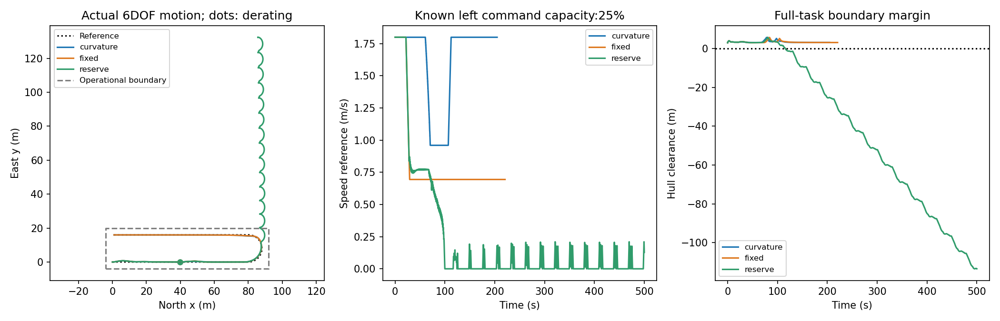
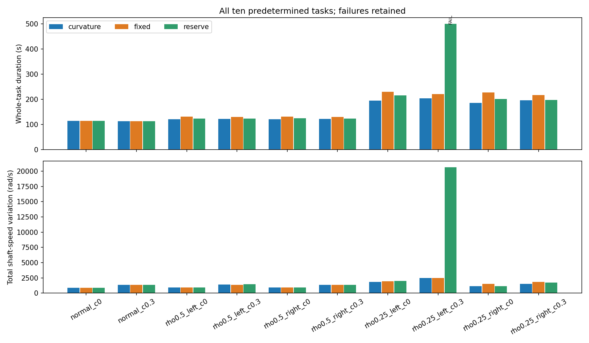

# R：已知单侧执行器降额后返回

**结论：正确约束分配与抗饱和已经使全部10任务安全返回；额外能力匹配降速更慢，当前偏航余量调速还引入1次明显失稳。**建议保留最简单的约束分配返回方案作为应用原型，不把本批写成需要新调节器的未解决缺口。若未来确有船体级故障或实测任务条件，再另行定义，不在本轮继续找有利压力参数。

## 具体问题与已知条件

2m双桨USV完成80m首段—半径8m U形转弯—80m反向返回。名义1.8m/s；首段进度40m触发已知单侧命令能力降额。十个预先固定任务包括2个无故障对照，以及ρ=0.5/0.25×左右侧×横流0/0.3的8个降额任务。ρ仅表示允许推力范围比例，对应命令转速范围乘sqrtρ；原实际轴速连续、0.1s执行动态不变，原推力效率不变。**不称其复现真实桨损坏或故障发生率。**

控制器均即时知道限值，使用同样准确位置、航向、地面速度。动力学的真实流参数不传入控制器。未研究故障检测、观测噪声或随机海况。完整仿真使用T中固定的官方Otter六自由度源码；此新目录只读复用T，不覆盖它。

## 三种方法与公平性

- curvature：原曲率前视速度+正确非对称约束分配+实际抗饱和；不能实现的总推力自然受限，船实际降速。
- fixed：共享全部控制，仅在降额后用能力匹配固定速度上限。上限=0.9×2min(两桨最大推力)/77.5544，ρ0.5/0.25为1.38888/0.69444m/s。不是故意设极低速度。
- reserve：同样控制，依据当前请求偏航矩下的最大可行总力在线限制速度参考。

两桨不等限值的分配先满足裁剪后的差动力，再在对应总力区间投影。150组正反推/极限准入全部通过，最大力矩回算误差1.42e−14；30条日志中的命令均满足降额限制，实际轴速保持原物理硬限内。降额后的短暂真实推力过渡没有被硬重置。抗饱和和公共反馈全部相同，没有拿仍使用旧限值的错误基线作比较。

## 全部真实结果

顺序均为curvature / fixed / reserve，包含全任务而非只截故障后。

| 预定任务 | 完成结果 | 全航时s |
|---|---|---:|
| normal_c0 | 安全 / 安全 / 安全 | 114.650 / 114.650 / 114.650 |
| normal_c0.3 | 安全 / 安全 / 安全 | 113.850 / 113.850 / 113.850 |
| rho0.5_left_c0 | 安全 / 安全 / 安全 | 121.475 / 132.250 / 124.400 |
| rho0.5_left_c0.3 | 安全 / 安全 / 安全 | 122.925 / 130.875 / 124.225 |
| rho0.5_right_c0 | 安全 / 安全 / 安全 | 121.650 / 132.250 / 124.600 |
| rho0.5_right_c0.3 | 安全 / 安全 / 安全 | 122.725 / 130.850 / 123.375 |
| rho0.25_left_c0 | 安全 / 安全 / 安全 | 195.000 / 230.675 / 216.300 |
| rho0.25_left_c0.3 | 安全 / 安全 / 越界+超时 | 204.750 / 220.650 / 500.000 |
| rho0.25_right_c0 | 安全 / 安全 / 安全 | 186.700 / 227.175 / 201.650 |
| rho0.25_right_c0.3 | 安全 / 安全 / 安全 | 196.725 / 217.150 / 197.450 |

| 方法 | 安全完成 | 平均全航时s（含500s失败） | 平均桨速总变化rad/s | 平均反转次数 |
|---|---:|---:|---:|---:|
| curvature | 10/10 | 150.045 | 1389.02 | 4.8 |
| fixed | 10/10 | 165.038 | 1448.86 | 5.0 |
| reserve | 9/10 | 184.050 | 3243.01 | 17.5 |

正常任务三法完全相同。8个降额任务fixed全部更慢，平均全体多14.99s。推进力活动平均13173.41/13104.22/16008.82 N·s，不能换成未经标定的电能收益。自然限力不是瞬时速度剪裁：实际速度仍经原船体/推进器积分产生。

本任务主指标没有沿用T的巡航±20%采样速度门，低速返回不因此被判失败。原始JSON中保留的`valid_line_m`等字段只为共用记录兼容，**不参与R方法选型，也不代表本任务测量质量**。

## 最不利案例与证据边界

预定最困难ρ0.25左侧、0.3m/s横流：curvature204.75s、fixed220.65s安全完成；reserve持续振荡并随流漂移，500s超时、最小外廓余量−113.53m，反转143次。

reserve的实际过程：t=98.4s，参考速度首次低于0.2m/s，位置约(87.447,11.324)m，实际前向速度0.217m/s；t=115.775s首次越界，参考速度为0，前向速度−0.264m/s。后续反复低速/倒行与偏航，未接回返回线。当前静态可行域速度调节不保证闭环前向机动性；在线调低参考并不自动比让受限执行器自然降速更安全。日志支持上述过程，不足以证明所有参考调节都会失败，也没有进行同状态因果分支或稳定性理论推导。

该工况半步复核dt0.025→0.0125：两个安全方法航时各−0.0375s，边界最小余量各−0.02229m；reserve仍超时越界，最终最小余量差0.887m。长时间失稳轨迹不逐点相同，故不把−113.53m当高精度物理预测；安全/失败分类及严重退化保持。

## 判断

本任务切入点明确，但当前压力范围中已有正确成熟方案足够；不是因为没有新算法就淘汰。主困难仍未成立为合理基线不能解决的应用缺口，且未具备实船/来源明确的降额参数与操作区域。可以保留一份成熟故障能力适配原型，但不建议马上围绕此批另写性能创新论文。未来若任务确需更紧的真实作业边界，必须由需求证据引入，不根据本批输赢收紧。

本候选停止，未改故障比例、方向、种子、公共判分或反馈；未扩展训练、故障检测平台或新水动力。

## 证据索引与复现

- `PROTOCOL.md`、`FROZEN_CONFIG.json`：首次执行前冻结，10任务全保留。
- `preflight.json`：非对称投影、正反推与能力限校验。
- `runs/main_v1/results.json`、30个NPZ：完整结果；`receipt.json`包含PID87692、UTC04:20:52.210758—04:21:51.575472、59.365s、代码哈希。
- `runs/dt_check/`：预指定难例3法复核，PID83272，UTC04:22:13.604125—04:22:36.259855、22.656s。
- `verification.json`：30条原始状态重算边界、命令限值/实际物理限值检查及半步差异。
- `pilot.py` 与`runs/main_v1/pilot_snapshot.py`；只读依赖`../turn_handover/preflight.py`及其`vendor/`，上游固定commit a93d1938ba1f78f2580c24c73f003091b2f03cd0。分发需同时包含T必要源码与原MIT许可。

```powershell
$env:PYTHONDONTWRITEBYTECODE='1'
& 'C:/Users/74095/anaconda3/python.exe' -B -X utf8 preflight_R.py
& 'C:/Users/74095/anaconda3/python.exe' -B -X utf8 pilot.py --mode main --out runs/reproduction_1
```

新输出目录必须不存在。每条状态标注t为积分区间起点，状态位于t+dt；控制命令作用于该区间；actual_X/actual_N是区间起点真实轴速计算的反馈力，而行内shaft_left/right是积分后的轴速，不能错当同一时刻反推。所有方法一致。整个任务单线程CPU、GPU0，无新依赖，全部进程已退出。





