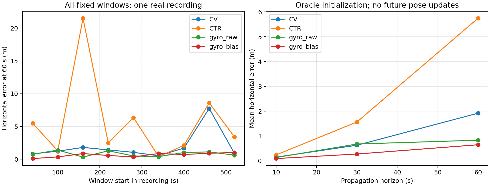
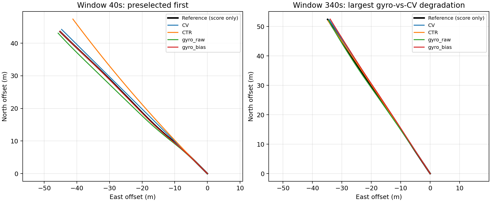

# 真实运动下的位置更新缺失：完美初始化传播诊断

## 结论

**不推荐据此启动“定位失效安全续航”论文。** 原始陀螺仪带来了可测的传播信息，但强简单 CV 在9个固定窗口中已有8个不超过2m/5m侧向误差；唯一明显改善来自一个窗口。缺失段均来自单次记录的近匀速普通航行，未覆盖预设低速和急转弯类别。最小的 raw gyro 传播与偏置校正版具有完全相同的2/5/10m首次超限结果，没有必要据此增加估计模块。

本结果只支持：在共享完美初态和弱速度变化条件下，实际陀螺仪可帮助预测短期地面轨迹。**未解决**真实在线初始化、故障检测、不确定性校准或何时可以安全暂停。此处的首次超限时刻由事后参考评分得到，不能提供给在线控制器。

## 方法与输入

使用 CANOE 首个按时间排列序列 `canoe-2025-08-20-16-07` 的前8MiB Ouster原始IMU，实际覆盖597.797s，另下载3MiB lidar坐标参考以评分。数据为[作者官方说明](https://raw.githubusercontent.com/utiasASRL/pycanoe/main/DATA_REFERENCE.md)及[AWS开放数据入口](https://registry.opendata.aws/canoe/)；CC BY 4.0。未把记录拆成独立海试，未按方法胜负挑窗口。

原始 IMU 与参考 GNSS/INS 属于不同传感器，但参考是整序列后处理结果。因此所有方法均获得**特权 t0 位置/速度/姿态以及过去20s后处理参考**。名义时间在过去不代表这些值没有未来信息。公平之处仅是各方法共享这一特权；不能因此称为真实因果初始化。

缺失段内：CV保持初始地速向量；CTR保持过去20s估计的COG转率；gyro_raw以原始三轴角速度积分姿态，并按姿态变化旋转初始地速；gyro_bias使用过去20s参考角速度校准固定三轴偏置后执行相同传播。这是已有的陀螺辅助航位推算思路，不是新算法；不是完整加速度惯导，也没有协方差校准。两种gyro均假设短时地速大小和COG相对船体方向的偏差保持，实际侧滑/变速会破坏该近似。

代码先按官方被动旋转 C1 C2 C3 解释角度。`C_es @ v_body` 与 ENU 速度最大残差为7.11e-16m/s。IMU-lidar旋转为单位阵，12.55mm量级杆臂已用于参考点的位置与速度变换。原始gyro与参考各轴相关0.912/0.826/0.971，时间最大间隔10.011ms；不把 `ang_z` 直接当ENU航向。全部检查在 `results/contract.json`。

## 固定窗口的真实结果

窗口起点为40,100,...,520s；每窗60s，全部保留。均由过去20s规则归入ordinary。过去地速中位数范围1.039–1.060m/s，窗口内最大速度变化0.046m/s，COG-heading偏差变化1.06–2.87度。没有低速或预先定义的急转弯窗口，不能宣称相应能力。

| 方法 | 平均水平误差10s (m) | 30s (m) | 60s (m) | 超2m侧向误差窗口 | 超5m窗口 |
|---|---:|---:|---:|---:|---:|
| CV | 0.150 | 0.630 | 1.920 | 1/9 | 1/9 |
| CTR | 0.241 | 1.566 | 5.744 | 7/9 | 4/9 |
| gyro_raw | 0.136 | 0.679 | 0.834 | 0/9 | 0/9 |
| gyro_bias | 0.094 | 0.276 | 0.649 | 0/9 | 0/9 |

gyro_bias相对CV在10/30/60s分别6/7/7个窗口误差较低；最坏退化分别+0.025/+0.100/+0.339m。gyro_raw在60s为8胜1负，最坏退化+0.170m。因此不能写所有时间和窗口均改善。

CV仅460s窗口在36.416s、48.306s分别越过2m、5m预算；两gyro在60s结束前未越过。**这是截尾结果，不是可保证续航60s。** 2/5/10m为预注册示例容差，不是实际测绘规范。偏置校正相对raw gyro把60s平均误差降低0.184m，未增加通过这些阈值的窗口数，尚无必要性证据。

CTR把之前的缓慢转向持续外推，160s窗口60s误差达到21.507m，而CV为1.811m；这说明该固定CTR在当前记录中不适用，不代表所有合理自适应运动模型无效。没有通过挑选CTR弱点取代CV主要对照。

## 图与证据





第二图的第一个窗口事前固定；第二个按最大gyro_bias相对CV退化选取，仅用于展示反例，全部任务已在第一图和CSV保留。曲线是**观测参考与离线预测**，不是方法闭环控制船只的实际航迹。

## 复现与代价

本机无需新依赖：

```powershell
$env:OMP_NUM_THREADS='1'
$env:OPENBLAS_NUM_THREADS='1'
$env:MKL_NUM_THREADS='1'
$env:CUDA_VISIBLE_DEVICES=''
& 'C:/Users/74095/anaconda3/python.exe' -X utf8 'C:/Users/74095/hs/SailBoat/sailboat-track-b/discovery_b3/candidates/position_outage/pilot.py'
```

- `PROTOCOL.md`：实测前固定的窗口、输入、阈值和终止条件。
- `pilot.py`：完整预处理、传播、评分和作图；有CSV末尾部分行剔除与坐标契约断言。
- `results/scores.csv`：36行方法×窗口完整结果，含截尾标识。
- `results/windows.json`：窗口分类、侧滑和速度变化。
- `results/traces.npz`：每窗完整参考与预测曲线。
- `results/receipt.json`：源码/协议/输入哈希、PID、实际UTC时间、解释器及资源。
- `downloads.json`、`DATA_REFERENCE.md`、`listing_*.xml`、`T_*.txt`：来源和坐标证据。

本地1个单线程CPU，GPU0；完整脚本实际3.713s（含读取、作图，不是单次在线推理时延），退出码0。原始数据范围下载约13.063MiB，加小型文档/目录/外参仍低于50MB。未写满盘服务器，未删除旧资产。

## 未判定与下一步边界

没有独立实时GNSS、IMU在线偏置和因果初始化证据，不能给出安全停止规则。9窗来自一段连续记录，也不足以校准可靠的尾部误差界。下一步若研究此问题，首先应取得实际在线状态及更有区分力的预定义操作工况；不能仅因为现有结果较好，把0/9越界变成99%安全保证。当前不追加窗口、不改变阈值、不训练。

## 补充：侧向误差定义核对（仅复算已有曲线）

原始协议/实现的“侧向误差”为预测位置误差沿**每时刻真实参考速度法向**的投影：`abs((p_pred(t)-p_ref(t)) dot n_ref(t))`。独立初筛另要求“相对初始测线”的横向误差，两者不相同；原始主表不应称为初始直线测线偏差。此处如实保留定义偏差，没有覆盖原评分。

额外固定法向版本为 `abs((p_pred(t)-p_ref(t)) dot n_0)`，n_0垂直于t0初始地速。仅从已有 `traces.npz` 计算，2m/5m超限窗口数如下：

| 方法 | 原随动法向2m | 固定初始法向2m | 原随动法向5m | 固定初始法向5m |
|---|---:|---:|---:|---:|
| CV | 1/9 | 1/9 | 1/9 | 1/9 |
| CTR | 7/9 | 6/9 | 4/9 | 4/9 |
| gyro_raw | 0/9 | 0/9 | 0/9 | 0/9 |
| gyro_bias | 0/9 | 0/9 | 0/9 | 0/9 |

CV同一460s窗口的首次2m/5m超限变为36.826s/48.946s。CTR一个2m临界窗口分类改变，但主要判断未改变：强简单CV仅1场超限、原始gyro已达到校准gyro的阈值成绩，仍不足以推荐在线安全续航方案。

进一步区别：上表是**预测相对参考的位置误差**在固定法向上的分量；真正的参考轨迹离开初始直线距离是 `abs((p_ref(t)-p_ref(0)) dot n_0)`，另存在 `actual_initial_line_departure_max_m`。没有预定测线/控制回路时，不能将后一项解释成实际任务违约，也不能把预测曲线当作受控航迹。

复现：以相同Python运行 `check_fixed_normal.py`。产物为 `results/fixed_normal_scores.csv` 和 `fixed_normal_summary.json`。本次1CPU分析0.076s，GPU0，未重跑传播；原冻结协议已另存 `PROTOCOL_FROZEN.md`，匹配原receipt中的协议哈希。
