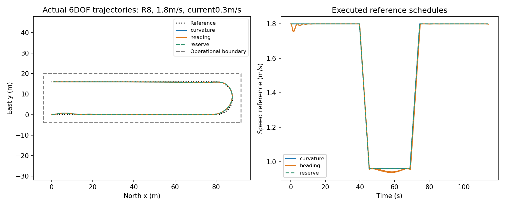
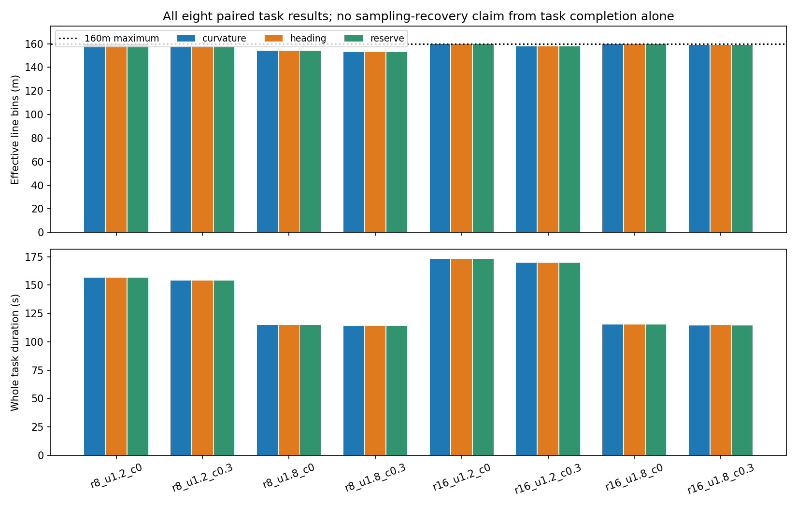

# T：有限端部空间的测线接回筛选

**结论：正确标定的成熟曲率减速与共同反馈已完成全部8个任务；没有发现值得增加推力余量调节器的性能缺口。**这不是只因新模块未胜简单法而否定问题：当前任务本身已经由成熟方法取得平均157.75/160m有效线长，且候选既未激活也未揭示新的代价折中。可保留为可运行成熟应用原型，但不能据此宣称独立新控制贡献或实测水文任务达标。

## 问题与方法

2m双桨艇沿80m测线，在半径8/16m的半圆内换到相距16/32m的反向测线，再行80m。速度1.2/1.8m/s，横流0/0.3m/s。允许区域在路径外有4m工程余量；以2×1.08m、仅由偏航旋转的平面船体矩形判越界。这不是实测岸线，也不是3D船体碰撞几何。

采用 Fossen 官方 Otter 完整六自由度模型，推进器有0.1s响应及非对称正反推。上游动力学文件未改。所有方法共享正确分段推力逆映射、偏航优先可行分配、实际执行残差抗饱和、相同反馈和观测。基线提前按曲率限制速度并减速；第二简单法再按航向误差减速；原型再按当前偏航需求保留可用推力。没有神经网络或未来状态预测。


## 实际结果（顺序：曲率 / 航向误差 / 推力余量）

全部24条执行记录完成且不越界。表中余量是三种方法最小值。

| 任务 | 有效线长m | 完整任务时间s | 最小船体余量m |
|---|---:|---:|---:|
| r8_u1.2_c0 | 160 / 160 / 160 | 156.575 / 156.650 / 156.575 | 3.030 |
| r8_u1.2_c0.3 | 158 / 158 / 158 | 153.775 / 154.050 / 153.775 | 3.030 |
| r8_u1.8_c0 | 154 / 154 / 154 | 114.650 / 114.700 / 114.650 | 3.045 |
| r8_u1.8_c0.3 | 153 / 153 / 153 | 113.850 / 114.125 / 113.850 | 3.045 |
| r16_u1.2_c0 | 160 / 160 / 160 | 173.075 / 173.100 / 173.075 | 3.030 |
| r16_u1.2_c0.3 | 158 / 158 / 158 | 169.650 / 169.725 / 169.650 | 3.030 |
| r16_u1.8_c0 | 160 / 160 / 160 | 115.350 / 115.350 / 115.350 | 3.045 |
| r16_u1.8_c0.3 | 159 / 159 / 159 | 114.625 / 114.725 / 114.625 | 3.045 |

三种方法有效线长逐任务完全相同。航向误差减速平均增加0.1094s；平均推进力活动14164.84 vs14166.90 N·s，桨转速总变化829.54 vs816.12，反转次数2.00 vs1.75。差异很小，不能写节能收益。推力余量方法8场零激活；包括记录的参考和执行状态在内，NPZ轨迹与基线逐项完全相同。

基线达到157.75/160m。最差153m出现在8m半径、1.8m/s、0.3m/s横流，损失包括短暂接回条件不满足。该指标按每1m格内至少一次满足横差≤1m、航迹角误差≤10°、地速在巡航±20%计数，**不代表整格连续测量合格**，也不直接等于声呐数据质量。主任务若需要推广，先补实际应用的质量要求；不能因本指标接近饱和而说测量控制已普遍解决。

## 为什么不采用早期表面收益

v1只有航向LOS，横流补偿不完整；v2加入瞬时漂角补偿后，在高速度下仍有持续航迹角振荡，且减半步长改变18–31m有效线长。航向误差减速一度显得多获得13–27m，但不能据此证明新的策略价值。共同修复离散目标差分前馈、漂角滤波和反馈标定后，优势消失。原始v1/v2、两个开发网格、修复版均保留，未覆盖。

最终配置kp200、kd90、漂角低通5s、LOS前视4m、曲率角速度限0.12rad/s、参考加减速0.15m/s²。这些来自有限开发标定，不是理论最优参数。所有8个场景在修复时已经见过，最终是探索性同条件配对，不称未见确认。

## 数值核验与边界

最终dt0.025s；预先指定难例三法各以0.0125s复核，有效线长差0m，任务时间差−0.0375s，最小余量差−0.02229m。24条原始航迹重新计算平面船体余量和有效格数，与结果一致。该检查支持当前数值比较，不是稳定性或实船保证。

控制器观测是假定准确的当前位置、姿态与地面速度；常流参数只给动力学，没有给策略。未研究噪声、波浪、部分失效、狭窄岸线或行业验收标准。总推力活动不是电能。日志时间t是积分区间起点，记录运动状态在t+dt，所有方法一致；时间差比较的分辨率为dt。

继续门未触发：未救回失败、未在至少2场新增8m有效线长。成熟应用方案可以保留；不应为了题目把边界收窄或增加有利种子。本目录停止扩大名义任务矩阵。

## 复现与证据

- `PROTOCOL.md`：冻结任务、意义门、完整共同修正记录。
- `FROZEN_CONFIG.json`：最终共享配置；`FROZEN_CONFIG_v1.json`保存旧配置。
- `runs/main_v3/results.json` 与24个NPZ：最终全部结果；`receipt.json`含PID、UTC起止、代码哈希、上游commit。
- `verification.json`、`runs/dt_check_v3/`：原始状态重算与半步复核。
- `runs/main_v1/`、`runs/main_v2/`：诊断旧批，不用于最终性能归因。
- `runs/dev_v1/`、`runs/dev_v2/`、`runs/stability_dev/`、`runs/stability_dev2/`、`runs/stability_dt/`：开发与数值诊断。
- `preflight_receipt.json`：逐上游文件哈希、极限/正反推检查；`vendor/LICENSE`保留原许可。

```powershell
$env:PYTHONDONTWRITEBYTECODE='1'
& 'C:/Users/74095/anaconda3/python.exe' -B -X utf8 preflight.py
& 'C:/Users/74095/anaconda3/python.exe' -B -X utf8 pilot.py --mode main --out runs/reproduction_1
```

输出目录必须不存在，防止覆盖。`verify_and_plot.py`读取最终main_v3并复算难例/重画两图；不是新研究批。程序均使用单线程CPU，GPU0，无安装依赖。最终main_v3 PID79096，UTC04:15:36.600613至04:16:19.472202，42.872s，退出0。

## 原始方法来源

- [Fossen 官方 Otter](https://github.com/cybergalactic/PythonVehicleSimulator/blob/a93d1938ba1f78f2580c24c73f003091b2f03cd0/src/python_vehicle_simulator/vehicles/otter.py)：船体与推进器模型、原控制接口；下载源码只读复用。
- [官方 MSS 导引实现](https://www.fossen.biz/MSS/)：LOS/ILOS/ALOS与实际海洋控制的成熟背景；本pilot的低通漂角LOS是简单工程组合，不声称逐项复现ALOS定理。
- [Sarhadi 幅值/速率抗饱和研究](https://arxiv.org/html/2601.01302v1)：说明简单实际执行反馈可作为强对照；本pilot未声称复现REMUS工作点性能。




