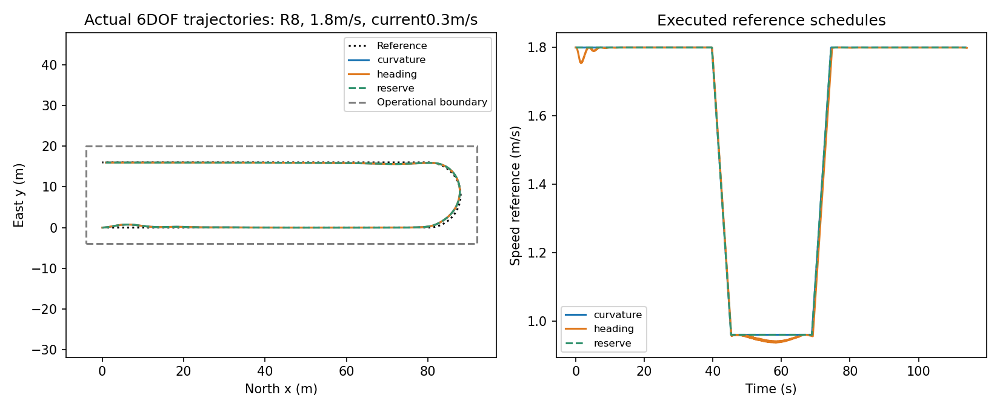
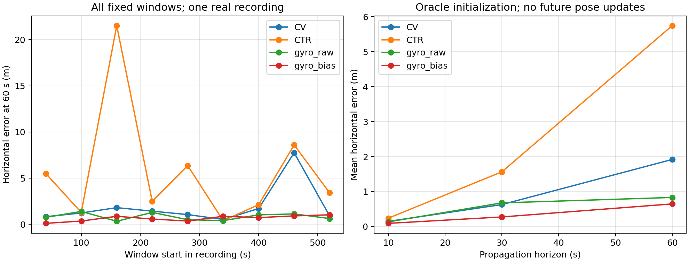
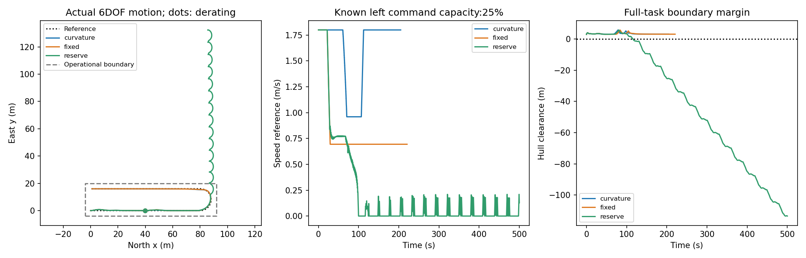

# B3：从具体作业环节寻找CCDC选题

状态：三个实际pilot及最终独立证据审查已完成。2026-10-09。用户续授权扩大问题范围，A/旧B/B2保留。方法可以直接采用成熟算法，价值要由具体任务和实际结果支撑。

## 当前选择

**本轮尚未选出足以启动新论文的题目。** 这不是因方法不够新：T与R的成熟方案已经可运行，但本批任务没有暴露需要新增策略的缺口；N存在信息收益，却缺少因果初始化和关键机动覆盖。将正常实现工作包装成新课题，会重复前几轮的问题。

本轮从“旧帆船控制器怎么再加模块”改为三个明确操作问题：有限水域换线、位置更新中断、单侧执行器降额后的路径接续。另核查了移动水质测量，未把数据缺失用合成结果补齐。

| 实际筛选问题 | 最强实际简单对照 | 真实效果与代价 | 决定 |
|---|---|---|---|
| T：转弯后接回下一条测线 | 曲率前视减速+合理反馈+约束分配 | 8/8完成且无外廓越界；三法有效格数相同，额外余量法零激活 | 保留成熟原型，不增加模块，不直接立新题 |
| N：位置更新缺失后的10–60s传播 | 恒速度、恒转率、原始gyro | 原始gyro将60s平均误差1.920降至0.834m；阈值状态只改变1窗，存在退化 | 保留条件性信息价值；不能写安全续航 |
| R：已知一侧降额后在有限水域接续U形路径 | 同限值非对称分配+实际抗饱和 | 简单方法10/10；固定能力限速10/10但更慢；动态余量9/10且新增失控案例 | 采用简单参考作为工程默认；不保留动态余量法 |

对CCDC的建议仍是“具体任务+成熟方法+可信证据”，而非必须发明新网络。这里缺的是能改变实际作业结果的条件和独立验证，不是公式数量。若必须在现有资产中选择一项有限深化，**条件性首选R：已知单侧推力限幅下，小型双桨无人艇的换线任务可完成性与速度参考选择**。选择的是任务，不是失败的reserve方法。它不依赖尚缺的声纳质量或在线GNSS初态，已有完整闭环简单原型；但当前10条件都被该原型解决，还不能直接立为新论文。

R下一步只有一个优先判别：先取得有来源的作业水域、流速与推进能力范围，再检验成熟基线在哪些条件可完成、哪些条件必须改变任务。如果没有影响操作选择的能力边界，就停止；不能根据本批输赢缩窄水域或提高流速制造困难。水质走航的质量—航时折中为需数据的备选，当前也不是实测入选。

## Literature landscape

应用锚点先于算法。UNH/NOAA对Surveyor实际作业的98页报告指出，转弯数据需移除，风流引起测线变化与覆盖缺口；这是作业需求，不是小型船上的定量性能结论。https://web.uri.edu/oeci/wp-content/uploads/sites/1967/Observations-on-Initial-Use-of-Saildrone-Surveyor-for-Deep_Sea-Mapping_cp.pdf （实际读印刷7–11页及P86相关段，不宣称通读）。

现成解法包括Dubins/TSP测线连接、跳行与在线传感覆盖适配；控制上有ILOS/ALOS、约束推力分配与抗饱和。Fossen官方Otter模型提供实际六自由度积分和推进器动态，但不是本项目实船标定。任何在正反推映射、分配或限幅上的修复都应公平用于基线，不当作新方法收益。

定位方向存在CANOE真实原始IMU和后处理GNSS/INS参考；官方明确参考由全序列批处理产生，不能冒充在线GNSS，更不能拿未来平滑值初始化可部署算法。仅在数据契约支持的范围内试验。

官网当前CCDC2027，初稿2026-10-31；无人系统控制应用在会议范围内，但没有核实到“创新要求较低”的官方规则。选择应在约三周的准备尺度内有可完成证据，不估计接收概率。来源、环境和日期见 ../notes/venue_and_execution.md。

## Ranked ideas

三路初始意见独立形成；原始意见 ../notes/operations.md、control_opportunities.md、reliability.md。九条仅合并O1/C1，形成八个问题；完全无位置更新与低频位置更新的信息条件不同，不预先合并。表中不是性能排名，未实测的缺口一律是假设。

|ID|具体问题|首批必须出现的成熟强对照|主要风险|
|---|---|---|---|
|T|测线端部转弯后恢复有效采样|可行圆弧/Dubins/跳行；相同LOS、抗饱和、前视曲率减速|简单方法已足够；不能凭声纳无数据声称测绘质量|
|R|已知单侧推力降额后完成下一段或中止|同约束分配+抗饱和+曲率限速；保守低速|故障发生率/程度未标定，信息须双方同给|
|N|短时位置更新缺失时还能沿测线继续多久|因果恒速度/恒转率、惯导/EKF和固定暂停|真实数据online输入未核验，不能偷用后处理真值|
|H|低速横流时COG误作船首造成错误校正|低速禁用、创新门控及适用融合|可能只是常规传感契约修复|
|C2|低频位置更新或短丢测后恢复有效采样|多速率EKF、合理位置辅助航迹角估计|缺少核实的在线GNSS记录；不能把加噪后处理参考当实测GNSS|
|S|舵机速率约束下连续变向|实际执行反馈抗饱和+参考平滑|无可信硬件参数，不随意造极慢舵机|
|G|已知覆盖缺口的最少补测|在线幅宽适配+贪心补线|传感覆盖日志未确认，不能虚构声纳质量|
|D|回收接近同时满足位置/艏向/速度|成熟受限轨迹规划+分段减速控制|推力与横流可达性、复现成本|

## Novelty verification

真实独立gpt-6-astra xhigh /root/b3_selection_review已完成来源与应用范围审查，见 ../notes/selection_review.md。同家族、provisional。保留T与N进行有限实测；G待覆盖数据契约，其他候选未被证明无效。成熟方法有效可以采用，但相同问题重复实现不能宣称新发现。

## External critical review

真实独立 /root/b3_evidence_review（gpt-6-astra，ultra）已对T/N及R原始轨迹进行复算，最终意见见 ../notes/evidence_review.md。同家族provisional，不是CCDC外部评审或接收意见。复算支持有限结论；R失败仅分类在半步下保持，不宣称逐点收敛。N的单460s窗贡献约60–68%的平均误差降低，其余窗口仍有平均收益；“一个窗口”仅指示例阈值状态改变。

## Pilot evidence

T完成了共同跟踪器修复与最终核验：8个配对任务全部完成且外廓不越界，三法有效格数逐任务相同，平均157.75/160m；推力余量法全程未激活。难例半步核验有效格数差0m、航时差−0.0375s、余量差−0.0223m。旧v1/v2步长敏感的表面收益不作性能结论。全部场景已见，最终批是探索配对，不称新确认。详见 ../candidates/turn_handover/RESULTS.md。

该有效长度按每1m格至少一次满足位置、航迹角和速度门槛计数，不代表连续合格采样或实际声纳质量。当前不再追加名义测线场景来追求新模块优势。

N已完成固定9窗×4方法，实际进程退出，详见 ../candidates/position_outage/RESULTS.md。服务器磁盘满，使用本机已有Anaconda CPU环境，不安装新包、不清理共享数据。共享上限24h、3候选、4单线程CPU，GPU0。

N的60s平均水平误差为CV 1.920m、CTR 5.744m、原始gyro 0.834m、校准gyro 0.649m。CV有1/9窗超过示例侧向预算，gyro没有；两种gyro的阈值结果相同。全部窗口来自单条记录的普通近匀速航段，且初态及过去校准参考有后处理特权。这支持限定条件下陀螺信息有用，不支持部署安全续航或暂停决策；不据此进入论文写作。

原N侧向预测误差按每时刻参考速度法向计算；另复算了固定初始速度法向。两者不等于真实船离初始直线的距离。复算只改变CTR一个2m临界窗口，不改变CV与gyro主要结论，原评分保留。

### R：实质改变任务的第三次筛选

具体问题：双桨艇在有限水域已知一侧命令能力下降后，如何完成U形转弯并返回起始侧。允许低速返回，主指标不沿用T的采样速度门槛。这里不是回到原出发点，也没有实现自动继续/中止决策。固定10个条件、三个公平策略：正确非对称分配下的自然降速、能力匹配固定速度上限、当前偏航请求下的可用能力调节。全部都知道相同降额，全部通过原轴动态实际执行。

| 方法 | 安全完成/10任务 | 平均全航时s（保留超时） | 平均桨转速总变化 |
|---|---:|---:|---:|
| 自然限力降速 | 10 | 150.045 | 1389.02 |
| 能力匹配固定上限 | 10 | 165.038 | 1448.86 |
| 动态余量调节 | 9 | 184.050 | 3243.01 |

这些是同一结构化压力组合下的描述性结果，不是故障概率或随机独立样本。反例为左侧25%能力、横流0.3m/s：简单方法204.75s、固定上限220.65s完成；动态余量500s超时，最小外廓余量约−113.5m。半步核验保留三者成败，失败轨迹精确偏移量仍有约0.89m差异，不把它当实船精确预测。协议、全部结果及实际轨迹见 ../candidates/derated_return/。不把静态瞬时可行域误写成闭环稳定或返回保证。

### 水质采样：扩大范围后的文献与资产筛除

额外核查了移动水质测量的响应延迟与速度安排。Wateree原始论文实际为2024年，直接浸水探头没有管路；高速偏差混有推进混合、内部滤波及响应时间。成熟固定低速、停留与已标定补偿必须作为强对照。当前未取得足以区分这些原因的同步原始记录，因此不运行人为一阶滞后仿真冒充真实应用验证。该问题保留为需数据的候选，不占第四pilot。来源与完整理由见 ../notes/water_sampling_screen.md。

### T 的可检验机制（尚非收益结论）

已固定官方Otter源commit a93d1938ba1f78f2580c24c73f003091b2f03cd0，准入正反推往返误差2.84e-14 N，镜像转向符号检查通过。每侧推力范围[-66.708,119.682] N，力臂0.395m。令总纵向力X=f_L+f_R，偏航力矩N=0.395(f_L-f_R)，两侧共同限幅给出 |N|≤0.395 min(X+133.416,239.364−X)。例如X=200N时偏航余量仅15.55Nm；请求总推力与转向确实耦合。但公平基线已按偏航优先分配，也有抗饱和，因此这个公式不能代替候选收益证据；剩下要测的是提前速度安排是否改变实际进入下一条测线的过程。

流程示意（不是实验图）：共同几何路线 → 当前反馈与前视曲率 → 速度参考策略 → 共同航向/速度反馈及抗饱和 → 共同可行推力分配 → 实际六自由度动力学 → 下一步反馈。仅速度参考策略在候选间变化。

## 关键图与复现

T：同一实际动力学积分下，额外策略几乎重合。此图不是实船记录。

N：真实船运动记录上的离线预测误差，不是方法执行的闭环航迹。

R：预先指定困难任务；动态余量法严重退化，不能只展示正常成功。

所有可运行入口、来源、日志时间约定和完整原始记录见 [RESULTS_INDEX](../RESULTS_INDEX.md)。三类任务分母分别为8个仿真条件、单记录9窗和10个仿真条件，不能相加成总体成功率。独立角色原始意见保留；其判断不是科学证据的替代。

本轮未训练、未用GPU、未修改A/旧B/B2、未push。服务器满盘仅影响服务器写入，本轮已有本地可运行成果；未清理共享数据。三个pilot名额已用完，不为凑一个正结果追加第四题或继续扫描。

## 后续方向与停止条件

条件性R问题可以写成：**在已知单侧执行器降额和给定作业水域下，什么时候成熟约束分配足以完成换线，什么时候必须改变速度参考或任务？** 方法优先保留当前简单反馈，不预设需要MPC、网络或失败的reserve。

当前可证：有限已知条件下，简单方案足够；多一层静态能力调速可能更差。当前不可证：未知故障检测、真实损坏、现场安全、一般稳定性或完整返航系统。下一阶段须先有操作范围来源，再固定新的独立条件，并报告完成、边界、航时与操纵成本；不能事后调边界制造优势。如果来源范围内简单方案仍充分，就采用它或结束该题，不强行增加机制。

因没有足够信号，本轮没有启动最终方法精炼与大实验计划。ARIS完整五阶段的推进门保留未通过状态；这是未将有限筛选升级为成熟研究方案，不是隐瞒执行失败或等待新授权。有限发现工作包本身已交付。

<!-- ARIS_IDEA_DISCOVERY_EVIDENCE_GATE:START -->
## Evidence Gate
**Status:** BLOCKED

The workflow is not complete. Required stage evidence is missing:
- BLOCKED: research-refine-pipeline evidence missing (status=skipped)
<!-- ARIS_IDEA_DISCOVERY_EVIDENCE_GATE:END -->
