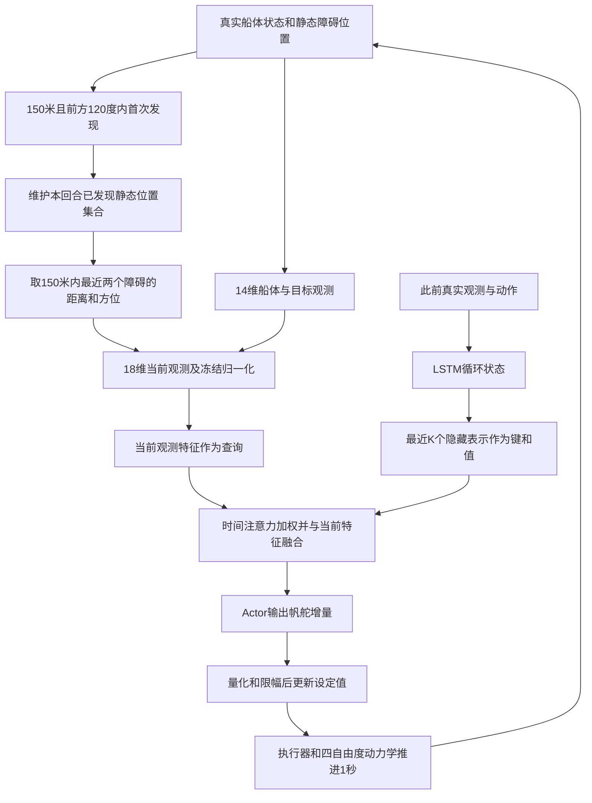

# 师兄避障方法与现有资产：接手上下文

日期：2026-11-05。用途：交给另一个 agent 进行问题诊断与选题；不是投稿稿件，也不是新方法有效性的声明。A 详细预测路线已停止，旧数据、代码和负结果全部保留。B 线不改。本轮未训练、未新增导航实验。

## 1. 先区分三种来源

| 来源 | 实际内容 | 不能据此推出的内容 |
|---|---|---|
| Yang 等，Applied Ocean Research 175 (2026),105246，DOI 10.1016/j.apor.2026.105246 | 无直接风输入的 SAC-LSTM 帆舵控制；14维观测；本地 `main.pdf`，19页 | 不是18维避障 checkpoint 的身份凭证，不把其成功率当避障结果 |
| 师兄《大论文-Final.pdf》，131页 | 第五章“面向静态障碍物环境的控制模型优化”；18维、时间注意力、静态避障及探测距离实验 | 封面为2026年12月，按收到的论文版本处理，不声称已答辩或正式出版；表格尚未用对应原始日志独立复算 |
| 已继承的 PART5 代码与 `0204_actor10800` | 有哈希、原入口和迁移验证的18维避障 Actor/normalizer | 不自动等于大论文当前表格使用的 checkpoint；训练批次、各对照权重及新版实验日志身份仍待闭合 |

另有101页的《师兄大论文.pdf》，内容较旧。应优先理解131页版本，但“Final”文件名不证明其每项数字已与代码匹配。19页期刊论文、101页旧稿、131页稿件不得混用页码或结果。

来源位置与 SHA256 见本目录 `SOURCE_MANIFEST.json`。论文正文页78对应131页PDF的第91页；以下均使用PDF页码。

## 2. 原避障问题究竟是什么

原任务是局部点到点航行：帆船从起点驶向目标，环境有静态障碍，策略每秒决定帆和舵如何调整。船靠风推进；策略不直接接收风速、风向，而从船体运动和此前动作中利用历史信息。**原第五章不是移动船舶意图预测，也不是全局航线规划。**

论文第91—93页给出的环境：训练30%无障碍、70%含障碍；含障碍时5—8个静态点，坐标范围 x=[120,380]、y=[−250,250]米，与起点、终点及其他障碍间距不小于120米。以中心周围40米作为安全域；进入安全域终止。40米是任务规定的安全域，不等于精确船体与障碍实体发生接触。

首次发现障碍须同时满足：距离150米以内，且位于船艏左右各60°。一经发现，环境保存障碍的静态世界坐标；以后即使出了视场，只要距离仍在150米内，仍可进入观测。保存坐标的集合不是神经网络记忆。它依赖静态障碍假设，不能原样解释为真实传感器跟踪移动目标。

观测末尾只有**两个障碍的距离与相对方位，共四个数**，不是四个障碍。每步按距离选最近两个，无障碍用(0,0)填充；槽位身份可能切换。观测没有障碍速度、航向、身份编号或协方差。位置由仿真坐标计算，并非图像检测结果。

## 3. 从观测到动作的完整链

这是论文结构与已读代码的概念图；未渲染验证。注意力选择的是历史时刻，不是直接在多个障碍间作空间注意力。

18维：位置x,y；横摇、艏向；船体纵向/横向速度；横摇/艏向角速度；实际帆角/舵角；目标距离与x方向距离的单步减少量；目标x,y；两个障碍的距离/方位。位置用米、角度用弧度、速度用米每秒。归一化 `(x−mean)/(sqrt(var)+1e−6)`。

当前观测有独立输入分支。上一时刻真实观测和上一动作先更新LSTM，再用当前观测查询历史表示。K=10表示注意力直接读取10个隐藏表示；在线LSTM循环状态继续更新，不能说模型只能记住10秒。论文窗口实验同时改变训练序列/展开/注意力窗口，因此不能把差异单独归因于在线记忆长度。

Actor输出两个归一化动作，转换为最大约10°的帆、舵增量，按整度向下取整后累加至目标角；目标帆角限制±90°、舵角±30°，实际执行器角度受物理变化速率约束。负数向下取整的不对称性保留。**一次动作对应1秒物理推进，不是一次给出未来多秒动作chunk。** CPU计算耗时与仿真航行秒数不同。

SAC用于训练；部署只执行Actor，不需要Critic在线决策。原测试脚本未调用eval，dropout可能仍开启；我们A的eval冻结协议关闭dropout，是明确变体。原协议还有传感器/执行器噪声和Dryden风；A使用另外的合成风场与无附加噪声协议，不能直接合并成功率。

## 4. 奖励与安全的关系

论文第95—96页：基础奖励包含趋近目标、帆舵调节、阶段到达、最终到达与时间项；再减去两槽位障碍距离惩罚。每个有效距离d满足0<d<150时，惩罚为 `exp(−(d−40)/20)`，否则为0；两个直接相加。

在继承的 `sailboat_s14_obst_V3.py` 中可读到对应执行语句。注释“系数3”“第二个权重减半”与执行语句不一致：实际系数1，两项都完整相加。复现应服从代码，并记录论文/注释差异，不据旧注释改实现。

奖励惩罚不是安全保证。策略只看两槽位，终止检查却使用全部真实障碍；因而“未看到/未编码”不等于“没有危险”。原离散时刻安全检查也不证明每个积分子步或真实船体包络均无碰撞。

## 5. 师兄论文中已经报告的能力与失败

以下均为131页稿件的**原文报告值，未独立复算**，不是本轮实验结果。

第97页表5.1，1000个静态场景：Attention成功95.5%，Deep-LSTM84.8%，MeanPool71.8%；安全域侵入分别44、127、254次。每类模型选择一个训练checkpoint，不能用1000个环境回合冒充多个训练种子。

第99页表5.3：K=5/10/20成功率91.3%/95.5%/71.4%。不能推出“加长历史普遍有害”，训练配置和checkpoint共同变化。

第104—106页是本轮最重要的已有失败证据。每个探测距离采用500个配对场景；只改变未知障碍的首次发现距离，发现后仍以150米参与后续观测。

| 首次发现距离 | Deep-LSTM成功率 | Attention成功率 | 仅Attention成功 | 仅Deep成功 | 安全域侵入Deep/Attention |
|---|---:|---:|---:|---:|---:|
| 150 m | 88.4% | 96.2% | 54 | 15 | 53 / 19 |
| 120 m | 89.2% | 96.6% | 51 | 14 | 50 / 17 |
| 100 m | 88.8% | 79.8% | 41 | 86 | 50 / 101 |
| 80 m | 60.6% | 43.0% | 70 | 158 | 190 / 285 |

这支持“所报告checkpoint在晚发现条件下出现排序反转”，尚不支持“注意力导致反应迟钝”。两策略到首次发现时可能已经处于不同船速、艏向和执行器状态。论文第106页也明确指出：在结局筛选后的Deep成功/Attention失败子集里，Attention随后10秒的舵角、艏向调整较小，仅是行为描述，不能独立确定原因。

第115—116页固定Attention模型的动态权重与均匀权重干预：1000场成功率95.1%与94.8%，共同成功916场。共同成功场景中均匀权重平均多7.31秒，说明总体成功率差很小但效率/控制开销可能变化。不要把注意力图当机制证明，也不要重做已有的简单均匀权重干预当作新贡献。

## 6. 原论文协议与当前A代码不是同一个环境

| 项目 | 原第五章/V3 | A连续航行适配 |
|---|---|---|
| 障碍 | 静态布局 | 单恒速移动目标，可叠加静态压力障碍 |
| 首次探测 | 150m+前方120°，保存静态位置 | 高层可见1000m内目标当前位置和速度；不是原探测器 |
| 低层编码 | 中心距离，最近两个 | `ObstacleFrame`按边界映射距离再取两个，无原首次视场/记忆逻辑 |
| 安全域 | 障碍中心40m | 移动实体25m+缓冲60m；静态实体45m+缓冲60m |
| 目标 | 原局部目标 | 高层更换局部参考，重编码真实历史并恢复执行器设定值 |
| 时间 | 每步1秒，原策略直接动作 | 旧动作先执行，下一步参考生效；计算期间物理时钟暂停 |

A的距离映射是 `max(0, 中心距离−排除半径+40)`，不是原观测的中心距离。原V3快照reset还使用固定七障碍地图，生成器配置最小间距100m；这与新论文所述随机训练布局/120m间距不同。它可能是评估快照差异，不自动等于训练错误；必须找到当前论文对应训练/评估配置后才能复现其表格。

## 7. A路线停止依据与可复用资产

权威证据：`runs/a_fair_20261105/RESULTS_ZH.md`、`RESULTS.json`、`AUDIT.json`、`episodes.csv`。协议匹配校准后，低阶L*在原24场和新16场分别24/24、16/16，详细S15同样全成功。新16场详细预测平均快3.9375秒、中位0，但完整回合CPU约为L*的7.76倍；没有额外安全成功，按预注册门槛停止。新16场为8几何各2实现，非16独立几何。所有有利和不利结果保留。

重新只读检查新16场：反应式4个失败全部是NoRouteError，记录时实体余量仍58.94—59.73m，动态缓冲余量−1.057至−0.273m。不能把这四次称实体碰撞，也不能将退出后的未知行为算安全。L*虽单次规划最大记录0.946秒，历史重编码最大2.195秒，8/16任务有重编码超过1秒；这仅说明已有运行记录中存在控制周期预算风险，不是部署硬件最坏执行时间测量。

可复用：冻结18D控制器、物理模型、严格动作时序、配对随机源、原始轨迹审计、校准后的低阶预测器。不可直接继承为结论：详细模型更值得、历史重放本身带来安全收益、已实现实时控制、缓冲违规就是实体碰撞。

## 8. 接手入口与边界

本机根：`C:/Users/74095/hs/SailBoat/sailboat-routing-v0`。当前聊天cwd中的443a worktree不是上述最新资产根。

服务器：`ssh donghai`，`/home/ot/Students/hs/sailboat-routing-v0`，解释器 `.venv/bin/python`。2026-11-05已只读确认真实根和脏工作树。所有服务器写入只准在`/home/ot/Students/hs/`，先检查真实路径及符号链接；其他学生目录只读，不改共享环境、不终止他人任务。

推荐阅读顺序：本文件 → `idea-stage/IDEA_REPORT.md` → 源论文指定页 → `docs/OBSTACLE_PROTOCOL.md` → 冻结源码 → A结果与审计。冻结源码位于 `runs/a_fair_20261105/frozen/`：

- `third_party/obstacle_candidate/{sailboat_s14_obst_V3.py,utils_lstm_att_normal.py,SAC_lstm_att_normal.py}`：原避障网络与环境快照。
- `src/sailboat_routing/r6_controller.py`：观测适配与真实历史重编码。
- `r7_dynamic.py`：目标观测；`r8_planner.py`：AvailabilityRelay；`r12_model.py`：低阶预测。
- `scripts/run_r8.py`：真实执行顺序、规划失败终止；不要修改冻结目录。
- `docs/obstacle_candidate_identity.json`：Actor/normalizer来源；其中performance_evaluated=false是早期身份检查时状态，不代表后续从未测试。

完整A恢复包：`deliverables/A_fair_comparison_20261105_complete.zip`，包含本次冻结源码、权重、72次完整新增航行和校准分支；不是师兄新论文1000/500场原始实验包。更早原24任务全轨迹另在R13恢复包/服务器原runs。本次交接轻量包只含文档、摘要与核查脚本，不含论文PDF或权重。

原资产研究使用与评审提供许可已确认，不重复询问；不推断公开发布许可。新交接文件本轮仅生成在本机，未声称服务器已同步。没有自动push、上传私有资产或投稿。

## 9. 可直接给接手agent的任务

先核对上述三层资产身份，定位131页论文表5.5的配置、checkpoint、500场场景ID与原始日志。找不到则明确缺口；不要用A动态测试替代原静态探测实验。先回答“晚发现时失效来自没有可行避让、信息不足还是策略响应”，再选择方法。执行前冻结样本规则、对照、评价和停止条件；不按Attention失败挑新测试集，不恢复A，不默认增加网络。对于有限动作搜索，找到可行避让是模型内存在性证据；若使用真风或未来信息，不代表当时的合法观测足以选中它；没找到不等于证明物理不可避。现阶段交付为问题选择及最小诊断设计，不启动大规模训练。
