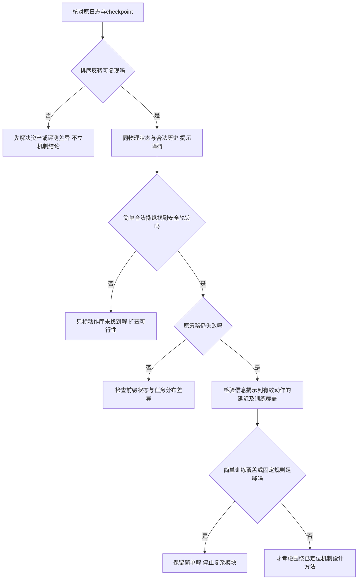

# 避障研究切入点：从已见失败到可证伪问题

2026-11-05。ARIS idea-creator 的定向问题筛选；不是完成了全部新颖性认证或pilot的声明。本轮只读已有结果、核对代码、阅读原论文和检索相关研究，没有新增导航或训练。所有候选需要最小验证后再决定投入；A详细预测性能路线保持停止。

## 当前判断

优先问题：**当障碍较晚进入观测时，帆船还有没有可用的避让机会，现有策略为何没有利用？**

这个问题比“给SAC-LSTM增加一个安全模块”更明确。师兄131页稿件已经报告探测距离缩短后的排序反转，因此有具体失败现象可追溯；但原始日志和checkpoint尚未闭合，不能提前宣布机制或新方法。

原文表5.5：Attention在150/120/100/80米的成功率为96.2/96.6/79.8/43.0%；Deep-LSTM为88.4/89.2/88.8/60.6%。每个距离500场。详见 `../SENIOR_OBSTACLE_HANDOFF_ZH.md`，PDF104—106页。重点不是“把80米成功率刷高”，而是区分**可行动作消失、信息不够、策略未响应、训练分布不匹配**。这四种原因需要不同解决路径。

## 证据分层

| 观察 | 证据等级 | 目前支持什么 | 尚不支持什么 |
|---|---|---|---|
| 晚发现时Attention被Deep-LSTM反超 | 已读论文报告，未复算 | 存在值得追踪的特定失效条件 | 注意力结构是原因；我方actor10800必复现 |
| 两个障碍槽位、静态位置缓存、无速度输入 | 源码核实 | 输入存在明确容量与静态假设 | 第三个障碍已造成实测失败 |
| A强低阶与详细方法新任务均16/16 | 原始结果与审计 | 当前详细预测额外安全收益未成立 | 所有预测都无用；所有复杂任务均已解决 |
| 低阶参考重编码最大2.195秒 | 新16场CSV重新统计 | 同步更新存在周期预算风险 | 已在真实设备发生控制失效 |
| 反应式4个失败均NoRouteError，实体余量仍约59米 | CSV与退出代码核实 | 缓冲违规后物理续航没有被观察 | 四次实体碰撞；退出后必然可恢复 |

## 文献对切入角度的约束

本轮检索了无风输入帆船控制、风约束避障、晚探测/不可避免碰撞、时空循环海事避障、目标意图不确定性、实时/事件触发避障等方向。已读本地原文及下述可访问一手来源；部分出版商全文403/验证码，仅能核对摘要，不能声称完成10—15篇全文综述或穷尽查新。

1. [Yang等原论文](https://doi.org/10.1016/j.apor.2026.105246)：本地19页原文已读。14维无直接风输入的历史控制是既有基础；原静态避障扩展应以学位论文第五章为源，不应归给这篇期刊论文。
2. [Waltz与Okhrin，Spatial-temporal recurrent reinforcement learning for autonomous ships](https://arxiv.org/abs/2211.01004)：已提出处理多目标和部分可观测的时空循环结构，并与势场、速度障碍比较。因此“用记忆/注意力处理多个船”本身不构成缺口。
3. [Wolsieffer，Safe Navigation for Autonomous Sailboats under Uncertain Wind Conditions](https://www.benwolsieffer.com/experience/Ben_Wolsieffer_Safe_Navigation_for_Autonomous_Sailboats_under_Uncertain_Wind_Conditions.pdf)：作者2020年技术报告已考虑风不确定性和帆船禁航约束；采用风传感观测。它是相关先行工作，不应说成已同行评审期刊证据。无风传感器条件是否带来新问题仍须证明。
4. [Fraichard与Asama，Inevitable Collision States](https://emotion.inrialpes.fr/fraichard/publications/journals/04-rsjar-fraichard-asama.pdf)：不可避免碰撞状态是成熟概念，涉及系统和障碍动力学。不能把“考虑船来不来得及转”声称为首创，也不能用有限动作搜索失败宣称进入了该集合。
5. [Dynamic collision avoidance method of unmanned sailboat based on improved fast-marching square method](https://english.ship-research.com/en/article/doi/10.19693/j.issn.1673-3185.03241)：出版商摘要已包括局部风场、禁航区和会遇约束。避免将“动态目标+风约束”作为空白；全文访问后遇验证码，尚未复现其比较方法。
6. [Nonlinear dynamic surface-based event-triggered control for path-following and collision avoidance of unmanned sailboats with output constraints](https://www.sciencedirect.com/science/article/pii/S0029801825037618)：出版商检索摘要已显示事件触发与帆船避障结合；全文403，具体假设待核。实时备选方向必须超过一般事件触发包装。
7. [Collision avoidance decision-making considering uncertain navigation intent](https://doi.org/10.1109/TITS.2025.3649489)：机构存档摘要描述贝叶斯估计、注意力与actor-critic；大PDF抓取失败，尚未全文核对。目标意图不确定性不是未经研究的问题。
8. [Mitigating perception-induced false safety in USV navigation](https://www.sciencedirect.com/science/article/pii/S0029801826035043)：出版商摘要已讨论感知退化、记忆与风险。全文403；“无检测不等于安全”也不能单独作为新颖性声明。

据这些来源，**可能的gap是“有限探测提前量与帆船可执行操纵之间的条件关系，在既有无风输入循环策略上未被当前证据分离”**。这是待查证的具体差异，不是“整个领域没人做过”的结论。是否构成论文贡献，还取决于强简单方法能否解决，以及能否得到跨布局、风况和训练种子的规律。

## 候选全集与机械合并

两名生成agent分别提出8项和5项。按问题对象合并3组重复项后共10项；未因主观新颖性在评审前删除。一个Astra生成成功；另一Astra及继承模型调用容量失败，改用gpt-6.1-sol。技能所列第二生成模型gpt-5.5不在可用模型表，未伪称已调用。独立校核单列记录，均属同家族provisional。

| 编号 | 核心问题 | 当前状态 | 必须击败的简单解释/对照 |
|---|---|---|---|
| Q1 | 晚发现：仍可避让却未响应，还是机会已消失？ | 论文失败现象，身份待核 | 固定舵脉冲、正确标定短时操纵、探测距离随机化训练 |
| Q2 | 最近两个槽位是否遗漏危险第三物体？ | 代码限制，未见因果失败 | 两槽位风险排序与滞回；输入分布变化解释 |
| Q3 | 神经网络“记忆能力”是否依赖完美静态坐标缓存？ | 代码事实，性能影响未知 | 里程计坐标缓存、常规滤波 |
| Q4 | 初次看见移动障碍时，几何相同但速度不同是否需要不同动作？ | 原训练静态，动态歧义待证 | 两帧差分/卡尔曼跟踪+CPA |
| Q5 | 同一几何下左右绕行可执行性如何随风/船体状态改变？ | 物理动机，尚无新配对证据 | 禁航角规则、经验操纵表、合适传统跟踪器 |
| Q6 | 陈旧观测的误差是否只是时间戳未对齐？ | 非理想链待核，A公平批不受此结论影响 | 当前时刻常速外推；先当实现问题 |
| Q7 | 规划后的全历史重编码是否破坏持续1Hz反馈？ | 实际耗时证据，闭环影响未知 | 持续旧参考跟踪、降频、丢弃过期结果 |
| Q8 | 测试是否主要测缓冲/终点可用性而非实际碰撞？ | 已验证覆盖局限 | 清晰失败分类、成熟CPA/有限转率避让 |
| Q9 | 从目标前方还是尾后通过，比增大绕行幅度更重要吗？ | CPA实现存在但A反应对照未用 | 已有CPA+侧承诺、固定尾后通过 |
| Q10 | 轻微缓冲违规后还有哪些恢复动作？ | 旧运行器早停，后续未知 | 保持参考、固定离障方向；不可重标旧成功 |

Q8是所有方向的评价前置工作；Q6首先是实现核验。Q2—Q5、Q9—Q10保留在候选池，不作为已经成立的论文题目。没有为了新题目把A错误重新命名为创新。

## 优先诊断Q1：把“晚发现”改写成“剩余可用操纵时间”问题

实际先做三件事：核对表5.5的两模型与全部配对记录；在固定物理前缀上控制障碍信息揭示时刻；从相同状态运行原策略和少量合法操纵，寻找确实存在的避让见证。此阶段不训练、不加网络。

**工作假设**：一部分近距离失败仍存在可执行安全动作；当前策略未在剩余时间内产生足够有效控制。竞争解释包括：训练没见过晚揭示；两策略本来就以不同速度驶近障碍；槽位切换/归一化异常；物理上避让空间已经不足；控制命令虽不同但整度量化后相同。

图为拟议诊断流程，未执行、未渲染验证。

**样本与对照**：不要只抽Attention失败。先按距离、风夹角、速度分层，使用预先冻结的完整小场景组，保留双方成功/双方失败/胜负互换。全文配对日志用于复算；同状态分支用于因果定位，二者回答不同问题。物理状态还须包括实际帆舵角、设定值、积分/RNG状态。不同网络不能直接互换h/c；各模型应在同一真实观测—动作前缀上构造其自身合法历史，标注该分支是诊断而非自然部署分布。

**自变量**：先只改变首次揭示距离，随后将速度、相对来向、风夹角作为预设分层；不要一次加入丢检、噪声、多个目标和突变风。观察时间从首次真实可见起计，禁止给部署策略未来障碍或真风。真风/完整模型操纵搜索只作诊断见证。

**指标**：原40米安全域侵入与到达结局；命令→量化后目标角→实际角→艏向响应的分步延迟；安全动作见证存在率；最小间距。成功双方才统计航时，同时报告成功集合大小。`(距离−安全域半径)/接近速度`可作粗略提前量标签，不能替代受风、转向和执行器约束的可行性证明；接近速度非正时另分类。

**最小成本建议**：资产/日志检查CPU级；若身份齐全，先12个预定几何，每几何2个环境随机实现，4个揭示条件、2模型=192回合上限。先2回合测耗时，据真实耗时缩减到不超过2 CPU小时；少量同状态动作分支另设1 CPU小时上限，GPU0。此预算为后续建议，未启动。不同随机环境不替代训练种子；单checkpoint诊断只支持这个checkpoint，后续方法性结论至少需要独立训练重复与独立几何测试。

**强基线顺序**：原Attention/Deep-LSTM → 固定合法操纵见证 → 受转率约束的短时控制/经验操纵表 → 如确有训练分布缺口，再比较同预算的探测距离随机化训练。后者尚未授权启动。若普通数据覆盖即可解决，就不要追加注意力门控。

**支持结果**：多种独立布局中存在安全操纵见证，原策略仍系统性失效；排除量化/历史构造/前缀状态后，差异与剩余操纵时间稳定相关。**反驳/停止**：不能复现排序反转；正确简单控制或等预算训练覆盖已消除问题；失败仅发生在未找到可行见证的极端任务；收益只来自提前看见障碍或放宽安全域。无法区分时保留不确定结论，不追加模块。

潜在贡献首先是失效边界与机制诊断；只有机制被定位且简单方案不足，才转为控制方法论文。不能承诺该方向可发表。

## 独立校核后的次序与补充限制

新上下文校核agent独立读取PDF104—106页并复算CSV，确认关键表格及计时数字。其排序为Q1优先，Q8作为评价前置工作，Q3作为低成本备选；Q7只在有实际部署目标时推进。本报告采纳该次序。该意见是同家族provisional，不是正式同行评审或新颖性认证。

必须补充：使用真风或未来信息搜索找到安全轨迹，只证明当前仿真模型下存在一条可行轨迹，不证明策略凭当时可用观测能够选中它。需要再区分“物理可行但不可辨识”和“合法因果信息已足够却策略没有利用”。原两模型自然闭环前缀不同，也不能仅凭Deep-LSTM在另一状态成功就推断Attention当前状态有解。

Q3的具体做法：先用观测时刻的障碍坐标与本船运动维护简单静态位置缓存，在无误差条件下验证它与原V3观测一致；再每次只加入一种定位误差或丢检，比较原真值缓存、简单坐标缓存及常规滤波。问题是原控制能力对模拟器提供的完美静态位置记忆依赖多大。已有代码证明这种依赖接口存在，尚未证明性能脆弱。不得把静态世界坐标缓存误称为每步使用新的传感器观测。建议先24个短配对分支、CPU上限1小时，未执行；误差范围需由目标传感器或明确合成假设支持。若简单缓存/滤波足够，则停止学习记忆新模块；若仅产生脱离应用范围的退化，也不继续。这个备选比实时重编码更直接对应师兄原避障方法。

## 条件备选Q7：参考切换时，如何在不破坏反馈的条件下更新时间记忆

先测完整观测→规划→历史重编码→新参考应用的耗时，再让物理持续推进，分别测试“只延迟高层参考”和“连低层反馈也阻塞”。两者必须分开。已有R9时序实现与结果先读，防止重复已有工作。

事实：新16任务中L*规划最大0.946秒，重编码最大2.195秒，8场超过1秒；R重编码最大1.385秒，6场超过1秒。它表明优化规划本身不保证完整1Hz链达标。具体数字绑定当前机器/负载，不能当所有设备的实时上界。

研究假设是参考坐标变化需要处理历史一致性，而昂贵重编码与持续反馈存在冲突；尚未证明它造成航行退化。先试低层持续执行旧参考、固定更新频率及过期结果丢弃。零延迟必须复现原轨迹。禁止把简单截断LSTM历史当作输出等价加速。

成本：先只读计时与短前缀profiling；必要时24个配对短分支，建议1 CPU小时上限，未执行。若目标硬件全链本来满足周期，或简单异步/降频已满足要求，则停止新算法选题，保留工程修复。这个方向应放在Q1之后，除非近期确有硬件部署需求。

## 本轮界限与接手次序

先交付避障上下文，再核对晚探测表格的原始资产，最后开展受限因果诊断。对不可避免性、注意力内部机制、新颖性、实船可用性均不作超证据结论。未进行新pilot；排名是诊断信息价值的暂定顺序，不是按方法胜率排名。独立校核见 `REVIEW.md`；本地交接包不含权重，也不冒充完整恢复包。
