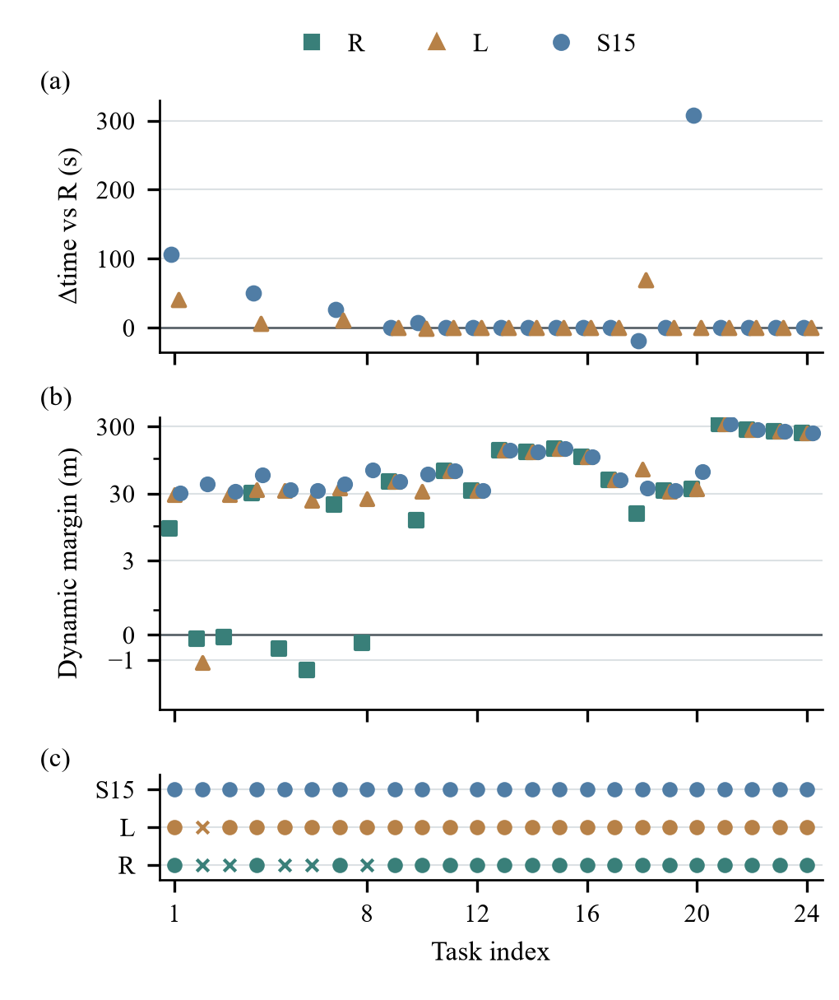
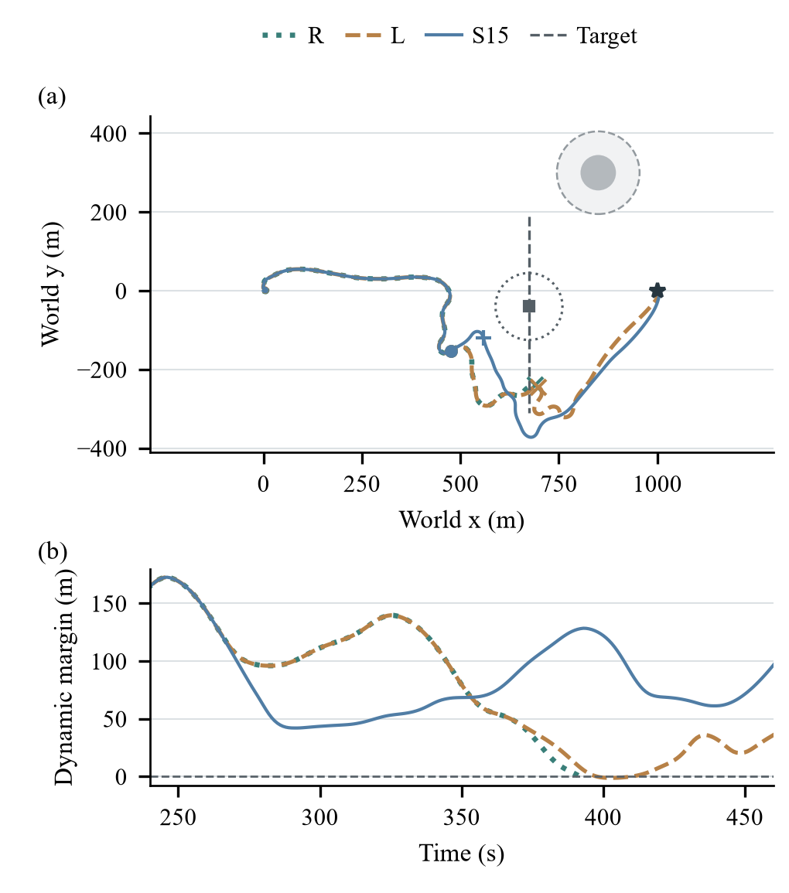
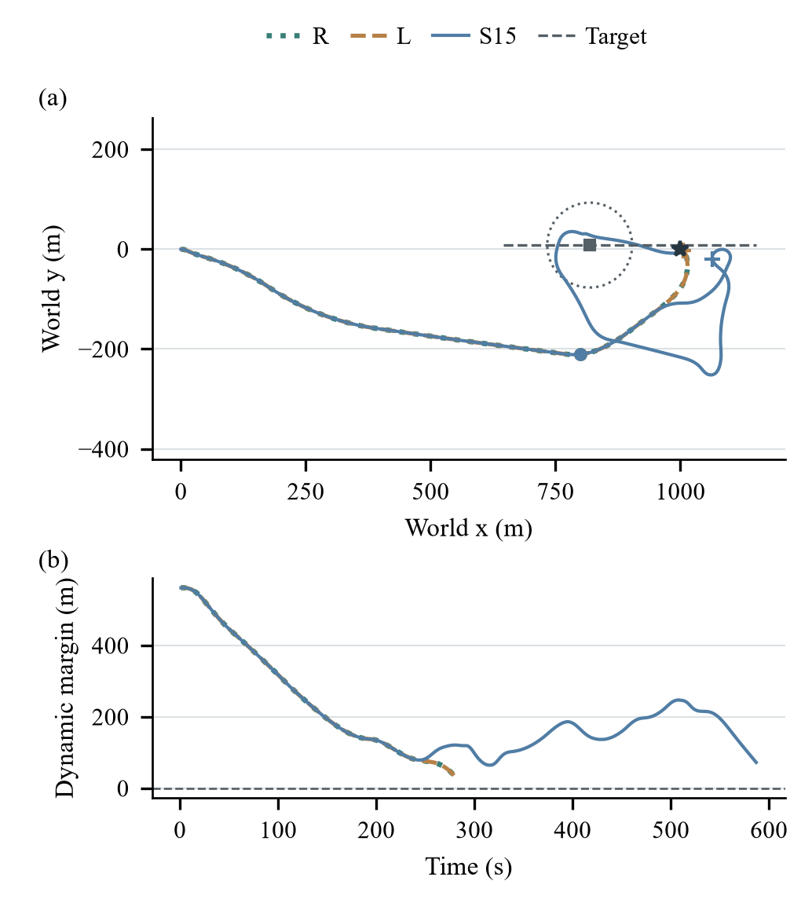
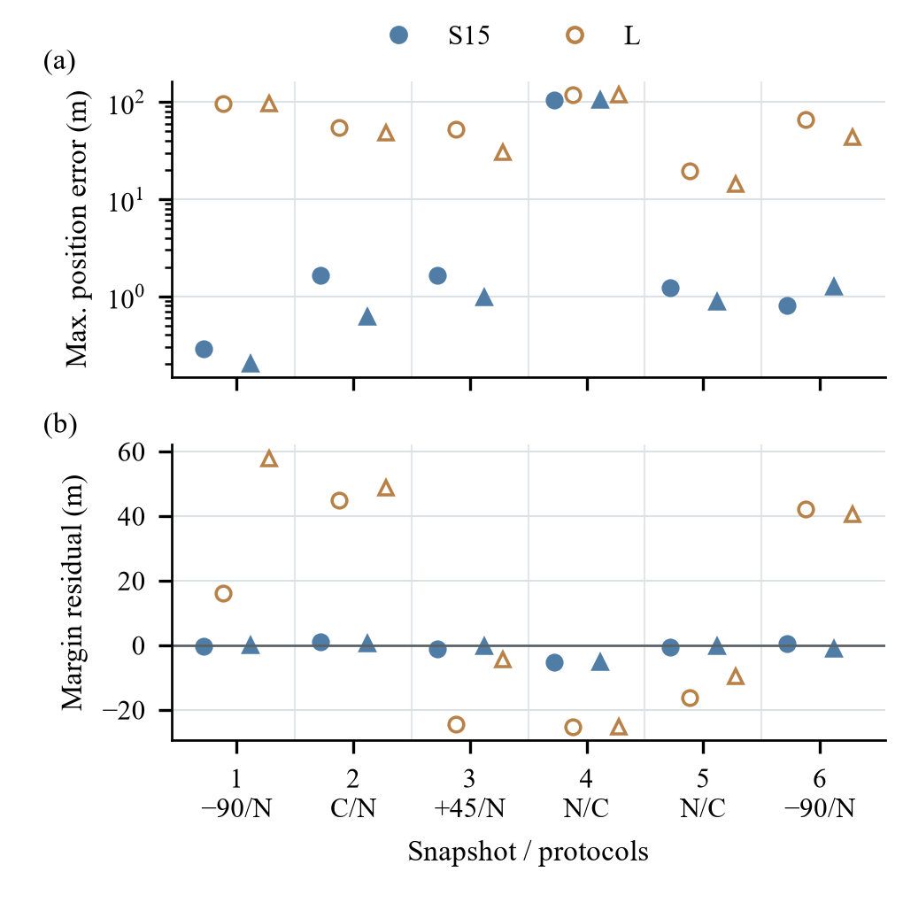
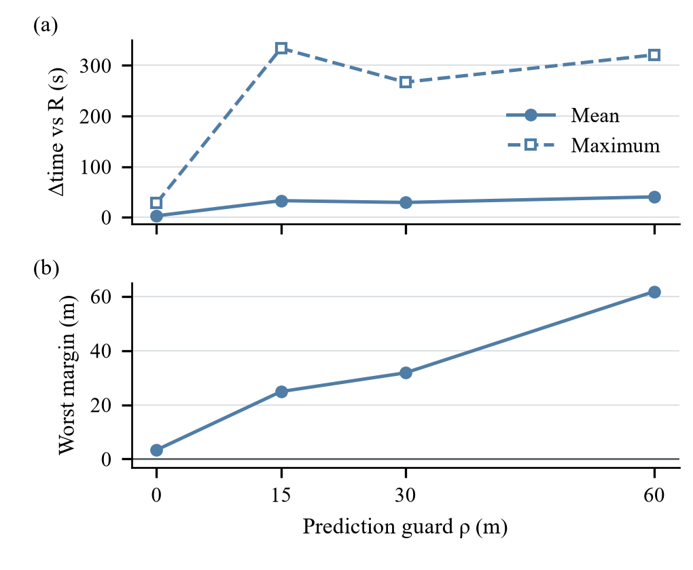

# 帆船参考点预测与动态避障：实验目的、假设、方法、结果及证据全说明

版本：2026-10-22。用途：帮助作者独立理解现有实验、检查论证并组织自己的写作。本文是实验说明书，不是论文草稿，也不是新实验计划的执行记录。

## 阅读入口与证据约定

如果第一次接触本项目，先读第1—4节，再读第8—11节的执行过程。需要写实验部分时，读第5—7节及第12—17节。需要判断什么能写成结论时，读第18—20节。精确场景参数和全部结果在[逐场景附录](附录_逐场景结果.md)，无需依赖历史聊天。

本文沿用已经执行的实验，而不是根据结果重新创造一套研究历史。文中的“假设”是为了理解现有证据而整理的可检验问题，**不宣称这些文字曾作为事前预注册假设**。场景冻结、参数和输出以保存的清单与记录为依据。

证据等级分为三种：

- **本次复核**：从CSV重新计算，或与恢复包中的原始记录字段比对。本次不进行物理仿真。
- **已有记录**：历史检查、诊断或实验已保存的结果。本次读取并解释，不把它写成新运行。
- **待验证**：现有设计无法回答，或资产来源尚未完整确认。

本次复核主实验72条CSV记录与对应原始`trace.json`中的汇总字段，检查安全标签、是否到达、时间、路径长度、动态裕度及CPU。还核对同一场景三方法的初始状态一致、五个冻结源码哈希一致。这不等于重新积分72条轨迹，也不证明原实现的全部物理假设正确。核对记录见[RECOMPUTED_RESULTS.json](RECOMPUTED_RESULTS.json)。

## 1. 一句话定义实验

**在同一个帆船模拟器、同一个已经训练好的驾驶控制器和同一组任务中，比较三种选择临时目标点的方式，观察它们能否安全到达、用了多少航行时间，以及消耗多少计算。**

实验对象不是大语言模型，不是新策略训练，也不是海上实船。研究改变的是驾驶控制器上方的导航监督程序：它选择让船接下来追踪哪个参考点。底层控制器依然负责每秒输出帆、舵命令。

主实验有24个一公里任务，每个任务执行三种方法，共72次完整任务运行。24是任务数，72是运行次数。两个方法在同一场景上的结果是一对，不是来自两个独立场景。

## 2. 为什么这个问题存在

### 2.1 几何上能通过，不代表船实际能这样走

在地图上，从船到某个点画一条直线，直线没有穿过障碍，只能说明这一条线是空的。帆船的实际运动还取决于风、惯性、当前速度、转弯响应以及帆舵变化。控制器追踪同一个点，也未必沿直线行驶。

移动目标又增加了时间因素。两条航迹在图上交叉，不一定发生碰撞，因为双方可能在不同时间经过；两条线看起来不相交，也不能只靠肉眼判断是否满足缓冲距离。必须比较同一时刻船和目标的距离。

### 2.2 我们要考察的机制

如果监督程序能够估计“现有控制器接受这个参考后会走出怎样的航迹”，它可能比只看当前几何关系更早发现不合适的参考，并选择绕行方案。

这是机制假设，而不是必然成立的定理。预测模型可能不准，候选可能都不好，安全条件可能导致过度绕行，计算还可能来不及。因此实验必须同时保留有利案例、不利案例和成本。

### 2.3 研究目的的层次

| 层次 | 具体问题 | 对应证据 |
|---|---|---|
| 执行定义 | 一个候选究竟如何交付、保持、恢复？ | 协议、源码、执行时序 |
| 执行一致性 | 预测初始化和真实系统是否对应？ | 旧动作匹配、前缀和延续检查 |
| 局部预测 | 同一个状态、同一个协议，预测与真实执行差多少？ | 固定协议分支诊断 |
| 整体任务 | 完整航行是否更安全、更快？ | 24个配对任务 |
| 工程代价 | 为上述变化增加了多少计算？ | 整任务CPU与固定输入耗时测量 |

不能用前缀完全相同来证明未来预测准确，也不能用未来预测更准来自动证明完整任务更好。

## 3. 方法名称、继承内容与本轮新增工作

### 3.1 用行为命名方法

| 本文名称 | 原稿代号 | CSV中的variant | 预测方法 |
|---|---|---|---|
| 几何导航 | R | reactive | 不展开未来候选航迹，按共享几何导航规则选择参考 |
| 简化预测导航 | L | simple | 固定最近地速，用简化转向响应预测运动 |
| 详细预测导航 | S15 | sampled | 模拟递归控制器、执行器和船体动力学 |

“S15”是内部实验名称，15指保持/复查周期。简化预测也用15秒，因此不应通过这个名称暗示两者更新频率不同。本文保留代号仅用于对照旧图和数据，正文解释优先使用完整中文名称。

几何导航并非不避障。它使用地图、当前目标观测及临时终点管理规则。三种方法共享真实驾驶控制器，不能把它们说成“三个不同的强化学习策略”。

### 3.2 继承内容

已有的船体动力学、18输入递归SAC控制器及匹配归一化器由 Chao Yang 提供。当前使用确定性动作输出，不更新权重，不重新训练。

这个资产与关联论文中的14维输入表述不同，原始训练运行的完整对应关系仍未确认。不能直接把关联论文的训练成绩、训练场景独立性或公开发布状态归到本实验资产上。获得研究使用和审稿材料提供许可，也不等于已经公开发布。

### 3.3 当前工作实现了什么

实现把参考点及其交付、保持和恢复规则作为候选协议，连接继承控制器与预测分支；恢复预测所需历史和执行器状态；比较几何导航、简化预测、详细预测；记录安全、航时、成本及诊断。

这主要是监督接口与实验评估，不是从零提出船体模型、SAC算法或“预测未来再选动作”这一通用思想。方法价值必须落在本控制器的执行定义和对应证据上。

## 4. 可检验假设及当前判断

| 问题／工作假设 | 如果成立，应看到什么 | 什么会反驳或削弱它 | 当前证据 |
|---|---|---|---|
| 预测能够改变有意义的导航决策 | 同输入出现不同参考选择，配对任务出现收益 | 决策始终相同或产生更多失败 | 存在同输入决策差异；详细预测相对简化预测多1个安全完成 |
| 详细闭环预测比简化预测更接近固定协议执行 | 同协议、同时间域的误差较小 | 更详细仍同样不准或更差 | 选定开发状态的中位误差较小，但有106 m反例 |
| 更详细的预测带来整体航时改善 | 共同安全任务航时分布改善 | 时间优势不稳定或明显增加 | 均值+7 s、中位0、最坏+308 s，不支持总体提速 |
| 附加计算通常值得 | 明确任务价值和预算后仍占优 | 简单方法同样完成且成本更低 | 未定义可验证的通用效用，没有证明通常值得 |
| 每个重建组件都独立增加安全收益 | 对每个组件有接口公平的独立对照 | 等效简化可替代，或无法隔离贡献 | 未做充分组件因果隔离，不能这样声称 |
| 当前配置可实时运行 | 持续运动下按期交付仍保持表现 | 计算超期、计划过时导致退化 | 当前暂停物理时间，未验证实时运行 |

这些判断不是给方法打总分。不同问题有不同实验单位和结论强度。

## 5. 环境定义：船、地图、目标与起始条件

### 5.1 平面坐标与地图

主任务起点为(0,0) m，终点为(1000,0) m。x正方向沿起点到终点，y表示横向偏离。数字是仿真平面坐标，不是经纬度。

主任务静态地图范围为x∈[−2500,3500] m、y∈[−3000,3000] m，网格分辨率25 m；网格是几何规划工具，不是船每次跳动25 m。物理推进是连续动力学积分。物理接口还设置4000 m的world-radius限制。

```text
                         y 正方向
                             ↑
                             │       固定圆障碍(850,300)
                             │              ○
起点(0,0) ● ───────────────────────────────── ★ 终点(1000,0)
                                            x 正方向 →
```

示意图未按比例，固定障碍只出现在组合条件任务。

### 5.2 船体模型不是点沿直线移动

继承模型包含四自由度运动：前后运动、横向运动、横摇、偏航。状态还记录位置、方向、速度、角速度及实际帆舵角。部分继承参数为质量25900 kg，帆面积170 m²、舵面积1.17 m²、龙骨面积8.7 m²。完整参数见[evidence/dynamics_parameters.json](evidence/dynamics_parameters.json)，不要把不同量纲的惯性、附加质量和力矩参数全部写成kg。

这不是已确认的小型实船数字孪生。上述数值属于继承仿真模型，尺寸代理也不等于真实船体轮廓。没有实船标定证明或结构模型失配测试。

起点位置相同不意味着所有任务初始航向和速度都为零。物理reset依场景种子和设置生成状态。本次从原始轨迹提取了[INITIAL_STATES.csv](INITIAL_STATES.csv)，且核对同一场景三方法初态完全相同。`raw`是模拟器原始状态数组，不是18维控制器输入，不能混用索引。

### 5.3 移动目标

每个主任务只有一个移动目标，速度和方向在整个任务中保持不变。它不主动避让本船，也不进行机动。因此预测中采用恒速外推，与目标生成假设匹配；不能把结果解释为已验证机动目标预测能力。

除终点组外，目标速度取0.65～0.95 m/s；终点组取0.8～1.0 m/s。这些是低速目标，不代表全部真实船舶运动范围。

## 6. 24个任务怎样生成

### 6.1 五类场景

| 类别 | 数量 | 目标初始位置与运动 | 基础风向／固定障碍 |
|---|---:|---|---|
| 组合条件（原mixed_pressure） | 8 | q=(x,sT)，x∈[620,710] m，T∈[185,230] s，v=(0,−s) | 风向115°～135°；圆心(850,300) m、实体半径45 m |
| 交叉会遇 | 4 | q=(x,−sT)，x∈[420,540] m，T∈[140,220] s，v=(0,s) | 风向45°～80°；无固定障碍 |
| 追越 | 4 | x∈[230,300] m，y∈[−15,15] m，v=(s,0) | 同上 |
| 终点附近受阻 | 4 | x∈[610,650] m，y∈[−15,15] m，v=(s,0) | 同上 |
| 非冲突 | 4 | x∈[500,600] m，y为±[340,390] m，v=(s,0) | 同上 |

这里s表示目标速度，q表示初始位置，v表示速度向量。T用于设定目标何时穿过y=0这条线，不保证此时本船也到达交点。终点组的目标不是固定堵在终点，它从前方继续向x正方向移动。

组合条件同时改变交会几何、背景风向与固定障碍。它不是一个单因素压力测试。不能说“因为风变化更强，所以方法成功”，也不能说“因为多一个障碍，所以失败”，除非另做隔离因素的实验。

### 6.2 随机性、冻结与配对

场景生成种子为202610612。场景序号i从0到23，物理种子为2026106120+i，风场种子为物理种子+100000。实际抽样顺序保存在`prepare_r12_confirmation.py`，不能只给同一个种子却改变抽样顺序后仍称同一任务。

每个类别按stable/fast交替配置，合计12个恒定风、12个变化风。三方法共享同场景的初始状态、地图、风场、目标运动、控制器与评价规则。所有生成任务和失败均保留。

**稳定风组与变化风组不是仅改风况的严格配对消融。** 不同场景还分别抽取了位置、速度和背景方向；非冲突组的横向正负侧也随编号变化。分组表可描述这批任务，不能单独证明风况的因果影响。

记录表明该确认组在参数冻结后生成；它与简化模型校准场景ID分离。但继承控制器的完整训练场景未知，因此不能保证相对策略训练数据的严格未见性。

全部24个实际参数在[SCENES_24.csv](SCENES_24.csv)，可读版在[逐场景附录](附录_逐场景结果.md)。

## 7. 风场：基础方向与时空变化分别是什么

### 7.1 方向约定

程序返回风吹向的方向。0°沿x正方向，90°沿y正方向；它不是气象学“从哪里吹来”的命名。例如90°表示向图上方吹，不能直接说成北风。基础风向在生成一个任务时确定，并非航行中途从普通组的45°突然切换到组合组的135°。

### 7.2 恒定风与变化风

| 参数 | 恒定风stable | 时空变化风fast |
|---|---|---|
| 基础风速 | 8 m/s | 8 m/s |
| 基础风向 | 按场景抽取后固定 | 按场景抽取后固定 |
| 方向／速度变化 | 完全不变 | 叠加位置与时间的平滑变化 |
| 变化开始 | 无 | 当前主任务在100 s开始 |
| 激活过渡 | 无 | 100～130 s平滑引入 |
| 方向波动幅度参数 | 0 | 45° |
| 附加平滑扰动幅度参数 | 0 | 6° |
| 风速调制幅度 | 0 | ±20%，理论包络6.4～9.6 m/s |
| 基准时间周期／空间波长 | 不影响恒定输出 | 480 s／1200 m |
| 扰动节点间隔 | 不影响恒定输出 | 60 s |

### 7.3 公式怎样理解

令a(t)表示变化激活程度：100秒前为0，130秒后为1，中间使用a=3u²−2u³，其中u=(t−100)/30。这样风的变化平滑接入。

风向写成“基础方向 + a(t)×[45°×波动值 + 6°×扰动值]”。波动值由两个正弦项组成，权重分别为0.65和0.35，各自同时依赖位置和时间；扰动值在−1至1之间，由随机节点平滑插值得到。45°与6°是幅度参数，不是每秒变化量。两分量相加的理论偏转包络可达±51°，不表示每个任务都达到这个极值。

程序精确使用T=2πt/480、k=2π/1200：

```text
wave = 0.65 sin[T + k(0.8x+0.6y) + φ0]
     + 0.35 sin[0.53T + k(−0.6x+0.8y) + φ1]
方向 = 基础方向 + a(t) × [45° × wave + 6° × perturbation(t)]
速度 = 8 × {1 + a(t) × 0.20 sin[0.73T + k(0.6x−0.8y) + φ2]}
```

计算代码中角度换成弧度。φ0、φ1、φ2由风场私有随机种子确定。因为含0.53和0.73倍时间项，不能说整个风场480秒完全重复。

真实环境根据当前位置和物理时间查询风场；相同位置、相同时间的查询不会推进随机数状态。不同方法走不同路线时，可能遇到不同局部风，这是同一空间风场中的路径差异，并非给不同方法故意配置不同天气。

详细预测器不能读取真实风场、种子或未来变化时间表，只能用历史船体运动估计局部风。一条预测分支内将风估计保持不变，所以真实风的变化是误差来源之一。未做独立结构失配测试，不能把这种风估计误差当作所有模型误差的代表。

## 8. 控制器、观测和执行器

### 8.1 观测与控制层次

```text
真实环境：船体状态、目标观测、静态地图
                    ↓
上层导航：决定下一阶段追踪的参考点
                    ↓
底层递归控制器：每秒计算帆、舵命令
                    ↓
执行器逐渐转动，动力学推进船的位置和姿态
                    └────────新的真实观测反馈────────┘
```

上层接收当前状态、因果历史、已经发出的命令、完整静态图和当前目标观测。目标观测包括身份、时间戳、位置、地面速度和有效性。观测范围1000 m；不附加传感器噪声。目标真值用于事后安全评价，不等于全部真值提供给在线预测器。

底层输入为18维。局部坐标框架把当前参考放在(500,0) m，不进行距离缩放；世界位置和朝向按该参考框架编码。

| 输入索引（从0开始） | 内容 | 直观含义 |
|---|---|---|
| 0、1 | 局部x、y | 船在当前参考坐标下的位置 |
| 2、3 | 横摇、相对航向 | 船怎样倾斜、朝向哪里 |
| 4、5 | 纵向、横向速度 | 船沿自身轴线怎样运动 |
| 6、7 | 横摇率、偏航率 | 姿态变化多快 |
| 8、9 | 实际帆角、舵角 | 执行器当前状态 |
| 10、11 | 到参考的距离改善、到局部x=500的距离改善 | 最近一步是否取得进展 |
| 12、13 | 参考坐标(500,0) | 当前追踪目标 |
| 14—17 | 两个障碍的编码距离和相对方位 | 最近相关障碍信息 |

障碍编码距离为max(0,中心距离−排除半径+40 m)，只保留编码距离≤150 m的对象，按编码距离和方位排序，缺项补零。这是底层输入适配，不是上层1000 m观测范围。两个阈值作用不同。

控制器使用匹配的冻结归一化器：(输入−均值)/(标准差+10⁻⁶)。网络带递归状态与10槽注意力历史，隐藏层配置(256,256)，输出确定性tanh动作。本文不重新证明或重建其原训练过程。

### 8.2 动作不是直接把船转到某个方向

输出的两个命令缩放成10°量级增量，按实现的有符号向下取整规则量化到1°，累积到帆舵设定值并限幅。帆设定范围±90°，舵设定范围±30°，实际角度每秒最多改变10°。有符号floor不等于对负数向零取整，复现时不能自行替换。

设定值与实际角度是两个量：命令决定想转到哪里，实际执行器逐渐接近它。动力学使用继承的自适应Dormand–Prince积分推进每个一秒控制区间。

## 9. 参考点和候选协议如何构造

### 9.1 正常几何导航

共享几何导航采用120 m规划余量、500 m前视、100 m交接距离、80 m几何净空触发参数。这些是现有实现配置，不是本实验求出的最优值。

终点不满足点净空条件时，先判断能否保留已有临时参考：它必须距本船超过100 m，参考点及船到参考点的线段均清晰。否则考虑终点周围半径305 m圆上的8个点，角度间隔45°。候选至少距船200 m，连接线段清晰，端点距排除边界的剩余净空至少120 m。按“距离 + 80 m/rad×绝对转向角”排序。终点可用时清除临时参考并恢复正常路线。

点必须有限、在地图内、严格位于排除圆外；线段的最近距离必须严格大于排除半径，相切不算清晰。没有合适参考可能触发NoRouteError。三方法共享这个机制，所以终点管理不能被算作详细预测独有的收益。

### 9.2 预测候选集

按固定顺序考虑：正常反馈；当前参考延续（若存在）；相对正常参考方向−90°、−45°、+45°、+90°的4个侧向点。侧向点在距当前船位350 m处。最多6个候选。

正常候选在预测中继续运行正常导航反馈，参考不一定恒定。其他候选保持其参考P=15 s，再清除临时管理状态并恢复正常反馈。预测尾段不再嵌套未来候选搜索。不同协议即使起始坐标相同，也可能产生不同轨迹。

```text
同一个候选点
     ├─ 始终按正常导航更新：一个协议
     └─ 先保持，再恢复正常导航：另一个协议
```

点由几何规则生成，预测器评价执行后果。它不是连续空间中的全局最优轨迹优化，也没有对350 m和四个偏转角做全面最优性验证。

## 10. 两种预测模型的具体计算

### 10.1 简化预测导航

状态只有位置p、运动方向χ和方向变化率r。这里χ是地面运动方向，不一定等于船头方向。初始速度和方向来自最近位移，r用最近三个方向增量的中位数估计。最近地速v在整条预测分支中保持不变。

每个一秒预测步，计算当前运动方向与参考方位的夹角e，再计算希望达到的转向率r目标，最后让当前转向率逐渐接近它：

```text
r目标 = clip(κe, −r上限, r上限)
r下一步 = r当前 + (1−exp(−Δt/τ)) × (r目标−r当前)
χ下一步 = χ当前 + Δt × r下一步
p下一步 = p当前 + vΔt × [cos(χ当前+Δt r下一步/2), sin(...)]
```

Δt=1 s；τ是响应时间，κ是方向偏差到目标转向率的比例，clip表示限幅。方向差先包裹到合适角度范围，不能把359°与1°之差理解成358°的大转弯。

模型给共享导航模块提供“预测运动方向+当前船头与运动方向差”的航向近似，速度输入仍用预测位置的十步窗口。首个区间所有候选相同，用当前运动外推；它没有显式执行pending旧动作。预测不模拟递归控制器、实际帆舵、风或速度变化。这是整个预测器替换，不能称作仅改变微分方程阶数。

### 10.2 简化模型参数怎样校准

τ∈{1,3,8,20} s，κ∈{0.025,0.05,0.1,0.2} s⁻¹，r上限∈{0.04,0.08,0.16} rad/s，共48组。用7个旧训练源场景的136个不变参考15秒窗口选参数，在另外5个旧验证源场景的87个窗口上报告误差。

目标先对每个源场景内部的窗口位置误差取平均，再对源场景平均，避免长任务窗口多而主导选择。选中(8,0.1,0.16)，训练误差2.749 m、验证误差2.694 m。源场景ID和全网格结果在[evidence/calibration.json](evidence/calibration.json)。

这些窗口是相关的，不是223个独立任务。转向率上限达到网格最大值，不是已经识别出的真实物理极限。最重要的覆盖缺口是：校准15秒且参考不变，使用时却预测60秒且可能改变和恢复参考。当前比较因此不能证明所有合理低阶预测器都不够好。

### 10.3 详细预测的状态恢复

详细模型从观测的当前船体状态开始，恢复累积帆舵设定值、控制器记忆、当前参考坐标框架及导航管理器状态。它使用与真实执行同源的船体模型，但采用独立实例，预测不得改变真实物理状态。

执行器设定值由实际发出的历史命令累积恢复；实际帆舵角直接来自当前物理状态。控制器记忆则在当前参考框架下重新编码历史，重置递归和注意力状态，依次处理已记录状态和实际先前命令。重放产生的动作丢弃，不重新执行过去，也不把过去改成“假如早就使用新参考”的轨迹。

边界t已有状态s₀至sₜ、命令a₀至aₜ₋₁。历史重放先处理0至t−1，下一次对sₜ调用应精确匹配真实控制器已计算的旧参考动作。这个检查验证当前动作对应，不宣称所有隐藏张量完全相同或未来永远准确。

### 10.4 局部风估计

利用从t−6、t−4、t−2开始的三个历史一秒转移，最近一个结束于t−1。比较“观测到的速度、角速度变化”和“给定试探风时动力学预测的变化”，寻找能较好解释近期运动的风向量(wₓ,wᵧ)。整个计算只使用过去信息。

残差包含纵向、横向速度及横摇、偏航角速度的导数差，以diag(1,1,5,5)进行经验缩放。优化变量每个风分量限制在[−16,16] m/s；首次尝试初始先验(0,8)及6个方向不同、模长8的初值，此后从上次估计热启动。每个初值最多35次函数评价，有限差分步长10⁻³。历史不足时保留旧估计。

这是有限的局部最小二乘拟合，不是已证明唯一的风反演，也不是外部天气预测。一条分支中风估计保持常值。

### 10.5 闭环展开

```text
恢复分支初态
    ↓
先执行已经算好的旧动作一个控制区间
    ↓
按协议交付参考，必要时在新框架重建记忆
    ↓
控制器计算下一动作 → 执行器响应 → 船体运动
    ↑                                  ↓
    └──────分支自身预测状态反馈─────────┘
    ↓
达到60秒，或预测到达／路径失败／积分失败时停止
```

分支有自己的历史和管理器副本。模拟出来的状态绝不写入真实历史。目标按当前观测速度外推，预测观测保持1000 m范围限制；但净空评价会持续考虑预测开始时已有效观测的目标，即使它后来离开观测范围。不会凭空加入尚未观测的未来目标。

预测到达可提前停止并视为有效分支；路径或积分失败不算有效。提前到达只说明评估到该时刻，不证明之后停留仍安全。

## 11. 选择规则与一秒执行时序

### 11.1 为什么不是把所有候选都算完再找最低代价

先预测正常参考。如果预测有效、积分成功且最小裕度≥30 m，立即返回正常参考。只有它不通过，才预测替代协议。因此不同方法可能在同一个状态计算不同数量的候选。

若有满足guard的候选，按J排序，再按固定枚举顺序打破相同值：

J = 预测末端到最终终点的距离 + 非正常参考的20 m附加项 + 侧向参考的10 m附加项。

所有项单位是米。正常参考拒绝后，所有可行替代都加相同的20 m，所以这个20 m常数并不决定“是否值得干预”。是否进入干预由触发条件和正常参考guard决定。

如果没有候选满足guard但仍有有效预测，优先最大化预测最小裕度，再比较J和枚举顺序。若没有有效预测，则按规则保持当前参考或用正常参考。没有经过认证的兜底安全策略。

### 11.2 复查触发与参考保持

最早复查时刻为10 s，需足够历史，并有严格小于600 m的有效目标。非正常参考保持尚未到期时，保持优先，不调用正常管理器。到期允许复查。一次实际规划后下次时刻设为当前t+15，不意味着整段航程无条件每15秒都计算。

三个时间尺度是底层控制Δt=1 s、保持/复查P=15 s、预测时域H=60 s。没有action chunk下发：真实帆舵动作每秒重新反馈计算。

### 11.3 精确时序

| 时刻／区间 | 实际操作 |
|---|---|
| 边界t | 底层依据旧参考算出动作；随后上层规划 |
| 上层计算期间 | 物理时间暂停，环境没有向前走 |
| t→t+1 | 执行已算好的旧动作 |
| t+1 | 交付变更的参考，按新框架重建记忆 |
| t+1→t+2 | 新参考最早影响这一段物理运动 |

保持定时器从选择时刻t开始，而不是交付t+1开始。在t+15边界允许释放，若该时刻选择恢复参考，参考于t+16交付。这个一秒差异由离散执行协议造成，复现时不能随意把15秒改成“交付后再完整保持15秒”。

预测期间暂停物理时间，是当前结果的前提。实际船不会暂停，因此本文测量的是理想计算条件下的导航行为。

## 12. 指标：到底统计了什么

### 12.1 安全距离

移动目标的排除距离为85 m，其中25 m为本船10 m与目标15 m的实体代理半径之和，再加60 m缓冲。静态障碍排除半径为实体半径+60 m，组合条件中的45 m圆因此使用105 m排除半径。

动态裕度=同一时刻船与目标中心距离−85 m。0是实际缓冲边界；预测guard=30 m表示要求在这个边界外再留30 m。以该动态目标为例，预测guard通过对应预测间距至少115 m，而实际缓冲安全判定要求间距严格大于85 m。

```text
中心间距                         含义
≤25 m                            实体代理相交
>25且≤85 m                      侵犯安全缓冲，未必实体碰撞
>85 m                            满足当前圆代理缓冲条件
预测最小间距≥115 m               满足额外30 m预测guard
```

边界等号按代码规则处理：安全要求严格正裕度，guard允许等于30 m。实际船体不是圆，圆代理安全不能称为船体连续安全证明。

### 12.2 同步线段最小间距

设一秒开始时相对位置为r₀，本秒结束的相对位置变化为d。在线段内取α∈[0,1]，相对位置r(α)=r₀+αd。距离最小时α*=clip(−r₀·d/||d||²,0,1)，再减去排除半径。d²≤10⁻¹²时采用退化处理。

这个计算会检查一秒区间内双方同步线段的最近位置，不是只看整数秒点。它对这一分段线性近似精确，不等于真实非线性连续曲线或船体扫掠体精确。

### 12.3 完成、到达与退出不是同一件事

安全完成要求到达终点10 m范围内，且整个任务静态和动态裕度均严格为正，并在允许时间内结束。主任务上限1800 s。

`arrived=True`表示到达；`success=True`才表示安全完成。`complete=True`表示运行完成其记录流程，不是成功标签。`reason=NoRouteError`是退出原因；失败类型还要根据实际裕度判断，不能仅由退出字符串决定。

缓冲侵犯不一定立刻终止任务。简化预测的唯一失败仍然到达了终点，但因为曾越界而不算安全。五个几何导航失败均有缓冲侵犯并以NoRouteError退出。不能把提前退出时间当作更快到达。

### 12.4 配对航时与航程

对同一场景的两个方法，只有双方都安全完成，才计算共同安全航时差。详细减简化，正值代表详细更慢。以19个与几何导航共同安全任务比较，与23个详细/简化共同安全任务比较，是两个不同分母。

路径长度为执行位置点累积路程；航时相同不表示路线一样。共同安全统计是条件比较，不能替代全部任务的安全率，也不能直接当作整体效用。

### 12.5 计算成本

整任务CPU累计计算实际执行、初始化和规划等工作。墙钟耗时是外界钟表经过的时间；两者在共享主机、多进程下不是同一个量。

固定输入规划profile只计局部估计、rollout和选择核心，排除模型加载、部分初始候选/正常导航设置与真实反馈执行。它不等于端到端延迟，更不是每个底层动作的耗时。

## 13. 实验地图：哪些试验回答哪些问题

| 实验 | 数据规模 | 主要变量 | 目的与限制 |
|---|---|---|---|
| 简化模型校准 | 7训练+5验证旧源场景，136/87窗口 | 48组τ、κ、转向率上限 | 选低阶参数；不验证60秒新协议 |
| 主确认实验 | 24任务×3方法=72运行 | 导航方式/预测器 | 比较安全、共同安全航时、CPU |
| guard敏感性 | 12旧任务，阈值0/15/30/60 m | 预测筛选阈值 | 检查选择与成本变化；不选择新最优阈值 |
| 已执行前缀诊断 | 46源任务，1083窗口 | 进入、普通反馈、重评估、释放阶段 | 检查实际选择到下次规划前的预测对应 |
| 固定协议诊断 | 6选定开发状态×2协议 | 相同状态下协议及预测器 | 区分预测误差与后续重新规划 |
| 数值子步检查 | 关键失败与安全配对案例 | 观测更小积分步，不改控制 | 检查一秒弦线近似是否改变标签 |
| 计算profile | 3固定状态×3重复×2预测器 | 预测器和运行状态 | 描述计算成本，不是部署保证 |

不能把窗口、分支、重复计时统称为“更多独立场景”。也不能把所有历史组简单加到24个主任务上。

## 14. 主实验结果与完整负结果

### 14.1 总体结果（本次复算）

| 指标 | 几何导航 | 简化预测 | 详细预测 |
|---|---:|---:|---:|
| 执行任务 | 24 | 24 | 24 |
| 到达终点 | 19 | 24 | 24 |
| 安全完成 | 19 | 23 | 24 |
| 最小动态裕度/m | −1.412 | −1.115 | 30.428 |
| 发生预测非正常介入的任务 | 0 | 11 | 11 |
| 全任务CPU总量/s | 270.677 | 378.445 | 2133.232 |

“介入任务”按`interventions>0`统计，不是所有参考点变化；几何导航同样会切换正常参考。详细预测的24/24仅表示本组全部完成，不是普遍100%成功概率。

### 14.2 按任务类别与风况分组（本次复算）

| 任务类别 | 风况 | n | 几何导航 | 简化预测 | 详细预测 |
|---|---|---:|---:|---:|---:|
| 组合条件 | 恒定 | 4 | 2/4 | 4/4 | 4/4 |
| 组合条件 | 变化 | 4 | 1/4 | 3/4 | 4/4 |
| 交叉会遇 | 恒定 | 2 | 2/2 | 2/2 | 2/2 |
| 交叉会遇 | 变化 | 2 | 2/2 | 2/2 | 2/2 |
| 追越 | 恒定 | 2 | 2/2 | 2/2 | 2/2 |
| 追越 | 变化 | 2 | 2/2 | 2/2 | 2/2 |
| 终点附近受阻 | 恒定 | 2 | 2/2 | 2/2 | 2/2 |
| 终点附近受阻 | 变化 | 2 | 2/2 | 2/2 | 2/2 |
| 非冲突 | 恒定 | 2 | 2/2 | 2/2 | 2/2 |
| 非冲突 | 变化 | 2 | 2/2 | 2/2 | 2/2 |
| 全部恒定风 | 汇总 | 12 | 10/12 | 12/12 | 12/12 |
| 全部变化风 | 汇总 | 12 | 9/12 | 11/12 | 12/12 |
| 总体 | 汇总 | 24 | 19/24 | 23/24 | 24/24 |

汇总行不可重复累加。详细相对简化唯一增加的完成位于组合条件变化风组，但该分组不能把收益归因于风。

### 14.3 航时、航程与介入

详细与简化的23个共同安全任务：5个更快、13个同航时、5个更慢；差值总和161 s，均值+7 s，中位0，范围−136至+308 s。共同安全路径长度差的既有汇总为均值+40.177 m、中位0，范围−306.316至+1071.207 m。

相对几何导航，简化预测和详细预测分别在19个共同安全任务上平均增加6.632 s、25.158 s，最大分别增加69 s、308 s。这与23对的+7 s不矛盾，因为比较对象和入选任务集合不同。

既有日志计数中，简化/详细的进入介入次数为29/20，非正常选择次数54/29，无候选满足guard时的fallback次数15/2。进入一次介入、重复选择非正常参考以及一次fallback不是同一个事件，不能互换。较少干预也不自动证明更高效率。



图中的R/L/S15对照第3节。时间面板相对R使用19个共同安全配对；缺失失败配对不是零代价。正文统计详细与简化时使用23对，不要直接从这个面板误读分母。

### 14.4 唯一新增安全完成案例

场景`r12new_mixed_pressure_1`中，详细与简化在260 s之前具有相同记录状态与历史。详细正常参考预测最小裕度11.893 m，小于30 m，因此继续评价替代；简化预测59.832 m，直接返回正常参考。详细选择+90°候选，其预测裕度36.546 m、代价509.528 m；−90°候选裕度70.147 m、代价513.228 m。它没有选择最大裕度候选，因为存在guard可行候选时按代价排序。

选择发生260 s，参考交付261 s，首次物理差异262 s。所选参考约(627.068,163.231) m，正常参考约(575,−200) m。这些是该记录的实际数值，不是示意。

| 方法 | 到达／退出时间 | 最小动态裕度 | 任务结果 |
|---|---:|---:|---|
| 几何导航 | 392 s退出 | −0.162 m | 缓冲侵犯且未到达 |
| 简化预测 | 566 s到达 | −1.115 m | 到达但缓冲侵犯 |
| 详细预测 | 519 s到达 | +42.096 m | 安全完成 |



这个例子支持相同输入下的决策差异以及完整航程结果差异。之后两者继续重规划并进入不同状态，不能据此断言一次+90°选择独立造成整个航程收益。−1.115 m是85 m缓冲边界的侵犯，不是25 m实体代理碰撞。

### 14.5 最大航时损失案例

第四个endpoint任务中，几何导航与简化预测均279 s安全到达，详细预测587 s，多308 s。三种方法都安全，详细预测的绕行不能在这个任务上解释成“新增安全完成所必需的代价”。



它显示完整任务可能产生不利干预成本，但没有单因素实验确认具体由风估计、有限时域或候选限制中的哪一项导致。不得把合理猜测写成已定位根因。

## 15. 预测与执行诊断：检查方法及结果

### 15.1 真实执行前缀

已有记录来自46个历史源任务，共1083个选中协议窗口，1048个完整15秒前缀、35个截短前缀。比较止于下次规划或更早结束，不能拿改变执行协议后的真实轨迹去指责原预测。

进入、普通反馈、重评估、释放四类的最大位置误差分别为1.039、30.506、2.090、0.626 m。该范围内未发现预测正裕度却实际非正、或预测达到30 m而实际低于30 m的短前缀。这个有限观察不验证没被执行的候选，也不保证60秒尾段。

### 15.2 固定协议分支

从6个选定开发状态，各执行两个固定协议分支。先恢复相同物理前缀，再真实执行约定协议，期间禁止新的候选搜索，最多60秒。这样才可以把差异归为预测与同协议执行之间的误差。

| 状态 | 来源与时刻 | 两个协议 | 三方共同区间 |
|---|---|---|---|
| 1 | r8new_mixed_pressure_2，149 s | −90°／正常 | 60／60 s |
| 2 | r8new_mixed_pressure_4，228 s | 延续／正常 | 60／60 s |
| 3 | r10new_endpoint_0，247 s | +45°／正常 | 58／58 s |
| 4 | r8new_endpoint_1，341 s | 正常／延续 | 60／60 s |
| 5 | r8new_nonconflict_0，56 s | 正常／延续 | 60／60 s |
| 6 | r10new_mixed_pressure_0，157 s | −90°／正常 | 60／60 s |

12条物理前缀匹配；其中6个实际被选中的协议，还核对了源运行随后15秒位置一致。其余6条替代分支没有对应原运行中的“被选中延续”，不能声称全12条都做过这一检查。

详细预测与实际分支有12条60秒共同区间；加上简化模型后，其中两条因简化预测更早到达而共同区间变成58秒。三方误差比较必须使用10条60秒和2条58秒的共同域。

在这些共同区间内，分支最大位置误差的中位数为详细1.104 m、简化53.818 m。详细存在106.064 m最大误差反例。简化有3个正常协议预测裕度达到30 m，但实际仅17.868、23.384、16.430 m：这是guard不足，不是实际安全缓冲侵犯，因为仍大于0。

状态4正常与延续轨迹重合，两条相同反例不能当两次独立失败。其详细预测/实际最小裕度约140.990/146.171 m，所以百米位置误差也不自动等于安全失败。



这6个状态是明确挑选的开发诊断，不是随机准确率测试。有些与简化模型校准源任务重叠；149 s与341 s两个固定时刻缺少事前统计选择准则记录。因此，误差中位数只描述这些状态。

### 15.3 一个可解释的局部判断

历史压力状态149 s，详细正常协议预测17.706 m，固定实际执行17.868 m；侧向−90°预测94.815 m，实际95.098 m。简化正常预测75.748 m，会通过30 m guard。该例说明预测差异确实可能改变决策判断，但它是开发案例，不是第14节新确认任务的260秒状态，不能混写。

## 16. guard敏感性、数值检查和计算成本

### 16.1 guard敏感性

12个预选旧任务包括3压力、3终点、交叉/追越/非冲突各2。只改预测阈值，实际安全边界不变。原30 m结果在一致性核验后复用，不重复算作新实验。

| guard/m | 安全完成/12 | 最坏实际动态裕度/m | 共同安全航时差中位/最大/s | 非正常选择 | fallback |
|---:|---:|---:|---:|---:|---:|
| 0 | 12/12 | 3.35 | 0 / 28 | 7 | 0 |
| 15 | 12/12 | 24.88 | 0 / 334 | 13 | 1 |
| 30 | 12/12 | 31.78 | 0 / 267 | 20 | 0 |
| 60 | 12/12 | 61.77 | 0 / 321 | 32 | 2 |

几何导航在这12个任务中为10/12；航时比较使用10个共同安全配对。四个阈值安全完成相同，却有明显不同的时间尾部。不能说更大guard必然更快、更安全，也没有据此改选最优阈值。



### 16.2 更小积分子步检查

关键案例用原命令重放，只增加观测积分器已接受子步的记录，不改积分容差、控制或一秒端点。最大接受子步0.1 s。唯一确认差异的几何/简化/详细最小动态裕度分别由一秒段的−0.162187/−1.115322/42.095555 m变为子步段的−0.162187/−1.117383/42.094165 m，安全标签不变。

这支持这些标签不是单纯由一秒线段近似的符号错误造成；它不代表检查了所有连续时刻或完整船体扫掠碰撞。历史另两个几何缓冲侵犯与其详细安全配对也保留了对应标签。

### 16.3 固定输入计时

| 输入状态 | 详细候选数 | 简化候选数 | 作用 |
|---|---:|---:|---|
| 压力状态 | 6 | 1 | 简化正常预测提前通过，详细继续搜索 |
| 终点状态 | 6 | 6 | 都展开替代候选 |
| 非冲突状态 | 1 | 1 | 都正常早返 |

每个状态每种预测器重复3次，共各9个测量。详细核心墙钟中位数17.009 s、最大17.685 s；简化中位数0.067 s、最大0.136 s。它们不是在所有状态上都固定花这个时间，更不是“每个控制步都算17秒”。

原运行主机AMD EPYC 7V12，最多4个单线程CPU实验worker，无GPU训练。时序测量在共享主机上进行，是经验耗时，不是最坏实时期限证明。整任务CPU和核心profile不同，不应相除后宣称每候选性能差多少倍。

## 17. 历史实验为什么不能混入主结果

下表来自既有补充记录，用于说明研究经历与负结果。本次没有重新验证这些组的全部原始运行；不能把它们与24主任务合并成更大确认集。

| 历史组 | n | 几何R | 详细S15 | 长保持S60 | 正常预测后保持NH |
|---|---:|---:|---:|---:|---:|
| R8短任务 | 30 | 28 | 30 | 30 | — |
| R8长任务 | 4 | 3 | 4 | 4 | — |
| R10已见机制任务，与R8重叠 | 13 | 11 | 13 | 13 | 9 |
| R10新确认任务 | 12 | 12 | 12 | 12 | 11 |

S60保持/复查周期60 s，仍有候选搜索，不是无搜索方法。NH先预测正常参考，不通过时保持当前参考，不评价替代候选，不是无预测方法。

历史12个新任务中，详细预测没有新增安全完成，10条R/S15轨迹相同，平均共同安全航时增加27.08 s，端点案例增加271 s。该负结果必须保留，不能只引用历史救援案例。详细S15较S60平均快9.25 s，但CPU为777.05对328.77 s，仍有代价取舍。

R8/R10/R12/R13是开发与文档版本标识，不是算法名。当前主确认是R12冻结方法的24任务；R13及后续写作修订没有产生新的主任务结果。

## 18. 结论边界：哪些判断成立，哪些不成立

| 可以据证据表述 | 不应扩展成 |
|---|---|
| 这24任务中详细比简化多1个安全完成 | 详细预测普遍更安全，或碰撞风险已降低某个真实比例 |
| 详细在选定固定协议诊断中有较小中位误差 | 任何场景误差都小于某个固定界 |
| 历史、设定值和旧动作恢复使执行定义可检查 | 每个恢复模块分别带来独立安全收益 |
| 同一260秒状态的预测选择不同 | 这一次选择独立造成整个航程获益 |
| 30米是经验预测筛选阈值 | 30米是经过证明的鲁棒安全界 |
| 主实验有变化风 | 已证明抗任意风、抗观测噪声、实船泛化 |
| 在计算暂停条件下完成任务 | 真实运动中实时规划已达标 |
| 相比这个已校准的简化模型有差异 | 详细动力学、递归记忆或某一组件不可替代 |

只有当预测位置误差与目标误差在同一协议、对象和时间域上存在可靠上界E，且E小于guard，才能由类似“实际裕度≥预测裕度−E”推导对应安全结论。当前没有这样的统一误差界。有限样本最大误差不能直接替代它。

本研究也没有预先定义可将安全、航时和计算合并的工程效用。因此不能事后设置权重，给详细方法打一个有利总分，或声称附加成本通常值得。

## 19. 竞争解释与后续最小验证

本节是未来建议，不是已完成结果，不自动启动实验。

### 19.1 优先排除简化模型校准覆盖不足

保留原三参数、48点网格及同一监督器，只把训练诊断改成真实使用的60秒保持/恢复协议。沿原7/5训练验证源场景，每场景按事前固定规则选择一个状态，最多6协议，共最多72短分支。训练按场景等权60秒误差选参，验证不回流调参；提前终止处理提前固定。

冻结后只增加24个简化模型完整任务，与已有结果对照。这是已知benchmark的增强对照，不是新的未见确认。如果原失败消失且无新失败，则详细新增完成优势在增强对照中未保留。一次预定网格后停止，不围绕失败反复扩网格。

### 19.2 再测试新场景重复性

例如8个新几何×2个风实现×3方法，共48航行，事前固定生成规则、方法和统计口径。几何独立单位是8，不能把16个风重复全部当独立几何。多个场景下稳定收益支持更强但仍有界的结论；优势只在单例、风下反转或全部方法安全，则仍不足以推断普遍优越。

### 19.3 局部因果解释可以先做两条分支

从确认案例260秒同一状态，执行正常和+90°固定协议，最多60秒，不再搜索。比较实际裕度与预测判断，可区分当次正常拒绝是否合理、侧向是否真的保持guard。这不替代全航程配对确认，也不能等同于整段收益归因。

### 19.4 实时部署应先改变评测条件

让真实模拟时钟在计算期间继续走，规定旧命令继续方式、过期结果处理和目标硬件期限。先测端到端延迟，再考虑减少重复重建或候选计算。任何加速都必须核对动作、历史和前缀一致性。直接截断递归记忆可能改变控制器行为，不能无验证地当成纯工程优化。

根据风险在两个预测器之间切换是未验证设想。需要定义当前可获得的触发信息、失败处理和独立测试，不能按已经知道的失败案例设计规则后宣称通用切换有效。

## 20. 如何用这份说明独立组织自己的论证

先确定中心问题：“预测参考协议的执行后果，是否改变特定帆船控制器的避障行为及其代价？”不要先从方法名字或模型复杂度开始。

介绍方法时，先交代世界坐标、任务、可用信息和控制器，再交代参考来源、预测模型、筛选和交付。否则读者会把参考点当动作，把15秒当动作包，把60秒当控制周期。

介绍实验时，先区分训练继承资产、简化模型校准、主确认、开发诊断和历史记录。每张表必须写清单位、样本单位、分母、比较对象和数据阶段。

解释结果时，先报告全部24任务，再分析唯一新增完成与最大航时损失；用固定协议诊断解释局部预测，不把它替代任务结果。计算代价和暂停物理时间应在主要方法/实验条件中出现，而非只在最后轻描淡写。

讨论时说明两种竞争解释：详细模型覆盖了更重要的状态，或简化模型的校准目标不匹配。现有数据不能完全区分它们。承认这个边界不会使19/23/24失效，但会改变结论能说到多强。

## 21. 数据字段、代码入口和复算方法

### 21.1 随附文件

| 文件 | 用途 |
|---|---|
| 实验全说明.md / 实验全说明.html | 主文；HTML用于浏览与导航 |
| 附录_逐场景结果.md | 24个任务参数、三方法结果及全部失败 |
| SCENES_24.csv | 实际场景参数，不只有生成范围 |
| RESULTS_24.csv | 一行一个场景，三方法全部关键指标 |
| PAIRED_TIMES.csv | 共同安全航时入选/排除及逐对差值 |
| INITIAL_STATES.csv | 原始轨迹提取的各场景初态数组 |
| evidence/ | 原轻量证据副本，不改变源记录 |
| figures/ | 原有图，不重新绘制或修改科学结果 |
| RECOMPUTED_RESULTS.json | 本次统计复算及原记录核对范围 |
| SOURCE_IDENTITY.json | 阅读起点与文件SHA256 |
| rebuild_evidence.py | 标准库脚本，复算主表与附录，不仿真 |

重要CSV字段：`scene_id`配对键，`variant`方法，`stage`数据阶段，`success`安全完成，`arrived`是否到达，`reason`退出原因，`time_s`已执行物理时间，`path_length_m`实际累计路程，`min_dynamic_margin`动态最小裕度，`min_static_margin`静态最小裕度，`cpu_seconds`该任务CPU。无静态障碍时相关值可能缺失或为无穷，不能强行填成0米。

### 21.2 从任意解压目录复算已有数据

在本文所在文件夹运行：

```text
python rebuild_evidence.py
```

只需Python标准库，使用同目录evidence。它读取confirmation清单和CSV，验证72行、24场景及每场景三方法，输出统计和附录。不调用策略，不加载权重，不启动导航。`--archive`可额外指定原完整恢复包以比对原始trace汇总字段和源码哈希。日常重新汇总不传`--source`，避免误把其他版本作为起点。

本次统计验证之外的诊断数值保留为历史记录读取，不声称全部由这一个脚本重新计算。尤其历史组全量轨迹、未来实验与实船结果不在复算范围内。

### 21.3 完整重新运行实验需要什么

需要完整代码、18维Actor、匹配normalizer、依赖环境、配置和场景。轻量证据不是可运行模拟器。原完整包名`R13_REPRODUCTION_internal.zip`，SHA256为`d0fdc80b40b5252ced7dfd15370a30e092b3232cc1b7ef65e131bedac50ce640`。本说明包没有附带该包或权重，也没有公开下载链接。

完整包中的`verify_recovery.py`检查资产哈希、加载与日志重聚合，仍不是重新运行72次任务。旧批处理脚本包含原截止时间和禁止覆盖已有输出检查；重新执行需另建运行目录、合理的新截止时间，并保持科学配置不变。不能直接覆盖原目录或把绕过执行管理检查写成已经复现。

| 完整包相对路径 | 职责 |
|---|---|
| scripts/prepare_r12_confirmation.py | 场景生成、方法配置、冻结清单 |
| scripts/prepare_r12.py | 简化模型校准准备 |
| scripts/run_r12.py | 主批处理入口及预测器替换 |
| scripts/run_r8.py | 共享真实物理执行、参考交付和记录 |
| src/sailboat_routing/r8_planner.py | 候选与正常优先筛选、保持、回退 |
| src/sailboat_routing/r8_model.py | 详细模型恢复、风估计、分支展开 |
| src/sailboat_routing/r12_model.py | 简化预测状态与更新 |
| src/sailboat_routing/wind_fields.py | 环境私有合成风场 |
| scripts/check_r12_branches.py | 固定协议分支诊断 |
| scripts/analyze_r12_prefix.py | 实际执行前缀比较 |
| scripts/profile_r12.py | 固定输入计算耗时 |
| checkpoints/obstacle_candidate/ | 继承策略与匹配归一化器 |

原恢复说明指定Python3.13及requirements.lock。锁文件记录numpy2.4.6、scipy1.18.1、torch2.13.0+cpu等版本；这些是归档文本记录，不表示本次已经重新安装验证。完整锁文件附为RECOVERY_requirements.lock。归档README中的旧“许可待定”文字与之后确认的研究/审稿材料提供许可存在历史先后差异；原件保留，不擅自改写。原训练归属细节和公开发布状态仍未确认。

Actor文件`saclstm_s14obst_noise_0204_actor10800.pth`的SHA256为`6092d4543c003793f4cd3f21c5ed722f0978eebfdba2f62d77892af333085bd6`；normalizer对应SHA256为`3baf7d1d9d4c9e4505fc991f339221e9e0dc64e9777c6f1c568413a2846b63b6`。文件名含s14不意味着可以忽略实际18维接口。

## 22. 术语对照与最后检查

| 术语 | 本文中的具体含义 |
|---|---|
| 参考点 | 控制器追踪的临时空间目标 |
| 参考协议 | 参考点及交付、保持、恢复规则 |
| 正常/nominal | 不额外选择绕行候选时的共享导航反馈 |
| 闭环 | 下一步动作依赖最新状态反馈 |
| rollout | 在预测副本里逐步向前模拟 |
| pending action | 当前已经算好、接下来必须先执行的旧动作 |
| guard | 对预测裕度的额外筛选阈值 |
| fallback | 无候选满足guard时的回退规则，不是安全认证 |
| confirmation | 已冻结的主评价阶段标签 |
| 配对 | 同一个场景中比较方法 |
| 共同安全 | 两方法都安全完成后才纳入航时比较 |
| 前缀一致 | 诊断恢复的过去状态与记录一致 |
| 墙钟时间 | 现实钟表经过的计算时间 |
| 物理时间 | 模拟船和目标推进的时间 |

独立使用数据时最后检查：方法名称和记录键是否对应；24任务是否被历史组重复扩充；航时比较分母是否清楚；不安全到达是否仍判失败；唯一新增完成与最大绕行是否同时呈现；风方向约定是否写明；计算暂停是否明确；预测精度、执行一致性与整体收益是否分别论证。做到这些，读者才能由实验定义理解结果，而不是被代号和抽象结论带着走。
