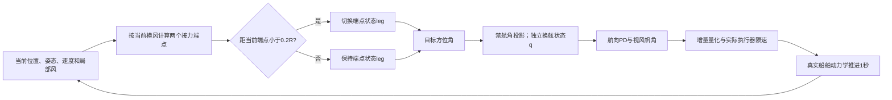

# B 方法说明

## 背景—问题—假设—方法—效果—代价—边界

**背景。** 帆船持续观测一个区域时，到达中心后任务并未结束。无动力推进的帆船不必原地静止，但必须尽量减少离开观测区域的时间。本轮把任务改为半径50m区域内1200s驻留，另设100m尺度检查；这是假想观测足迹，不声称来自某台真实仪器的硬规格。

**问题。** 在同一重型帆船动力学和当前风观测条件下，何种简单成熟航行模式能维持区域内观测，并付出怎样的操纵代价？开发证据没有证明所有成熟驻留方法都失效。中心追踪和正确实现的双点接力都已达到四场开发任务100%区内；研究价值是公平适配、取舍和适用边界，而不是新算法必要性。

**假设。** 保持推进的几何引导比反复降速驻留更适合当前动力学，但中心追踪可能已足够。可反驳条件是：新确认中接力没有优于中心追踪，或者收益伴随不可接受的长期离区。冻结后不换种子、不更改判分、不以单个有利例子宣布成立。

**方法。** 采用传统的横风双点接力，用常规航向反馈和视风帆角控制直接驱动继承动力学。当前风向决定两个相对中心的横风目标，距离中心各0.5R。进入当前目标0.2R邻域时切换到另一端。期望航向若进入逆风禁航扇区，投影到50°迎风边界，保留独立换舷状态。该方案无需RL模型或训练。保留连续指向中心的强简单对照。

**效果与代价。** 新确认24场相对中心追踪，接力区内占比平均-0.69个百分点，2胜/13平/9负，实际帆舵累计变化平均-6.8rad。开发集的并列100%不能代替这一结果。帆舵角变化不是能耗测量；分工况完整数值见研究报告。

**边界。** 所有方案获得理想当前局部风、位置、姿态、体速度和角速度；无未来风。固定继承4自由度动力学，无海流/波浪/交通船。没有现实传感器或实船验证。不能与A线无风观测避碰数字合并。

## 来源与必要适配

Viel等(2018, doi:10.1016/j.ifacol.2018.09.462)给出阶段驻留、可航航向及帆舵反馈结构；Morge等(2022, doi:10.1109/ACCESS.2022.3232462)提供传统航向/帆角和区域驻留实践；Liu等(2025, doi:10.3390/jmse13040668)比较保持运动的直指中心、圆和方形驻留引导，并用NMPC避免低速失控。本轮只借用成熟引导和简单帆舵反馈，不声称复现Liu的NMPC或Viel全部加速度控制与理论条件。跨论文数字不横比。

阶段对照移植Viel的approach/round/hold结构并公平使用共同帆舵控制。两个版本分别保留开发中任务指标最好的小内圈，以及考虑文献内部空间条件的较大内圈。观测圈R与内部控制圈dT/dM不同：small取0.2R/R，footprint取R/2R。前者不满足原文所有几何前提，因此只能叫小圈适配；后者也没有模型一致性证明，不能声称原文方法被复现后失败。公开记录全部适配与开发修正。

## 在线流程与公式

令位置p、区域中心c、风吹向角w，横风单位向量b=(cos(w+π/2),sin(w+π/2))。两个目标g=c+ℓ·0.5R·b，ℓ∈{−1,+1}。若‖p−g‖<0.2R，则ℓ反号；换舷状态q与ℓ分开保存。

参考航向ψ*=atan2(g_y−p_y,g_x−p_x)。若cos(w−ψ*)+cos(50°)<0，则改为ψ*=w+π+q·50°。否则q由sin(w−ψ*)符号更新。该几何处理不能保证船即时达到参考航向。

舵命令δr=clip(−0.7wrap(ψ−ψ*)−1.5r, ±π/6)，倒航时反号。当前视风计算α=atan2(Wsin(w−ψ)−v,−[Wcos(w−ψ)−u])，帆角δs=clip(α/2,±π/2)。这些是常规控制适配，不是新控制定理。

期望帆舵角经过原环境动作接口转换为每步最多10°的目标增量，再由实际执行器与船舶动力学推进1s。原有浮点动作转换和执行器状态均保留；不能把参考角或目标位置当作实际航迹。每一秒从最新真实状态重新计算，风场与动力学同步推进。目标船不存在，本轮是区域观测任务。

阶段hold分支在正向速度时让帆去推力，在非正速度时恢复推进帆角；该分支曾遗漏，已修正且旧日志标作不适于结论。早期接力把目标端点与换舷共用状态也是实现错误，旧成绩全部作废，不作为新方案收益。

## 尺度依据、评价与复现

同一动力学的90°转向达到10°误差带需15–25s、移动37.8–44.1m；180°转向31s、位移31.1m。50m半径能容纳有限机动又足以区分滞留与持续推进，100m是宽松尺度。位移不是稳态转弯半径，不能由它证明Viel的理论空间条件。1200s覆盖多次往返，原型180s响应不能代替长期任务。

主要指标为t=0..1199的1Hz位置样本中距离≤R的比例，分母固定1200；提前失败的剩余时间无区内信用。完整仿真、最长连续离区采样时长、含t=1200的最大半径、实际帆舵累计绝对角变化与最大横倾分别报告。区外接入与区内开始分开统计。

复现入口：scripts/station.py configs/confirmation.json；采用现有环境，PYTHONDONTWRITEBYTECODE=1，OMP/MKL/OPENBLAS线程均为1。FREEZE.json保存全部实例和源码哈希，原始日志每个任务一文件。禁止覆盖已有输出；另设新batch重跑。

## 执行闭环总览

图描述程序信息流，不是机理成立的额外证据。循环在1200s结束；数值积分失败则记录失败并停止，不给予后续区内信用。

## 一个真实决策

冻结confirmation_00在t=0：位置(-1.19,0.79)m，当前风吹向-55.99°，船首-32.25°，初速0.00m/s。接力端点按当前横风计算为(20.72,13.98)m，切点门限10m。记录的最终参考航向为31.03°，归一化帆/舵增量命令为[-0.9999999427042205, 1.0]。该命令随后才进入实际动力学，不能把参考方向当作瞬时运动。原始证据：runs/confirmation/confirmation_00_relay__shuttle.json的trace[0]。
