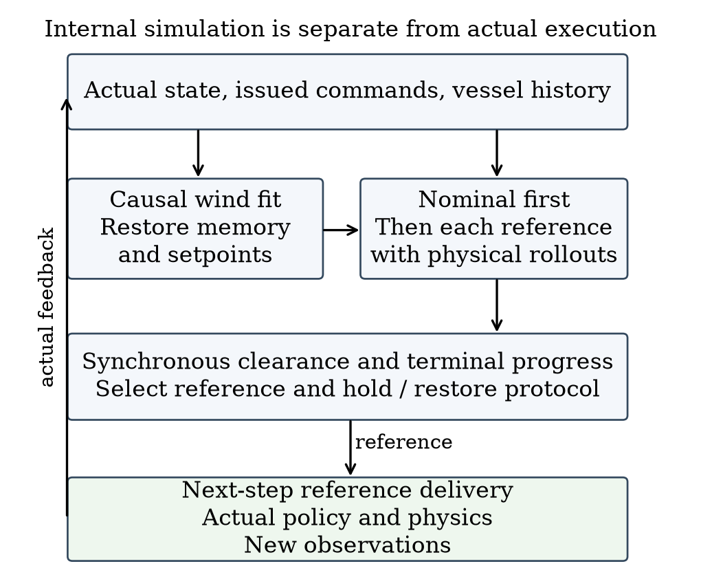
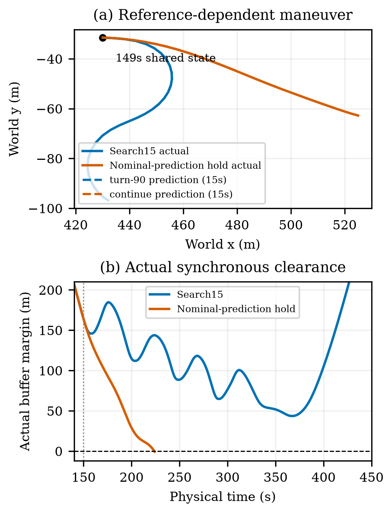

# Candidate Reference Execution Prediction for Sailboat Avoidance in Closed Loop Simulation

Authors and affiliations to be confirmed

## Abstract

A position reference does not specify the trajectory that a sailing controller will execute. This distinction matters when a recurrent sail-and-rudder policy is reused for continuous navigation around moving vessels. We adapt the control-induced-motion principle of generalized velocity obstacles to finite position-reference protocols. An independent simulator restores the controller's causal history and actuator state, fits local wind from observed motion, and predicts each reference together with its holding and feedback-restoration rules. The supervisor preserves nominal feedback when its predicted clearance is sufficient and otherwise selects among executable-reference predictions. In a historical frozen evaluation, candidate search safely completed all 30 short tasks, whereas a reactive relay completed 28; the difference was avoidance of two safety-buffer incursions. A separate 12-instance confirmation gave equal safe completion for search and the reactive relay, with search adding 27.08 seconds on average and up to 271 seconds. Mechanism comparisons show that search can outperform a specified prediction-triggered hold rule, while a slower-update search remains competitive. The study specifies an auditable reference-selection interface and its conditional effects under ideal-compute closed-loop simulation. Its practical unresolved question is when intervention warrants its navigation cost.

Keywords: autonomous sailing; reference selection; closed-loop prediction; dynamic avoidance; recurrent control

## I. Introduction and Related Work

Sailing propulsion and maneuverability depend on wind and the boat's evolving state. A high-level waypoint therefore cannot be interpreted as either an instantaneous heading or a straight trajectory. A local learned controller may tack, turn gradually, or retain a response to its previous reference. A geometrically clear waypoint can consequently lead to a safety-buffer incursion during a moving-vessel encounter. The relevant high-level decision is which reference the existing feedback controller should execute, and for how long.

High-level sailing planners already exploit task-specific environmental structure. Silva Junior et al. use Q-learning for sailboat path planning [1]. Our question concerns execution below that planning interface: two references, or two holding rules for the same reference, can induce different trajectories through a recurrent sail-and-rudder policy. We study continuous navigation with a known static map and no direct wind observation, using a single low-speed moving target and observed vessel motion.

Generalized velocity obstacles (GVO) evaluate motion induced by admissible controls, rather than treating a desired velocity as immediately achievable [2]. Their numerical formulation motivates evaluating reference-conditioned motion here. Our control variable is a position reference plus a finite holding and feedback-restoration protocol. A separate physical simulator runs the same inherited local policy to evaluate these protocols. The resulting method is a sampled adaptation of the GVO principle, rather than a new velocity-obstacle theory.

Reference governors likewise modify commands supplied to an existing closed loop [3]. That supervisory organization is relevant to this interface, although our finite predictions and empirical clearance guard do not provide an admissible-set certificate. Motion-based wind estimation offers another useful connection: MoWe studies obtaining wind information from sailing motion [4]. Here a small inverse-dynamics fit supplies a constant local wind estimate to each prediction. We do not implement MoWe or claim its estimator properties.

This paper makes two contributions. First, it specifies a reference-execution prediction interface that restores recurrent memory, actuator setpoints and command timing, and evaluates simultaneous boat-to-vessel clearance. Second, it separates the value of reference selection from the value of initiating intervention through paired closed-loop comparisons, same-state decision evidence and adverse cases. Planning computation is performed with the physical simulation clock paused. Within this explicit condition, the boat still moves through sailboat dynamics and low-level feedback; neither perfect heading tracking nor future environmental information is assumed.

## II. Navigation Problem and Controller Interface

### A. State and information

At one-second boundary t, the physical state contains world position p, roll and heading, body surge and sway velocities, roll and yaw rates, and actual sail and rudder angles. The final mission destination is G, while g is the currently active position reference. The supervisor receives the current state, previously observed states and issued commands, the static circular-obstacle map, and target-vessel observations with identity, position, ground velocity, timestamp and validity. Target observations are available within 1000 m. The evaluator uses the actual target trajectory even when it is outside this observation range.

The physical environment and the internal prediction model are separate instances. The latter accepts causal state and command history, not the actual wind field, environment random generator, scenario seed, or target's future maneuver schedule. Target velocity is extrapolated inside a prediction. Actual environmental evolution can differ from that extrapolation. Static-map knowledge is complete, and the evaluated observations have no added sensor noise.

### B. Inherited local policy and continuous references

The local policy is an inherited 18-input recurrent soft actor-critic (SAC) asset; SAC's general learning formulation is described in [5]. The asset combines recurrent processing and attention, uses its frozen normalizer, and produces deterministic tanh actions during evaluation. No network training is performed for this study. The physical simulator is the inherited sailboat dynamics implementation, while the 18-input asset supplies the policy and normalizer. These are research-group assets whose publication attribution and release permission require author confirmation; they are not claimed as newly developed or publicly released components.

A rigid local frame places the active reference at (500, 0) m without rescaling lengths. At reference application, its angle is the boat-to-reference bearing θ and its origin is g − 500[cos θ, sin θ]. Body velocities u and v remain in body coordinates. The two progress differences are previous minus current distance to the reference, and previous minus current |500 − x_local|; both start at zero. The first 14 inputs comprise local position, roll and local heading, body velocities, angular rates, actual sail/rudder angles, two progress differences, and the local reference coordinates. The final four inputs are distance/bearing pairs for up to two selected static or observed dynamic obstacles. Their encoded distance is max(0, d − R + 40 m), where d is center distance and R is the obstacle's exclusion radius. Pairs within 150 m in that encoding are sorted by distance and bearing; missing pairs are zero-filled. This inherited boundary-input adapter is shared by the dynamic methods.

On a reference change, the adapter reconstructs recurrent state by reencoding the real state history in the new frame and replaying the actual past commands. Each historical dynamic-obstacle input uses its observation from that time. Predicted histories are never inserted into the real controller history. The ten-slot attention history is distinct from the persistent recurrent state; it is not a ten-step memory reset.

Each normalized action component is scaled by 10 degrees, floor-quantized in one-degree increments, and accumulated into an actuator setpoint. Signed floor is used also for negative increments. Sail and rudder setpoints are clipped to ±90 and ±30 degrees respectively. Actual angles approach them at at most 10 degrees per second. An adaptive Dormand–Prince integrator advances the inherited dynamics over each one-second control step. Thus reference direction alone does not determine the executed motion.

### C. Timing and evaluation

At t, the policy first computes an action using the active reference. The supervisor then selects a proposed reference. The already computed action advances the real dynamics to t+1, after which a changed reference is applied and memory is reencoded. Consequently, a selection at t can first affect the physical transition from t+1 to t+2. Planning wall time is recorded but does not advance this physical clock in the main experiments.

Static exclusion radii equal entity radius plus 60 m. The dynamic radius is 85 m: a combined 25 m entity radius, comprising a 10 m own-boat and 15 m target proxy, plus a 60 m buffer. Safety is measured on every one-second segment. For dynamic motion, define r₀ = pₜ − qₜ and Δr = (pₜ₊₁ − qₜ₊₁) − r₀. The segment clearance is

$$c_t = \min_{0\leq\alpha\leq1}\|r_0+\alpha\Delta r\|-85\ \mathrm{m}. \tag{1}$$

Static clearance is the analogous distance from a boat segment to an obstacle center minus its exclusion radius. Safe completion requires arrival within 10 m of G before the task limit and strictly positive static and dynamic clearance throughout. The time limits are 1800, 5400 and 9000 s for 1, 3 and 5 km tasks. An incursion remains a failure even if arrival subsequently occurs. NoRouteError is an exit label, not the safety measurement. Circular proxies and linear interpolation between recorded states define the evaluation; they are not exact swept-hull guarantees.

## III. Candidate Reference Execution Prediction

### A. Nominal feedback and prediction inputs

The nominal supervisor is a geometric route relay with local obstacle response and shared temporary-endpoint handling. Its settings are 120 m planning allowance, 500 m lookahead, 100 m handoff distance and 80 m clearance trigger. It uses current observed target positions in its circle map. The search supervisor first considers this nominal feedback, preserving it whenever the predicted margin meets an additional planning guard. Fig. 1 separates the prediction branches from physical execution.



Prediction is first eligible at t = 10 s and is evaluated only when a valid observed target lies strictly within 600 m and the update timer is due. A non-nominal reference remains active until its holding timer expires. The representative configuration uses a 60 s prediction horizon and a 15 s holding/update period. These are development settings, not optimized values or stability bounds.

### B. Local wind fitting

Let z = (u, v, ωφ, ωψ) denote the four stored body-velocity and angular-rate components, and let f_z denote their time derivative returned by the inherited dynamics. The rate-component symbols distinguish these state variables from position p. At decision t with sufficient history, the fit uses three observed transitions with start indices Iₜ = {t−6, t−4, t−2}. Thus the latest used transition ends at t−1; the transition t−1 to t is not used. For each pair, the state midpoint is arithmetic except for a shortest-angle heading midpoint. Actual midpoint sail and rudder angles enter f_z, with zero within-step angle increments for this derivative evaluation.

The fitted world-frame wind vector w is obtained from

$$\hat w_t=\arg\min_{w\in[-16,16]^2}\sum_{i\in I_t}\|D[f_z(\bar s_i,w)-(z_{i+1}-z_i)/\Delta t]\|^2,\quad D=\mathrm{diag}(1,1,5,5),\ \Delta t=1\mathrm{s}. \tag{2}$$

The componentwise bounds have units m/s and are not a bound on vector norm. The initial prior is (0, 8) m/s. The first fit evaluates that prior and six magnitude-8 m/s initializations separated by 60 degrees, retaining the lowest residual. Later fits warm-start from the previous estimate. The implementation uses bounded least squares with max_nfev = 35 and finite-difference step 10⁻³ per start; this is not a 35-call total execution bound. With fewer than three available transitions, it retains the prior. Wind is then fixed within each candidate rollout. The fit is a local motion-consistency approximation rather than access to the hidden future wind.

### C. Restoring and predicting candidate execution

Each branch restores the current physical state and reconstructs actuator setpoints by accumulating all previously issued commands through the same scaling, quantization and clipping rules. It restores the current reference frame and policy memory from the causal history. The reproduced current policy action must equal the already computed real action elementwise before the branch proceeds.

For target j, the predicted position is q̂ⱼ(t+k) = qⱼ(t) + k vⱼ(t), using only its current valid observation. Predicted observations retain the 1000 m visibility limit. The same local policy and dynamics advance the boat at one-second intervals under the fitted wind. Prediction terminates after 60 s, on reaching the original task goal, or on integration or predicted route failure. An early predicted arrival is valid; a route or integration failure makes that prediction ineligible for guarded selection.

The fixed candidate order is nominal feedback, continuation of the current reference, and four side references. If β is the bearing from current pₜ to the nominal reference, a side reference is

$$g_\theta=p_t+350[\cos(\beta+\theta),\sin(\beta+\theta)]^T\mathrm{m},\quad\theta\in\{-90,-45,45,90\}^\circ. \tag{3}$$

Nominal feedback follows the ordinary relay's updates throughout the rollout. Each other candidate initially holds its reference for the configured period, then restores ordinary relay feedback, clearing the incumbent reference on release. All candidates use the already computed action in their first step and apply proposed references with the same next-step order as real execution. A nominal and continuation candidate can therefore share coordinates while inducing different motion. The prediction tail assumes nominal feedback after release; future online decisions may instead initiate another intervention.

### D. Trigger, selection and recovery

The predicted margin m(c) is the minimum static or synchronous dynamic clearance over the candidate's simulated segments. A candidate is feasible when prediction is valid, integration succeeds and m(c) ≥ 30 m. This 30 m planning guard is separate from the zero-margin evaluation boundary. The nominal candidate is evaluated first; when feasible, evaluation stops and nominal feedback is used. Otherwise the remaining candidates are evaluated and feasible candidates minimize

$$J(c)=\|\hat p_c(K_c)-G\|+20\,\mathbf1_{c\ne\mathrm{nominal}}+10\,\mathbf1_{c\in\mathrm{side}}\quad[\mathrm m]. \tag{4}$$

Here K_c is the completed prediction length, at most 60 steps. Exact score ties retain the fixed enumeration order. If no candidate meets the guard, the supervisor chooses the valid, integration-successful prediction with maximal margin, breaking ties by lower J and then enumeration order. If none is valid, it returns the current reference if available, otherwise nominal. This is a best-effort fallback, not a certified safe backup. A base-planner failure before candidate construction can still terminate the actual task.

The chosen non-nominal reference is held until the timer expires. At the next eligible evaluation, the process either continues intervention, chooses another reference, or returns to nominal feedback. Algorithm 1 summarizes this decision. There is no separate geometric side-reference prefilter: feasibility is evaluated through the predicted execution.

```text
Algorithm 1  Reference selection at a physical decision boundary
1  If a non-nominal hold is active, return the held reference.
2  Obtain the nominal relay reference from current observations.
3  If no target is within 600 m or the update is not due, return nominal.
4  Fit wind from causal motion history and restore prediction state.
5  Predict nominal feedback. If valid with margin >= 30 m, select it.
6  Otherwise predict current-reference hold and four side references.
7  Select minimum J among feasible candidates, or use margin fallback.
8  After every prediction, set next review to t + period. Hold a
   non-nominal selection until then; otherwise release the hold.
9  Return the reference for application after the already computed action.
```

Temporary endpoint occupation is handled identically for all comparators. When the final goal is currently covered, the nominal relay retains a clear current reference more than 100 m away if possible. Otherwise it considers eight points on a 305 m ring around the goal, rejecting points closer than 200 m to the boat, blocked segments, or endpoint clearances below 120 m. It minimizes distance plus 80 times absolute heading turn in radians. When the goal becomes available, it clears the incumbent and reconnects to the original task. If no temporary reference exists, it reports NoRouteError. The endpoint mechanism neither stops the boat nor removes a vessel.

## IV. Experimental Setup and Results

### A. Comparators and evidence groups

All comparisons retain the same policy, normalizer, dynamics, static map, initial state, external wind-field parameters, target motion and task judgement within each instance. Different executed paths can encounter different local values of the same spatial wind field. No additional learning is performed. We compare the following methods, using ideal-compute timing for all main results.

**Reactive relay (R)** uses nominal feedback and the shared endpoint manager. It includes local obstacle response and sail/rudder feedback, but does not simulate future candidate execution. **Search15 (S15)** is the representative method with a 15 s hold/update period. **Search60 (S60)** searches the same candidate set over the same 60 s horizon, with a 60 s hold/update period. Changing this period also changes subsequent wind-estimation history. **Nominal-prediction hold (NH)** predicts only nominal feedback; if that prediction is invalid, fails integration, or has margin below 30 m, it holds the current reference for 15 s when available, otherwise returning nominal. It does not predict alternatives. Each method triggers from its own actual history, not from another method's future trigger times.

The historical short evaluation contains 30 instances, six each of crossing, overtaking, non-conflict, endpoint and designed high-pressure crossing. These instances were generated after the then-current method freeze, but were later inspected during method selection. A separate historical long group contains four tasks: crossing and overtaking at both 3 and 5 km. The seen mechanism group contains 13 of the historical short instances and is not an additional independent sample. Finally, the new confirmation contains 12 frozen 1 km instances: four pressure and two each of crossing, overtaking, endpoint and non-conflict. All generated instances are retained. These small designed strata are not a sample of natural maritime traffic frequency.

All main tasks contain one non-reacting target with constant world-frame velocity and no scheduled turn. Target speeds range from 0.575 to 1.231 m/s in the historical short group, are 0.9 or 1.0 m/s in the long group, and range from 0.657 to 0.913 m/s in new confirmation. Constant-velocity extrapolation is therefore matched to these observed targets; robustness to target maneuvers is not evaluated. The private synthetic wind field has base speed 8 m/s. Historical short tasks contain 18 stable, six slow and six fast profiles; new confirmation contains six stable and six fast profiles. Stable wind is fixed. Slow/fast profiles add bounded spatial and temporal direction waves with amplitudes 25/45 degrees, directional perturbations up to 3/6 degrees, and speed modulation of 12/20 percent. Exact instance manifests and asset hashes accompany the draft; public redistribution of the inherited assets remains subject to permission.

Table I reports the groups separately. Safety completion is the primary endpoint. Navigation-time differences are computed only on pairs in which both methods safely complete, and early failure is not counted as fast arrival. A task, rather than a one-second state, prediction window or candidate, is the sampling unit.

Table I. Safe completions by evidence group. The seen mechanism row overlaps the historical short row and must not be pooled with it.

| Evidence group | Tasks | R | S15 | S60 | NH |
|---|---:|---:|---:|---:|---:|
| Historical short | 30 | 28 | 30 | 30 | — |
| Historical long | 4 | 3 | 4 | 4 | — |
| Seen mechanism | 13 | 11 | 13 | 13 | 9 |
| New confirmation | 12 | 12 | 12 | 12 | 11 |

Table II. S15 navigation-time difference from the reactive relay on common-safe pairs. Median difference is zero in each group.

| Evidence group | Pairs | Mean (s) | Maximum (s) |
|---|---:|---:|---:|
| Historical short | 28 | +15.29 | +267 |
| Historical long | 3 | +8.67 | +26 |
| Seen mechanism | 11 | +38.91 | +267 |
| New confirmation | 12 | +27.08 | +271 |

### B. Avoided incursions and same-state selection

In the historical short group, both search protocols safely complete all 30 tasks, whereas the reactive relay incurs the dynamic buffer in two pressure tasks. Its margins are −1.225 and −0.872 m before NoRouteError termination; S15 completes the corresponding tasks with margins 43.589 and 38.455 m. No entity collision is observed in those failed reactive trajectories, so the measured gain is prevention of buffer incursion and recovery of safe task completion. The remaining 24 non-pressure tasks are safe for all three methods. S15 and the reactive relay have identical complete trajectories in 22 of 30 tasks.

The seen mechanism group tests whether predicting nominal risk and simply retaining the incumbent reference can reproduce search's effect. S15 and S60 complete all 13 tasks, while NH completes nine. The four NH failures include both historical reactive-incursion cases. Three first-decision differences have identical preceding physical states, commands, vessel observations and complete nominal predictions. This controls the information and initial execution conditions for those decisions without assuming later trajectories remain identical.

Fig. 2 illustrates the first difference at 149 s in one pressure case. Nominal feedback predicts 17.706 m minimum margin and continuation predicts 22.110 m; both are positive but below the 30 m guard. The −90-degree reference at (238.784, −324.617) m predicts 94.815 m margin and has score 521.172 m, below the other feasible side scores. It is selected at 149 s and applied at 150 s; the first physical-state difference occurs at 151 s. S15 safely completes at 444 s with 43.589 m actual margin. NH terminates at 224 s with −0.649 m margin. This establishes a difference between the defined online selection rules, not proof that the first turn alone determines the final outcome or that every side candidate is necessary.



The selected prediction has maximum position error 0.00684 m over the first 15 s after that decision, including the first old-action step. The corresponding reference-execution interval gives the same maximum. This is a favorable local case. Historical ordinary-feedback windows include an error of 30.506 m over 15 s. Prediction tails also mix model error with later decisions that may differ from the assumed return to nominal feedback. A local agreement therefore does not turn the planning guard into an error bound.

In the four long tasks, both search protocols complete four and the reactive relay completes three. The 3 km crossing is completed by S15 in 929 s and S60 in 877 s; the reactive trajectory ends after incursion at 512 s. All methods complete the 5 km crossing, with times 1306, 1332 and 1516 s for R, S15 and S60. The two overtaking tasks have identical trajectories and no search intervention.

### C. New confirmation and intervention cost

The new confirmation gives 12 safe completions for R, S15 and S60, and 11 for NH. S15 does not improve safe completion over R in this group. Ten of the twelve complete trajectories are identical between S15 and R. Intervention occurs in only a pressure instance and an endpoint instance, adding 54 and 271 s respectively. Their mean over all twelve common-safe pairs is 27.08 s. These unchanged tasks should not be counted as evidence of successful activated avoidance.

In the new pressure instance, R completes in 299 s with 6.512 m margin; S15 takes 353 s with 37.337 m; S60 takes 443 s with 17.993 m. NH instead incurs the buffer, reaching −20.580 m before termination at 292 s. This demonstrates that the tested hold response can harm an otherwise safe closed loop. Search avoids that outcome, but the case does not establish that intervention was necessary compared with continued reactive feedback.

Fig. 3 contrasts a historical rescue with the largest new navigation cost. In the new endpoint case, R is already safe at 313 s with 10.957 m margin. S15 completes at 584 s with 34.687 m margin. A larger margin comes with 271 s extra travel time; the evaluation defines no utility function that proves this exchange worthwhile. The historical endpoint case also has a 267 s cost, involving both the maneuver and subsequent endpoint availability. Neither case should be attributed solely to holding duration.


Search60 remains a substantive competitor. In the new group it has the same safe-completion count as S15, using 328.77 s cumulative episode CPU time versus 777.05 s. S15 reduces common-safe navigation time by 9.25 s on average relative to S60, with median zero. NH uses 693.43 s CPU and R uses 130.83 s; these totals include complete episodes and their different durations. They are not planning deadlines. In the historical long group, one S15 planning call takes 43.459 s, longer than the 15 s update period. The main results rely on ideal computation timing and do not demonstrate that this update rate can be delivered online.

## V. Discussion

The comparisons distinguish three decisions: whether to predict, whether to intervene, and which reference to execute after intervention. The same-state evidence and NH failures show that incumbent holding is not interchangeable with reference-conditioned search. However, new confirmation provides no safety-completion advantage over the reactive relay, and its active interventions increase navigation time. The practical limitation within the studied setting is therefore the trigger's intervention value, not merely a future implementation-speed issue.

Several details make the adaptation meaningful at the controller interface. The output is a position reference rather than a directly executable velocity. Restoring setpoints and causal recurrent state gives each branch the same starting controller condition. Keeping the first old action and subsequent delivery order matches the real interface. Predicting feedback after a finite hold distinguishes protocols that use identical reference coordinates. These choices specify what is being compared; they do not establish model robustness or candidate completeness.

The results depend on known dynamics, accurate current motion observations, local constant-wind fitting and short-horizon constant-velocity extrapolation. The 30 m guard has no certified uncertainty interpretation, and all-candidate infeasibility is handled by a best-effort branch. The one-second circular clearance proxy is also narrower than continuous physical hull safety. Evaluation covers a single low-speed non-cooperative target rather than a complete maritime rule system.

A separate timing-aware study of the same project provides a deployment boundary: with an additional five seconds of waiting in one case, a predicted margin of 82.692 m accompanies an actual −0.949 m incursion. That experiment uses a different delivery protocol and is not pooled with the ideal-compute results. It shows why future deployment evidence must model motion during computation. It does not identify a unique cause of the discrepancy without further isolation.

The evidence is deliberately limited. Historical tasks were independent of the then-current freeze but later influenced selection; the seen mechanism set overlaps them. The new set is small and has only two activated S15 instances. These observations support a conditional interface study, not a statistically established population advantage. The next useful assessment is a predefined intervention-value comparison that retains the reactive and slower-update alternatives, rather than another search for a favorable update period.

## VI. Conclusion

We presented candidate-reference execution prediction for an inherited recurrent sailboat controller. The supervisor evaluates position references together with holding, delivery and feedback-restoration rules through an independent causal simulator. Historical closed-loop results include avoided moving-vessel buffer incursions, and same-state comparisons show that search can differ materially from a specified nominal-prediction hold rule. A separate new confirmation preserves safe completion but reveals no advantage over the reactive relay and a substantial intervention-cost tail. The resulting contribution is a concrete reference-prediction interface and evidence of when selection matters under ideal-compute simulation. Determining when that selection warrants intervention remains the main practical question.

## Acknowledgment and Draft Declarations

Author names, affiliations, funding and formal attribution of the inherited controller, dynamics and weights require confirmation. AI tools assisted drafting, code-based evidence checking and internal simulated review. Human authors must verify the manuscript and the applicable disclosure wording before submission. No new training or physical experiment is reported here.

## References

[1] A. G. da Silva Junior, D. H. dos Santos, A. P. F. de Negreiros, J. M. V. B. de Souza Silva, and L. M. G. Gonçalves, “High-level path planning for an autonomous sailboat robot using Q-learning,” Sensors, vol. 20, no. 6, Art. 1550, 2020, doi: 10.3390/s20061550.

[2] D. Wilkie, J. van den Berg, and D. Manocha, “Generalized velocity obstacles,” in Proc. IEEE/RSJ International Conference on Intelligent Robots and Systems, 2009, doi: 10.1109/IROS.2009.5354175.

[3] E. Garone, S. Di Cairano, and I. Kolmanovsky, “Reference and command governors for systems with constraints: A survey on theory and applications,” Automatica, vol. 75, pp. 306–328, 2017, doi: 10.1016/j.automatica.2016.08.013.

[4] Q. Sun, W. Qi, and H. Qian, “MoWe: Motion observation for wind estimation of sailing robots,” Journal of Field Robotics, vol. 42, no. 5, pp. 2355–2374, 2025, doi: 10.1002/rob.22512.

[5] T. Haarnoja, A. Zhou, P. Abbeel, and S. Levine, “Soft actor-critic: Off-policy maximum entropy deep reinforcement learning with a stochastic actor,” in Proc. 35th International Conference on Machine Learning, vol. 80, pp. 1861–1870, 2018.
