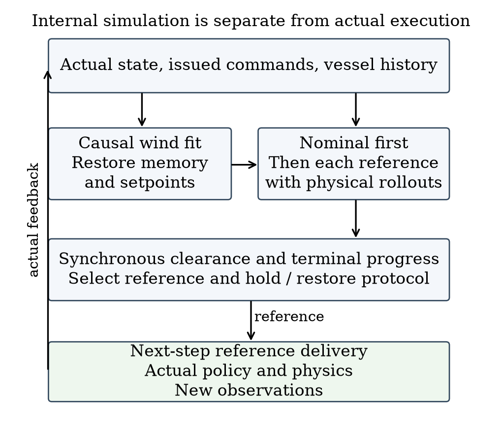

# Reference-Conditioned Closed-Loop Prediction for Dynamic Obstacle Avoidance of an Autonomous Sailboat

Authors and affiliations to be confirmed

## Abstract

@ABSTRACT@

Keywords: autonomous sailing; reference-conditioned prediction; dynamic avoidance; recurrent control; closed-loop simulation

## I. Introduction and Related Work

A waypoint specifies where a sailing controller should go, not the trajectory that it will execute. Wind-dependent propulsion, finite turning response, actuator dynamics and recurrent state can produce motion that differs from the waypoint chord. During a moving-vessel encounter, a geometrically clear reference can therefore induce a safety-buffer incursion. The supervisory problem is to compare references together with their holding and feedback-restoration rules.

High-level sailing planners can exploit environmental information; Silva Junior et al. use Q-learning for sailboat path planning [1]. We address the execution interface below planning, with a known static map, no direct wind measurement and observations of one low-speed target. Generalized velocity obstacles (GVO) evaluate control-induced motion rather than assuming that a desired velocity is immediately achievable [2]. Reference governors similarly modify commands supplied to an existing closed loop [3]. Branching-course model predictive control evaluates maritime maneuvers before executing their initial portion [6]. Feedback motion prediction provides controller-specific motion envelopes for unicycle reference regulation [7]. These works motivate the interface studied here; their controller assumptions and safety guarantees are not transferred to a recurrent sailing policy.

We adapt the GVO principle to finite position-reference protocols. A separate instance of the inherited policy and dynamics predicts each protocol under a motion-based local wind fit. MoWe [4] motivates obtaining wind information from vessel motion, but our bounded inverse-dynamics fit is neither its reproduction nor a new estimator. The contribution is a concrete execution-prediction interface and a qualified empirical assessment. We compare detailed prediction with a calibrated low-order candidate predictor, examine a finite guard range, and distinguish actual short-prefix agreement from fixed-protocol prediction quality. Planning computation pauses the physical clock. Actual motion still follows sailboat dynamics and feedback; neither perfect heading tracking nor future environmental information is supplied.

## II. System and Evaluation Conditions

### A. Inherited dynamics and local policy

The local controller is an inherited 18-input recurrent SAC policy with temporal attention, a frozen normalizer and deterministic tanh evaluation actions. Reference [5] describes SAC, not the specific inherited checkpoint. The Actor has hidden layers (256,256) and persistent recurrent state; its ten-slot attention history is not a periodic memory reset. No network is trained in this study. The physical simulator and detailed predictor use separate instances of the same inherited dynamics. This isolates state and hidden information, not model-identification error.

The implemented four-degree motion state includes position, roll, heading, body surge/sway velocities and roll/yaw rates, plus actual sail and rudder angles. Implemented parameters include mass 25,900 kg and sail, rudder and keel areas 170, 1.17 and 8.7 m². The reproducibility supplement lists the full parameter dictionary, exact code and weight hashes. Sailing-yacht models are discussed in [8]; code-level equivalence to that publication is not asserted. Formal attribution and distribution permission for the inherited controller and simulator remain author-verification items.

An active reference g defines a rigid frame with angle θ equal to the boat-to-reference bearing at application and origin g − 500[cos θ,sin θ]. It places the reference at (500,0) m without rescaling. The first 14 policy inputs are local position, roll/local heading, body velocities, angular rates, actual sail/rudder angles, two progress differences and reference coordinates. Progress differences are previous minus current goal distance and previous minus current |500 − x_local|, initially zero. Body velocities remain in body coordinates. Two additional obstacle distance/bearing pairs use max(0,d−R+40 m), where R is exclusion radius; pairs within 150 m in that encoding are sorted by distance/bearing, with missing entries zero-filled.

Reference changes reconstruct recurrent state by reencoding the real history and replaying issued commands. Each historical moving-obstacle input uses that time's observations. Predicted histories never enter the real history. Commands are scaled by 10 degrees, signed-floor quantized to one-degree increments and accumulated into setpoints, clipped to ±90 degrees for sail and ±30 degrees for rudder. Actual angles move at most 10 degrees per second. The custom adaptive Dormand–Prince integrator advances one-second control intervals; these actuation rules are shared by all physically executed comparators.

### B. Information, timing and safety

At boundary t, the supervisor receives observed physical state, causal history, issued commands, a complete static circular map, current reference/manager state and target observations with identity, timestamp, position, ground velocity and validity. Targets are observed within 1000 m. There is no added sensor noise. The predictor does not receive the real wind field, environment RNG, scenario seed or future target schedule. Actual evaluation uses the full target truth.

The local policy first computes an action at t using the active reference. Planning follows. That already computed action advances t to t+1; a changed reference is then applied and memory reencoded. The earliest affected physical interval is t+1 to t+2. The physical simulation clock pauses during planning. This is an ideal-compute evaluation, not a real-time implementation claim.

Dynamic exclusion distance is 85 m: a combined 25 m entity proxy (10 m own vessel and 15 m target) plus 60 m buffer. Static exclusion radius is entity radius plus 60 m. For relative displacement r₀=pₜ−qₜ and d=(pₜ₊₁−qₜ₊₁)−r₀, synchronized segment clearance is

$$
c_t=\|r_0+\alpha^*d\|-85\,\mathrm{m},\qquad \alpha^*=\operatorname{clip}_{[0,1]}\!\left(-\frac{r_0^\top d}{\|d\|^2}\right)\quad(d\ne0).
$$

For d=0, α*=0; code uses squared displacement ≤10⁻¹² as the numerical degeneracy threshold. The static calculation fixes q at the obstacle center. This is exact for synchronized one-second linear segments, not for swept hulls. Safe completion requires arrival within 10 m of G, strictly positive margins throughout, and completion within 1800/5400/9000 s for 1/3/5 km. A buffer incursion remains a failure even if the vessel later arrives. NoRouteError is an exit reason, not the safety measurement.

## III. Reference-Conditioned Prediction

### A. State reconstruction and reference protocols

The nominal geometric relay uses 120 m planning allowance, 500 m lookahead, 100 m handoff distance and an 80 m geometric-clearance trigger. Its shared temporary-endpoint manager retains a clear incumbent beyond 100 m when the goal is occupied, or considers eight points on a 305 m goal-centered ring. Candidates must be at least 200 m from the boat, have a clear segment and at least 120 m endpoint clearance; distance plus 80 times absolute heading turn ranks them. Goal availability clears the incumbent and reconnects to the mission. No admissible temporary reference causes NoRouteError. This mechanism is shared by all comparators.

Prediction eligibility starts at 10 s, requires a valid target strictly within 600 m, and requires the review timer to be due. A non-nominal hold takes precedence while t<until. The representative configuration uses horizon H=60 s, period P=15 s and guard ρ=30 m. A branch needs physical state, accumulated actuator setpoints, recurrent/attention state, reference frame, manager state, actual history and the already computed action. The implementation reconstructs setpoints from the complete command history starting from the zero initial setpoints and reconstructs policy state by historical replay. It asserts equality of the reproduced current action. That is a consistency check, not a future-accuracy proof.

The real nominal relay is called before prediction. Each candidate receives a clone of its resulting manager state. During a real hold, that manager is not updated; release clears the incumbent. These details matter when restoring a branch. The independent predictor clock starts at zero, while nominal management uses absolute task time. The execution snapshot is thus a specification of required information, not a claim to clone all hidden environmental state.



### B. Local wind fit and candidate rollout

Let z=(u,v,ωφ,ωψ) and f_z be its derivative from inherited dynamics. Three transitions start at Iₜ={t−6,t−4,t−2}; the most recent ends at t−1. The fitted vector minimizes the residual objective approximately:

$$
\mathcal L_t(w)=\sum_{i\in I_t}\|D e_i(w)\|^2,\qquad e_i(w)=f_z(\bar s_i,w)-\frac{z_{i+1}-z_i}{\Delta t}.
$$

The midpoint s̄ uses endpoint averages, except shortest-angle heading interpolation. Sail/rudder inputs are averages of observed endpoint angles, with zero within-step increments for this derivative evaluation. D=diag(1,1,5,5) is empirical scaling in stored units, not an estimated noise covariance. A bounded local least-squares solver searches componentwise w∈[−16,16]² m/s. The initial prior (0,8) and six magnitude-8 initializations separated by 60 degrees are tried on the first fit; subsequent fits warm-start from the preceding estimate. Each start has max_nfev=35 and finite-difference step 10⁻³. Insufficient history retains the current estimate. Neither a global minimum nor wind identifiability is guaranteed.

The ordered candidates are nominal feedback, current-reference continuation if available, and four points 350 m from the present position at −90, −45, +45 and +90 degrees relative to the nominal bearing. Nominal follows ordinary relay updates. Other candidates hold their reference for P seconds from selection, then restore ordinary feedback with incumbent cleared. Identical initial reference coordinates can therefore induce different trajectories. Future online searches are not simulated in that tail.

Each candidate uses the same pending old-reference action in its first interval. The fitted wind remains constant within a branch; target position is extrapolated from its current observed velocity. Forecast policy/relay observations retain the 1000 m sensing cutoff, but clearance scoring retains every initially valid observed target throughout the horizon. No unobserved future target is introduced. A branch stops at H, predicted arrival, route failure or integration failure. Early predicted arrival is valid; route/integration failure is not.

### C. Nominal-first selection and guard interpretation

Let V contain valid integration-successful candidates, F(ρ)={γ∈V:m̂(γ)≥ρ}, n denote nominal, and ι denote enumeration order. The original terminal preference is

$$
J(\gamma)=d_G(\gamma)+20\mathbf1_{\gamma\ne n}+10\mathbf1_{\gamma\in\mathrm{side}},\qquad d_G(\gamma)=\|\hat p^\gamma(K_\gamma)-G\|\quad[\mathrm m].
$$

Nominal feasible returns immediately. Otherwise a nonempty F is ranked by (J,ι). If F is empty but V is nonempty, ranking is lexicographic (−m̂,J,ι): maximum margin, then lower original cost. If V is empty, continuation is retained when available, otherwise nominal. Base-planner failure before candidate construction can still terminate execution. There is no separate side-reference geometric prefilter or certified backup.

The 20 m offset is common to all feasible alternatives after nominal rejection and does not price whether intervention is worthwhile in that branch. It can affect tied-margin fallback comparisons that include nominal. We preserve it in code. Search eligibility and nominal guard determine whether alternatives are considered; terminal preference ranks those alternatives.

```text
Algorithm 1  Selection at a one-second control boundary
1  If t < until, return the held reference.
2  Call nominal management, clearing incumbent after an expired hold.
3  If review is not due or no target is strictly within 600 m,
   release an expired hold and return nominal. Initial review is 10 s.
4  Set next review to t+P; fit wind and reconstruct branch state.
5  Predict nominal. If it is valid, integrates and meets ρ, select it.
6  Otherwise predict continuation and the four side protocols.
7  Select by guarded cost, margin fallback or incumbent fallback.
8  A non-nominal choice sets until=t+P; nominal releases the hold.
9  Apply a changed reference after the already computed real action.
```

At equality t=until, review is allowed. A release selected then applies one step later. Increasing ρ shrinks F only for the same frozen predictions; closed-loop safety or time need not change monotonically. For the same protocol, obstacle identities/radii and common time domain T, the triangle inequality gives

$$
|m^{\mathrm{real}}-\hat m|\le E,\qquad m^{\mathrm{real}}\ge\hat m-E.
$$

Here E is the supremum of own-position error plus target-position error over T and the compared obstacles. Static centers have zero position error. A known E<ρ would imply positive clearance for a prediction meeting ρ, but no such uniform bound is available. Empirical maxima and the 30 m guard do not establish one. Derivations and a fallback counterexample are in the supplement.

## IV. Matched Comparators and Experimental Design

### A. Historical evidence and targeted revision

Within each task, physical policy, normalizer, dynamics, initial conditions, map, external wind parameters, target motion, execution timing and evaluation are shared. Different paths may encounter different local wind. Reactive relay R uses nominal feedback without future candidate rollout. Search15 S15 is the detailed predictor with P=15; Search60 S60 retains the same candidates/H but uses P=60. Nominal-prediction hold NH predicts nominal and, if invalid, integration-failed or below guard, holds the current reference when available without evaluating alternatives. NH is not a no-prediction baseline; S60 is not a no-search method.

Historical R8 evidence comprises 30 short instances (six each of pressure crossing, ordinary crossing, overtaking, endpoint occupation and non-conflict) and four long tasks (crossing/overtaking at 3/5 km). The 13 R10 mechanism instances overlap the historical short set. R10 separately froze 12 new instances. R12 uses old tasks for calibration/sensitivity and one newly frozen 24-instance confirmation (8 pressure, 4 each of the other four families), comparing R, S15 and the simplified predictor. All generated tasks and failures are retained. These designed strata are not natural traffic frequencies, and the evidence groups are not pooled.

All targets in these main tests have constant world-frame velocity and no scheduled turn. The observed target-motion model is therefore matched; maneuver robustness is untested. The wind field has base speed 8 m/s. Historical short profiles are 18 stable/6 slow/6 fast; R10 has 6 stable/6 fast; R12 has 12 stable/12 fast. Slow/fast profiles add spatial/temporal direction waves of 25/45 degrees, perturbations up to 3/6 degrees and 12/20 percent speed modulation. Exact scene manifests accompany the results. Common-safe time/path differences exclude pairs where either method fails, and task—not prediction window—is the sampling unit.

### B. Matched low-order candidate predictor

The new comparator L retains the same supervisor, candidates, H/P/ρ, cost, fallback, endpoint manager and real execution. Only the predictor is replaced. Its low-order state is position, course χ and course rate r, initialized from causal recent position differences. The last observed ground speed v stays fixed over the horizon. For bearing error e to the currently active reference, it uses

$$
\bar r_k=\operatorname{clip}(\kappa e_k,-r_{\max},r_{\max}),\quad r_{k+1}=r_k+(1-e^{-\Delta t/\tau})(\bar r_k-r_k),\quad \chi_{k+1}=\chi_k+\Delta t\,r_{k+1}.
$$

Here Δt=1 s, eₖ=wrap(bearing(g−pₖ)−χₖ), and position advances with v at course χₖ+Δt rₖ₊₁/2. Current heading minus course is retained as a fixed offset for the cloned relay's heading input; its ten-step velocity window is recomputed from predicted positions. New references affect the following interval, and the initial interval is candidate-independent. Unlike detailed prediction, that first interval extrapolates observed motion rather than evaluating the pending action. L omits recurrent policy, actuator, wind and speed dynamics together; it is a full predictor replacement, not an isolated change of ODE order.

Parameters were selected from a fixed 48-point grid using seven previously seen tasks and validated on five other seen tasks. The objective equally weights each task's mean position error over unchanged-reference 15-second windows. The selected τ=8 s, κ=0.1 s⁻¹ and r_max=0.16 rad/s give train/validation errors 2.749/2.694 m over 136/87 windows. The rate cap is the upper tested value, not an identified physical limit. This calibration does not establish 60-second or newly proposed side-reference accuracy. Parameters and 24 new instances were frozen before observing their outcomes.

### C. Guard, prediction and numerical checks

Twelve preselected old tasks cover 3 pressure, 3 endpoint and 2 each of ordinary crossing/overtaking/non-conflict. We compare ρ∈{0,15,30,60} m without changing true safety. Original 30 m results are reused after a bitwise 444-step S15 reproduction, with other values run as complete tasks. This is sensitivity analysis; no new guard is selected.

Existing detailed-prediction logs provide actual selected-protocol prefixes until the next review or earlier prediction/real termination. Complete 15-second windows and truncated windows are reported separately; post-replanning tails are excluded. Six development snapshots additionally execute two fixed protocols each, to 60 seconds or actual termination. Full physical prefixes and selected first 15 seconds must reproduce the original trajectory before their branch comparisons are accepted. Predictors use only causal inputs; offline real branches alone advance the actual external field.

For two decisive meter-scale incursions and their safe S15 pairs, fixed issued commands are replayed with the original integrator while logging its accepted internal substeps. Endpoint parity must remain exact. Synchronized substep-segment clearance supplements, and does not replace, the original one-second metric. Hardware is an AMD EPYC 7V12 host with at most four one-thread CPU experiment workers and no GPU. Pure planning calls and complete-episode CPU are distinguished; no online deadline is claimed.

## V. Results

@RESULTS@

## VI. Discussion and Conclusion

@CONCLUSION@

## Acknowledgment and Author Actions

Author names, affiliations, funding and formal attribution/release permission for inherited assets remain to be confirmed. AI tools assisted drafting, implementation and internal evidence review. Human authors remain responsible for verification and disclosure. R12 adds the specified simulation comparisons and offline checks, with no policy training or physical experiment.

## References

@REFERENCES@
