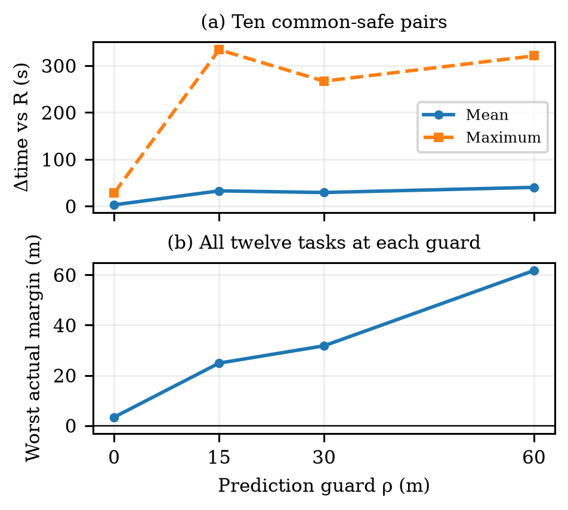

# Reference-Conditioned Closed-Loop Prediction for Dynamic Obstacle Avoidance of an Autonomous Sailboat

Authors: Sheng Huang (1), Chao Yang (1), Buyu Guo (2)

Affiliations: (1) Institute of Physical Oceanography and Remote Sensing, Ocean College, Zhejiang University, Zhoushan, China; (2) Donghai Laboratory, Zhoushan, China

## Abstract

A geometrically clear waypoint can induce an unsafe sailing trajectory when wind, actuator dynamics and controller memory affect its execution. We present a supervisory interface that predicts candidate position references together with their holding and route-restoration rules using a frozen recurrent controller. Each branch preserves causal history and the pending control action, estimates local wind from observed motion, and evaluates synchronized obstacle clearance. In 24 frozen simulation tasks, reactive navigation, a calibrated low-order predictor and detailed prediction safely complete 19, 23 and 24 tasks, respectively. All safe-completion differences occur in the eight combined-pressure encounters. Detailed prediction adds one completion over the low-order comparator but adds 7 s mean and 308 s maximum travel time over 23 common-safe tasks; cumulative episode CPU is 2133.23 versus 378.44 s. Fixed-protocol checks expose decision-relevant prediction differences and a 106 m adverse error. These results characterize the conditional value and cost of predicting executable reference protocols under ideal computation, with physical time paused during planning.

Keywords: autonomous sailing; reference-conditioned prediction; dynamic avoidance; recurrent control; closed-loop simulation

## I. Introduction and Related Work

A waypoint specifies where a sailing controller should go, not the trajectory that it will execute. Wind-dependent propulsion, finite turning response, actuator dynamics and recurrent state can produce motion that differs from the waypoint chord. During a moving-vessel encounter, a geometrically clear reference can therefore induce a safety-buffer incursion. The supervisory problem is to compare references together with their holding and feedback-restoration rules.

High-level sailing planners can exploit environmental information; Silva Junior et al. use Q-learning for sailboat path planning [1]. Qi et al. study collision-risk assessment and obstacle-avoidance control specifically for autonomous sailing robots [2]. We address the execution interface below planning, with a known static map, no direct wind measurement and observations of one low-speed target. Generalized velocity obstacles (GVO) evaluate control-induced motion rather than assuming that a desired velocity is immediately achievable [3]. Reference governors similarly modify commands supplied to an existing closed loop [4]. Branching-course model predictive control evaluates maritime maneuvers before executing their initial portion [5]. Feedback motion prediction provides controller-specific motion envelopes for unicycle reference regulation [6]. These works motivate the interface studied here; their controller assumptions and safety guarantees are not transferred to a recurrent sailing policy.

For the inherited recurrent sailing controller considered here, the supervisory input must specify a complete reference protocol. Changing a reference changes the local observation frame and reconstructed controller memory; holding it and restoring route feedback determine subsequent actions. We implement this interface within the control-induced prediction approach motivated by GVO. A local wind fit uses observed vessel motion; MoWe [7] motivates this information source, while our bounded inverse-dynamics fit is a separate implementation.

The contribution has two parts. First, an execution-consistent interface carries the pending old-reference action, causal controller history, reference hold and route-manager restoration into each candidate prediction. Second, a matched simulation study measures the resulting avoidance decisions, travel-time penalties and computation against reactive navigation and a calibrated low-order predictor. The research question is whether detailed prediction changes a safety-relevant reference decision enough to justify its additional cost in this setting. The inherited controller and dynamics supply the execution model; the new work is their supervisory integration and assessment. The study includes both an additional safe completion and an endpoint case with 308 s extra travel time.

## II. System and Evaluation Conditions

### A. Inherited dynamics and local policy

We use dynamics code and pretrained assets supplied with permission by Chao Yang from the codebase associated with Yang et al. [8]. The frozen controller is an 18-input recurrent soft actor-critic (SAC) policy [9] with temporal attention, hidden layers (256,256), persistent recurrent state, a ten-slot attention history and a matching normalizer. It uses deterministic tanh actions; no policy is trained in this study. This asset differs from the 14-dimensional formulation reported in [8], and its exact original training-run linkage is undocumented. All comparators execute the same 18-input asset.

The four-degree-of-freedom sailing dynamics follow the model lineage of Xiao and Jouffroy [10]. The simulated state contains position, roll, heading, surge/sway velocities, roll/yaw rates and actual sail/rudder angles. Prediction and physical execution use independent instances of the same supplied model structure. Thus the experiment tests execution-conditioned prediction within that simulator, including wind-estimation error, but not structural model mismatch. The input ordering and reconstruction are specified in Supplement S2; model parameters, asset hashes and reproduction commands appear in S9 and S11–S12.

An active reference g defines a rigid local frame with angle θ equal to its bearing at application and origin g − 500[cos θ,sin θ], placing g at (500,0) m without rescaling. The first 14 inputs encode local pose, body velocities/rates, actual actuator angles, progress and reference coordinates. Two obstacle distance/bearing pairs use max(0,d−R+40 m), where d is center distance and R is the exclusion radius, with a 150 m encoded-distance cutoff, distance/bearing sorting and zero-filled missing pairs. All comparators share this fixed input adapter; a historical matched check did not establish its independent necessity.

Reference changes rebuild controller memory from the recorded history, as specified in Section III-A. Predicted states never enter the physical controller's history. Commands are scaled by 10 degrees, signed-floor quantized to one-degree increments and accumulated into setpoints, clipped to ±90 degrees for sail and ±30 degrees for rudder. Actual angles move at most 10 degrees per second. A custom adaptive Dormand–Prince integrator advances one-second control intervals. All physically executed comparators share these actuation and integration rules.

### B. Information, timing and safety

At boundary t, the supervisor receives observed physical state, causal history, issued commands, a complete static circular map, current reference/manager state and target observations with identity, timestamp, position, ground velocity and validity. Targets are observed within 1000 m. There is no added sensor noise. The predictor does not receive the real wind field, environment RNG, scenario seed or future target schedule. Actual evaluation uses the full target truth.

The local policy first computes an action at t using the active reference. Planning follows. That already computed action advances t to t+1; a changed reference is then applied and memory reencoded. The earliest affected physical interval is t+1 to t+2. The physical simulation clock pauses during planning. This is an ideal-compute evaluation, not a real-time implementation claim.

Dynamic exclusion distance is 85 m: a combined 25 m entity proxy (10 m own vessel and 15 m target) plus 60 m buffer. Static exclusion radius is entity radius plus 60 m. For relative displacement r₀=pₜ−qₜ and d=(pₜ₊₁−qₜ₊₁)−r₀, synchronized segment clearance is

$$
c_{j,t}=\|r_0+\alpha^*d\|-D_j,\qquad \alpha^*=\operatorname{clip}_{[0,1]}\!\left(-\frac{r_0^\top d}{\|d\|^2}\right)\quad(d\ne0).
$$

For d=0, α*=0; code uses squared displacement ≤10⁻¹² as the numerical degeneracy threshold. Here Dⱼ=85 m for a dynamic target; for a static obstacle Dⱼ is its entity radius plus 60 m, and q is its fixed center. The actual task minimum m_real is the minimum of cⱼ,ₜ over all true obstacles and all executed intervals, including failed tasks. This is exact for synchronized one-second linear segments, not for swept hulls. Safe completion requires arrival within 10 m of G, strictly positive margins throughout, and completion within 1800/5400/9000 s for 1/3/5 km. A buffer incursion remains a failure even if the vessel later arrives. NoRouteError is an exit reason, not the safety measurement.

## III. Reference-Conditioned Prediction

### A. State reconstruction and reference protocols

The nominal geometric relay uses 120 m planning allowance, 500 m lookahead, 100 m handoff distance and an 80 m geometric-clearance trigger. Its shared temporary-endpoint manager retains a clear incumbent beyond 100 m when the goal is occupied, or considers eight points on a 305 m goal-centered ring. Candidates must be at least 200 m from the boat, have a clear segment and at least 120 m endpoint clearance; distance plus 80 m/rad times absolute heading turn (radians) ranks them. Goal availability clears the incumbent and reconnects to the mission. No admissible temporary reference causes NoRouteError. This mechanism is shared by all comparators.

Prediction starts no earlier than 10 s, requires a valid target strictly within 600 m, and runs when the review timer is due. A non-nominal hold takes precedence while t<until. The evaluated configuration uses horizon H=60 s, review/hold period P=15 s and guard ρ=30 m. A branch starts from the observed physical state, accumulated actuator setpoints, active reference frame, route-manager state, recorded history and the action already computed for the current interval.


Controller reconstruction and actuator reconstruction are separate. To rebuild memory at boundary t, the algorithm encodes all recorded states s₀,…,sₜ in the frame active at that boundary, using each state's historical target observations. It resets recurrent and attention state and performs exactly t forward calls for indices 0,…,t−1. Each call uses the encoded current and preceding observations and the actual preceding command; index 0 repeats the initial observation and uses a zero command. Replay outputs are discarded. The next call uses the encoded sₜ and actual command at t−1. Before branching, this call must exactly reproduce the pending old-reference action. Setpoints are reconstructed independently by accumulating the recorded commands through the quantization and clipping rules from zero initial setpoints.

When a changed reference is delivered, the physical controller rebuilds memory in its new frame using the same procedure. A prediction branch repeats that procedure on its own history, which contains the recorded prefix and its simulated continuation. Each branch also clones the route manager after the current nominal call. During a non-nominal hold the manager is not advanced; release clears its incumbent before restoring route feedback. These rules make each prediction correspond to a specified execution protocol. Matching the pending action checks initialization consistency; it does not establish future accuracy.

### B. Local wind fit and candidate rollout

Let z=(u,v,ωφ,ωψ) and f_z be its derivative from inherited dynamics. Three transitions start at Iₜ={t−6,t−4,t−2}; the most recent ends at t−1. The world-frame blowing-toward wind vector w minimizes the residual objective approximately:

$$
\mathcal L_t(w)=\sum_{i\in I_t}\|D e_i(w)\|^2,\qquad e_i(w)=f_z(\bar s_i,w)-\frac{z_{i+1}-z_i}{\Delta t}.
$$

The midpoint uses endpoint averages with shortest-angle heading interpolation and observed sail/rudder angles. D=diag(1,1,5,5) scales residuals empirically. A bounded local least-squares solver fits w∈[−16,16]² m/s, with multiple initializations on the first fit and causal warm starts thereafter. Insufficient history retains the preceding estimate. Supplement S14 gives solver settings; this local fit does not establish wind identifiability.

The ordered candidates are nominal feedback, current-reference continuation if available, and four points 350 m from the present position at −90, −45, +45 and +90 degrees relative to the nominal bearing. Nominal follows ordinary relay updates. Other candidates hold their reference for P seconds from selection, then restore ordinary feedback with incumbent cleared. Identical initial reference coordinates can therefore induce different trajectories. Future online searches are not simulated in that tail.

Each candidate uses the same pending old-reference action in its first interval. The fitted wind remains constant within a branch; target position is extrapolated from its current observed velocity. Forecast policy/relay observations retain the 1000 m sensing cutoff, but clearance scoring retains every initially valid observed target throughout the horizon. No unobserved future target is introduced. A branch stops at H, predicted arrival, route failure or integration failure. Early predicted arrival is valid; route/integration failure is not.

### C. Nominal-first selection and guard interpretation

For a candidate protocol γ, let Kγ be its number of completed one-second predicted intervals and O_t the union of the full static map and targets valid in the current observed list. Define

$$
\hat m(\gamma)=\min_{j\in\mathcal O_t}\min_{0\le k<K_\gamma}\hat c_{j,k}(\gamma).
$$

Each ĉ uses the synchronized segment expression and the same obstacle-specific D_j. The effective horizon Kγ≤60 includes every completed interval up to predicted arrival or termination; early arrival is valid but does not certify later occupancy. Failed route or integration predictions are excluded. P=15 s is the hold/review period; ρ=30 m is an extra predicted margin above the unchanged true exclusion boundary. Let V contain valid integration-successful candidates, F(ρ)={γ∈V:m̂(γ)≥ρ}, n denote nominal, and ι denote enumeration order. The terminal preference is

$$
J(\gamma)=d_G(\gamma)+20\mathbf1_{\gamma\ne n}+10\mathbf1_{\gamma\in\mathrm{side}},\qquad d_G(\gamma)=\|\hat p^\gamma(K_\gamma)-G\|\quad[\mathrm m].
$$

Nominal feasible returns immediately. Otherwise a nonempty F is ranked by (J,ι). If F is empty but V is nonempty, ranking is lexicographic (−m̂,J,ι): maximum margin, then lower original cost. If V is empty, continuation is retained when available, otherwise nominal. Base-planner failure before candidate construction can still terminate execution. There is no separate side-reference geometric prefilter or certified backup.

After nominal rejection, every feasible alternative receives the same 20 m offset, so this term does not determine whether intervention is worthwhile. It remains relevant to tied-margin fallback comparisons that include nominal. Search eligibility and the nominal guard trigger intervention; terminal cost ranks feasible alternatives.

```text
Algorithm 1  Selection at a one-second control boundary
1  If t < until, return the held reference.
2  Call nominal management, clearing incumbent after an expired hold.
3  If review is not due or no target is strictly within 600 m,
   release an expired hold and return nominal. Initial review is 10 s.
4  Set next review to t+P; fit wind and reconstruct branch state.
5  Predict nominal. If it is valid, integrates and meets ρ, select it.
6  Otherwise predict continuation and the four side protocols.
7  Select by guarded cost, margin fallback or incumbent fallback.
8  A non-nominal choice sets until=t+P; nominal releases the hold.
9  Apply a changed reference after the already computed real action.
```

At equality t=until, review is allowed. A release selected then applies one step later. Increasing ρ shrinks F only for the same frozen predictions; closed-loop safety or time need not change monotonically. For the same protocol γ, obstacle set O, radii and common time domain T, define M=m_real(γ;T,O) and M̂=m̂(γ;T,O) as the actual and predicted minima restricted to that domain. These differ from the whole-task metric m_real. The triangle inequality gives

$$
|M-\widehat M|\le E,\qquad M\ge\widehat M-E.
$$

Here E is the supremum of own-position error plus target-position error over T and the compared obstacles. Static centers have zero position error. A known E<ρ would imply positive clearance for a prediction meeting ρ, but no such uniform bound is available. Empirical maxima and the 30 m guard do not establish one. Derivations and a fallback counterexample are in the supplement.

## IV. Matched Comparators and Experimental Design

### A. Paired tasks and information conditions

Within each task, physical policy, normalizer, dynamics, initial conditions, map, external wind parameters, target motion, execution timing and evaluation are shared. Different paths may encounter different local wind. Reactive relay R uses nominal feedback without future candidate rollout. Detailed prediction S15 uses P=15 s. Historical long-hold search and nominal-prediction hold comparators are defined separately in Supplement S14.

The primary evaluation comprises 24 frozen one-kilometer instances: eight combined-pressure encounters and four each of ordinary crossing, overtaking, endpoint occupation and non-conflict. All methods were frozen before outcomes were observed, and all generated tasks and failures are retained. Earlier short/long tests, development checks and a separate twelve-task confirmation are supporting evidence with their own denominators in Supplement S6; overlapping mechanism cases are not pooled.

All 24 primary confirmation tasks are 1 km. Targets are generated at 0.65–0.95 m/s except endpoint tasks at 0.8–1.0 m/s. The pressure family jointly changes encounter geometry, base wind direction (115–135 degrees rather than 45–80 degrees), and a static circle at (850,300) m of entity radius 45 m. Gains within this family do not isolate those factors. Supplement S10 gives each family’s generation envelope. These are new supervisor-evaluation scenes; separation from the inherited policy’s undocumented training scenes is not certified.

Targets in the primary evaluation move at constant world-frame velocity; the extrapolation model is therefore matched. Base wind speed is 8 m/s. Twelve tasks use stable wind and twelve use fast spatial/temporal variation: direction waves of 45 degrees, perturbations up to 6 degrees and speed modulation of 20 percent. Historical profiles and exact realized values are indexed in the supplement. Common-safe time/path differences exclude pairs where either method fails, and task—not prediction window—is the sampling unit.

### B. Matched low-order candidate predictor

The comparator L retains the same supervisor, candidates, H/P/ρ, cost, fallback, endpoint manager and real execution. Only the predictor is replaced. Its low-order state is position, course χ and course rate r, initialized from causal recent position differences. The last observed ground speed v stays fixed over the horizon. For bearing error e to the currently active reference, it uses

$$
\bar r_k=\operatorname{clip}(\kappa e_k,-r_{\max},r_{\max}),\quad r_{k+1}=r_k+(1-e^{-\Delta t/\tau})(\bar r_k-r_k),\quad \chi_{k+1}=\chi_k+\Delta t\,r_{k+1}.
$$

Here r and r̄ are actual modeled and desired course rates (rad/s), χ is course in radians, κ has units s⁻¹, and τ is a response time in seconds. Δt=1 s, eₖ=wrap(bearing(g−pₖ)−χₖ), and position advances with v at course χₖ+Δt rₖ₊₁/2. Current heading minus course is retained as a fixed offset for the cloned relay's heading input; its ten-step velocity window is recomputed from predicted positions. New references affect the following interval, and the initial interval is candidate-independent. Unlike detailed prediction, that first interval extrapolates observed motion rather than evaluating the pending action. L omits recurrent policy, actuator, wind and speed dynamics together; it is a full predictor replacement, not an isolated change of ODE order.

Parameters were selected from a fixed 48-point grid using seven previously seen tasks and validated on five other seen tasks. The objective equally weights each task's mean position error over unchanged-reference 15-second windows. The selected τ=8 s, κ=0.1 s⁻¹ and r_max=0.16 rad/s give train/validation errors 2.749/2.694 m over 136/87 windows. The rate cap is the upper tested value, not an identified physical limit. This calibration does not establish 60-second or newly proposed side-reference accuracy. Parameters and 24 new instances were frozen before observing their outcomes.

### C. Guard, prediction and numerical checks

Twelve preselected old tasks cover 3 pressure, 3 endpoint and 2 each of ordinary crossing/overtaking/non-conflict. We compare ρ∈{0,15,30,60} m without changing true safety. Original 30 m results are reused after a bitwise 444-step S15 reproduction, with other values run as complete tasks. This is sensitivity analysis; no new guard is selected.

Prediction logs are compared only with the actually executed prefix before replanning or termination. Six selected development snapshots also execute two fixed protocols each, for up to 60 s, after exact physical-prefix reproduction; the six actually selected branches also reproduce their original first 15 s of positions. Three snapshots use the first non-nominal entry in selected tasks, one uses the first prediction, and two use specified diagnostic times (Supplement S7). These are selected cases, not a random accuracy benchmark. Real offline branches alone query the actual external evolution; predictors use causal inputs.

Observation-only integrator-substep replays check selected meter-scale incursions and safe pairs without changing commands or endpoints. They supplement the one-second metric. Experiments use an AMD EPYC 7V12 host, at most four single-thread CPU workers and no GPU.

## V. Results

### A. Matched 24-task comparison

Table I reports all 24 frozen confirmation tasks. Gains/losses count paired changes in safe completion. Time differences use only pairs where both methods succeed, so their denominators differ from the completion counts. Table II stratifies the same tasks by prespecified family. These small, designed task sets support descriptive comparisons within their generation envelope, not a population-level estimate of collision risk.

Table I. Matched 24-task results. Δt is relative to R on common-safe pairs; CPU is cumulative episode CPU, not navigation time.

| Metric | R | L | S15 |
| --- | --- | --- | --- |
| Safe /24 | 19 | 23 | 24 |
| Gain/loss vs R | — | 4/0 | 5/0 |
| Common-safe n | — | 19 | 19 |
| Mean Δt (s) | — | +6.63 | +25.16 |
| Median Δt (s) | — | 0 | 0 |
| Maximum Δt (s) | — | +69 | +308 |
| Episode CPU (s) | 270.68 | 378.44 | 2133.23 |

Table II. Safe completions by prespecified family. Pressure changes geometry, wind and static context jointly.

| Family | n | R | L | S15 |
| --- | --- | --- | --- | --- |
| Combined pressure | 8 | 3 | 7 | 8 |
| Crossing | 4 | 4 | 4 | 4 |
| Overtaking | 4 | 4 | 4 | 4 |
| Endpoint | 4 | 4 | 4 | 4 |
| Non-conflict | 4 | 4 | 4 | 4 |
| Total | 24 | 19 | 23 | 24 |

Against L, S15 gains one safe completion and loses none. Their 23 common-safe pairs have mean S15−L time +7 s, median 0 and maximum +308 s. Episode CPU totals are 2133.23 s for S15 and 378.44 s for L. All five R failures and the one L failure occur in the combined-pressure family; all methods safely complete the other sixteen tasks. L reaches the goal on its failed task but incurs the safety buffer. S15 and L each activate on eleven tasks. The gain therefore concerns one additional completion under joint geometric, wind and static-obstacle pressure.


### B. A decision difference and an adverse case

The unique L-unsafe/S15-safe task is the second combined-pressure instance (Supplement S8). The two methods have exactly equal recorded physical states, reference histories and issued commands through t=260 s. At that state, detailed nominal prediction gives 11.893 m minimum margin, below ρ=30 m, whereas L gives 59.832 m and returns nominal. Detailed prediction selects +90 degrees with predicted margin 36.546 m and cost 509.528 m; the feasible −90-degree alternative has margin 70.147 m and cost 513.228 m. The selected target is (627.068,163.231) m, versus nominal (575,−200) m. Selection occurs at 260 s, delivery at 261 s, and its first possible physical effect is the 261–262 s interval. This is a verified same-input decision difference; L does not evaluate alternatives after nominal passes.


Over the complete voyage, L reaches at 566 s with minimum margin −1.115 m at 402 s; S15 arrives at 519 s with 42.096 m at 291 s. R exits at 392 s with −0.162 m. The methods subsequently replan and encounter different states and local wind. The equal-prefix comparison isolates their decision at 260 s, while the complete-voyage outcomes include all later interventions. Fixed-protocol diagnostics in Section V-D separately test prediction accuracy. The supplement provides the full candidate table and log locations.

The fourth endpoint instance shows the largest travel-time penalty: R and L safely arrive in 279 s, while S15 takes 587 s (Fig. 4). This +308 s intervention cost coexists with the pressure-case benefit.


Separate historical evaluation recovered two reactive failures among thirty short tasks and one among four long tasks. Another twelve-task confirmation produced no additional completion over R and included a 271 s endpoint detour. Supplement S6 preserves these groups and the overlap of development cases. They do not enlarge the independent task count in Table I.

### C. Guard sensitivity

Table III shows all four guards on the same twelve old tasks; 30 m reuses exact original results after parity verification. Reactive succeeds on 10/12. The guard changes complete closed-loop decisions, not the true exclusion boundary. Non-nominal selection totals for 0/15/30/60 m are 7, 13, 20, 32; no-guard-feasible fallback totals are 0, 1, 0, 2. Figure 5 shows the cost tail and worst actual margin. The experiment does not identify an optimal guard or a monotone safety guarantee. The original 30 m configuration retains its identity.

Table III. Guard sensitivity; common-safe Δt is relative to R. True safety is unchanged.

| ρ (m) | Safe /12 | Worst dynamic (m) | Δt median/max (s) |
| --- | --- | --- | --- |
| 0 | 12 | 3.35 | 0.00/28.00 |
| 15 | 12 | 24.88 | 0.00/334.00 |
| 30 | 12 | 31.78 | 0.00/267.00 |
| 60 | 12 | 61.77 | 0.00/321.00 |



### D. Prediction agreement, numerical safety and cost

From 46 distinct historical source tasks, 1083 selected-protocol windows yield 1048 complete 15 s prefixes and 35 truncated prefixes. These are clustered windows, not 1083 independent tasks. Maximum position errors for entering, ordinary feedback, reevaluation and release are 1.039, 30.506, 2.090 and 0.626 m. No compared prefix has a predicted positive margin followed by a nonpositive actual margin; nor does a predicted 30 m guard become an actual guard shortfall on these short prefixes. This limited observation does not validate unexecuted candidates or later replanned tails.

All twelve fixed real branches from six snapshots reproduce their full physical prefixes exactly. The six branches using the actually selected protocols also reproduce the following 15 s of positions from the original executions exactly; the six alternative branches have no corresponding selected-prefix check. Detailed predictions and real branches share the full 60 s in all twelve. Three-way comparisons with L share 60 s in ten branches and 58 s in two because L predicts arrival earlier while the real branch continues. The median branch-maximum position error on those common intervals is 1.104 m for detailed prediction and 53.818 m for L. Three L nominal predictions meet 30 m while actual margins are 17.868, 23.384 and 16.430 m. These are guard shortfalls, not buffer incursions. Conversely, detailed prediction reaches 106.064 m position error at one endpoint snapshot; its nominal and continuation paths coincide and are not independent failures. Its predicted/actual minimum margins remain 140.990/146.171 m. Figure 6 makes both the local accuracy advantage and the adverse error explicit.


At the historical pressure snapshot t=149 s, detailed nominal predicts 17.706 m and rejects the 30 m guard; the selected −90-degree side protocol predicts 94.815 m. Fixed execution gives 17.868/95.098 m for the two protocols. The low-order predictor instead accepts nominal at 75.748 m in this same state. This isolates a decision-relevant prediction difference without attributing an entire later voyage to a single branch. This development snapshot illustrates fidelity on a fixed protocol; it is distinct from the new-confirmation complete-task comparison in Figs. 3–4.

Same-command accepted-substep replays preserve all one-second endpoints. The unique confirmation case remains R/L/S15 unsafe/unsafe/safe, with margins −0.162/−1.117/42.094 m. Two historical reactive incursions also retain negative margins, while their S15 pairs remain positive. Maximum accepted step is 0.1 s. This numerical circular-proxy evidence addresses a possible one-second chord artifact; it is not exact hull safety. Full values are in Supplement S4/S11/S14.

At three fixed states with three repetitions per predictor, the median estimation/rollout/selection wall time is 17.009 s for detailed prediction and 0.067 s for L. This excludes loading and initial setup; nominal early return can produce different candidate counts. The episode CPU totals in Table I measure different work and are not planning deadlines. A detailed call can exceed P=15 s while physical time remains paused. 


## VI. Discussion and Conclusion

The supervisory interface makes reference prediction consistent with a recurrent sailing controller's execution: the pending action is preserved, memory is reconstructed in the active frame, and reference hold and route restoration are simulated explicitly. The selection rule first tests nominal clearance, then evaluates finite alternatives when needed. The 20 m cost offset does not control intervention in the nominal-rejected feasible branch.

In the matched experiment, detailed prediction completes 8/8 combined-pressure tasks safely, compared with 7/8 for L and 3/8 for R; all methods complete the other sixteen tasks safely. The single additional completion over L accompanies +7 s mean and +308 s maximum travel time on common-safe pairs and higher episode CPU. L is therefore a computationally cheaper alternative with nearly the same completion count in these tasks. Its calibration on unchanged-reference 15 s windows limits the comparison: replacing the full predictor does not isolate which of recurrent memory, actuator, wind or speed modeling produces the difference. Fixed-protocol checks identify local decision-relevant fidelity, while the 106 m adverse error shows that detailed prediction can still be inaccurate.

The evidence is limited to the inherited dynamics, noiseless motion observations, a known static map and one low-speed constant-velocity target. The finite empirical guard and best-effort fallback provide no safety guarantee. Maneuvering targets, structural model mismatch, multi-vessel encounters and COLREGs behavior require separate evaluation. Planning pauses physical time, and a measured detailed call exceeds the 15 s review period; deployment therefore requires a protocol that accounts for motion during computation. Within the tested scope, executable reference protocols reveal both useful avoidance decisions and costly interventions, providing a basis for choosing prediction fidelity according to the application.

## Code and Model Availability

With permission from the inherited-asset provider, source code, pretrained weights, the matching normalizer, configurations and records needed to reproduce the reported experiments can be provided to editors and reviewers upon request. Supplement S9 and S11–S12 identify the versions and commands. This is an authorized provision route, not a claim of public release of the exact 18D assets.

## Acknowledgment

AI tools assisted drafting, implementation and internal evidence review.

## References

[1] A. G. da Silva Junior, D. H. dos Santos, A. P. F. de Negreiros, J. M. V. B. de Souza Silva, and L. M. G. Gonçalves, “High-level path planning for an autonomous sailboat robot using Q-learning,” Sensors, vol. 20, no. 6, Art. 1550, 2020, doi: 10.3390/s20061550.

[2] W. Qi, Q. Sun, C. Liu, X. Ji, Z. Cao, Y. Liang, and H. Qian, “Collision Risk Assessment and Obstacle Avoidance Control for Autonomous Sailing Robots,” in Proc. IEEE International Conference on Robotics and Automation (ICRA), pp. 2511–2517, 2021, doi: 10.1109/ICRA48506.2021.9560859.

[3] D. Wilkie, J. van den Berg, and D. Manocha, “Generalized velocity obstacles,” in Proc. IEEE/RSJ International Conference on Intelligent Robots and Systems, 2009, pp. 5573–5578, doi: 10.1109/IROS.2009.5354175.

[4] E. Garone, S. Di Cairano, and I. Kolmanovsky, “Reference and command governors for systems with constraints: A survey on theory and applications,” Automatica, vol. 75, pp. 306–328, 2017, doi: 10.1016/j.automatica.2016.08.013.

[5] B.-O. H. Eriksen, M. Breivik, E. F. Wilthil, A. L. Flåten, and E. F. Brekke, “The branching-course model predictive control algorithm for maritime collision avoidance,” Journal of Field Robotics, vol. 36, no. 7, pp. 1222–1249, 2019, doi: 10.1002/rob.21900.

[6] A. İşleyen, N. van de Wouw, and Ö. Arslan, “Feedback motion prediction for safe unicycle robot navigation,” in Proc. IEEE/RSJ International Conference on Intelligent Robots and Systems, 2023, pp. 10511–10518, doi: 10.1109/IROS55552.2023.10341787.

[7] Q. Sun, W. Qi, and H. Qian, “MoWe: Motion observation for wind estimation of sailing robots,” Journal of Field Robotics, vol. 42, no. 5, pp. 2355–2374, 2025, doi: 10.1002/rob.22512.

[8] C. Yang, B. Guo, Y. Zhang, Y. Gu, Y. Li, S. Huang, H. Huang, J. Dong, and P. Li, “Learning to sail without wind information: reinforcement learning-based control for unmanned sailing vessels under partial observability,” Applied Ocean Research, vol. 175, Art. no. 105246, 2026, doi: 10.1016/j.apor.2026.105246.

[9] T. Haarnoja, A. Zhou, P. Abbeel, and S. Levine, “Soft actor-critic: Off-policy maximum entropy deep reinforcement learning with a stochastic actor,” in Proc. 35th International Conference on Machine Learning, vol. 80, pp. 1861–1870, 2018.

[10] L. Xiao and J. Jouffroy, “Modeling and nonlinear heading control of sailing yachts,” IEEE Journal of Oceanic Engineering, vol. 39, no. 2, pp. 256–268, 2014, doi: 10.1109/JOE.2013.2247276.
