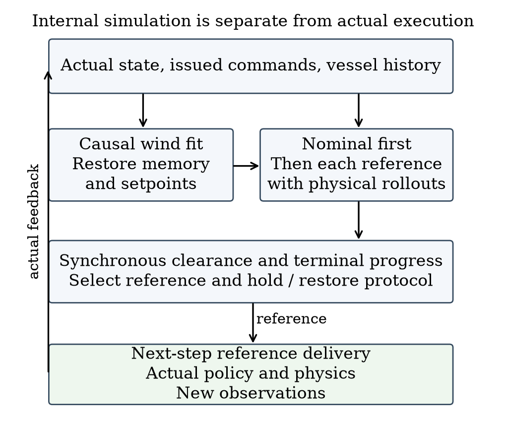
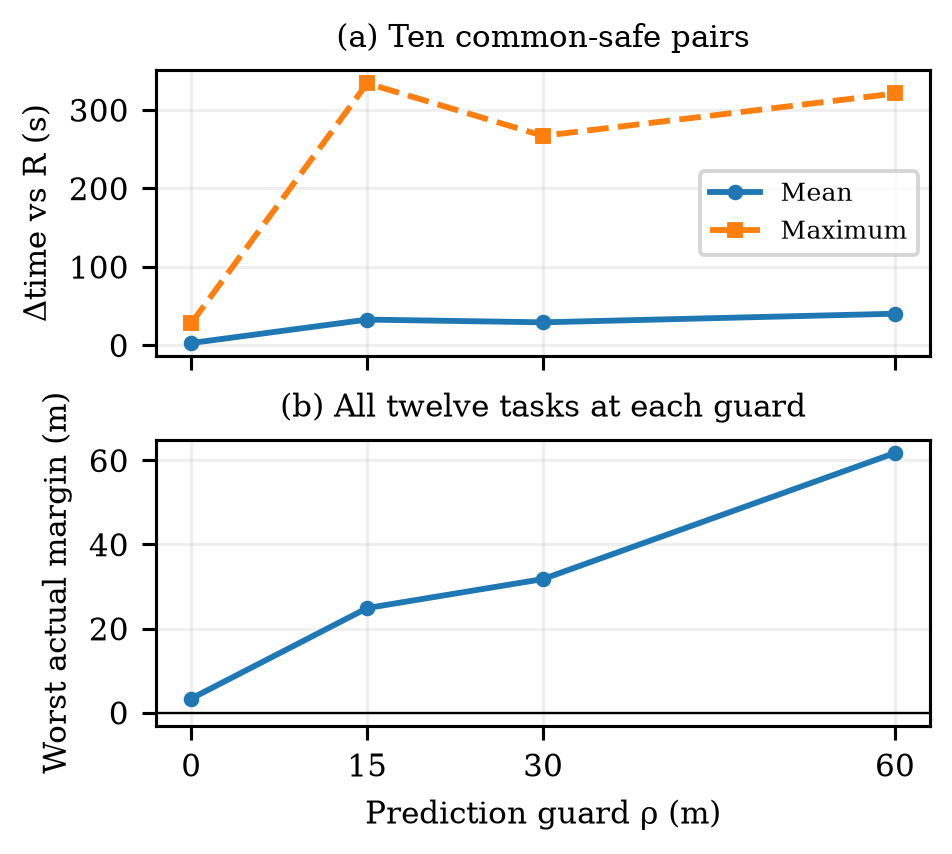

# Reference-Conditioned Closed-Loop Prediction for Dynamic Obstacle Avoidance of an Autonomous Sailboat

Authors and affiliations to be confirmed

## Abstract

A geometrically clear waypoint can induce an unsafe sailing trajectory because a recurrent controller responds through wind-dependent dynamics and control history. We adapt control-induced motion prediction to candidate position references together with their hold-and-restore protocols. Independent instances of an inherited sailing policy and dynamics reconstruct causal history, fit local wind from motion and compare synchronized clearance before reference delivery. In a frozen 24-task simulation comparison, reactive navigation, a calibrated low-order predictor and detailed prediction safely complete 19, 23 and 24 tasks. Their counts are 3, 7 and 8 in eight combined-pressure encounters; all three complete the other sixteen tasks. Detailed prediction gains one completion over the low-order comparator, while adding 7 s on average and up to 308 s across 23 common-safe pairs, with 2133.23 versus 378.44 s cumulative episode CPU. Fixed-protocol diagnostics explain a local fidelity advantage and retain a 106 m adverse prediction error. The contribution is an execution-consistent supervisory interface and evidence of its conditional avoidance value and cost under ideal computation, where planning pauses physical time.

Keywords: autonomous sailing; reference-conditioned prediction; dynamic avoidance; recurrent control; closed-loop simulation

## I. Introduction and Related Work

A waypoint specifies where a sailing controller should go, not the trajectory that it will execute. Wind-dependent propulsion, finite turning response, actuator dynamics and recurrent state can produce motion that differs from the waypoint chord. During a moving-vessel encounter, a geometrically clear reference can therefore induce a safety-buffer incursion. The supervisory problem is to compare references together with their holding and feedback-restoration rules.

High-level sailing planners can exploit environmental information; Silva Junior et al. use Q-learning for sailboat path planning [1]. We address the execution interface below planning, with a known static map, no direct wind measurement and observations of one low-speed target. Generalized velocity obstacles (GVO) evaluate control-induced motion rather than assuming that a desired velocity is immediately achievable [2]. Reference governors similarly modify commands supplied to an existing closed loop [3]. Branching-course model predictive control evaluates maritime maneuvers before executing their initial portion [6]. Feedback motion prediction provides controller-specific motion envelopes for unicycle reference regulation [7]. These works motivate the interface studied here; their controller assumptions and safety guarantees are not transferred to a recurrent sailing policy.

The missing interface is a candidate execution protocol, rather than only a waypoint coordinate. For a recurrent controller, changing the reference also changes its local frame and reconstructed memory; holding that reference and later restoring route feedback changes the subsequent trajectory. We adapt the control-induced prediction principle of GVO to these finite protocols. A motion-based local wind fit supplies the branch model; MoWe [4] motivates motion-based wind estimation, while the bounded inverse-dynamics fit used here is a separate implementation.

Our contribution is an execution-consistent supervisory interface and a matched empirical assessment. The interface preserves the pending old-reference action, causal policy history, hold duration and route-manager restoration in each branch. The inherited policy, dynamics and established prediction principle remain separate from this adaptation; state reconstruction and the clearance-error inequality are not proposed as new control theory. The assessment tests whether detailed execution modeling adds value over a specified calibrated low-order predictor, and accounts for intervention and computation costs alongside safe completions. In the primary comparison, its additional completion occurs in a combined-pressure encounter; an endpoint encounter instead incurs a 308 s detour. These complementary results define the scope of the method.

## II. System and Evaluation Conditions

### A. Inherited dynamics and local policy

The dynamics implementation and pretrained assets were supplied by Chao Yang from the research codebase associated with Yang et al. [9] and are used with permission. We evaluate an inherited 18-input recurrent SAC policy with temporal attention, a matching frozen normalizer and deterministic tanh actions. This is distinct from the 14-dimensional wind-input-free policy formulation in [9]; checkpoint identity and reproduction of its benchmark results are not claimed. The Actor has hidden layers (256,256), persistent recurrent state and a ten-slot attention history. Reference [5] describes SAC. No policy is trained here. Separate instances of the inherited dynamics isolate physical execution and prediction; this does not isolate model-identification error.

The inherited four-degree dynamics include position, roll, heading, surge/sway velocities, roll/yaw rates and actual sail/rudder angles. The model lineage is Xiao and Jouffroy [8]; attribution to the supplied research codebase [9] is separate. Independent predictor and execution instances use the same model structure. Supplement S9 and S11–S12 identify exact parameters, observation mapping, source/weight hashes and reproduction commands. The journal's 14D formulation and this 18D asset are not treated as identical checkpoints; the exact original training-run linkage is undocumented.

An active reference g defines a rigid local frame with angle θ equal to its bearing at application and origin g − 500[cos θ,sin θ], placing the reference at (500,0) m without rescaling. The first 14 inputs describe local pose, body velocities/rates, actual actuator angles, progress and reference coordinates. Two obstacle distance/bearing pairs use max(0,d−R+40 m), with exclusion radius R, a 150 m encoded-distance cutoff, distance/bearing sorting and zero-filled missing pairs. This fixed input adapter is shared by all comparators. Its numerical distance transformation is not claimed as an independently established contribution; a historical matched input check did not establish its necessity.

Reference changes reconstruct recurrent state by reencoding the real history and replaying issued commands. Each historical moving-obstacle input uses that time's observations. Predicted histories never enter the real history. Commands are scaled by 10 degrees, signed-floor quantized to one-degree increments and accumulated into setpoints, clipped to ±90 degrees for sail and ±30 degrees for rudder. Actual angles move at most 10 degrees per second. The custom adaptive Dormand–Prince integrator advances one-second control intervals; these actuation rules are shared by all physically executed comparators.

### B. Information, timing and safety

At boundary t, the supervisor receives observed physical state, causal history, issued commands, a complete static circular map, current reference/manager state and target observations with identity, timestamp, position, ground velocity and validity. Targets are observed within 1000 m. There is no added sensor noise. The predictor does not receive the real wind field, environment RNG, scenario seed or future target schedule. Actual evaluation uses the full target truth.

The local policy first computes an action at t using the active reference. Planning follows. That already computed action advances t to t+1; a changed reference is then applied and memory reencoded. The earliest affected physical interval is t+1 to t+2. The physical simulation clock pauses during planning. This is an ideal-compute evaluation, not a real-time implementation claim.

Dynamic exclusion distance is 85 m: a combined 25 m entity proxy (10 m own vessel and 15 m target) plus 60 m buffer. Static exclusion radius is entity radius plus 60 m. For relative displacement r₀=pₜ−qₜ and d=(pₜ₊₁−qₜ₊₁)−r₀, synchronized segment clearance is

$$
c_{j,t}=\|r_0+\alpha^*d\|-D_j,\qquad \alpha^*=\operatorname{clip}_{[0,1]}\!\left(-\frac{r_0^\top d}{\|d\|^2}\right)\quad(d\ne0).
$$

For d=0, α*=0; code uses squared displacement ≤10⁻¹² as the numerical degeneracy threshold. Here Dⱼ=85 m for a dynamic target; for a static obstacle Dⱼ is its entity radius plus 60 m, and q is its fixed center. The actual task minimum m_real is the minimum of cⱼ,ₜ over all true obstacles and all executed intervals, including failed tasks. This is exact for synchronized one-second linear segments, not for swept hulls. Safe completion requires arrival within 10 m of G, strictly positive margins throughout, and completion within 1800/5400/9000 s for 1/3/5 km. A buffer incursion remains a failure even if the vessel later arrives. NoRouteError is an exit reason, not the safety measurement.

## III. Reference-Conditioned Prediction

### A. State reconstruction and reference protocols

The nominal geometric relay uses 120 m planning allowance, 500 m lookahead, 100 m handoff distance and an 80 m geometric-clearance trigger. Its shared temporary-endpoint manager retains a clear incumbent beyond 100 m when the goal is occupied, or considers eight points on a 305 m goal-centered ring. Candidates must be at least 200 m from the boat, have a clear segment and at least 120 m endpoint clearance; distance plus 80 times absolute heading turn ranks them. Goal availability clears the incumbent and reconnects to the mission. No admissible temporary reference causes NoRouteError. This mechanism is shared by all comparators.

Prediction eligibility starts at 10 s, requires a valid target strictly within 600 m, and requires the review timer to be due. A non-nominal hold takes precedence while t<until. The representative configuration uses horizon H=60 s, period P=15 s and guard ρ=30 m. A branch needs physical state, accumulated actuator setpoints, recurrent/attention state, reference frame, manager state, actual history and the already computed action. The implementation reconstructs setpoints from the complete command history starting from the zero initial setpoints and reconstructs policy state by historical replay. It asserts equality of the reproduced current action. That is a consistency check, not a future-accuracy proof.

Each branch clones the route manager after its current nominal call. While a non-nominal reference is held, the real manager is not advanced; release clears its incumbent before restoring feedback. Branches use the same rules. Thus candidate predictions specify how a reference is applied and released, rather than interpreting its bearing as an instantaneous heading. Supplement S2 records exact reconstruction and clock handling.



### B. Local wind fit and candidate rollout

Let z=(u,v,ωφ,ωψ) and f_z be its derivative from inherited dynamics. Three transitions start at Iₜ={t−6,t−4,t−2}; the most recent ends at t−1. The fitted vector minimizes the residual objective approximately:

$$
\mathcal L_t(w)=\sum_{i\in I_t}\|D e_i(w)\|^2,\qquad e_i(w)=f_z(\bar s_i,w)-\frac{z_{i+1}-z_i}{\Delta t}.
$$

The midpoint uses endpoint averages with shortest-angle heading interpolation and observed sail/rudder angles. D=diag(1,1,5,5) scales residuals empirically. A bounded local least-squares solver fits w∈[−16,16]² m/s, with multiple initializations on the first fit and causal warm starts thereafter. Insufficient history retains the preceding estimate. Supplement S14 gives solver settings; this local fit does not establish wind identifiability.

The ordered candidates are nominal feedback, current-reference continuation if available, and four points 350 m from the present position at −90, −45, +45 and +90 degrees relative to the nominal bearing. Nominal follows ordinary relay updates. Other candidates hold their reference for P seconds from selection, then restore ordinary feedback with incumbent cleared. Identical initial reference coordinates can therefore induce different trajectories. Future online searches are not simulated in that tail.

Each candidate uses the same pending old-reference action in its first interval. The fitted wind remains constant within a branch; target position is extrapolated from its current observed velocity. Forecast policy/relay observations retain the 1000 m sensing cutoff, but clearance scoring retains every initially valid observed target throughout the horizon. No unobserved future target is introduced. A branch stops at H, predicted arrival, route failure or integration failure. Early predicted arrival is valid; route/integration failure is not.

### C. Nominal-first selection and guard interpretation

For a candidate protocol γ, let Kγ be its number of completed one-second predicted intervals and O_t the union of the full static map and targets valid in the current observed list. Define

$$
\hat m(\gamma)=\min_{j\in\mathcal O_t}\min_{0\le k<K_\gamma}\hat c_{j,k}(\gamma).
$$

Each ĉ uses the synchronized segment expression and the same obstacle-specific D_j. The effective horizon Kγ≤60 includes every completed interval up to predicted arrival or termination; early arrival is valid but does not certify later occupancy. Failed route or integration predictions are excluded. P=15 s is the hold/review period; ρ=30 m is an extra predicted margin above the unchanged true exclusion boundary. Let V contain valid integration-successful candidates, F(ρ)={γ∈V:m̂(γ)≥ρ}, n denote nominal, and ι denote enumeration order. The terminal preference is

$$
J(\gamma)=d_G(\gamma)+20\mathbf1_{\gamma\ne n}+10\mathbf1_{\gamma\in\mathrm{side}},\qquad d_G(\gamma)=\|\hat p^\gamma(K_\gamma)-G\|\quad[\mathrm m].
$$

Nominal feasible returns immediately. Otherwise a nonempty F is ranked by (J,ι). If F is empty but V is nonempty, ranking is lexicographic (−m̂,J,ι): maximum margin, then lower original cost. If V is empty, continuation is retained when available, otherwise nominal. Base-planner failure before candidate construction can still terminate execution. There is no separate side-reference geometric prefilter or certified backup.

The 20 m offset is common to all feasible alternatives after nominal rejection and does not price whether intervention is worthwhile in that branch. It can affect tied-margin fallback comparisons that include nominal. We preserve it in code. Search eligibility and nominal guard determine whether alternatives are considered; terminal preference ranks those alternatives.

```text
Algorithm 1  Selection at a one-second control boundary
1  If t < until, return the held reference.
2  Call nominal management, clearing incumbent after an expired hold.
3  If review is not due or no target is strictly within 600 m,
   release an expired hold and return nominal. Initial review is 10 s.
4  Set next review to t+P; fit wind and reconstruct branch state.
5  Predict nominal. If it is valid, integrates and meets ρ, select it.
6  Otherwise predict continuation and the four side protocols.
7  Select by guarded cost, margin fallback or incumbent fallback.
8  A non-nominal choice sets until=t+P; nominal releases the hold.
9  Apply a changed reference after the already computed real action.
```

At equality t=until, review is allowed. A release selected then applies one step later. Increasing ρ shrinks F only for the same frozen predictions; closed-loop safety or time need not change monotonically. For the same protocol γ, obstacle set O, radii and common time domain T, define M=m_real(γ;T,O) and M̂=m̂(γ;T,O) as the actual and predicted minima restricted to that domain. These differ from the whole-task metric m_real. The triangle inequality gives

$$
|M-\widehat M|\le E,\qquad M\ge\widehat M-E.
$$

Here E is the supremum of own-position error plus target-position error over T and the compared obstacles. Static centers have zero position error. A known E<ρ would imply positive clearance for a prediction meeting ρ, but no such uniform bound is available. Empirical maxima and the 30 m guard do not establish one. Derivations and a fallback counterexample are in the supplement.

## IV. Matched Comparators and Experimental Design

### A. Paired tasks and information conditions

Within each task, physical policy, normalizer, dynamics, initial conditions, map, external wind parameters, target motion, execution timing and evaluation are shared. Different paths may encounter different local wind. Reactive relay R uses nominal feedback without future candidate rollout. Detailed prediction S15 uses P=15 s. Historical long-hold search and nominal-prediction hold comparators are defined separately in Supplement S14.

The primary evaluation comprises 24 frozen one-kilometer instances: eight combined-pressure encounters and four each of ordinary crossing, overtaking, endpoint occupation and non-conflict. All methods were frozen before outcomes were observed, and all generated tasks and failures are retained. Earlier short/long tests, development checks and a separate twelve-task confirmation are supporting evidence with their own denominators in Supplement S6; overlapping mechanism cases are not pooled.

All 24 primary confirmation tasks are 1 km. Targets are generated at 0.65–0.95 m/s except endpoint tasks at 0.8–1.0 m/s. The pressure family jointly changes encounter geometry, base wind direction (115–135 degrees rather than 45–80 degrees), and a static circle at (850,300) m of entity radius 45 m. Gains within this family do not isolate those factors. Supplement S10 gives each family’s generation envelope. These are new supervisor-evaluation scenes; separation from the inherited policy’s undocumented training scenes is not certified.

Targets in the primary evaluation move at constant world-frame velocity; the extrapolation model is therefore matched. Base wind speed is 8 m/s. Twelve tasks use stable wind and twelve use fast spatial/temporal variation: direction waves of 45 degrees, perturbations up to 6 degrees and speed modulation of 20 percent. Historical profiles and exact realized values are indexed in the supplement. Common-safe time/path differences exclude pairs where either method fails, and task—not prediction window—is the sampling unit.

### B. Matched low-order candidate predictor

The comparator L retains the same supervisor, candidates, H/P/ρ, cost, fallback, endpoint manager and real execution. Only the predictor is replaced. Its low-order state is position, course χ and course rate r, initialized from causal recent position differences. The last observed ground speed v stays fixed over the horizon. For bearing error e to the currently active reference, it uses

$$
\bar r_k=\operatorname{clip}(\kappa e_k,-r_{\max},r_{\max}),\quad r_{k+1}=r_k+(1-e^{-\Delta t/\tau})(\bar r_k-r_k),\quad \chi_{k+1}=\chi_k+\Delta t\,r_{k+1}.
$$

Here r and r̄ are actual modeled and desired course rates (rad/s), χ is course in radians, κ has units s⁻¹, and τ is a response time in seconds. Δt=1 s, eₖ=wrap(bearing(g−pₖ)−χₖ), and position advances with v at course χₖ+Δt rₖ₊₁/2. Current heading minus course is retained as a fixed offset for the cloned relay's heading input; its ten-step velocity window is recomputed from predicted positions. New references affect the following interval, and the initial interval is candidate-independent. Unlike detailed prediction, that first interval extrapolates observed motion rather than evaluating the pending action. L omits recurrent policy, actuator, wind and speed dynamics together; it is a full predictor replacement, not an isolated change of ODE order.

Parameters were selected from a fixed 48-point grid using seven previously seen tasks and validated on five other seen tasks. The objective equally weights each task's mean position error over unchanged-reference 15-second windows. The selected τ=8 s, κ=0.1 s⁻¹ and r_max=0.16 rad/s give train/validation errors 2.749/2.694 m over 136/87 windows. The rate cap is the upper tested value, not an identified physical limit. This calibration does not establish 60-second or newly proposed side-reference accuracy. Parameters and 24 new instances were frozen before observing their outcomes.

### C. Guard, prediction and numerical checks

Twelve preselected old tasks cover 3 pressure, 3 endpoint and 2 each of ordinary crossing/overtaking/non-conflict. We compare ρ∈{0,15,30,60} m without changing true safety. Original 30 m results are reused after a bitwise 444-step S15 reproduction, with other values run as complete tasks. This is sensitivity analysis; no new guard is selected.

Prediction logs are compared only with the actually executed prefix before replanning or termination. Six development snapshots also execute two fixed protocols each, for up to 60 s, after exact physical-prefix and selected-first-15-s reproduction. Real offline branches alone query the actual external evolution; predictors use causal inputs.

Observation-only integrator-substep replays check selected meter-scale incursions and safe pairs without changing commands or endpoints. They supplement the one-second metric. Experiments use an AMD EPYC 7V12 host, at most four single-thread CPU workers and no GPU.

## V. Results

### A. Matched 24-task comparison

Table I reports all 24 frozen confirmation tasks. Gains/losses are paired changes in safe completion. Time differences condition on both methods succeeding; they do not assign an artificial navigation time to failures. Table II stratifies the same tasks by their prespecified families.

Table I. Matched 24-task results. Δt is relative to R on common-safe pairs; CPU is cumulative episode CPU, not navigation time.

| Metric | R | L | S15 |
| --- | --- | --- | --- |
| Safe /24 | 19 | 23 | 24 |
| Gain/loss vs R | — | 4/0 | 5/0 |
| Common-safe n | — | 19 | 19 |
| Mean Δt (s) | — | +6.63 | +25.16 |
| Median Δt (s) | — | 0 | 0 |
| Maximum Δt (s) | — | +69 | +308 |
| Episode CPU (s) | 270.68 | 378.44 | 2133.23 |

Table II. Safe completions by prespecified family. Pressure changes geometry, wind and static context jointly.

| Family | n | R | L | S15 |
| --- | --- | --- | --- | --- |
| Combined pressure | 8 | 3 | 7 | 8 |
| Crossing | 4 | 4 | 4 | 4 |
| Overtaking | 4 | 4 | 4 | 4 |
| Endpoint | 4 | 4 | 4 | 4 |
| Non-conflict | 4 | 4 | 4 | 4 |
| Total | 24 | 19 | 23 | 24 |

Against L, S15 gains one safe completion and loses none. Their 23 common-safe pairs have mean S15−L time +7 s, median 0 and maximum +308 s. Episode CPU is 2133.23 s for S15 versus 378.44 s for L. All five R failures and the one L failure occur in the combined-pressure family; all methods safely complete the other sixteen tasks. L reaches the goal on its failed task, but its buffer incursion makes that task unsafe. S15 and L each activate on eleven tasks. These results show one additional completion within this designed envelope, with navigation and computation costs; they neither isolate a single pressure factor nor estimate natural traffic benefit.


### B. A decision difference and an adverse case

The unique L-unsafe/S15-safe task is the second combined-pressure instance (Supplement S8). The two methods have exactly equal recorded physical states, reference histories and issued commands through t=260 s. At that state, detailed nominal prediction gives 11.893 m minimum margin, below ρ=30 m, whereas L gives 59.832 m and returns nominal. Detailed prediction selects +90 degrees with predicted margin 36.546 m and cost 509.528 m; the feasible −90-degree alternative has margin 70.147 m and cost 513.228 m. The selected target is (627.068,163.231) m, versus nominal (575,−200) m. Selection occurs at 260 s, delivery at 261 s, and its first possible physical effect is the 261–262 s interval. This is a verified same-input decision difference; L does not evaluate alternatives after nominal passes.


Over the complete voyage, L reaches at 566 s with minimum −1.115 m at 402 s; S15 arrives at 519 s with minimum 42.096 m at 291 s. R exits at 392 s with margin −0.162 m. Later states, subsequent interventions and encountered wind differ. We therefore do not attribute the full-voyage outcome solely to the first target change or infer its counterfactual 60-second effect from a later replanned trajectory. The full candidate table and exact log locations are supplied in the supplement.

The largest time-cost counterexample is the fourth endpoint instance: R and L safely arrive in 279 s, while S15 takes 587 s. That +308 s penalty remains in the primary table and Fig. 4. Useful risk intervention and unnecessary intervention must both be evaluated.


Separate historical evaluation recovered two reactive failures among thirty short tasks and one among four long tasks. Another twelve-task confirmation produced no additional completion over R and included a 271 s endpoint detour. Supplement S6 preserves these groups and the overlap of development cases. They do not enlarge the independent task count in Table I.

### C. Guard sensitivity

Table III shows all four guards on the same twelve old tasks; 30 m reuses exact original results after parity verification. Reactive succeeds on 10/12. The guard changes complete closed-loop decisions, not the true exclusion boundary. Non-nominal selection totals for 0/15/30/60 m are 7, 13, 20, 32; no-guard-feasible fallback totals are 0, 1, 0, 2. Figure 5 shows the cost tail and worst actual margin. The experiment does not identify an optimal guard or a monotone safety guarantee. The original 30 m configuration retains its identity.

Table III. Guard sensitivity; common-safe Δt is relative to R. True safety is unchanged.

| ρ (m) | Safe /12 | Worst dynamic (m) | Δt median/max (s) |
| --- | --- | --- | --- |
| 0 | 12 | 3.35 | 0.00/28.00 |
| 15 | 12 | 24.88 | 0.00/334.00 |
| 30 | 12 | 31.78 | 0.00/267.00 |
| 60 | 12 | 61.77 | 0.00/321.00 |



### D. Prediction agreement, numerical safety and cost

From 46 distinct historical source tasks, 1083 selected-protocol windows yield 1048 complete 15 s prefixes and 35 truncated prefixes. These are clustered windows, not 1083 independent tasks. Maximum position errors for entering, ordinary feedback, reevaluation and release are 1.039, 30.506, 2.090 and 0.626 m. No compared prefix has a predicted positive margin followed by a nonpositive actual margin; nor does a predicted 30 m guard become an actual guard shortfall on these short prefixes. This limited observation does not validate unexecuted candidates or later replanned tails.

All twelve fixed real branches from six snapshots reproduce their full physical prefixes and the selected first 15 s exactly. Detailed predictions and real branches share the full 60 s in all twelve. Three-way comparisons with L share 60 s in ten branches and 58 s in two because L predicts arrival earlier while the real branch continues. The median branch-maximum position error on those common intervals is 1.104 m for detailed prediction and 53.818 m for L. Three L nominal predictions meet 30 m while actual margins are 17.868, 23.384 and 16.430 m. These are guard shortfalls, not buffer incursions. Conversely, detailed prediction reaches 106.064 m position error at one endpoint snapshot; its nominal and continuation paths coincide and are not independent failures. Its predicted/actual minimum margins remain 140.990/146.171 m. Figure 6 makes both the local accuracy advantage and the adverse error explicit.


At the historical pressure snapshot t=149 s, detailed nominal predicts 17.706 m and rejects the 30 m guard; the selected −90-degree side protocol predicts 94.815 m. Fixed execution gives 17.868/95.098 m for the two protocols. The low-order predictor instead accepts nominal at 75.748 m in this same state. This isolates a decision-relevant prediction difference without attributing an entire later voyage to a single branch. This development snapshot illustrates fidelity on a fixed protocol; it is distinct from the new-confirmation complete-task comparison in Figs. 3–4.

Same-command accepted-substep replays preserve all one-second endpoints. The unique confirmation case remains R/L/S15 unsafe/unsafe/safe, with margins −0.162/−1.117/42.094 m. Two historical reactive incursions also retain negative margins, while their S15 pairs remain positive. Maximum accepted step is 0.1 s. This numerical circular-proxy evidence addresses a possible one-second chord artifact; it is not exact hull safety. Full values are in Supplement S4/S11/S14.

At three fixed states with three repetitions per predictor, the median estimation/rollout/selection wall time is 17.009 s for detailed prediction and 0.067 s for L. This excludes loading and initial setup; nominal early return can produce different candidate counts. The episode CPU totals in Table I measure different work and are not planning deadlines. A detailed call can exceed P=15 s while physical time remains paused. Delayed-execution tests use a different protocol and remain separate boundary evidence (Supplement S6/S14).


## VI. Discussion and Conclusion

The study adapts control-induced prediction to a recurrent sailboat controller through explicit reference, holding and feedback-restoration protocols. Causal reconstruction makes candidate predictions correspond to the actual control interface. The main selection mechanism is nominal-first guard testing followed by finite alternative evaluation; the 20 m term is not a general intervention-cost tradeoff.

The matched experiment locates the additional benefit of detailed prediction in the combined-pressure family: 8/8 safe completions versus 7/8 for L and 3/8 for R, with 16/16 for all methods elsewhere. The single gain over L coexists with +7 s mean and +308 s worst additional time on common-safe tasks and higher episode CPU. L therefore remains a practical computational alternative within the evaluated information setting; the comparison does not establish that detailed dynamics are universally necessary. In particular, L was calibrated on unchanged-reference 15 s windows, not all 60 s hold-and-restore maneuvers. The fixed-protocol checks support local decision fidelity, while the 106 m adverse error and best-effort fallback bound the interpretation of the empirical guard.

The results apply to the inherited dynamics, noiseless current motion observations, a known static map and one low-speed constant-velocity target. Maneuvering targets, model mismatch, multi-vessel rules and full COLREGs behavior remain outside the tested scope. Planning pauses physical time, and a measured detailed call can exceed the 15 s review period; deployment needs a moving-while-computing protocol and its own evaluation. Within this scope, comparing executable reference protocols provides a concrete way to expose both useful avoidance choices and costly interventions before selecting a more complex predictor for an application.

## Code and Model Availability

With permission from the inherited-asset provider, source code, pretrained weights, the matching normalizer, configurations and records needed to reproduce the reported experiments can be provided to editors and reviewers upon request. Supplement S9 and S11–S12 identify the versions and commands. This is an authorized provision route, not a claim of public release of the exact 18D assets.

## Acknowledgment

The authors thank the inherited-asset provider for permission to use the research code and pretrained assets. Author names, affiliations and funding are to be completed by the authors. AI tools assisted drafting, implementation and internal evidence review; human authors are responsible for verification and any required disclosure.

## References

[1] A. G. da Silva Junior, D. H. dos Santos, A. P. F. de Negreiros, J. M. V. B. de Souza Silva, and L. M. G. Gonçalves, “High-level path planning for an autonomous sailboat robot using Q-learning,” Sensors, vol. 20, no. 6, Art. 1550, 2020, doi: 10.3390/s20061550.

[2] D. Wilkie, J. van den Berg, and D. Manocha, “Generalized velocity obstacles,” in Proc. IEEE/RSJ International Conference on Intelligent Robots and Systems, 2009, doi: 10.1109/IROS.2009.5354175.

[3] E. Garone, S. Di Cairano, and I. Kolmanovsky, “Reference and command governors for systems with constraints: A survey on theory and applications,” Automatica, vol. 75, pp. 306–328, 2017, doi: 10.1016/j.automatica.2016.08.013.

[4] Q. Sun, W. Qi, and H. Qian, “MoWe: Motion observation for wind estimation of sailing robots,” Journal of Field Robotics, vol. 42, no. 5, pp. 2355–2374, 2025, doi: 10.1002/rob.22512.

[5] T. Haarnoja, A. Zhou, P. Abbeel, and S. Levine, “Soft actor-critic: Off-policy maximum entropy deep reinforcement learning with a stochastic actor,” in Proc. 35th International Conference on Machine Learning, vol. 80, pp. 1861–1870, 2018.

[6] B.-O. H. Eriksen, M. Breivik, E. F. Wilthil, A. L. Flåten, and E. F. Brekke, “The branching-course model predictive control algorithm for maritime collision avoidance,” Journal of Field Robotics, vol. 36, no. 7, pp. 1222–1249, 2019, doi: 10.1002/rob.21900.

[7] A. İşleyen, N. van de Wouw, and Ö. Arslan, “Feedback motion prediction for safe unicycle robot navigation,” in Proc. IEEE/RSJ International Conference on Intelligent Robots and Systems, 2023, pp. 10511–10518, doi: 10.1109/IROS55552.2023.10341787.

[8] L. Xiao and J. Jouffroy, “Modeling and nonlinear heading control of sailing yachts,” IEEE Journal of Oceanic Engineering, vol. 39, no. 2, pp. 256–268, 2014, doi: 10.1109/JOE.2013.2247276.

[9] C. Yang, B. Guo, Y. Zhang, Y. Gu, Y. Li, S. Huang, H. Huang, J. Dong, and P. Li, “Learning to sail without wind information: reinforcement learning-based control for unmanned sailing vessels under partial observability,” Applied Ocean Research, vol. 175, Art. no. 105246, 2026, doi: 10.1016/j.apor.2026.105246.
