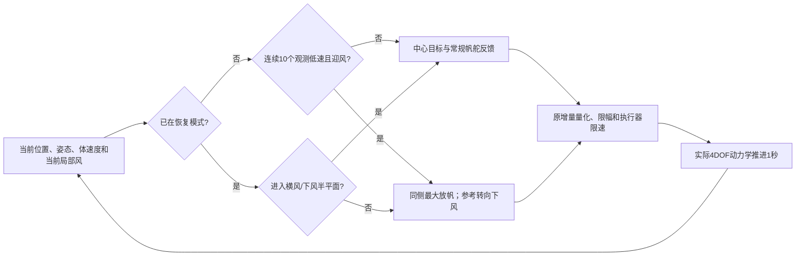

# B 方法说明：区域观测中的低速迎风恢复

## 背景—问题—假设—方法—效果—代价—边界

**背景。** 帆船到达观测点后，还需要在有限区域内持续采样。本轮任务是半径50m区域内1200s观测，以及从75m外接入；另做100m尺度检查。区域是明确的假想观测足迹，不声称来自某台真实仪器的规格。与A线的无风观测动态避碰分开。

**问题。** 只改变中心追踪或横风接力，不能解除共同低层的低速迎风横漂。第一版24场新确认中，中心追踪的区内/外起始平均区内比例为83.35%/86.74%；多个任务长达约1090s离区。接力比中心平均低0.69个百分点，节省6.8rad帆舵变化，不能称解决了问题。第一版完整负结果保存在docs/v1_validation，后续视为开发材料。

**假设。** 低速迎风时，仅靠舵追踪一个新方向可能无法离开当前帆力—水动力平衡。先改变帆的受力，再恢复普通引导，可以解除这一状态。该假设由同前史分支和后续闭环开发支持，但不据单例宣称普适因果。

**方法。** 保留简单中心追踪、常规帆舵反馈和原执行器限速。若连续10个1Hz观测满足|u|<0.5m/s且船首距迎风方向小于70°，进入恢复：参考航向改为当前下风方向；帆放到视风同侧的原最大角90°。船首转到横风/下风半平面后立即恢复中心引导。无需RL、训练、运动预测或主动把帆推到视风另一侧；额外增速等待在开发中无益，已删除。

**效果。** 第二版冻结12风险任务平均区内98.24%，相对center增加86.76个百分点，相对匹配的luff_no_build为+0.49个百分点（3胜8平1负）；12普通任务平均99.21%，相对center为+0.00个百分点。所有任务与不利例均保留。开发中的100/100/100/95.67%仅解释方案选择，不冒充新确认。

**代价。** 相对匹配luff_no_build，12风险任务平均仅多5.92s区内，但帆舵累计变化多3.98rad；最差任务少19s区内，最长离区最大值98s对85s。主要证据支持帆恢复模式，不支持最大90°规则的普遍优势。恢复时暂时放弃指向中心，可能先向外移动；帆舵变化增加。更大的瞬态横倾、最长离区与误触发均须报告。帆舵累计角变化只是操纵代理，不是电能。

**推广边界。** 所有比较使用理想当前局部风、位置、姿态、体速度及角速度；无未来风。原模型直接控制带符号帆角并限制速率。同侧放帆不要求本次开发中的主动背风帆，但仍不等于验证了真实帆索/柔性帆机构。没有海流、波浪、交通船、传感噪声或实船验证；不声称普适驻留或安全保证。

## 为什么改变低层，而不继续改目标几何

第一版中心和横风接力在4场开发中同为100%，新确认却出现共同的长期低速横漂。稳定例confirmation_12在t100时u=0.138m/s、v=0.467m/s；后续趋向u≈0.125、v≈0.459，舵已达−30°而偏航率趋近0。船首与目标仍有大角度差，参考变化没有产生所需实际运动。

从原始初始状态重放到t100，核对全部历史逐项相同；不干预分支400s原始状态与原日志逐项一致。中立舵、反向舵均未恢复（区内比例27.5%）。改变帆设置能恢复：逆向帆+中立舵72.75%；随视风放帆+反向舵76.5%；同侧最大放帆+反向舵83.25%。这排除了“只换舵或评分即可”的解释，也表明主动背风帆不是必要条件。分支是开发期反事实，在线控制没有读取事后最佳分支。

后续8场闭环开发比较下风参考、随视风放帆、同侧最大放帆、主动背风帆和必要阶段删除。最后选择同侧最大放帆、转出迎风半平面即恢复的两状态版本。不是通过增加网络解决共同反馈适用域问题。

## 采用谁的什么方法

采用成熟的帆船模式控制与保持运动思想，具体来源和未复制部分见LITERATURE_AND_ADAPTATION.md。

- Viel等2018（10.1016/j.ifacol.2018.09.462）采用接近/绕行/驻留、可航角处理及低速帆舵分支。本轮借用模式分工、航向反馈和帆力管理概念；没有复制其300kg模型、全部自适应加速度控制或理论保证。
- Liu等2025（10.3390/jmse13040668）在驻留中研究持续指向中心等保持运动策略。本轮保留这个强简单引导，不声称复现其NMPC。
- Bink等2026（10.1016/j.engappai.2026.115804）在实船/仿真中记录迎风停滞后先下风恢复速度再重新航行，也显示传统控制与不同RL训练实例的恢复差异。本轮借鉴这一成熟恢复目标，没有使用其模型、训练或冒称复制其策略。
- Morge等2022（10.1109/ACCESS.2022.3232462）提供传统帆舵与模式控制实践依据；不同船型数字不能横比。

当前两状态触发、同侧最大放帆和退出规则是本船接口上的小型适配，不把它挂名为某篇论文的完整算法，也不宣称首次发现失速恢复。

## 信息与执行流程

图省略120s恢复上限和10s重触发冷却；完整规则如下。图描述控制流，不是额外物理证据。

采用同一世界平面坐标，x正向为0角、逆时针为正；图中x/y不是已标定的地理经纬坐标。令风吹向角为w，船首角ψ，体坐标纵向速度u、横向速度v，偏航角速度r。普通模式参考为中心方位ψ*=atan2(c_y−p_y,c_x−p_x)。若cos(w−ψ*)+cos(50°)<0，令ψ*=w+π+q·50°；否则q按sin(w−ψ*)的符号更新（零取+1）。q初值+1并独立保持。这是各方案共同的50°逆风投影，恢复时参考改为w。

低速迎风指示为

`b_t = [|u_t|<0.5] AND [|wrap(ψ_t−w_t−π)|<70°]`。

仅当b_t连续10个1Hz观测为真且无冷却时进入恢复；若t=0起即满足，则t=9触发，不能把它写成从首个样本后又等满10s。恢复时ψ*=w；视风侧由`W sin(w−ψ)−v`的符号确定，帆参考为该符号乘π/2。角度是参考，仍经过原动作量化和帆角速率限制。

正常/恢复共用舵律：

`δr*=clip(−0.7 wrap(ψ−ψ*)−1.5r,−π/6,π/6)`，u<0时反号。

普通帆参考为`δs*=clip(α/2,−π/2,π/2)`，其中

`α=atan2(W sin(w−ψ)−v, −[W cos(w−ψ)−u])`。

这是用当前观测计算的简化视风角，不宣称与包含横倾、帆高风切变和杆臂速度的内部气动力角完全一致。

退出恢复条件为`cos(w−ψ)≥0`（船首处于横风或下风半平面），或持续120s上限；退出后低速计数清零、冷却10s。最终方案不等到u≥1.5；“release_build”保留这一增速等待作为消融。该退出不是安全证明，继续航行仍由普通闭环控制和真实物理约束决定。

## 参数依据和比较边界

0.5m/s区分开发中约0.125m/s纵向、约0.46m/s横漂的陷阱与正常约4m/s航行；10个1Hz观测要求持续而不是瞬时低速。70°允许识别迎风附近的低推进状态；不是从新确认调出的角度。90°是原执行器上限，不是新网格搜索值。120s防止恢复模式永久占据控制，10s冷却限制立即重复。没有扫描一组阈值后挑最好新测试结果，参数未获普适最优性证明。

第二版24新实例预定义为12低速迎风（迎风±35°、u0=0/.25/.5）和12普通（下风±110°、u0=.5/2/4），每类8区内/4区外接入；风向与位置随机，stable/slow/fast循环。8个100m尺度实例另冻结。风险定义依据物理初始状态，不按新方法输赢筛选。

完整对照另补结构匹配的luff_no_build：与最终方案一样在转至横风/下风时立即返回，只使用随视风放帆，避免只给最终方案删阶段的机会。该补证在查看第二版结果前登记，源码与批次另存。

完整对照：普通center；只改下风参考的downwind；随视风放帆并增速的luff；同侧最大放帆加增速的release_build；最终release。所有方案从相同物理状态开始，传感、动力学、动作边界、1200s判分一致。

首要指标仍为1200个1Hz采样的区内比例，提前失败尾部无信用；另报最长离区、含末态最大半径、积分完整性、操纵量、横倾和CPU。恢复窗口不算独立任务。一般尺度与条件边界见实际完整结果。

## 一个新确认中的真实决策

recovery_confirmation_00在t=9s：纵速0.172m/s、横速0.464m/s，船首35.92°、当前风吹向-174.85°，低速迎风计数10。控制器进入recovery_turn，帆参考90.0°，当时实际帆角仅14.0°；图08显示原限速接口如何逐步执行。t=25s退出恢复。记录来源为analysis_v2/selected_cases.json及对应原始轨迹；不是人工挑选未来最优动作。
